> [0. Acerca del Grupo](../../0.md) › [0.7. Temas Individuales (Parte 1)](../0.7.md) › [0.7.1. Integrante 1](0.7.1.md)

# 0.7.1. Integrante 1

# **Gestión de claves y criptografía:**


## Desarrollo conceptual

La criptografía es la técnica que protege la información transformando los datos en un formato codificado, haciéndolos ilegibles, de modo que aolo las personas autorizadas puedan acceder a su contenido.
Este proceso hace uso de algoritmos y claves para cifrar y descifrar la información. El cifrado permite convertir un mensaje entendible en otro que no se puede leer, mientras que el descifrado lo revierte, devolviendo el dato original. Su objetivo principal es garantizar la confidencialidad, integridad y autenticidad de la información, evitar accesos no autorizados, modificaciones indebidas o suplantación de identidad.

Sin embargo, un algoritmo fuerte no es suficiente por sí solo. La seguridad depende de cómo se manejan las claves,para ello la gestión de claves es un conjunto de procesos que aseguran que las claves criptográficas se creen, almacenen, usen y eliminen de forma segura.
La regla principal es que la clave no debe estar con el contenido que protege, puesto a que, si esto se expone no importa qué tan fuerte sea el algoritmo todo el sistema se puede ver comprometido

| Tipo | Descripción | Ejemplos |
|------|-------------|----------|
| **Simétrico** | Usa la misma clave para cifrar y descifrar. Rápido e ideal para grandes volúmenes de datos, pero debe de compartir la clave de forma segura. | AES, DES, ChaCha20 |
| **Asimétrico** | Usa un par de claves, una pública para cifrar y privada para descifrar,eliminando el problema de compartir la clave secreta, aunque es más lento. | RSA, ECC, Diffie-Hellman |
| **Hash** | Transforma cualquier dato en una cadena de longitud fija e irreversible. Si el dato cambia aunque sea un carácter, el hash es completamente diferente. | SHA-256, bcrypt, Argon2 |
| **Híbrido** | Combina asimétrico para intercambiar la clave de sesión y simétrico para cifrar los datos reales. | TLS, HTTPS |


## Consideraciones Técnicas

### Manejo de claves con HashiCorp Vault

Para la gestión segura del par de claves RSA-2048 se utilizó HashiCorp Vault, una herramienta open source especializada en el almacenamiento y acceso controlado de secretos criptográficos.

Repositorio oficial:
https://github.com/hashicorp/vault

Vault fue desplegado mediante Docker Compose junto con el resto de servicios del sistema: 
- PostgreSQL 
- HashiCorp Vault 
- Backend Node.js 
- Frontend Nginx 

Todos los servicios se comunican mediante la red interna creada automáticamente por Docker Compose. 

## Compilando Docker
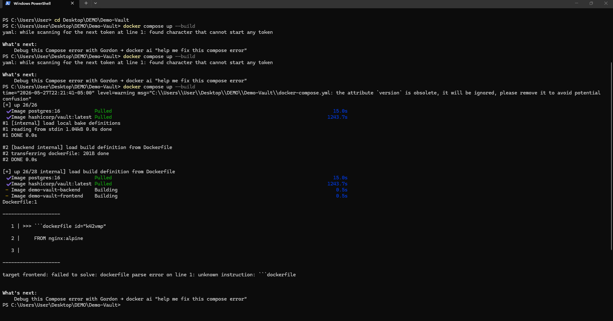   

## Docker creado exitosamente
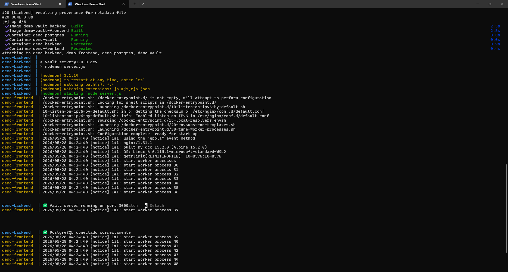

### Interfaz de HashiCorp Vault

Al iniciar Vault mediante Docker Compose, la interfaz web puede visualizarse desde el host utilizando:

```text
http://127.0.0.1:8300
```

El puerto 8300 corresponde al puerto publicado por Docker para acceder al servicio desde el navegador.

Desde esta interfaz se administran las claves RSA utilizadas por el sistema, permitiendo centralizar la gestión de secretos y configuraciones sensibles sin necesidad de modificar el código fuente de la aplicación. Esto facilita la actualización y administración de información crítica de manera controlada, contribuyendo a la mantenibilidad del sistema.
## HashiCorp Dashboard UI
.png)


## Añadiendo secretos desde la interfaz
Las claves RSA-2048 fueron almacenadas dentro del motor KV Secrets de Vault utilizando el path:

```
secret/data/rsa
```
En esta implementación se almacenan dinámicamente:
- publicKey
- privateKey

## Añadiendo Secretos
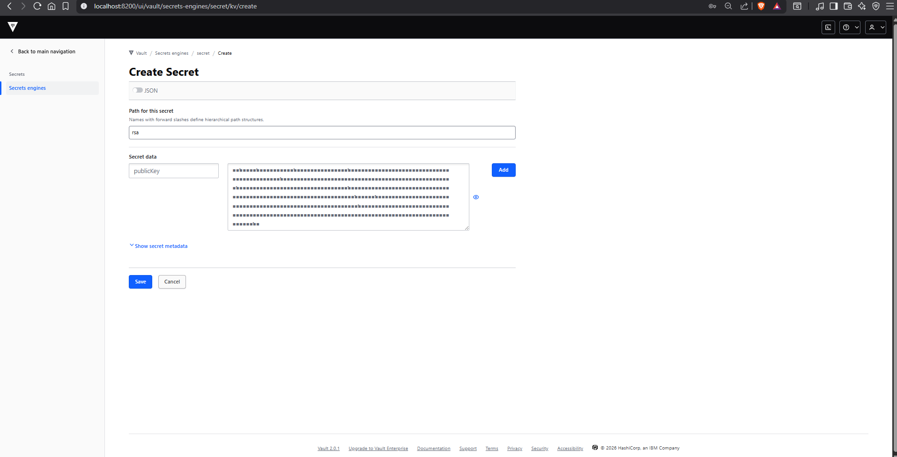

## Secretos añadidos - Public y Private Key
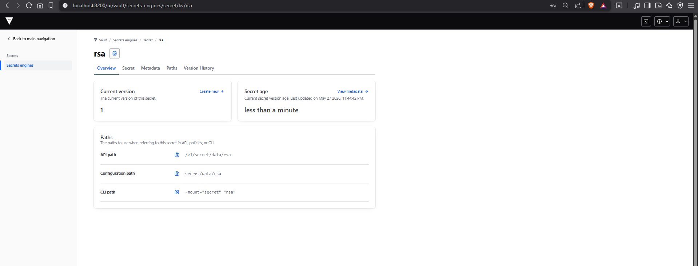

## Secretos añadidos
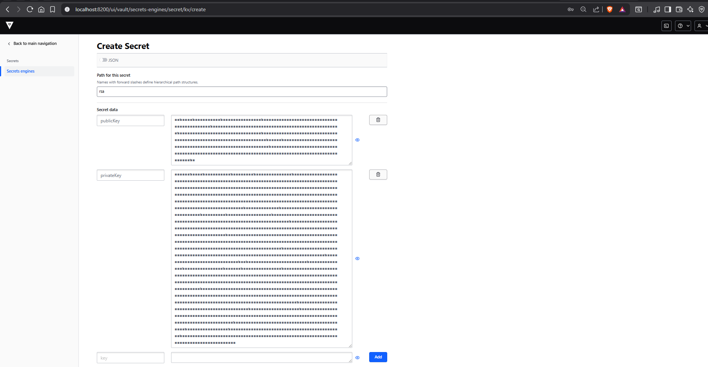

## Resultado en Vault

Una vez almacenados, los secretos quedan disponibles para ser consumidos dinámicamente por el backend mediante `node-vault`.

El backend obtiene las claves utilizando:

```bash
const secret = await vault.read('secret/data/rsa');
```
---

## Consideración sobre Vault en modo desarrollo

Durante las pruebas del proyecto se identificó una limitación asociada al uso de HashiCorp Vault en modo desarrollo (`server -dev`).
En este modo los secretos son almacenados únicamente en memoria RAM, por lo que no son persistentes entre reinicios.
Como consecuencia, al reiniciar los contenedores Docker o apagar el equipo, Vault pierde automáticamente todos los secretos almacenados previamente, incluyendo las claves RSA utilizadas por el sistema.
Esto ocasionó que el backend no pudiera recuperar las claves necesarias para descifrar los correos electrónicos almacenados en PostgreSQL, generando errores en los endpoints que dependían de la recuperación de dichas claves.
Para resolver este problema se implementó el script `init-vault.js`, encargado de restaurar automáticamente las claves RSA almacenadas en:
```text
server/keys/public.pem
server/keys/private.pem
```
y volver a cargarlas en Vault bajo la ruta:
```text
secret/data/rsa
```
La restauración se realiza mediante:
```bash
npm run init-vault
```
permitiendo recuperar la funcionalidad completa del sistema después de reiniciar el entorno de ejecución.

## Clave Restaurada con Init-Vault
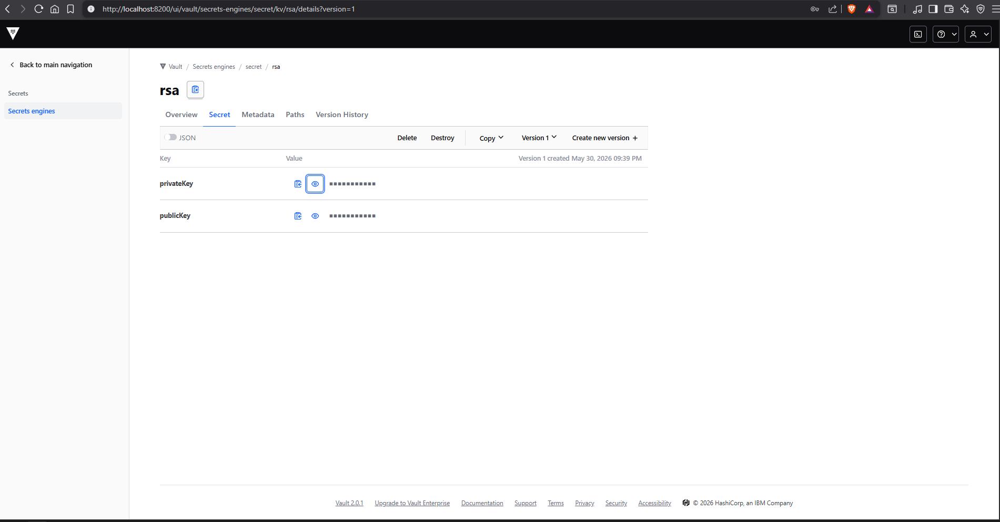


---
## Instalación de node-vault

Para conectar el backend con Vault se utilizó la librería node-vault mediante npm:

```bash
npm install node-vault
```
## Implementación de vault.js

Se creó un módulo dedicado `vault.js` que se encarga de la conexión y recuperación dinámica de las claves RSA desde Vault.
```bash
/* Demo-Vault/server/vault.js */
require('dotenv').config();
const nodeVault = require('node-vault');

const vault = nodeVault({
  apiVersion: 'v1',
  endpoint: 'http://vault:8200',
  token: process.env.VAULT_TOKEN || 'root'
});

async function getRSAKeys() {
  const secret = await vault.read(
    'secret/data/rsa'
  );

  return {
    publicKey:
      secret.data.data.publicKey,

    privateKey:
      secret.data.data.privateKey
  };
}
module.exports = {
  getRSAKeys

};
```

Este módulo exporta la función `getRSAKeys()`, utilizada por el backend cada vez que se necesita cifrar o descifrar información sensible.

Ventajas de esta implementación:

- las claves RSA nunca permanecen escritas dentro del código fuente,
- las claves operativas son recuperadas dinámicamente desde Vault,
- los archivos `.pem` se utilizan únicamente como respaldo para restaurar las claves durante la ejecución de la demo,
- el backend obtiene las claves en tiempo de ejecución sin exponerlas directamente en la aplicación.

### Implementación según el lenguaje

Cada lenguaje tiene librerías nativas o de terceros para trabajar con criptografía. 
Las más comunes son:

| Lenguaje | Librería | Notas |
|----------|----------|-------|
| **Node.js** | `crypto` (nativa) | No requiere instalación, incluida en Node.js |
| **Python** | `cryptography`, `pycryptodome` | Instalación vía pip |
| **Java** | `javax.crypto` (nativa) | Incluida en el JDK estándar |
| **C#** | `System.Security.Cryptography` (nativa) | Incluida en .NET |

---

### Configuración de RSA

### Implementación del cifrado en `encryption.js`

El cifrado fue implementado dentro del módulo encryption.js utilizando criptografía asimétrica RSA-2048 con:

- RSA
- OAEP Padding
- SHA-256

```javascript
const crypto = require('crypto');

function encrypt(text, publicKey) {
  return crypto.publicEncrypt(
    {
      key: publicKey,
      padding: crypto.constants.RSA_PKCS1_OAEP_PADDING,
      oaepHash: 'sha256',
    },
    Buffer.from(text)
  ).toString('base64');
}

function decrypt(encryptedText, privateKey) {
  return crypto.privateDecrypt(
    {
      key: privateKey,
      padding: crypto.constants.RSA_PKCS1_OAEP_PADDING,
      oaepHash: 'sha256',
    },
    Buffer.from(encryptedText, 'base64')
  ).toString();
}

module.exports = { encrypt, decrypt };
``` 
### Funcionamiento del cifrado RSA-2048 con OAEP y SHA-256

El módulo `encryption.js` implementa un mecanismo de cifrado asimétrico utilizando el algoritmo RSA-2048. A diferencia del cifrado simétrico, donde una misma clave se utiliza tanto para cifrar como para descifrar información, RSA emplea un par de claves: una clave pública y una clave privada.

Durante el proceso de cifrado, la función `encrypt()` recibe el texto original y la clave pública. El texto es convertido en un `Buffer` para que pueda ser procesado por el módulo criptográfico de Node.js. Posteriormente, se aplica el método `crypto.publicEncrypt()`, el cual utiliza el algoritmo RSA junto con el esquema de relleno OAEP (`RSA_PKCS1_OAEP_PADDING`) y el hash SHA-256.

El uso de OAEP (*Optimal Asymmetric Encryption Padding*) agrega aleatoriedad al proceso de cifrado, evitando ataques criptográficos basados en patrones repetitivos. Además, SHA-256 se utiliza como función hash para fortalecer la seguridad del padding y proporcionar una mayor resistencia frente a ataques modernos.

Una vez cifrada la información, el resultado binario es convertido a formato Base64 mediante `.toString('base64')`, permitiendo almacenar o transmitir el dato cifrado como texto legible.

Para el proceso de descifrado, la función `decrypt()` utiliza la clave privada correspondiente. El texto cifrado en Base64 es transformado nuevamente a un `Buffer` y procesado mediante `crypto.privateDecrypt()`. Gracias a la relación matemática entre ambas claves, únicamente la clave privada puede recuperar el contenido original, garantizando la confidencialidad de la información.

Este enfoque permite proteger datos sensibles durante su almacenamiento o transmisión, asegurando que únicamente las entidades autorizadas puedan acceder al contenido original.

---

### bcrypt y el hash de contraseñas

Para contraseñas no se usa cifrado sino hashing, porque no es necesario recuperar el valor original, solo verificar que coincide. bcrypt es el algoritmo recomendado para este propósito por dos razones principales:

- Incluye un **salt** automático, lo que significa que dos contraseñas iguales producen hashes distintos, evitando ataques de diccionario y rainbow tables.
- Es **intencionalmente lento**, lo que hace que un ataque de fuerza bruta sea costoso computacionalmente.

```javascript
const bcrypt = require('bcrypt');

// Hashear una contraseña (el 10 es el número de rondas de procesamiento)
const hash = await bcrypt.hash('mi_contraseña', 10);
console.log(hash); 
// $2b$10$X9f2Q... (cada vez es diferente aunque la contraseña sea igual)

// Verificar una contraseña contra su hash
const coincide = await bcrypt.compare('mi_contraseña', hash);
console.log(coincide); // true
```

---

### Estructura de base de datos para datos cifrados

Al utilizar RSA-2048, el dato cifrado se almacena en formato Base64 para facilitar su persistencia en PostgreSQL.

El esquema RSA-OAEP incorpora mecanismos criptográficos de padding seguro que proporcionan aleatoriedad y fortalecen la seguridad del cifrado.

En esta estructura, el correo electrónico del usuario se almacena cifrado dentro del campo `encrypted_email`, garantizando la protección de la información sensible incluso en caso de acceso no autorizado a la base de datos.

```sql
CREATE TABLE users (
  id              SERIAL PRIMARY KEY,
  full_name       VARCHAR(100) NOT NULL,
  encrypted_email TEXT NOT NULL,
  username        VARCHAR(50) UNIQUE NOT NULL,
  password_hash   TEXT NOT NULL,
  created_at      TIMESTAMP DEFAULT CURRENT_TIMESTAMP
);
```

El campo `password_hash` no almacena contraseñas en texto plano, sino un hash seguro generado mediante algoritmos especializados de protección de credenciales, permitiendo reforzar la seguridad del sistema ante posibles filtraciones de datos.


## Demo (Código)

### Escenario

DriveShare es una plataforma de alquiler de vehículos entre particulares. En este tipo de plataforma se maneja información sensible de los usuarios como correos electrónicos y datos de contacto. Almacenar esta información en texto plano dentro de la base de datos representa un gran riesgo, puesto que, si un atacante accede a dicha base de datos, toda la información de los usuarios quedaría expuesta inmediatamente.

Para abordar esta problemática se desarrolló **Vault**, una demo que ilustra cómo aplicar criptografía asimétrica RSA-2048, hashing seguro de contraseñas y gestión dinámica de claves mediante HashiCorp Vault en un sistema de registro de usuarios.

El objetivo es demostrar que, mediante el cifrado seguro de información sensible, el uso de bcrypt para contraseñas y una administración adecuada de claves criptográficas, es posible proteger la información incluso si la base de datos llega a ser comprometida.

---

### Configuración

El proyecto está construido con las siguientes tecnologías:

| Componente | Tecnología |
|------------|------------|
| **Backend** | Node.js + Express |
| **Base de datos** | PostgreSQL |
| **Cifrado de datos** | RSA-2048 OAEP SHA-256 (`crypto` nativo de Node.js) |
| **Hash de contraseñas** | bcrypt |
| **Frontend** | HTML + Nginx |
| **Gestión de secretos** | HashiCorp Vault |
| **Contenedores** | Docker + Docker Compose |

El proyecto funciona completamente mediante Docker Compose, utilizando contenedores independientes para:

- PostgreSQL
- HashiCorp Vault
- Backend Node.js
- Frontend Nginx

Todos los servicios se comunican mediante la red interna de Docker.

Las variables de entorno utilizadas por los servicios son gestionadas mediante Docker Compose. El proyecto puede ejecutarse directamente utilizando los contenedores definidos en `docker-compose.yml`.

Las credenciales utilizadas por los contenedores son:

```yaml
POSTGRES_USER=postgres
POSTGRES_PASSWORD=postgres
POSTGRES_DB=vaultdb

VAULT_TOKEN=root
VAULT_ADDR=http://vault:8200
```

Una vez iniciado el entorno:

```bash
docker compose up -d
```

Durante el arranque del backend, el script `init-vault.js` restaura automáticamente las claves RSA almacenadas en:

```text
server/keys/public.pem
server/keys/private.pem
```

y las registra nuevamente en HashiCorp Vault bajo la ruta:

```text
secret/data/rsa
```

Esto permite que la aplicación continúe cifrando y descifrando información incluso después de reiniciar los contenedores, evitando la pérdida de secretos provocada por la ejecución de Vault en modo desarrollo (`server -dev`).

El código completo está disponible en el repositorio del grupo en GitHub.

Link de demo:

[Repositorio Demo Vault](https://github.com/ulima-arqsoft/arqui261-personal-rado-delgado.git)
---

### Resultados

### Docker creado exitosamente

Los contenedores fueron desplegados correctamente mediante Docker Compose.


---
### Pantalla inicial del Demo

Vista principal de la aplicación al iniciar.

.png)

---

### Casos de prueba

Se realizaron pruebas funcionales relacionadas con:

- cifrado RSA-2048,
- descifrado de información,
- versionado de secretos,
- restauración de claves,
- manejo de errores,
- y validación de dependencia entre Vault y el backend.

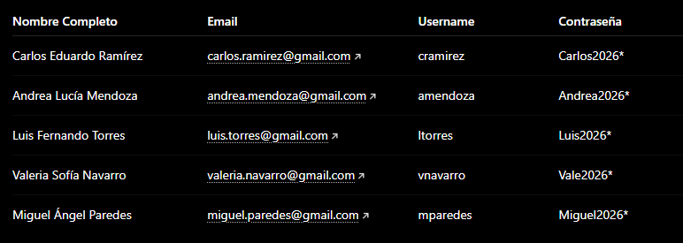


---

### Registro exitoso

Durante el registro, el backend cifra automáticamente el correo electrónico utilizando RSA-2048 con OAEP SHA-256 y genera el hash bcrypt de la contraseña antes de almacenar los datos en PostgreSQL.

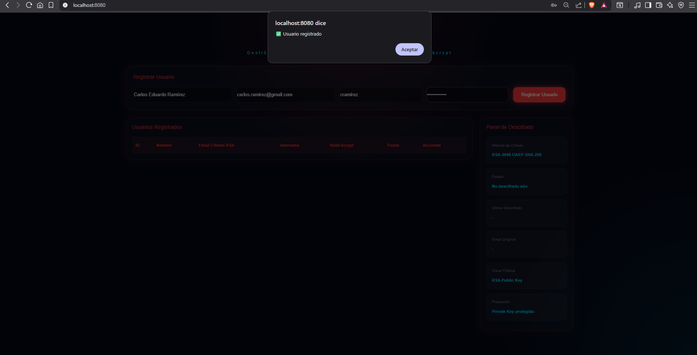

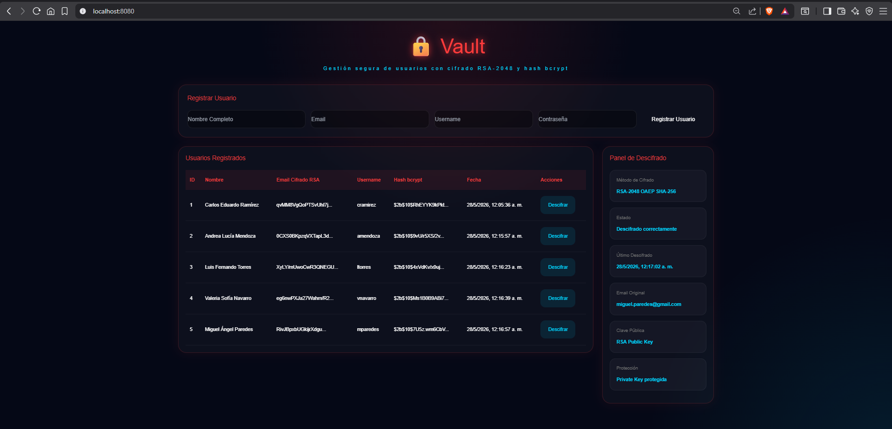

---

### Verificación de datos en PostgreSQL
### Verificación en dokcer

Se verifica desde PostgreSQL que:

- los correos electrónicos se almacenan cifrados,
- las contraseñas se almacenan como hash bcrypt,
- y la información sensible no permanece en texto plano.

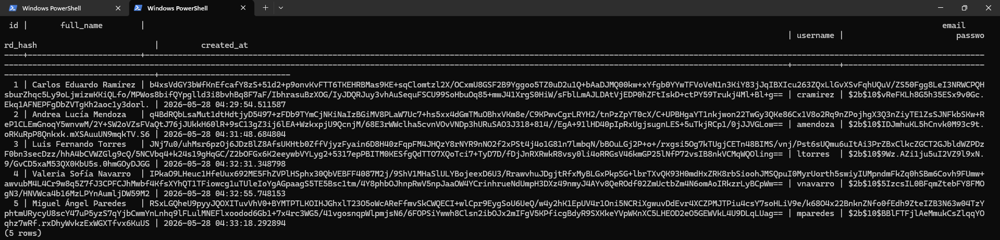

---

### Verificación mediante pgAdmin

Además de las consultas realizadas desde la API REST, se verificó el contenido de la base de datos utilizando pgAdmin conectado directamente al contenedor PostgreSQL.

Configuración utilizada:

```text
Host: localhost
Port: 5433
Database: vaultdb
Username: postgres
Password: postgres
```

La conexión permitió inspeccionar directamente la tabla `users` y comprobar que:

- Los correos electrónicos son almacenados cifrados mediante RSA.
- Las contraseñas son almacenadas utilizando hashes bcrypt.
- Los registros persisten correctamente dentro del volumen Docker asociado a PostgreSQL.
- La información recuperada coincide con los resultados obtenidos desde la API del backend.

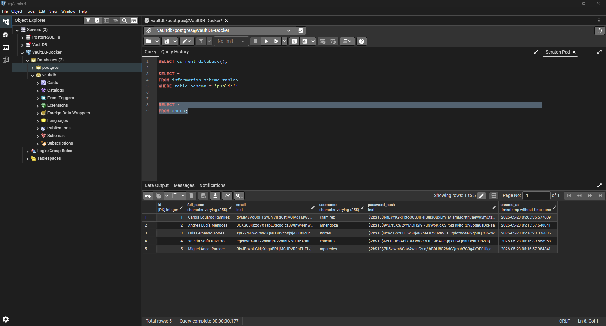


---
### Descifrado exitoso

El sistema recupera dinámicamente la clave privada desde Vault y descifra correctamente los datos almacenados utilizando RSA-2048 OAEP SHA-256.

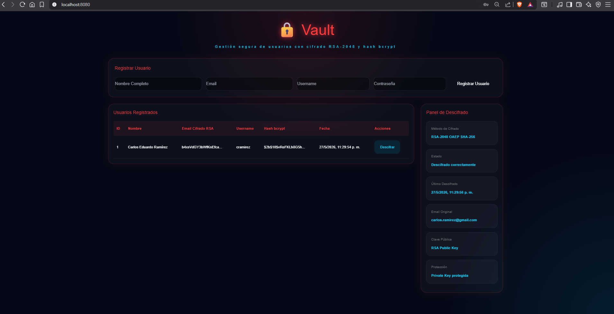

---

## RECORDAR:

### Error por usar versión equivocada de clave

Se realizaron pruebas utilizando versiones incompatibles de claves RSA almacenadas en Vault.

Cuando la clave privada no coincide con la utilizada originalmente durante el cifrado, el backend falla durante el proceso de descifrado.

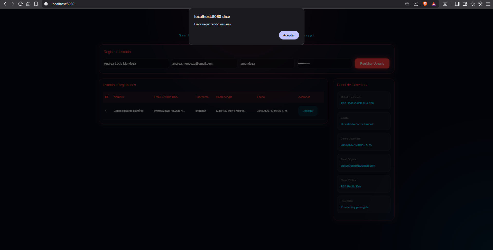

---

### Versionado de secretos en Vault

Vault permite administrar múltiples versiones de secretos criptográficos, restaurar versiones anteriores y validar el comportamiento del sistema frente a claves inválidas.

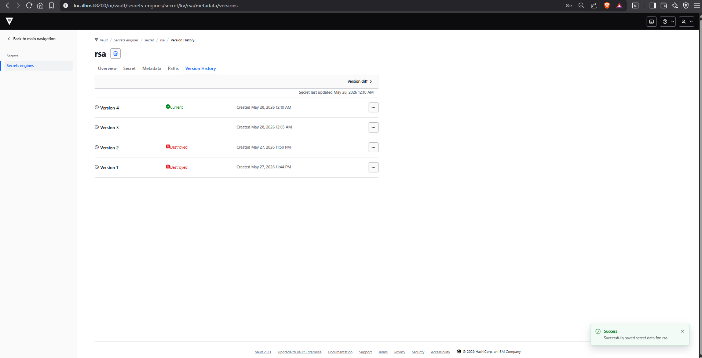


# VIDEO DEMOSTRATIVO

https://www.youtube.com/watch?v=MKusYJxTT10


--- 
[🏠 Home](../../../README.md) | [Siguiente ➡️](../0.7.2/0.7.2.md)