> [0. Acerca del Grupo](../../0.md) › [0.7. Temas Individuales (Parte 1)](../0.7.md) › [0.7.5. Integrante 5](0.7.5.md)

# 0.7.5. Integrante 5

# Análisis y Visualización de Logs

# 1. Introducción

## 1.1 Descripción general

Las aplicaciones web generan continuamente registros de actividad conocidos como **logs**. Estos registros contienen información sobre solicitudes realizadas, errores, advertencias, tiempos de respuesta, accesos de usuarios, operaciones internas y comportamiento de los diferentes componentes del sistema.

Aunque los logs constituyen una fuente importante para comprender lo que ocurre dentro de una aplicación, su revisión directa puede resultar compleja cuando se almacenan como grandes cantidades de texto. Localizar un error específico, reconocer un aumento de latencia o identificar qué servicio produce más fallas puede requerir revisar manualmente numerosos registros.

El **análisis y visualización de logs** permite transformar esos registros en información más comprensible mediante filtros, búsquedas, métricas, gráficos y agrupaciones. De esta manera, los responsables del sistema pueden detectar comportamientos anómalos, investigar problemas y comprender con mayor rapidez el estado general de la aplicación.

Con el propósito de demostrar este enfoque, se desarrolló **LogScope**, un prototipo web académico que simula una plataforma básica de análisis y visualización de logs. La aplicación permite generar registros mediante escenarios predefinidos, almacenarlos localmente, filtrarlos, consultar su detalle y visualizar indicadores desde un Dashboard centralizado.

Todos los registros utilizados por LogScope son simulados. El sistema no recopila información de servidores reales, servicios en la nube, contenedores, archivos del sistema operativo ni plataformas externas de observabilidad.

---

## 1.2 Objetivo del proyecto

Diseñar e implementar un prototipo web que permita demostrar el proceso de recolección, análisis y visualización de logs mediante un Dashboard, filtros de búsqueda, métricas, gráficos y escenarios simulados relacionados con operación normal, degradación del rendimiento y errores críticos.

---

## 1.3 Alcance

LogScope incluye las siguientes funcionalidades:

- Login simulado.
- Dashboard centralizado.
- Generador de logs mediante escenarios predefinidos.
- Registro persistente de logs.
- Clasificación por nivel: `INFO`, `WARN`, `ERROR` y `CRITICAL`.
- Identificación del servicio o fuente que generó cada registro.
- Búsqueda por texto.
- Filtros por nivel, fuente y rango de tiempo.
- Visualización del detalle de cada log.
- Cálculo del tiempo de respuesta promedio.
- Distribución de logs por nivel.
- Evolución de logs a través del tiempo.
- Identificación de servicios con mayor cantidad de errores.
- Registro de hallazgos generados por reglas de análisis.
- Reinicio de los datos de demostración mediante un endpoint.

Para mantener el proyecto dentro de un alcance académico, se implementaron tres escenarios:

- Operación normal de la aplicación.
- Degradación por latencia elevada.
- Error crítico de conexión con la base de datos.

La plataforma no procesa logs reales ni se conecta con herramientas como Elasticsearch, Logstash, Kibana, Grafana, Splunk, Azure Monitor o servicios externos. Los registros y hallazgos se almacenan localmente en una base de datos SQLite.

---

## 1.4 Tecnologías utilizadas

| Tecnología | Uso |
|------------|-----|
| React | Construcción de la interfaz de usuario. |
| Vite | Entorno de desarrollo y construcción del frontend. |
| JavaScript | Lógica del frontend y del backend. |
| CSS | Diseño visual y adaptación de la interfaz. |
| Recharts | Representación de métricas mediante gráficos. |
| Fetch API | Comunicación HTTP desde el frontend. |
| Node.js | Entorno de ejecución del backend. |
| Express | Implementación de la API REST. |
| CORS | Habilitación de la comunicación entre frontend y backend. |
| better-sqlite3 | Acceso directo a la base de datos. |
| SQLite | Persistencia local de logs, fuentes y hallazgos. |

La solución no utiliza TypeScript, Tailwind CSS, PostgreSQL, Docker, microservicios, WebSockets, JWT, ORM ni APIs externas.

---

# 2. Problema

## 2.1 Contexto

Las aplicaciones modernas pueden estar formadas por diferentes servicios, módulos y componentes. Cada uno genera registros para informar sobre operaciones realizadas, errores producidos, advertencias, solicitudes recibidas y tiempos de procesamiento.

Cuando los registros se almacenan únicamente como texto, la información se encuentra disponible, pero no necesariamente resulta fácil de interpretar. Un administrador puede necesitar revisar múltiples líneas para descubrir qué ocurrió, cuándo sucedió, qué componente estuvo involucrado y cuál fue el impacto del problema.

---

## 2.2 Problema identificado

La revisión manual de logs presenta las siguientes limitaciones:

- Dificultad para localizar rápidamente errores específicos.
- Gran cantidad de registros sin una vista consolidada.
- Falta de indicadores sobre el comportamiento general del sistema.
- Dificultad para comparar niveles de severidad.
- Mayor tiempo para identificar el servicio que origina una falla.
- Poca visibilidad sobre tendencias de rendimiento.
- Riesgo de pasar por alto eventos importantes.
- Dependencia de la interpretación manual de archivos de texto.

Por ejemplo, una aplicación puede registrar numerosas solicitudes exitosas y, entre ellas, varias operaciones con tiempos de respuesta superiores a tres segundos. Si no existe una forma de agrupar o visualizar esos datos, la degradación puede permanecer oculta hasta que un usuario reporte el problema.

---

## 2.3 Flujo manual del problema

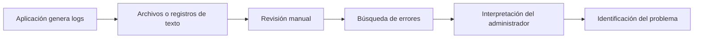

En este enfoque, el tiempo necesario para detectar un problema depende de la cantidad de registros, de la forma en que fueron escritos y de la experiencia de la persona que los revisa.

---

## 2.4 Necesidad de análisis y visualización

Para facilitar la interpretación de los registros es útil contar con un mecanismo que los centralice, normalice sus campos y los convierta en indicadores visuales.

Una plataforma de análisis de logs puede representar este comportamiento mediante un flujo de procesamiento compuesto por etapas. Los registros son recibidos, interpretados, normalizados, clasificados, almacenados y finalmente presentados mediante tablas, tarjetas y gráficos.

En LogScope este flujo se simula dentro del backend y utiliza reglas sencillas para identificar condiciones como latencia elevada o fallas críticas de base de datos.

---

## 2.5 Objetivo de la solución

La solución propuesta debe ser capaz de:

- Recibir logs generados por escenarios simulados.
- Interpretar los datos principales de cada registro.
- Normalizar el nivel, la fuente, el mensaje y la fecha.
- Almacenar los registros en SQLite.
- Aplicar reglas básicas de análisis.
- Generar hallazgos cuando se detecten condiciones relevantes.
- Permitir búsquedas y filtros.
- Calcular métricas consolidadas.
- Mostrar gráficos y tablas desde un Dashboard.
- Mantener trazabilidad sobre los registros generados.

---

## 2.6 Escenarios considerados

| Escenario | Objetivo |
|-----------|----------|
| Operación normal | Generar solicitudes exitosas con niveles `INFO` y tiempos de respuesta dentro de un rango esperado. |
| Latencia elevada | Generar registros `WARN` con tiempos de respuesta altos y crear un hallazgo de degradación del rendimiento. |
| Error de base de datos | Generar registros `ERROR` y `CRITICAL` relacionados con una falla de conexión y crear un hallazgo crítico. |

Estos escenarios permiten demostrar el flujo de análisis sin requerir integración con sistemas externos.

---

# 3. Solución propuesta

## 3.1 Descripción de la solución

**LogScope** es una aplicación web académica que simula una plataforma de análisis y visualización de logs. El usuario puede iniciar sesión mediante un control de acceso demostrativo, consultar el Dashboard, ejecutar escenarios, explorar registros, aplicar filtros, revisar hallazgos y visualizar información consolidada.

El backend procesa cada escenario mediante un servicio interno que representa el flujo de análisis. Este servicio genera los registros, normaliza sus campos, los clasifica, aplica reglas sencillas y almacena los resultados en SQLite.

---

## 3.2 Flujo general de LogScope

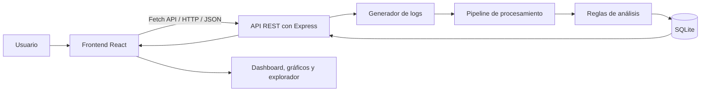

El flujo comienza cuando el usuario ejecuta un escenario. El frontend envía una solicitud HTTP al backend, el generador crea los registros, el pipeline procesa los datos y las reglas determinan si debe crearse un hallazgo. Finalmente, el frontend actualiza el Dashboard y las demás vistas.

---

## 3.3 Componentes de la plataforma

| Componente | Responsabilidad |
|------------|-----------------|
| **Frontend** | Presentar las vistas, capturar acciones del usuario y consumir la API REST. |
| **API REST** | Recibir solicitudes, validar parámetros y devolver respuestas JSON. |
| **Generador de logs** | Crear registros simulados para los escenarios de demostración. |
| **Pipeline de procesamiento** | Interpretar, normalizar, clasificar y preparar los logs para su almacenamiento. |
| **Motor de análisis** | Aplicar reglas para detectar latencia elevada, errores repetidos y fallas críticas. |
| **SQLite** | Almacenar fuentes, logs y hallazgos. |
| **Dashboard** | Consolidar métricas, gráficos y registros recientes. |
| **Explorador de logs** | Permitir búsqueda, filtros y consulta del detalle de cada registro. |

Todos estos elementos forman parte de una única aplicación cliente-servidor. No se implementan microservicios ni despliegues independientes.

---

## 3.4 Funcionamiento del pipeline de logs

El procesamiento de cada log se organiza como una secuencia de etapas inspirada en el patrón **Pipe-and-Filter**:

1. El generador produce un log simulado.
2. La etapa de entrada recibe el registro.
3. El parser interpreta sus campos.
4. La normalización establece un formato común.
5. La clasificación asigna el nivel correspondiente.
6. Las reglas de análisis evalúan el contenido.
7. El registro se almacena en SQLite.
8. Si corresponde, se crea un hallazgo.
9. Las métricas del Dashboard se recalculan.
10. El resultado se devuelve al frontend.

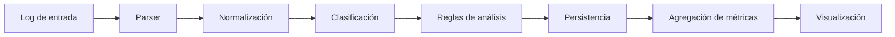

Cada etapa tiene una responsabilidad específica. Esto permite modificar una transformación sin concentrar toda la lógica en una sola función.

---

## 3.5 Escenarios implementados

| Escenario | Logs generados | Resultado del análisis |
|-----------|-----------------|------------------------|
| **Operación normal** | Registros `INFO` de solicitudes exitosas y tiempos de respuesta normales. | Los datos se almacenan y actualizan las métricas sin crear hallazgos. |
| **Latencia elevada** | Registros `WARN` con tiempos de respuesta superiores al umbral configurado. | Se crea un hallazgo `HIGH` de degradación del rendimiento. |
| **Error de base de datos** | Registros `ERROR` y `CRITICAL` con código HTTP 500. | Se crea un hallazgo `CRITICAL` asociado con una falla de conexión. |

---

## 3.6 Beneficios de la solución

- Centraliza los logs en una única interfaz.
- Facilita la identificación de errores y advertencias.
- Convierte registros técnicos en métricas visuales.
- Permite filtrar información por diferentes criterios.
- Reduce el tiempo necesario para localizar un registro específico.
- Muestra tendencias relacionadas con volumen y rendimiento.
- Identifica los servicios que producen más errores.
- Mantiene trazabilidad sobre los hallazgos detectados.
- Permite repetir la demostración mediante escenarios controlados.
- Relaciona el tema de logs con decisiones arquitectónicas y atributos de calidad.

---

## 3.7 Limitaciones

- Los logs son simulados y no provienen de sistemas reales.
- No se procesan archivos `.log` externos.
- No existe recolección en tiempo real mediante agentes.
- No se utilizan colas de mensajes ni procesamiento distribuido.
- Las reglas de análisis son simples y previamente definidas.
- No se implementan modelos de aprendizaje automático.
- SQLite limita el alcance a una demostración local.
- El login no representa un mecanismo de autenticación seguro.
- No se implementan alertas por correo, SMS o servicios externos.
- Los gráficos representan únicamente los datos almacenados en la demostración.

---

# 4. Arquitectura del sistema

## 4.1 Visión general

LogScope utiliza una arquitectura cliente-servidor organizada en tres capas: presentación, negocio y persistencia.

El frontend está implementado con React y se comunica con el backend mediante solicitudes HTTP utilizando Fetch API. El backend, desarrollado con Node.js y Express, expone una API REST y contiene el generador, el pipeline y las reglas de análisis. La persistencia se implementa con SQLite y consultas SQL directas mediante better-sqlite3.

Además de la separación por capas, el procesamiento interno de los logs utiliza una estructura Pipe-and-Filter para dividir las transformaciones en etapas consecutivas.

---

## 4.2 Arquitectura cliente-servidor

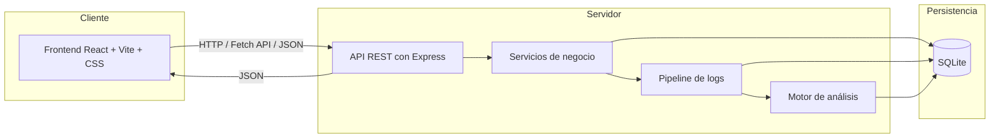

El frontend no accede directamente a la base de datos. Toda operación se realiza a través de la API REST.

---

## 4.3 Arquitectura de tres capas

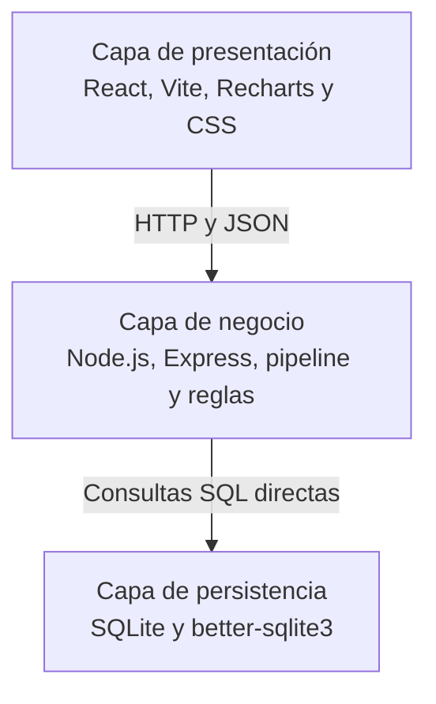

### Capa de presentación

Responsabilidades:

- Mostrar el login simulado.
- Presentar el Dashboard.
- Ejecutar escenarios de generación.
- Mostrar métricas y gráficos.
- Permitir la búsqueda y filtrado de logs.
- Consultar el detalle de un registro.
- Mostrar hallazgos de análisis.
- Gestionar estados de carga y mensajes visuales.

### Capa de negocio

Responsabilidades:

- Exponer la API REST.
- Validar solicitudes y parámetros.
- Generar logs simulados.
- Ejecutar las etapas del pipeline.
- Aplicar reglas de análisis.
- Calcular métricas del Dashboard.
- Atender búsquedas y filtros.
- Gestionar el reinicio de los datos de demostración.

### Capa de persistencia

Responsabilidades:

- Almacenar fuentes de logs.
- Almacenar registros normalizados.
- Registrar hallazgos.
- Mantener fechas, niveles y metadatos.
- Facilitar consultas por nivel, fuente y texto.
- Eliminar los datos de demostración cuando se solicite.

---

## 4.4 Patrón Pipe-and-Filter

El patrón Pipe-and-Filter se utiliza para representar la transformación sucesiva de los logs.

| Filtro | Responsabilidad |
|--------|-----------------|
| **Entrada** | Recibir el registro generado por el escenario. |
| **Parser** | Separar y validar los campos del log. |
| **Normalizador** | Convertir el registro a una estructura común. |
| **Clasificador** | Asignar el nivel y categorizar el evento. |
| **Analizador** | Aplicar reglas para detectar condiciones relevantes. |
| **Persistencia** | Guardar el log y los hallazgos en SQLite. |
| **Agregador** | Calcular métricas para el Dashboard. |

Las tuberías representan el paso de la salida de una etapa hacia la entrada de la siguiente.

Esta decisión favorece la modificabilidad, porque permite agregar un nuevo filtro —por ejemplo, anonimización de datos o detección de patrones— sin reescribir todo el flujo.

---

## 4.5 Secuencia de procesamiento de un escenario

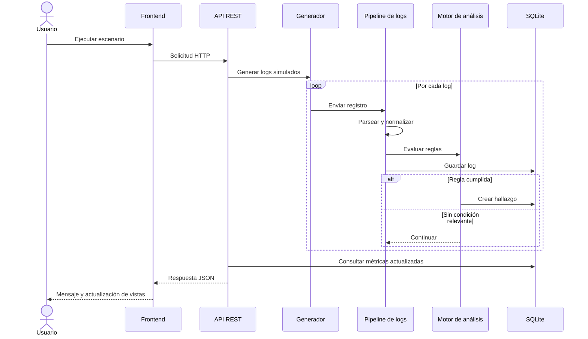

---

## 4.6 Decisiones arquitectónicas

### Separación por capas

La interfaz, la lógica de procesamiento y la persistencia se organizan en secciones diferentes. Esto reduce la mezcla de responsabilidades y facilita localizar los cambios.

### API REST como interfaz de comunicación

El frontend utiliza exclusivamente endpoints HTTP. Esta decisión evita el acceso directo a SQLite desde la interfaz y centraliza las reglas de generación, análisis y consulta en el backend.

### Pipeline como servicio interno

La lógica de procesamiento se concentra en un servicio del backend compuesto por etapas. No se trata de un microservicio independiente, sino de un módulo encargado de recibir, transformar y almacenar los logs.

### Uso de Pipe-and-Filter

Cada transformación se implementa como una etapa con una responsabilidad concreta. Esta organización facilita incorporar nuevos formatos, validaciones o reglas de análisis.

### Persistencia local con SQLite

SQLite permite mantener la solución pequeña y fácil de ejecutar. better-sqlite3 ofrece acceso directo mediante consultas SQL sin incorporar un ORM.

### Estructura normalizada de logs

Todos los registros se convierten a un formato común con campos como nivel, fuente, mensaje, endpoint, código de estado, tiempo de respuesta y fecha. Esto facilita las búsquedas y los cálculos.

### Control de acceso demostrativo

El login utiliza las credenciales `admin` y `admin123`. Cuando son correctas, se guarda un indicador sencillo en `localStorage`. Este mecanismo se utiliza exclusivamente para la demostración y no representa un sistema de autenticación seguro.

---

## 4.7 Atributos de calidad considerados

| Atributo | Soporte en LogScope |
|----------|---------------------|
| **Modificabilidad** | El pipeline permite incorporar nuevos filtros, formatos o reglas sin modificar toda la aplicación. |
| **Mantenibilidad** | La organización en capas, rutas, servicios y componentes facilita localizar responsabilidades. |
| **Usabilidad** | La interfaz incluye navegación lateral, tarjetas, gráficos, filtros, tablas y mensajes visuales. |
| **Rendimiento** | Las consultas permiten filtrar desde el backend y el Dashboard utiliza métricas agregadas. |
| **Trazabilidad** | Cada log y hallazgo conserva fuente, nivel, mensaje, fecha y datos relacionados. |
| **Interoperabilidad** | El frontend y el backend intercambian información mediante HTTP y JSON. |
| **Testabilidad** | Los escenarios controlados permiten repetir entradas conocidas y comprobar resultados esperados. |
| **Portabilidad** | El uso de Node.js, React y SQLite permite ejecutar la demostración en diferentes sistemas operativos. |

No se afirma que la aplicación sea escalable para grandes volúmenes de información, debido a que todos los componentes pertenecen a una misma solución local y utilizan SQLite.

---

# 5. Diseño e implementación

## 5.1 Organización del proyecto

```text
logscope/
├── frontend/
│   ├── src/
│   │   ├── components/
│   │   ├── pages/
│   │   ├── services/
│   │   ├── App.jsx
│   │   ├── main.jsx
│   │   └── styles.css
│   ├── index.html
│   ├── package.json
│   └── vite.config.js
├── backend/
│   ├── src/
│   │   ├── config/
│   │   ├── database/
│   │   ├── filters/
│   │   ├── routes/
│   │   ├── services/
│   │   ├── app.js
│   │   └── server.js
│   ├── .env.example
│   └── package.json
├── .gitignore
└── README.md
```

La estructura separa el frontend del backend. Dentro del backend, la carpeta `filters` contiene las etapas del pipeline y la carpeta `services` concentra la generación de escenarios, las reglas y las métricas.

---

## 5.2 Diseño del frontend

El frontend fue desarrollado con React, Vite, JavaScript, Recharts y CSS.

Las principales vistas son:

| Vista | Función |
|-------|---------|
| **Login** | Validar las credenciales demostrativas y guardar el acceso en `localStorage`. |
| **Dashboard** | Mostrar estadísticas, gráficos, logs recientes y hallazgos recientes. |
| **Simulador** | Ejecutar los tres escenarios implementados. |
| **Explorador de logs** | Consultar registros y aplicar filtros por nivel, fuente y texto. |
| **Detalle de log** | Mostrar toda la información relacionada con un registro. |
| **Analítica** | Mostrar distribución por nivel, evolución temporal, fuentes con errores y tiempos de respuesta. |
| **Hallazgos** | Consultar las condiciones detectadas por las reglas de análisis. |

La interfaz presenta un tema oscuro inspirado en herramientas de observabilidad. Utiliza barra lateral, encabezado, tarjetas, gráficos, tablas, etiquetas de nivel, botones y mensajes de estado.

---

## 5.3 Diseño del backend

El backend utiliza Node.js, Express, JavaScript y CORS.

| Elemento | Responsabilidad |
|----------|-----------------|
| **Config** | Gestionar variables y valores de configuración. |
| **Database** | Crear la base de datos, tablas y consultas SQL. |
| **Filters** | Implementar parser, normalización, clasificación y análisis. |
| **Routes** | Definir los endpoints de la API REST. |
| **Services** | Implementar escenarios, métricas, búsquedas y reglas. |
| **app.js** | Configurar Express, CORS, JSON y rutas. |
| **server.js** | Iniciar el servidor HTTP. |

El servicio de simulación concentra la generación de operación normal, latencia elevada y error de base de datos. Los filtros procesan cada registro antes de almacenarlo.

---

## 5.4 Modelo de datos

La base de datos contiene tres tablas principales:

- `log_sources`
- `logs`
- `findings`

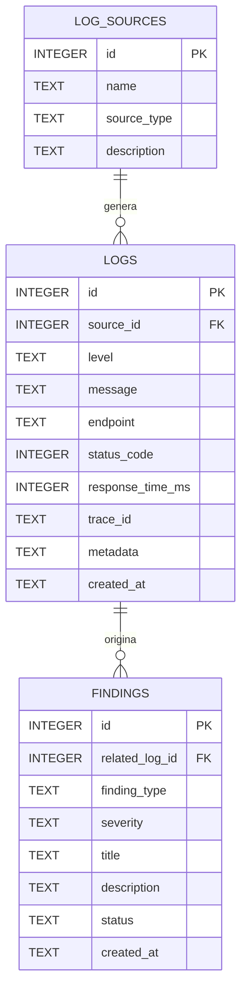

### Descripción de las tablas

| Tabla | Información almacenada |
|-------|------------------------|
| `log_sources` | Nombre, tipo y descripción de cada servicio que genera logs. |
| `logs` | Fuente, nivel, mensaje, endpoint, código HTTP, tiempo de respuesta, trazabilidad, metadatos y fecha. |
| `findings` | Tipo de hallazgo, severidad, título, descripción, estado, log relacionado y fecha. |

El campo `metadata` almacena información complementaria en formato JSON serializado. Para mantener la solución sencilla, no se utiliza una tabla independiente para cada tipo de dato adicional.

---

## 5.5 Fuentes iniciales

| Fuente | Tipo | Responsabilidad simulada |
|--------|------|--------------------------|
| `auth-service` | Servicio | Autenticación y validación de acceso. |
| `vehicle-service` | Servicio | Consulta y gestión de vehículos. |
| `reservation-service` | Servicio | Procesamiento de reservas. |
| `payment-service` | Servicio | Operaciones de pago. |
| `database` | Infraestructura | Persistencia de la aplicación. |
| `api-gateway` | Infraestructura | Recepción y redirección de solicitudes. |

Estas fuentes se crean al inicializar la base de datos y se utilizan durante los escenarios.

---

## 5.6 API REST

| Método | Endpoint | Descripción |
|--------|----------|-------------|
| `GET` | `/api/dashboard` | Obtiene métricas, gráficos y registros recientes. |
| `GET` | `/api/logs` | Obtiene los logs y acepta filtros por nivel, fuente, texto y fecha. |
| `GET` | `/api/logs/:id` | Obtiene el detalle de un log. |
| `GET` | `/api/sources` | Obtiene las fuentes disponibles. |
| `GET` | `/api/findings` | Obtiene los hallazgos generados. |
| `GET` | `/api/analytics` | Obtiene agregaciones para la vista analítica. |
| `POST` | `/api/simulations/normal` | Ejecuta el escenario de operación normal. |
| `POST` | `/api/simulations/high-latency` | Ejecuta el escenario de latencia elevada. |
| `POST` | `/api/simulations/database-error` | Ejecuta el escenario de error de base de datos. |
| `DELETE` | `/api/demo/reset` | Limpia logs y hallazgos de la demostración. |

Las solicitudes y respuestas utilizan JSON.

Ejemplo de consulta con filtros:

```text
GET /api/logs?level=ERROR&source=payment-service&search=timeout
```

---

## 5.7 Reglas de negocio

### Operación normal

La simulación genera veinte logs con las siguientes características:

- Niveles principales: `INFO`.
- Códigos HTTP: `200` y `201`.
- Tiempos de respuesta entre 80 y 300 milisegundos.
- Fuentes distribuidas entre `api-gateway`, `auth-service`, `vehicle-service` y `reservation-service`.
- Mensajes relacionados con solicitudes completadas correctamente.

El escenario no crea hallazgos porque los valores permanecen dentro del rango esperado.

### Latencia elevada

La simulación genera doce logs asociados con `reservation-service`:

- Nivel: `WARN`.
- Endpoint principal: `/api/reservations`.
- Códigos HTTP: `200` y `504`.
- Tiempos de respuesta entre 1500 y 3500 milisegundos.
- Mensajes relacionados con lentitud y tiempo de espera.

La regla de análisis verifica si existen al menos cinco registros con un tiempo superior a 1500 milisegundos dentro del escenario.

Cuando se cumple la condición:

- Se crea un hallazgo `PERFORMANCE_DEGRADATION`.
- La severidad del hallazgo es `HIGH`.
- Se registra el servicio afectado.
- Se almacena el promedio de tiempo de respuesta observado.
- El Dashboard actualiza la cantidad de advertencias y el tiempo promedio.

### Error de base de datos

La simulación genera seis registros relacionados con `payment-service` y `database`:

- Niveles: `ERROR` y `CRITICAL`.
- Endpoint principal: `/api/payments`.
- Código HTTP: `500`.
- Mensajes relacionados con conexión rechazada, timeout y transacción fallida.
- Tiempos de respuesta superiores a 2000 milisegundos.

Cuando se detecta el patrón:

- Se crea un hallazgo `DATABASE_CONNECTION_FAILURE`.
- La severidad es `CRITICAL`.
- Se relaciona el hallazgo con uno de los logs críticos.
- Se registra una descripción del impacto observado.
- Se actualizan las métricas de errores y hallazgos críticos.

---

## 5.8 Dashboard

El Dashboard muestra:

- Total de logs.
- Total de registros `INFO`.
- Total de advertencias.
- Total de errores.
- Total de registros críticos.
- Tiempo de respuesta promedio.
- Total de hallazgos abiertos.
- Logs recientes.
- Hallazgos recientes.
- Distribución por nivel.
- Evolución de logs a través del tiempo.
- Fuentes con mayor cantidad de errores.

La información se obtiene mediante `GET /api/dashboard`.

---

## 5.9 Vista analítica

La vista analítica presenta los siguientes gráficos:

- Gráfico circular de distribución por nivel.
- Gráfico de líneas con la cantidad de logs por intervalo.
- Gráfico de barras con errores por fuente.
- Gráfico de barras con tiempo de respuesta promedio por endpoint.

Las agregaciones se calculan en el backend y se devuelven mediante `GET /api/analytics`.

---

## 5.10 Explorador de logs

El explorador permite:

- Consultar todos los registros.
- Filtrar por nivel.
- Filtrar por fuente.
- Buscar palabras dentro del mensaje.
- Ordenar desde los registros más recientes.
- Limpiar los filtros aplicados.
- Abrir el detalle de un log.

Cada fila muestra como mínimo:

- Fecha y hora.
- Nivel.
- Fuente.
- Mensaje.
- Endpoint.
- Código HTTP.
- Tiempo de respuesta.

---

## 5.11 Consideraciones de implementación

Durante el desarrollo se consideraron las siguientes prácticas:

- Separación entre frontend, backend y persistencia.
- Componentes reutilizables en React.
- Uso de Fetch API para solicitudes HTTP.
- Consultas SQL directas sin ORM.
- Pipeline dividido en filtros independientes.
- Validación de parámetros de búsqueda.
- Manejo básico de errores en la API.
- Estados de carga en la interfaz.
- Mensajes de éxito, advertencia y error.
- Etiquetas visuales según el nivel del log.
- Persistencia local de logs y hallazgos.
- Endpoint de reinicio para repetir la demostración.

---

# 6. Demostración

## 6.1 Objetivo de la demostración

La demostración tiene como propósito mostrar el flujo completo de LogScope, desde la generación de registros hasta su procesamiento, almacenamiento, análisis y representación visual.

No se plantean pruebas exhaustivas de rendimiento ni procesamiento masivo. La demostración se centra en verificar visualmente que las funcionalidades principales se comportan de acuerdo con las reglas definidas.

---

## 6.2 Login simulado

El acceso se realiza con las siguientes credenciales:

- Usuario: `admin`
- Contraseña: `admin123`

Cuando las credenciales son correctas, se guarda un indicador en `localStorage` y se muestra el Dashboard.

> **Figura 6.1. Pantalla de login de LogScope**


---

## 6.3 Dashboard principal

El Dashboard presenta tarjetas con métricas generales, logs recientes, hallazgos recientes, distribución por nivel y evolución temporal.

Antes de ejecutar escenarios, los indicadores pueden mostrarse en cero o con datos iniciales de demostración.

> **Figura 6.2. Dashboard principal**

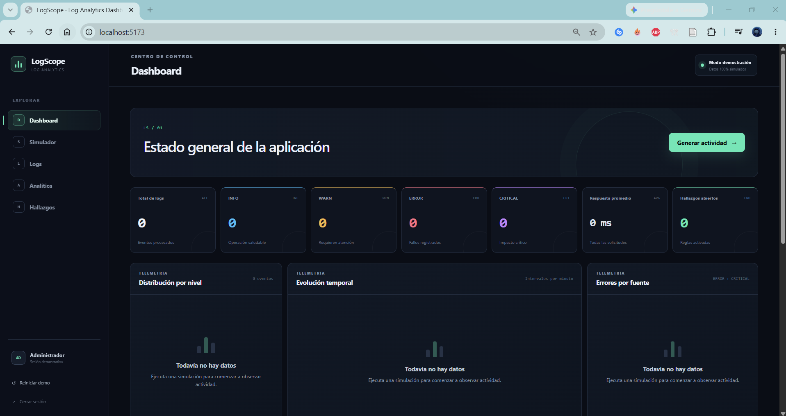

---

## 6.4 Simulador de logs

La vista del simulador contiene tres opciones:

- Generar operación normal.
- Generar latencia elevada.
- Generar error de base de datos.

Cada botón muestra un estado de carga durante el procesamiento y un mensaje con el resultado.

> **Figura 6.3. Simulador de logs**

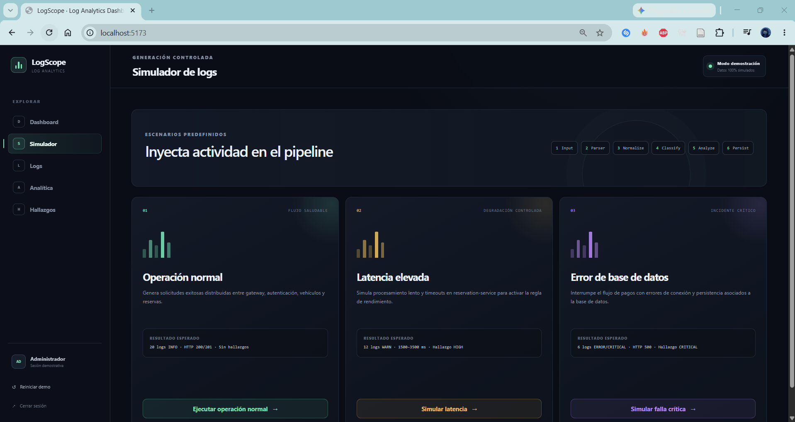

---

## 6.5 Escenario 1: Operación normal

Al ejecutar la simulación se generan veinte registros `INFO` distribuidos entre diferentes servicios.

El resultado observable es:

- Solicitudes exitosas con códigos `200` y `201`.
- Tiempos de respuesta dentro del rango esperado.
- Aumento del total de logs.
- Actualización del gráfico temporal.
- Actualización de la distribución por nivel.
- Ausencia de hallazgos críticos.

> **Figura 6.4. Resultado de operación normal**


---

## 6.6 Escenario 2: Latencia elevada

La simulación genera registros `WARN` asociados con el procesamiento de reservas y tiempos de respuesta superiores al umbral establecido.

El resultado observable es:

- Incremento de advertencias.
- Aumento del tiempo de respuesta promedio.
- Aparición de `reservation-service` entre las fuentes destacadas.
- Creación de un hallazgo `HIGH` de degradación del rendimiento.
- Visualización de tiempos elevados en la vista analítica.

> **Figura 6.5. Resultado de latencia elevada**


> **Figura 6.6. Hallazgo de degradación del rendimiento**


---

## 6.7 Escenario 3: Error de base de datos

La simulación genera registros `ERROR` y `CRITICAL` relacionados con una falla de conexión entre `payment-service` y la base de datos.

El resultado observable es:

- Registros con código HTTP `500`.
- Mensajes de conexión rechazada y timeout.
- Incremento del total de errores y eventos críticos.
- Creación de un hallazgo `CRITICAL`.
- Aparición de `payment-service` y `database` entre las fuentes con errores.
- Actualización de gráficos y tarjetas del Dashboard.

> **Figura 6.7. Resultado de error de base de datos**


> **Figura 6.8. Hallazgo crítico registrado**


---

## 6.8 Explorador y filtros

Después de generar los escenarios, el explorador permite comprobar que los registros pueden localizarse mediante filtros.

Ejemplos de demostración:

- Seleccionar el nivel `ERROR`.
- Seleccionar la fuente `payment-service`.
- Buscar la palabra `timeout`.
- Filtrar registros `WARN` de `reservation-service`.
- Limpiar los filtros para volver a mostrar todos los logs.

> **Figura 6.9. Explorador de logs con filtros**

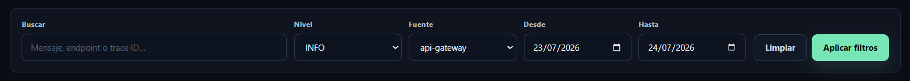

---

## 6.9 Detalle de un log

Al seleccionar un registro se muestra su información completa:

- Identificador.
- Fecha y hora.
- Nivel.
- Fuente.
- Mensaje.
- Endpoint.
- Código HTTP.
- Tiempo de respuesta.
- Identificador de trazabilidad.
- Metadatos adicionales.

> **Figura 6.10. Detalle de un registro**


---

## 6.10 Visualización analítica

La vista analítica permite observar la distribución de niveles, la evolución del volumen, las fuentes con más errores y el tiempo promedio por endpoint.

Después de ejecutar los tres escenarios debe observarse una diferencia clara entre la operación normal, las advertencias de latencia y los errores críticos.

> **Figura 6.11. Vista analítica de LogScope**

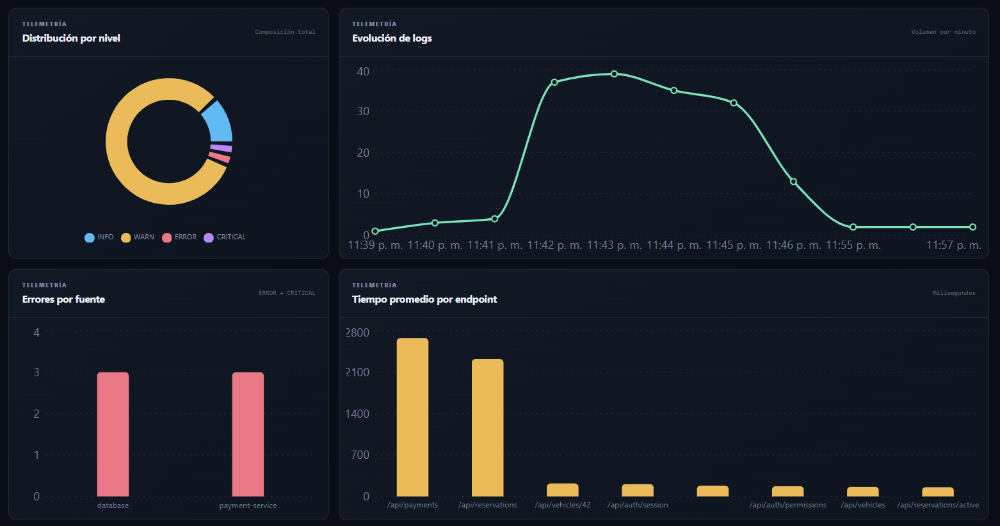


---

## 6.11 Resumen de la demostración

| Escenario | Resultado observable |
|-----------|----------------------|
| Operación normal | Logs `INFO`, solicitudes exitosas, tiempos normales y ausencia de hallazgos. |
| Latencia elevada | Logs `WARN`, aumento del tiempo promedio y hallazgo `HIGH`. |
| Error de base de datos | Logs `ERROR` y `CRITICAL`, códigos `500` y hallazgo `CRITICAL`. |

---

# 7. Resultados

LogScope permite observar el funcionamiento de un flujo simplificado de análisis y visualización de logs dentro de un entorno académico.

Durante la demostración pueden verificarse los siguientes resultados:

- Los logs generados se normalizan y almacenan en SQLite.
- Cada registro conserva nivel, fuente, mensaje, fecha y datos técnicos.
- El Dashboard consolida métricas generales.
- Los gráficos cambian después de ejecutar cada escenario.
- La operación normal genera principalmente registros `INFO`.
- La latencia elevada incrementa las advertencias y el tiempo promedio.
- El error de base de datos genera registros `ERROR` y `CRITICAL`.
- Las reglas crean hallazgos cuando se cumplen condiciones definidas.
- El explorador permite buscar y filtrar registros.
- El detalle facilita investigar un evento individual.
- El endpoint de reinicio permite limpiar la demostración.

| Escenario | Estado esperado | Resultado |
|-----------|:---------------:|-----------|
| Operación normal | Correcto | Se almacenan veinte registros `INFO` sin generar hallazgos. |
| Latencia elevada | Correcto | Se registran advertencias y se crea un hallazgo `HIGH`. |
| Error de base de datos | Correcto | Se registran errores críticos y se crea un hallazgo `CRITICAL`. |

Estos resultados deben entenderse como observables durante la demostración funcional del prototipo. No representan una evaluación formal de rendimiento, escalabilidad ni capacidad de procesamiento masivo.

---

# 8. Conclusiones

1. LogScope permitió representar, de forma académica, el flujo básico de una plataforma de análisis y visualización de logs mediante generación, procesamiento, almacenamiento, búsqueda y representación gráfica.

2. La arquitectura cliente-servidor organizada en tres capas separa la interfaz, la lógica de negocio y la persistencia, lo que mejora la claridad y mantenibilidad del proyecto.

3. El uso del patrón Pipe-and-Filter permite dividir el procesamiento de logs en etapas como interpretación, normalización, clasificación, análisis y persistencia.

4. La API REST permite que el frontend consulte y genere información sin acceder directamente a la base de datos.

5. Los filtros, tablas, tarjetas y gráficos convierten registros técnicos en información más comprensible para el usuario.

6. Las reglas de análisis permiten detectar condiciones simples, como latencia elevada o fallas críticas de conexión, y registrarlas como hallazgos.

7. SQLite y better-sqlite3 resultan adecuados para el alcance del proyecto porque permiten mantener una persistencia local sencilla, sin requerir un servidor de base de datos ni un ORM.

8. Los escenarios controlados favorecen la testabilidad, porque permiten repetir las mismas entradas y comprobar que las métricas y hallazgos esperados se generan correctamente.

9. El prototipo no debe interpretarse como una plataforma de observabilidad lista para producción, debido a que no recopila logs reales ni procesa grandes volúmenes de información.

10. Como trabajo futuro, podrían incorporarse carga de archivos, recolección en tiempo real, alertas, anonimización de datos, búsqueda avanzada e integración con herramientas externas, manteniendo la misma separación de responsabilidades.

---

[⬅️ Anterior](../0.7.4/0.7.4.md) | [🏠 Home](../../../README.md) | [Siguiente ➡️](../0.7.6/0.7.6.md)
