> [0. Acerca del Grupo](../../0.md) › [0.8. Tema Individual: Patrones Cloud](../0.8.md) › [0.8.1. Integrante 1](0.8.1.md)

# 0.8.1. Integrante 1

# Sidecar

## Introducción

El **Sidecar pattern** es un patrón de arquitectura de software que consiste en desplegar componentes auxiliares —como logging, monitoreo, seguridad o configuración— en un proceso o contenedor **separado** del aplicativo principal, pero acoplado a su ciclo de vida.

El nombre viene de los sidecars de las motocicletas: van pegados al vehículo principal, comparten el viaje, pero son una pieza independiente que se puede quitar o reemplazar sin afectar al vehículo.

**¿Para qué sirve?**
- Externalizar responsabilidades transversales sin contaminar el código del servicio principal.
- Permitir que diferentes servicios compartan la misma lógica auxiliar sin importar el lenguaje en que estén escritos.
- Actualizar y escalar los componentes auxiliares de forma independiente.

**Tecnologías relacionadas**

| Tecnología | Rol en el patrón |
|---|---|
| Docker | Contenerización del sidecar junto al servicio principal |
| Kubernetes | Orquestación de pods con múltiples contenedores (sidecar containers) |
| Istio / Envoy | Service mesh basado en proxies sidecar (Envoy) por cada pod |
| Dapr | Abstracción de dependencias como sidecar (state, pub/sub, secrets) |
| OpenTelemetry | Recolección y enriquecimiento de telemetría como sidecar |

---

## 1. Problema

### Escenario típico

Imagina un servicio de backend que, además de su lógica de negocio, necesita:

- Registrar cada request en un sistema de logs centralizado.
- Exponer métricas de rendimiento a un sistema de monitoreo.
- Validar certificados TLS y manejar políticas de seguridad de red.
- Leer configuración dinámica desde un servidor de configuración.

La solución más directa es implementar todo eso **dentro del mismo servicio**. Pero esto trae problemas serios:

- **Acoplamiento tecnológico:** si el servicio está en Node.js, las librerías de logging, métricas y seguridad también deben ser de Node.js. Si mañana otro servicio del sistema está en Python o Go, hay que reimplementar todo.
- **Código inflado:** el servicio mezcla lógica de negocio con infraestructura, haciéndolo más difícil de mantener y testear.
- **Riesgo de cascada:** un fallo en el módulo de logging puede tumbar el servicio completo.
- **Actualizaciones acopladas:** cambiar la versión del agente de métricas obliga a redesplegar el servicio principal.

### Diagrama del problema

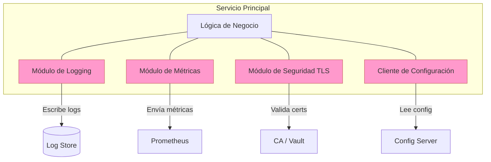

> **Recordar :** Toda la infraestructura auxiliar vive **dentro** del servicio. Un fallo en cualquier módulo rosado afecta la lógica de negocio.

---

## 2. Solución — El patrón Sidecar

### Explicación del patrón

El Sidecar pattern propone sacar las responsabilidades auxiliares del servicio principal y moverlas a un **proceso o contenedor separado** que se despliega junto a él.

Este componente auxiliar —el sidecar— comparte el mismo host, red y ciclo de vida que el servicio principal, pero corre de forma independiente. Si el sidecar falla, el servicio principal sigue operando. Si se actualiza el sidecar, no es necesario redesplegar el servicio principal.

### ¿Cómo funciona?

1. El servicio principal corre en su propio contenedor.
2. El sidecar corre en un contenedor separado dentro del **mismo pod** (en Kubernetes) o en el mismo host.
3. Ambos comparten la red local (`localhost`) y, opcionalmente, volúmenes de almacenamiento.
4. El servicio principal se comunica con el sidecar a través de llamadas locales (HTTP, gRPC, sockets Unix), con latencia mínima.
5. El sidecar se encarga de interactuar con el mundo exterior: sistemas de logs, métricas, seguridad, configuración.

### Diagrama de la solución

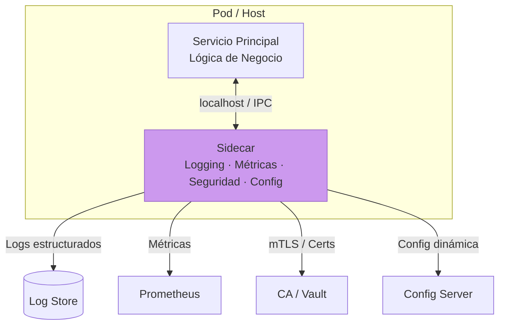

> El servicio principal solo habla con el sidecar. El sidecar es quien interactúa con la infraestructura externa.

### Componentes clave

| Componente | Rol |
|---|---|
| Aplicación Principal | Contiene exclusivamente la lógica de negocio. Delega todas las responsabilidades transversales al sidecar. |
| Sidecar | Proceso o contenedor auxiliar que gestiona logging, métricas, seguridad y configuración de forma desacoplada. |
| Logs | Flujo de eventos estructurados que el sidecar captura y reenvía a un sistema centralizado (ej. Elasticsearch, Loki). |
| Métricas | Indicadores de rendimiento (latencia, errores, throughput) que el sidecar expone o empuja hacia un sistema de monitoreo (ej. Prometheus, Datadog). |

### Beneficios

- **Independencia tecnológica:** el sidecar puede estar escrito en cualquier lenguaje. El mismo sidecar de logging sirve para un servicio en Node.js, otro en Python y otro en Go.
- **Bajo acoplamiento:** el servicio principal no tiene dependencias de infraestructura. Cambiar de sistema de logs no requiere tocar su código.
- **Mejor observabilidad:** centralizar logging y métricas en el sidecar garantiza consistencia en el formato y el enriquecimiento de datos.
- **Mayor mantenibilidad:** el sidecar se puede actualizar, parchear o reemplazar de forma independiente sin afectar el servicio principal.

### Consideraciones y limitaciones

- **Consumo adicional de recursos:** cada instancia del servicio principal requiere su propia instancia del sidecar, lo que multiplica el uso de CPU y memoria.
- **Complejidad de despliegue:** se deben gestionar dos contenedores por servicio, lo que suma configuración a los manifiestos de Kubernetes o Docker Compose.
- **Latencia de comunicación:** aunque la comunicación es local, sigue siendo una llamada entre procesos. En escenarios con comunicación muy frecuente, este overhead puede ser relevante.

**¿Cuándo NO utilizarlo?**
- El servicio es pequeño o un monolito simple donde el overhead no se justifica.
- El componente auxiliar necesita escalar de forma independiente al servicio principal (en ese caso, es mejor un servicio separado).
- La plataforma ya provee las capacidades de forma nativa (ej. el cloud provider ya gestiona logs y métricas sin necesidad de un agente adicional).

---

## 3. Casos de aplicación

### Caso 1 — Observabilidad y Monitoreo

**Contexto:** múltiples microservicios necesitan emitir logs y métricas con un formato consistente hacia sistemas centralizados, sin que cada equipo deba implementar esa lógica de forma individual.

**Solución:** desplegar un sidecar del **OpenTelemetry Collector** junto a cada servicio. El servicio emite telemetría en formato simple (stdout o HTTP local) y el sidecar se encarga de normalizar, enriquecer y reenviar los datos a Prometheus, Grafana Loki o cualquier backend de observabilidad.

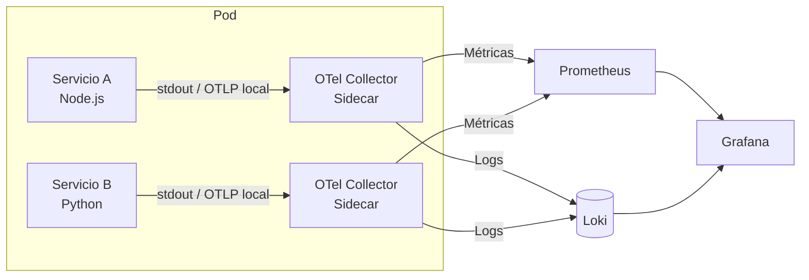

**Beneficio clave:** los servicios no conocen ni dependen del backend de observabilidad. Se puede migrar de Prometheus a Datadog sin tocar el código de ningún servicio.

---

### Caso 2 — Service Mesh y Seguridad de Red

**Contexto:** en una arquitectura de microservicios, garantizar comunicación cifrada (mTLS), control de tráfico (retries, circuit breaking) y políticas de acceso entre servicios requiere lógica compleja que no debería estar en cada servicio.

**Solución:** usar un **proxy sidecar** (Envoy, vía Istio) que intercepta todo el tráfico de red entrante y saliente del servicio. El servicio principal se comunica en texto plano con localhost; el sidecar maneja el cifrado, la autenticación y las políticas de red de forma transparente.

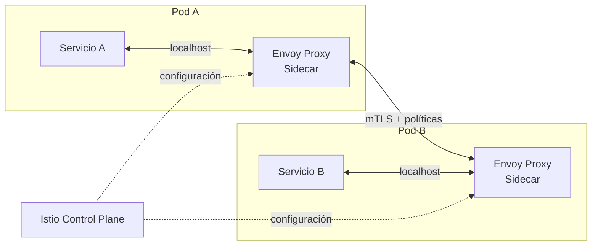

**Beneficio clave:** la seguridad de red se gestiona de forma centralizada desde el control plane de Istio, sin modificar el código de ningún servicio.

---

### Caso 3 — Adaptación e Integración de Sistemas

**Contexto:** un servicio legado expone una API en un protocolo antiguo (ej. SOAP, gRPC con versión vieja, mensajería propietaria). Los nuevos servicios del sistema solo hablan REST/JSON.

**Solución:** desplegar un **sidecar adaptador de protocolo** que traduce las llamadas REST/JSON entrantes al protocolo que entiende el servicio legado, y viceversa. El mundo exterior solo ve una API moderna; el servicio legado no necesita modificarse.

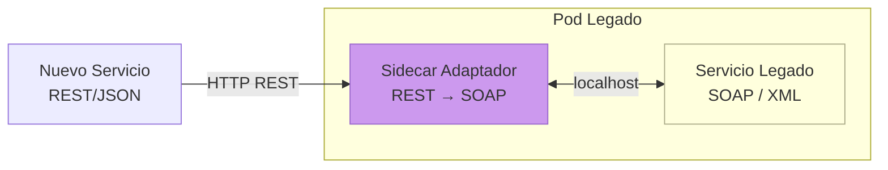

**Beneficio clave:** el servicio legado sigue funcionando sin cambios. La adaptación es transparente y se puede actualizar o reemplazar de forma independiente.

---

## 4. Aplicación en el Proyecto Grupal

### Contexto

DriveShare es una plataforma P2P de alquiler de vehículos compuesta por cinco módulos: Usuarios (M1), Catálogo (M2), Reservas (M3), Pagos (M4) y Reseñas (M5).

La propuesta aplica el patrón Sidecar al **Módulo 1 — Usuarios**, específicamente para desacoplar las tareas de auditoría de la lógica principal del servicio.

El Módulo de Usuarios es responsable de:

* Registro de usuarios.
* Login mediante correo electrónico y contraseña.
* Login mediante Google OAuth 2.0.
* Gestión de perfiles.


Actualmente, todas estas operaciones forman parte de la lógica principal del servicio. Sin embargo, registrar eventos de auditoría, clasificar incidentes o generar alertas son responsabilidades transversales que no pertenecen directamente al dominio del negocio.

Para resolver este problema se propone incorporar un **Audit Sidecar**, permitiendo separar completamente la auditoría del módulo principal.

---

### Implementación propuesta

Se propone desplegar un **Audit Sidecar** junto al User Service.

| Componente        | Responsabilidad                                                                                                                                                                  |
| ----------------- | -------------------------------------------------------------------------------------------------------------------------------------------------------------------------------- |
| **User Service**  | Gestiona las operaciones de negocio relacionadas con los usuarios: creación, consulta y cambio de rol.                                                                           |
| **Audit Sidecar** | Registra eventos relevantes del módulo de usuarios, clasifica su severidad, genera alertas cuando corresponde y almacena la información en una tabla de auditoría independiente. |

Los eventos auditados incluyen:

* Creación de usuarios (`USER_CREATED`).
* Consulta de usuarios (`USER_VIEWED`).
* Cambio válido de rol (`ROLE_CHANGED`).
* Cambio de rol rechazado (`ROLE_CHANGE_DENIED`).

---

### Arquitectura

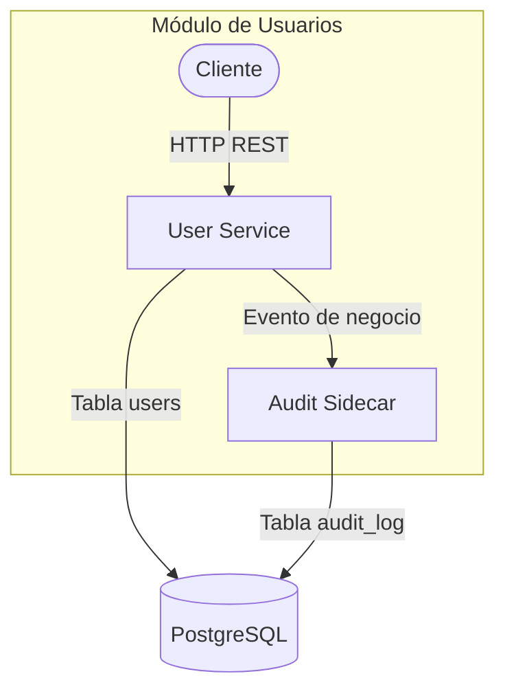

El User Service permanece enfocado exclusivamente en las operaciones del negocio, mientras que el Audit Sidecar procesa todos los eventos relacionados con auditoría de manera independiente.

---

### Beneficios esperados

* **Auditoría desacoplada:** la lógica de auditoría no se encuentra mezclada con la lógica de negocio.
* **Menor acoplamiento:** los cambios en las reglas de auditoría no requieren modificar el User Service.
* **Mayor mantenibilidad:** cada componente tiene una responsabilidad claramente definida.
* **Escalabilidad funcional:** pueden incorporarse nuevas reglas de auditoría sin afectar las operaciones de usuarios.
* **Generación de alertas:** eventos críticos pueden ser detectados y notificados automáticamente.


---

### Validación

| Escenario                                           | Qué se verifica                                                                                             |
| --------------------------------------------------- | ----------------------------------------------------------------------------------------------------------- |
| Creación de usuario                                 | El User Service registra el usuario y el Audit Sidecar almacena el evento `USER_CREATED`.                   |
| Consulta de usuario                                 | El User Service devuelve la información solicitada y el Audit Sidecar registra `USER_VIEWED`.               |
| Cambio de rol exitoso (`arrendatario → arrendador`) | El Audit Sidecar registra `ROLE_CHANGED`, clasifica la severidad como HIGH y genera una alerta.             |
| Intento de cambio de rol inválido                   | El User Service rechaza la solicitud y el Audit Sidecar registra `ROLE_CHANGE_DENIED` con severidad MEDIUM. |
| Consulta del historial de auditoría                 | Se muestran todos los eventos registrados en la tabla `audit_log`.                                          |

```
```


# 5. Demo del Patrón Arquitectónico Sidecar

# 5.1. Contexto

DriveShare es una plataforma P2P de alquiler de vehículos donde los usuarios pueden registrarse bajo uno de los siguientes roles:

* Arrendatario
* Arrendador

Dentro de la plataforma, un usuario puede solicitar un cambio de rol de **Arrendatario** a **Arrendador**, acción que representa una elevación de privilegios debido a que habilita nuevas funcionalidades relacionadas con la publicación y administración de vehículos.

Para mantener una arquitectura desacoplada y extensible, se implementó el patrón **Sidecar**, permitiendo separar completamente la lógica de auditoría de la lógica principal del módulo de usuarios.

---

# 5.2. Objetivo de la Demo

Demostrar que el patrón Sidecar permite:

* Registrar eventos relevantes del sistema.
* Clasificar eventos según su severidad.
* Generar alertas ante eventos importantes.
* Mantener desacoplada la lógica de auditoría del servicio principal.

---

# 5.3. Problema

Si toda la lógica de auditoría estuviera integrada dentro del módulo de usuarios, el sistema presentaría:

* Mayor acoplamiento.
* Menor mantenibilidad.
* Dificultad para escalar funcionalidades transversales.
* Mayor complejidad del código.

Por ello se propone utilizar un servicio Sidecar especializado únicamente en auditoría.

---

# 5.4. Arquitectura de la Solución

La solución está compuesta por tres componentes principales:

## User Service

Responsable de:

* Crear usuarios.
* Consultar usuarios.
* Gestionar cambios de rol.
* Aplicar reglas de negocio.

Puerto: `3000`

## Audit Sidecar

Responsable de:

* Recibir eventos.
* Clasificar severidad.
* Generar alertas.
* Registrar auditorías.

Puerto: `4000`

## PostgreSQL

Responsable de almacenar:

* Usuarios.
* Eventos auditados.

Puerto: `5432`

---

# 5.5. Diagrama de Arquitectura

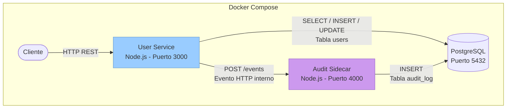

---
# 5.6. Estructura del Proyecto

```text
driveshare-sidecar-demo/
├── user-service/
│   ├── controllers/       # Recepción y procesamiento de solicitudes HTTP de usuarios
│   ├── services/          # Lógica de negocio y comunicación con el Audit Sidecar
│   ├── repositories/      # Acceso y persistencia de datos en la tabla users
│   ├── models/            # Entidades Sequelize del módulo de usuarios
│   ├── routes/            # Definición de endpoints REST del User Service
│   ├── config/            # Configuración de PostgreSQL y variables de entorno
│   ├── Dockerfile         # Imagen Docker del User Service
│   ├── package.json
│   └── server.js          # Punto de entrada de la aplicación
│
├── audit-sidecar/
│   ├── controllers/       # Recepción y procesamiento de eventos de auditoría
│   ├── services/          # Clasificación de severidad y generación de alertas
│   ├── repositories/      # Acceso y persistencia de datos en la tabla audit_log
│   ├── models/            # Entidades Sequelize del módulo de auditoría
│   ├── routes/            # Endpoints REST del Sidecar
│   ├── config/            # Configuración de PostgreSQL y variables de entorno
│   ├── Dockerfile         # Imagen Docker del Audit Sidecar
│   ├── package.json
│   └── server.js          # Punto de entrada del Sidecar
│
├── database/
│   └── init.sql           # Creación e inicialización de tablas PostgreSQL
│
├── docker-compose.yml    # Orquestación de PostgreSQL, User Service y Audit Sidecar
│
└── tests.http            # Casos de prueba para validar la demostración
```


---

# 5.7. Levantamiento del Entorno

## Compilando Docker y Desplegando los Servicios

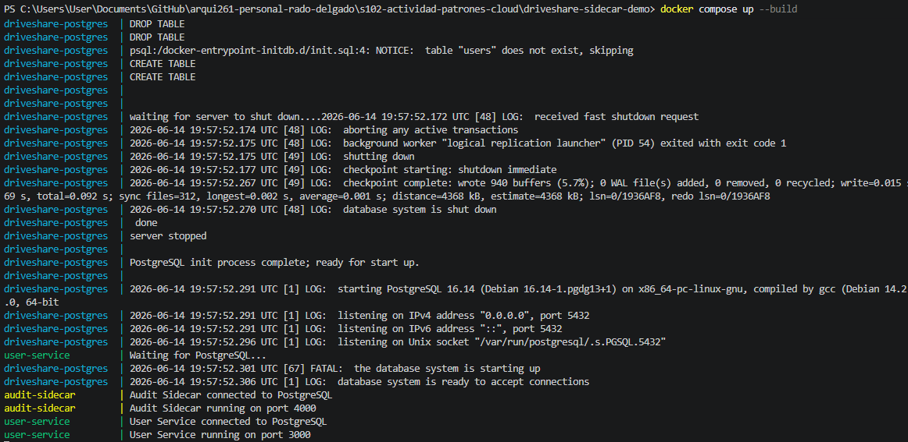

Ejecutar:

```bash
docker compose up --build
```

Resultado esperado:

* PostgreSQL iniciado correctamente.
* User Service iniciado correctamente.
* Audit Sidecar iniciado correctamente.

---

## Contenedores en Ejecución

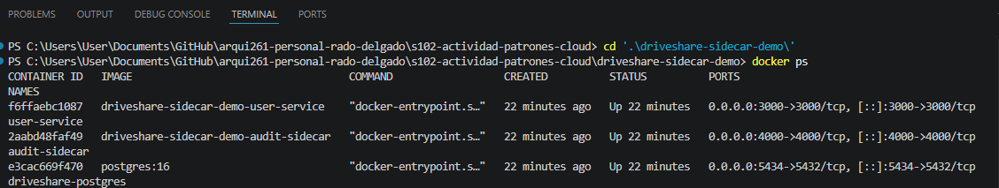

Verificar:

```bash
docker ps
```

Resultado esperado:

* driveshare-postgres
* user-service
* audit-sidecar

Se ejecutó Docker Compose para construir y levantar los tres componentes de la solución: PostgreSQL, User Service y Audit Sidecar. La salida confirma que los servicios iniciaron correctamente y establecieron conexión con la base de datos.

---

# 5.8. Base de Datos

## Tabla Users

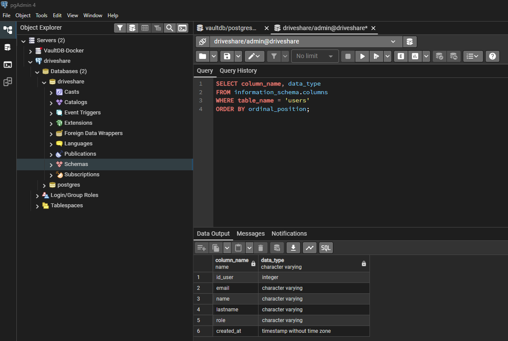

Contiene la información principal de los usuarios registrados.
La tabla `users` almacena la información principal de los usuarios registrados dentro de DriveShare. Cada usuario posee un identificador único, datos personales básicos y un rol dentro de la plataforma.

Campos principales:

* id_user
* email
* name
* lastname
* role

---

## Tabla Audit Log

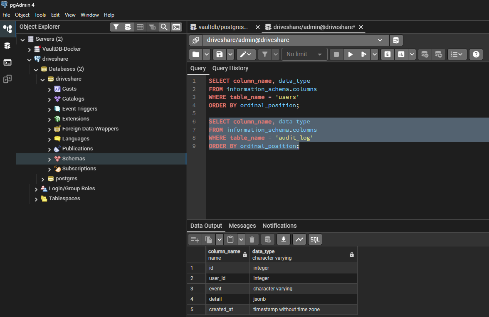

Contiene todos los eventos procesados por el Sidecar.

Campos principales:

* id
* user_id
* event
* detail
* created_at

---

# 5.9. Casos de Prueba

Los siguientes escenarios permiten validar el funcionamiento del patrón Sidecar y comprobar que los eventos generados por el módulo de usuarios son procesados y almacenados por el servicio de auditoría de forma independiente.

## Caso 1 - Crear Usuario

Solicitud:

```http
POST /users
```

Body:

```json
{
  "email": "juan@gmail.com",
  "name": "Juan",
  "lastname": "Perez",
  "role": "arrendatario"
}
```

Resultado esperado:

* Usuario creado correctamente.
* Evento USER_CREATED registrado por el Sidecar.

---

### Evidencia

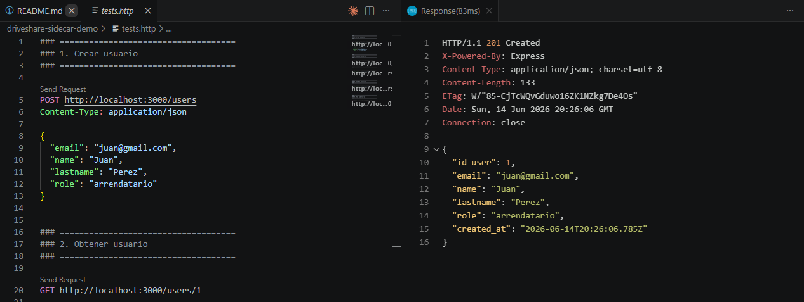

#### Usuario almacenado

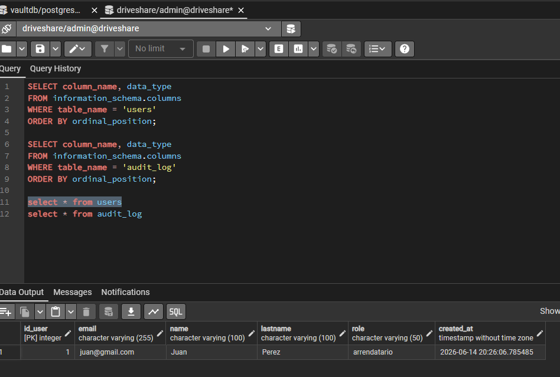

La información enviada mediante el endpoint de creación fue almacenada correctamente en la tabla `users`.

#### Evento auditado

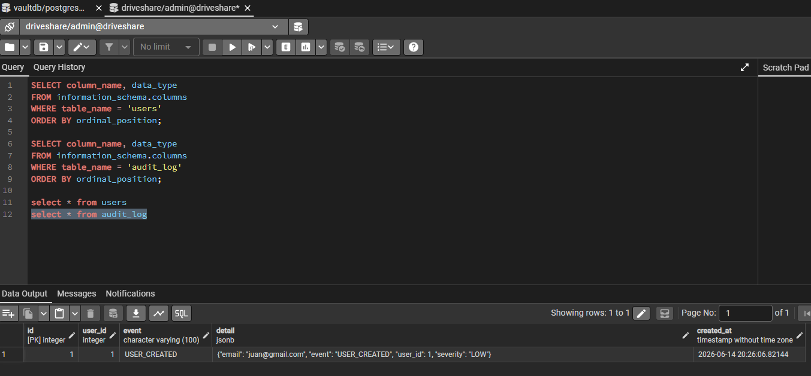

El Audit Sidecar registró automáticamente el evento `USER_CREATED` en la tabla `audit_log`.

---

## Caso 2 - Consultar Usuario

Solicitud:

```http
GET /users/1
```

Resultado esperado:

* Información del usuario recuperada.
* Evento USER_VIEWED registrado por el Sidecar.

---

### Evidencia

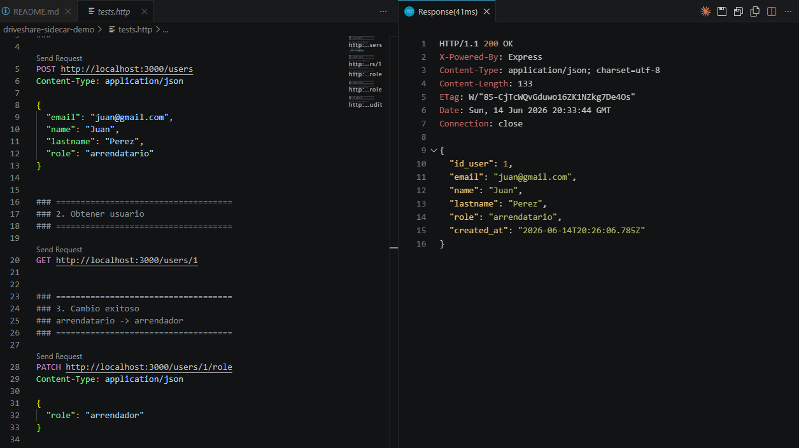

### Verificación en Base de Datos

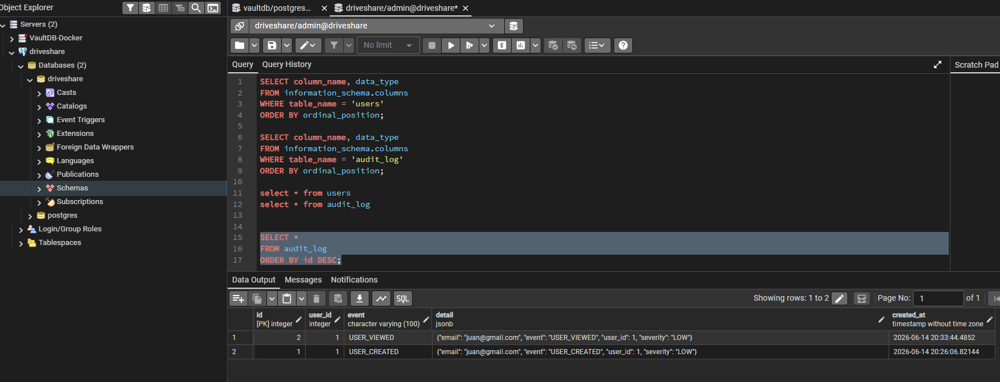

El Audit Sidecar registró automáticamente el evento `USER_VIEWED` al realizar la consulta del usuario, demostrando que las operaciones de lectura también pueden ser auditadas sin modificar la lógica principal del User Service.


---

## Caso 3 - Cambio de Rol Válido

Solicitud:

```http
PATCH /users/1/role
```

Body:

```json
{
  "role": "arrendador"
}
```

Resultado esperado:

* Cambio de rol exitoso.
* Evento `ROLE_CHANGED` registrado por el Audit Sidecar.
* Clasificación de severidad `HIGH`.
* Generación de alerta en consola.

---

### Evidencia

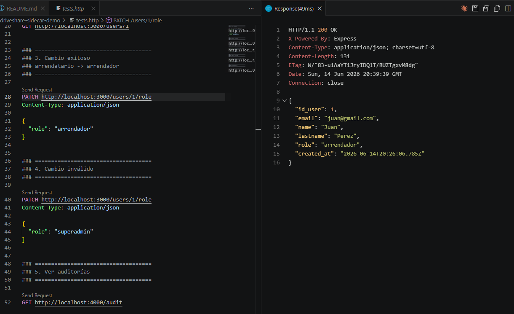

---

## Generación de Alerta de Alta Severidad

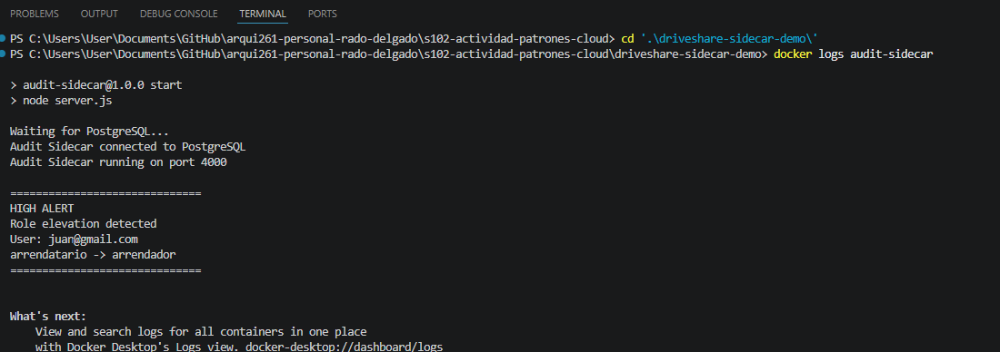

Cuando un usuario cambia su rol de **Arrendatario** a **Arrendador**, el Audit Sidecar clasifica automáticamente el evento como de severidad **HIGH**, ya que representa una elevación de privilegios dentro de la plataforma.

Como resultado, el Sidecar genera una alerta en consola para evidenciar que el evento fue detectado, procesado y auditado de forma completamente independiente al User Service.

---

### Verificación en Base de Datos

#### Usuario actualizado

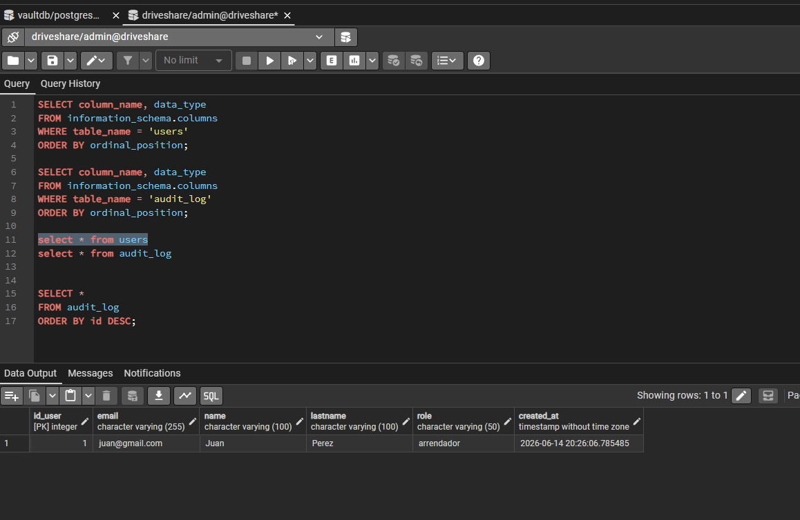

La tabla `users` refleja correctamente la actualización realizada por el User Service, mostrando el nuevo rol asignado al usuario.

#### Evento auditado

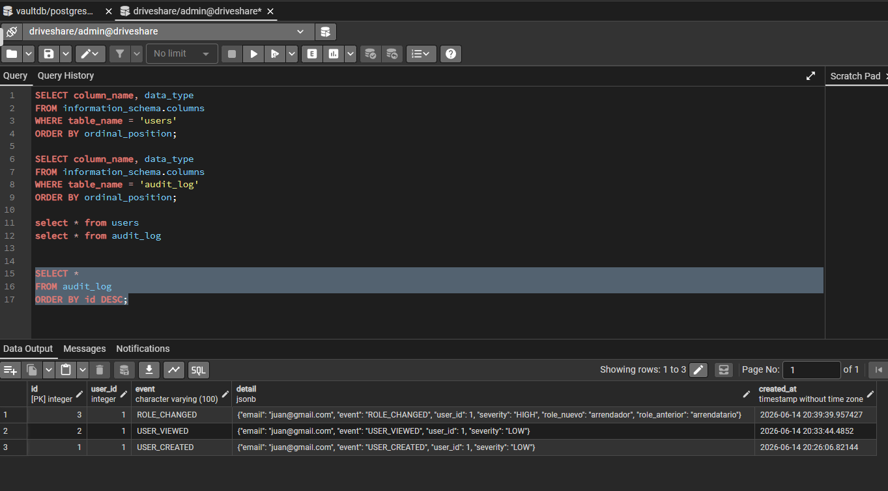

El Audit Sidecar registró el evento `ROLE_CHANGED`, almacenando la información del cambio de rol junto con su nivel de severidad correspondiente.

---

## Caso 4 - Cambio de Rol Inválido

**Nota:** DriveShare únicamente permite los roles `arrendatario` y `arrendador`. Cualquier valor diferente será rechazado y auditado por el Sidecar.

Solicitud:

```http
PATCH /users/1/role
```

Body:

```json
{
  "role": "superadmin"
}
```

Resultado esperado:

* Solicitud rechazada por el User Service.
* Evento `ROLE_CHANGE_DENIED` registrado por el Audit Sidecar.
* Clasificación de severidad `MEDIUM`.

---

### Evidencia

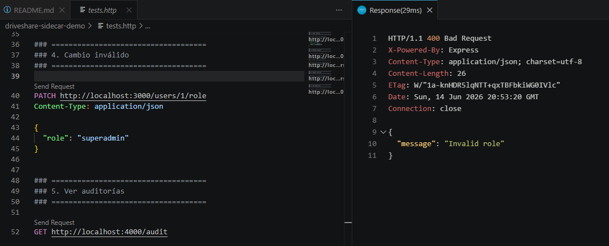

---

### Verificación en Base de Datos

#### Evento auditado

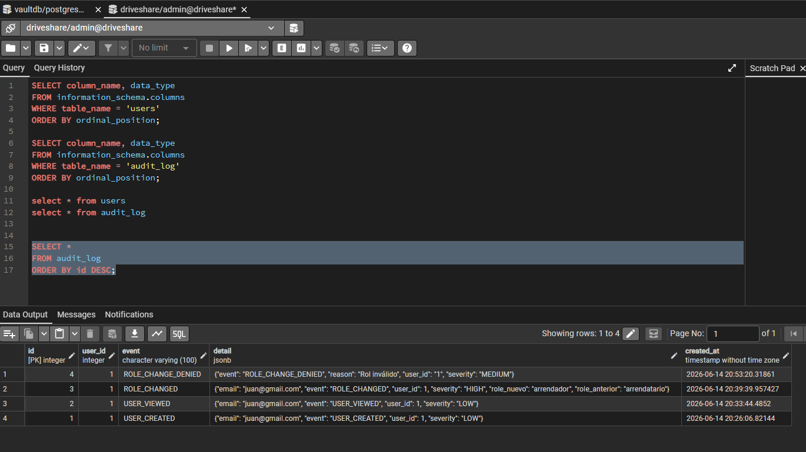

El Audit Sidecar registró el evento `ROLE_CHANGE_DENIED`, almacenando el motivo del rechazo y la información necesaria para futuras tareas de monitoreo y auditoría.

---

# 5.10. Resultados de Auditoría

## Eventos Registrados

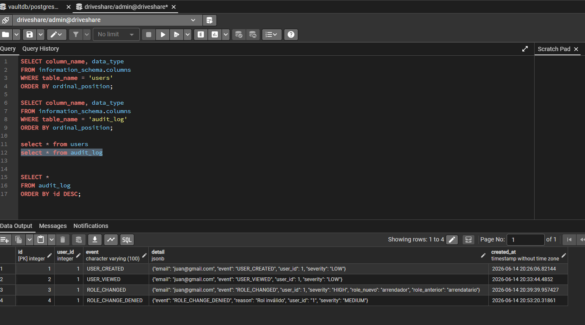

Eventos obtenidos:

| Evento             | Severidad |
| ------------------ | --------- |
| USER_CREATED       | LOW       |
| USER_VIEWED        | LOW       |
| ROLE_CHANGED       | HIGH      |
| ROLE_CHANGE_DENIED | MEDIUM    |

---

# 5.11. Beneficios del Patrón Sidecar

La implementación permitió:

* Separar la auditoría de la lógica de negocio.
* Reducir el acoplamiento entre componentes.
* Facilitar futuras extensiones.
* Centralizar el monitoreo de eventos.
* Mejorar la mantenibilidad de la solución.

---

# 5.12. Conclusiones

La demostración realizada permitió validar el funcionamiento del patrón arquitectónico Sidecar.

Durante la ejecución de los casos de prueba se comprobó que operaciones como la creación de usuarios, la consulta de información y los cambios de rol generan eventos que son procesados por un servicio de auditoría independiente, sin incorporar lógica adicional dentro del User Service.

El Audit Sidecar fue capaz de registrar eventos relevantes, clasificarlos según su severidad y generar alertas ante situaciones consideradas críticas, como la elevación de privilegios de un usuario de arrendatario a arrendador.

La implementación demuestra que es posible desacoplar completamente las responsabilidades de auditoría de la lógica principal del negocio, permitiendo una solución más mantenible, escalable y alineada con los principios promovidos por el patrón arquitectónico Sidecar.


# **Video de demostración:**  
Enlace de video: https://youtu.be/-7v1h-HwGKg

[🏠 Home](../../../README.md) | [Siguiente ➡️](../0.8.2/0.8.2.md)