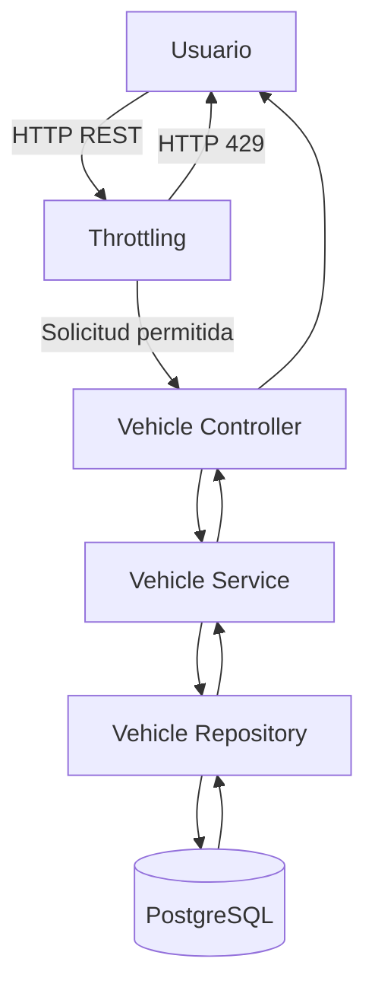
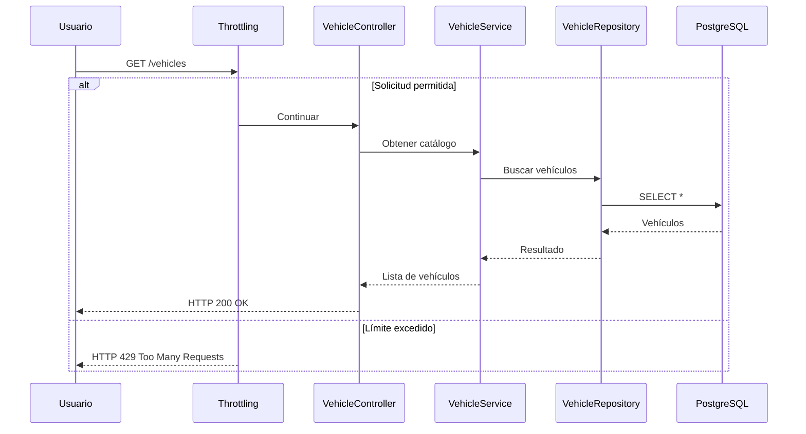
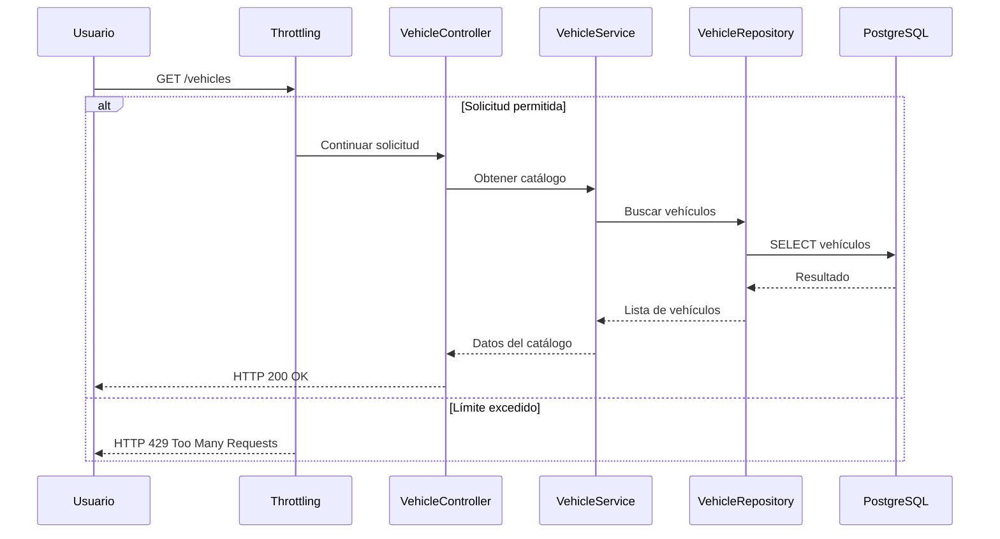

> [0. Acerca del Grupo](../../0.md) › [0.8. Tema Individual: Patrones Cloud](../0.8.md) › [0.8.2. Integrante 2](0.8.2.md)

# 0.8.2. Integrante 2

# Throttling Pattern

# 5. Aplicación del Patrón Cloud: Throttling

## 5.1 Introducción

El patrón **Throttling** es un patrón de arquitectura Cloud utilizado para controlar la cantidad de solicitudes que un cliente puede realizar hacia un servicio durante un intervalo de tiempo determinado.

Su propósito principal es proteger los recursos de la aplicación frente a sobrecargas ocasionadas por accesos masivos, consultas repetitivas o ataques automatizados, manteniendo la disponibilidad y el rendimiento del sistema.

En DriveShare, el patrón Throttling se implementa en el **Módulo 2 – Catálogo de Vehículos**, debido a que concentra una gran cantidad de operaciones de consulta realizadas por los usuarios antes de efectuar una reserva. Estas operaciones incluyen la visualización del catálogo, búsquedas, aplicación de filtros y consulta del detalle de los vehículos.

Mediante este patrón, el sistema controla el flujo de solicitudes permitiendo únicamente una cantidad determinada de peticiones dentro de un intervalo de tiempo, evitando así que un usuario o proceso automatizado pueda consumir excesivamente los recursos disponibles.

---

# 5.2 Objetivo

El objetivo de la implementación del patrón Throttling es proteger el Módulo de Catálogo de Vehículos frente a solicitudes excesivas que puedan afectar el rendimiento y la disponibilidad de la plataforma.

Específicamente se busca:

- Controlar la cantidad de solicitudes realizadas por cada usuario.
- Evitar la sobrecarga del servidor durante períodos de alta concurrencia.
- Reducir el consumo innecesario de recursos del backend.
- Disminuir la carga sobre PostgreSQL.
- Garantizar tiempos de respuesta estables.
- Mantener la disponibilidad del catálogo para todos los usuarios.

---

# 5.3 Contexto

Dentro de DriveShare, el Catálogo de Vehículos constituye uno de los módulos más utilizados por los usuarios.

Antes de realizar una reserva, los clientes consultan continuamente el catálogo para comparar vehículos disponibles, revisar fotografías, verificar precios y aplicar distintos criterios de búsqueda.

Las funcionalidades principales del módulo corresponden a los siguientes requisitos funcionales:

| Requisito | Funcionalidad |
|-----------|---------------|
| RF9 | Registro de vehículo |
| RF10 | Edición de vehículo |
| RF11 | Eliminación de vehículo |
| RF12 | Visualización del catálogo |
| RF13 | Carga de imágenes |
| RF14 | Gestión de disponibilidad |
| RF15 | Búsqueda de vehículos |
| RF16 | Filtros avanzados |
| RF17 | Visualización del detalle del vehículo |

De todas estas funcionalidades, las operaciones de consulta representan el mayor volumen de tráfico hacia el servidor, por lo que resulta necesario incorporar un mecanismo que controle la frecuencia de acceso.

---

# 5.4 Problema

Sin un mecanismo de limitación de solicitudes, cualquier usuario podría realizar cientos de consultas consecutivas hacia el catálogo de vehículos.

Esta situación ocasionaría diversos problemas:

- Incremento del consumo de CPU.
- Saturación de memoria.
- Elevado número de consultas hacia PostgreSQL.
- Disminución del rendimiento general.
- Incremento del tiempo de respuesta.
- Riesgo de ataques automatizados (bots).
- Posibles ataques de denegación de servicio (DoS).

El problema se vuelve más crítico considerando que el catálogo es consultado por todos los usuarios antes de realizar una reserva.

---

# 5.5 Solución

Para resolver este problema se implementa el patrón **Throttling**.

Este patrón incorpora un componente encargado de controlar la cantidad máxima de solicitudes que un cliente puede realizar durante un período de tiempo.

Cada solicitud enviada hacia el Catálogo de Vehículos pasa inicialmente por el componente Throttling.

El componente verifica el número de solicitudes realizadas por el usuario.

Si el usuario no supera el límite permitido, la solicitud continúa normalmente hacia el servicio del catálogo.

En caso contrario, el sistema responde inmediatamente con el código HTTP **429 (Too Many Requests)**, evitando que la petición llegue al servicio principal y consuma recursos innecesarios.

Esta solución desacopla completamente el control del tráfico respecto de la lógica de negocio implementada dentro del Vehicle Service.

---

# 5.6 Arquitectura de la solución



**Figura 5.1. Arquitectura del patrón Throttling aplicado al Módulo de Catálogo de Vehículos.**

---

# Funcionamiento de la arquitectura

1. El usuario realiza una consulta del catálogo.
2. La solicitud llega al componente Throttling.
3. El componente verifica el número de solicitudes realizadas por ese usuario.
4. Si el límite no ha sido alcanzado, la solicitud continúa hacia el controlador.
5. El controlador invoca al Vehicle Service.
6. El servicio consulta PostgreSQL mediante el repositorio.
7. La respuesta es enviada nuevamente al usuario.
8. Si el usuario supera el límite permitido, el componente responde inmediatamente con HTTP 429 sin acceder al servicio del catálogo.

---

# Beneficios obtenidos

La incorporación del patrón Throttling proporciona los siguientes beneficios:

- Protección frente a sobrecargas.
- Mayor disponibilidad del sistema.
- Mejor utilización de los recursos del servidor.
- Protección frente a ataques automatizados.
- Menor carga sobre PostgreSQL.
- Mayor estabilidad durante períodos de alta demanda.
- Mejor experiencia para los usuarios legítimos.


# 5.7 Componentes utilizados

La implementación del patrón **Throttling** en DriveShare utiliza los siguientes componentes de software.

| Componente | Tecnología | Responsabilidad |
|------------|------------|-----------------|
| Frontend | React + Vite | Permite a los usuarios consultar el catálogo de vehículos mediante solicitudes HTTP. |
| Backend | Node.js + Express | Procesa las solicitudes del catálogo y aplica el middleware de Throttling antes de ejecutar la lógica del negocio. |
| Middleware Throttling | express-rate-limit | Controla la cantidad máxima de solicitudes permitidas por usuario dentro de un intervalo de tiempo. |
| Vehicle Controller | Express Controller | Recibe las solicitudes HTTP relacionadas con el catálogo de vehículos. |
| Vehicle Service | Node.js | Implementa la lógica de negocio del catálogo de vehículos. |
| Vehicle Repository | Sequelize | Gestiona el acceso a PostgreSQL. |
| Base de Datos | PostgreSQL | Almacena la información de los vehículos disponibles para alquiler. |

---

# 5.8 Estructura del proyecto

Para mantener una arquitectura organizada y desacoplada, la implementación del patrón Throttling se integra dentro de la arquitectura en capas utilizada por DriveShare.

La estructura del proyecto es la siguiente:

```text
src/

├── controllers/
│      VehicleController.js
│
├── services/
│      VehicleService.js
│
├── repositories/
│      VehicleRepository.js
│
├── routes/
│      VehicleRoutes.js
│
├── middlewares/
│      ThrottlingMiddleware.js
│
├── config/
│      RateLimiter.js
│
└── app.js
```

Cada componente mantiene una responsabilidad claramente definida.

El middleware Throttling se ubica antes del controlador para evitar que solicitudes innecesarias lleguen al servicio del catálogo.

---

# 5.9 Implementación del patrón

Para implementar el patrón se utiliza la librería **express-rate-limit**, la cual permite limitar el número de solicitudes realizadas por un cliente.

## Instalación

```bash
npm install express-rate-limit
```

---

## Configuración del middleware

Archivo:

```text
config/RateLimiter.js
```

Código:

```javascript
const rateLimit = require("express-rate-limit");

const vehicleLimiter = rateLimit({

    windowMs: 60 * 1000,

    max: 5,

    standardHeaders: true,

    legacyHeaders: false,

    message: {

        message:
            "Demasiadas solicitudes. Intente nuevamente en unos segundos."

    }

});

module.exports = vehicleLimiter;
```

---

## Explicación

| Parámetro | Descripción |
|-----------|-------------|
| windowMs | Intervalo de tiempo durante el cual se cuentan las solicitudes. |
| max | Número máximo de solicitudes permitidas durante el intervalo. |
| standardHeaders | Devuelve información del límite mediante cabeceras HTTP estándar. |
| legacyHeaders | Deshabilita las cabeceras antiguas de Rate Limit. |
| message | Mensaje enviado cuando el usuario supera el límite permitido. |

En este ejemplo cada usuario podrá realizar **cinco solicitudes por minuto**.

Si realiza una sexta solicitud durante ese mismo intervalo recibirá un **HTTP 429**.

---

# 5.10 Integración con Express

Una vez configurado el middleware, se incorpora a las rutas del Catálogo de Vehículos.

Archivo:

```text
routes/VehicleRoutes.js
```

Código:

```javascript
const express = require("express");

const router = express.Router();

const vehicleLimiter =
require("../config/RateLimiter");

const VehicleController =
require("../controllers/VehicleController");

router.get(
    "/vehicles",
    vehicleLimiter,
    VehicleController.findAll
);

router.get(
    "/vehicles/search",
    vehicleLimiter,
    VehicleController.search
);

router.get(
    "/vehicles/filter",
    vehicleLimiter,
    VehicleController.filter
);

router.get(
    "/vehicles/:id",
    vehicleLimiter,
    VehicleController.findById
);

module.exports = router;
```

El middleware se ejecuta antes del controlador.

Si el límite de solicitudes no ha sido superado, el controlador procesa normalmente la petición.

En caso contrario, Express responde automáticamente con el código **HTTP 429**, evitando consumir recursos adicionales del servidor.

---

# 5.11 Flujo de ejecución



---

# 5.12 Integración con la Arquitectura

El patrón Throttling se integra únicamente sobre los endpoints de consulta del catálogo de vehículos.

Los endpoints protegidos son:

| Endpoint | Funcionalidad |
|----------|---------------|
| GET /vehicles | Listado del catálogo |
| GET /vehicles/search | Búsqueda por marca o modelo |
| GET /vehicles/filter | Filtros avanzados |
| GET /vehicles/:id | Detalle del vehículo |

Las operaciones de creación, actualización y eliminación de vehículos no utilizan Throttling debido a que únicamente son ejecutadas por los propietarios y presentan un volumen considerablemente menor de solicitudes.

# 5.13 Demostración del Patrón Throttling

## Escenario de prueba

Para validar el funcionamiento del patrón **Throttling**, se implementó un middleware utilizando la librería **express-rate-limit** sobre los endpoints de consulta del Catálogo de Vehículos.

La configuración utilizada para la demostración fue la siguiente:

| Parámetro | Valor |
|-----------|-------|
| Intervalo de tiempo | 1 minuto |
| Máximo de solicitudes | 5 solicitudes |
| Código de respuesta | HTTP 429 |
| Mensaje | Too Many Requests |

El objetivo consiste en verificar que el sistema permita únicamente cinco solicitudes consecutivas por usuario durante un minuto y rechace automáticamente las solicitudes adicionales.

---

# 5.14 Flujo de la demostración

Durante la prueba se ejecuta el siguiente flujo de procesamiento.



---

# 5.15 Prueba N°1 – Consulta normal

Se realiza una solicitud al catálogo de vehículos.

### Solicitud

```http
GET /vehicles
```

### Respuesta esperada

```http
HTTP/1.1 200 OK
```

Ejemplo de respuesta

```json
[
  {
    "id": 1,
    "marca": "Toyota",
    "modelo": "Corolla",
    "precioDia": 120
  },
  {
    "id": 2,
    "marca": "Hyundai",
    "modelo": "Accent",
    "precioDia": 95
  }
]
```

### Resultado

La solicitud es procesada correctamente debido a que el usuario aún no supera el límite permitido.

---

# 5.16 Prueba N°2 – Solicitudes consecutivas

Se realizan cinco consultas consecutivas al catálogo.

```text
Solicitud 1 → HTTP 200

Solicitud 2 → HTTP 200

Solicitud 3 → HTTP 200

Solicitud 4 → HTTP 200

Solicitud 5 → HTTP 200
```

### Resultado

Todas las solicitudes son aceptadas por el middleware.

---

# 5.17 Prueba N°3 – Exceso de solicitudes

Se realiza una sexta solicitud dentro del mismo minuto.

### Solicitud

```http
GET /vehicles
```

### Respuesta

```http
HTTP/1.1 429 Too Many Requests
```

```json
{
    "message":"Demasiadas solicitudes. Intente nuevamente en unos segundos."
}
```

### Resultado

El middleware Throttling rechaza automáticamente la solicitud.

El controlador y el servicio del catálogo no llegan a ejecutarse.

---

# 5.18 Prueba N°4 – Reinicio del contador

Después de esperar un minuto se vuelve a consultar el catálogo.

### Solicitud

```http
GET /vehicles
```

### Respuesta

```http
HTTP/1.1 200 OK
```

### Resultado

El contador de solicitudes se reinicia automáticamente.

El usuario vuelve a acceder normalmente al catálogo.

---

# 5.19 Evidencia esperada

Durante la ejecución de la demostración se espera observar el siguiente comportamiento.

| Solicitud | Resultado |
|------------|-----------|
| Solicitud 1 | HTTP 200 |
| Solicitud 2 | HTTP 200 |
| Solicitud 3 | HTTP 200 |
| Solicitud 4 | HTTP 200 |
| Solicitud 5 | HTTP 200 |
| Solicitud 6 | HTTP 429 |
| Solicitud 7 | HTTP 429 |
| Esperar 60 segundos | Contador reiniciado |
| Solicitud 8 | HTTP 200 |

---

# 5.20 Resultado de la demostración

La implementación permitió comprobar que el patrón **Throttling** controla correctamente el acceso al Módulo de Catálogo de Vehículos.

Las solicitudes realizadas dentro del límite configurado fueron procesadas normalmente por el servicio.

Cuando el usuario excedió el número máximo de solicitudes permitidas, el middleware respondió automáticamente con el código **HTTP 429 (Too Many Requests)**, evitando que la petición fuera procesada por el controlador y reduciendo la carga sobre el servidor y la base de datos.

La demostración confirma que el patrón protege eficazmente el servicio frente a accesos masivos sin afectar el funcionamiento normal de los usuarios legítimos.

---

# 5.21 Capturas sugeridas

Para documentar la demostración se recomienda incluir las siguientes evidencias:

| Figura | Descripción |
|---------|-------------|
| Figura 5.2 | Configuración del middleware Throttling (`express-rate-limit`). |
| Figura 5.3 | Ejecución correcta de una consulta al catálogo (HTTP 200). |
| Figura 5.4 | Respuesta HTTP 429 al superar el límite de solicitudes. |
| Figura 5.5 | Consola del servidor mostrando las solicitudes procesadas. |
| Figura 5.6 | Base de datos PostgreSQL con la información del catálogo de vehículos. |

> **Nota:** Estas capturas deberán obtenerse durante la ejecución del prototipo de DriveShare utilizando herramientas como Postman, Visual Studio Code y pgAdmin.


# 5.22 Beneficios obtenidos

La implementación del patrón **Throttling** en el Módulo de Catálogo de Vehículos aporta diversos beneficios relacionados con el rendimiento, la disponibilidad y la protección de los recursos de DriveShare.

## Protección frente a sobrecargas

El patrón limita la cantidad de solicitudes que un usuario puede realizar durante un intervalo determinado, evitando que consultas excesivas degraden el rendimiento del sistema.

---

## Mayor disponibilidad

Al controlar el flujo de solicitudes hacia el catálogo, el servicio permanece disponible para un mayor número de usuarios incluso durante períodos de alta demanda.

---

## Optimización del uso de recursos

Las solicitudes que exceden el límite configurado son rechazadas antes de ejecutar la lógica del negocio, reduciendo el consumo de CPU, memoria y conexiones hacia PostgreSQL.

---

## Protección frente a ataques automatizados

El patrón disminuye el impacto de herramientas automatizadas o bots que realizan consultas repetitivas sobre el catálogo de vehículos.

---

## Mejor experiencia para usuarios legítimos

Al evitar la saturación del sistema, los usuarios que realizan un uso normal de la plataforma mantienen tiempos de respuesta estables durante la consulta del catálogo.

---

## Arquitectura desacoplada

La lógica de limitación de solicitudes permanece completamente separada de la lógica del negocio implementada en el Vehicle Service, facilitando el mantenimiento y futuras modificaciones.

---

# 5.23 Consecuencias de la implementación

## Protección del servicio (Consecuencia Positiva)

El patrón Throttling evita que un único usuario pueda consumir de manera excesiva los recursos del sistema, manteniendo estable el funcionamiento del Catálogo de Vehículos.

Como consecuencia, es necesario definir adecuadamente los límites de solicitudes permitidas para evitar afectar a usuarios legítimos.

---

## Mayor estabilidad (Consecuencia Positiva)

La limitación del número de solicitudes disminuye la probabilidad de sobrecargas durante períodos de alta concurrencia.

No obstante, la configuración de límites demasiado restrictivos podría generar respuestas HTTP 429 en usuarios con un uso intensivo pero válido de la plataforma.

---

## Protección de PostgreSQL (Consecuencia Positiva)

Al impedir que solicitudes innecesarias lleguen al servicio del catálogo, PostgreSQL procesa únicamente consultas autorizadas, reduciendo el consumo de recursos y mejorando el rendimiento general.

Como contraparte, el sistema requiere monitorear periódicamente los parámetros de configuración del Throttling para adaptarlos al crecimiento de la plataforma.

---

# 5.24 Limitaciones

Aunque el patrón Throttling proporciona una protección importante para el sistema, presenta algunas limitaciones que deben considerarse durante su implementación.

- No evita completamente ataques distribuidos (DDoS) provenientes de múltiples direcciones IP.
- Requiere ajustar periódicamente los límites de solicitudes según el crecimiento del número de usuarios.
- Si los límites son demasiado bajos, algunos usuarios legítimos podrían experimentar restricciones temporales.
- Debe complementarse con otros mecanismos de seguridad como autenticación, autorización y monitoreo.

---

# 5.25 Buenas prácticas

Durante la implementación del patrón Throttling en DriveShare se recomienda seguir las siguientes prácticas:

- Definir límites de solicitudes diferentes según el tipo de operación.
- Aplicar Throttling principalmente sobre operaciones de consulta masiva.
- Registrar los eventos de bloqueo para facilitar el monitoreo.
- Configurar mensajes claros para informar al usuario cuando exceda el límite permitido.
- Monitorear continuamente el comportamiento del sistema para ajustar la configuración del Rate Limiter.
- Combinar Throttling con mecanismos de autenticación y autorización mediante JWT.

---

# 5.26 Conclusiones

La implementación del patrón **Throttling** permitió proteger el Módulo de Catálogo de Vehículos frente a accesos masivos y solicitudes excesivas, mejorando la estabilidad y disponibilidad de DriveShare.

El patrón demostró ser especialmente adecuado para las funcionalidades de consulta del catálogo, ya que estas representan la mayor carga de trabajo del sistema.

Durante la demostración se comprobó que el middleware limitó correctamente la cantidad de solicitudes permitidas por usuario, respondiendo con el código HTTP **429 (Too Many Requests)** cuando el límite configurado fue superado.

Asimismo, el patrón permitió desacoplar completamente el control del tráfico respecto de la lógica del negocio, manteniendo el Vehicle Service enfocado únicamente en la gestión del catálogo de vehículos.

Finalmente, la incorporación de Throttling contribuye al cumplimiento de atributos de calidad como la disponibilidad, el rendimiento, la mantenibilidad y la escalabilidad, fortaleciendo la arquitectura general de DriveShare.

---

# 5.27 Trabajo futuro

Como líneas de mejora para futuras versiones de DriveShare se propone:

- Implementar límites dinámicos según el rol del usuario (Administrador, Arrendador o Arrendatario).
- Integrar Redis para compartir contadores de solicitudes entre múltiples instancias del servidor.
- Incorporar monitoreo mediante Prometheus y Grafana para analizar el comportamiento del patrón en producción.
- Ajustar automáticamente los límites de solicitudes utilizando métricas de uso del sistema.
- Integrar mecanismos adicionales de protección frente a ataques distribuidos.

---

# 5.28 Referencias

- Microsoft. *Cloud Design Patterns – Throttling Pattern*. https://learn.microsoft.com/azure/architecture/patterns/throttling

- Microsoft. *Azure Architecture Center*. https://learn.microsoft.com/azure/architecture/

- AWS. *AWS Well-Architected Framework*. https://docs.aws.amazon.com/wellarchitected/

- NIST. *Application Container Security Guide (SP 800-190).* https://csrc.nist.gov/publications

- Express.js. *express-rate-limit Documentation*. https://www.npmjs.com/package/express-rate-limit

- PostgreSQL Global Development Group. *PostgreSQL Documentation*. https://www.postgresql.org/docs/

- Node.js Foundation. *Node.js Documentation*. https://nodejs.org/docs/

---

# 5.29 Resumen general de la demostración

| Aspecto | Resultado |
|----------|-----------|
| Patrón implementado | Throttling |
| Módulo | Catálogo de Vehículos |
| Tecnología | Node.js + Express |
| Middleware | express-rate-limit |
| Base de datos | PostgreSQL |
| Objetivo | Controlar la cantidad de solicitudes por usuario |
| Código HTTP utilizado | 429 Too Many Requests |
| Beneficio principal | Protección del catálogo frente a sobrecargas |
| Atributos de calidad favorecidos | Disponibilidad, Rendimiento, Escalabilidad y Mantenibilidad |
