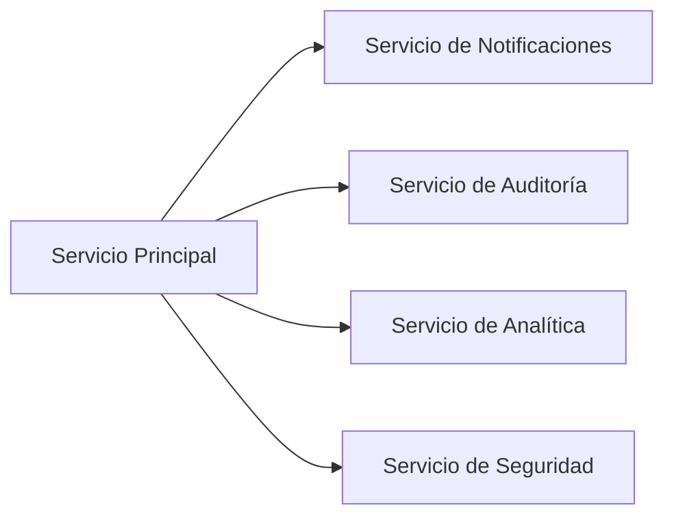
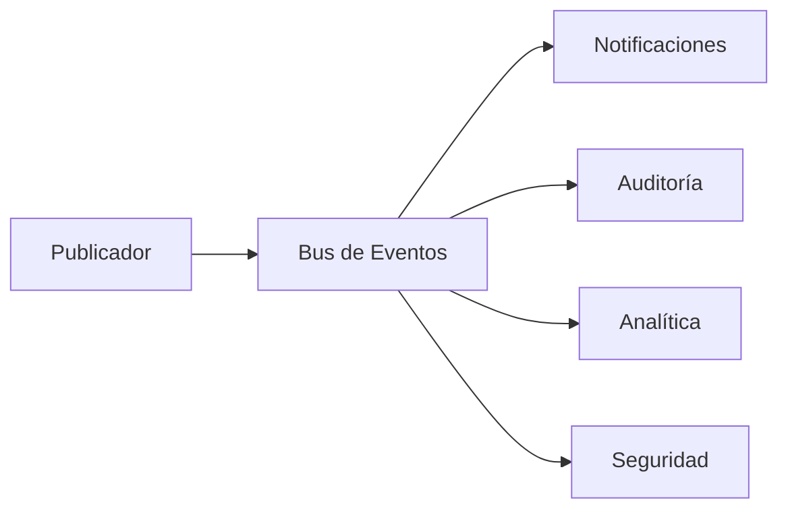
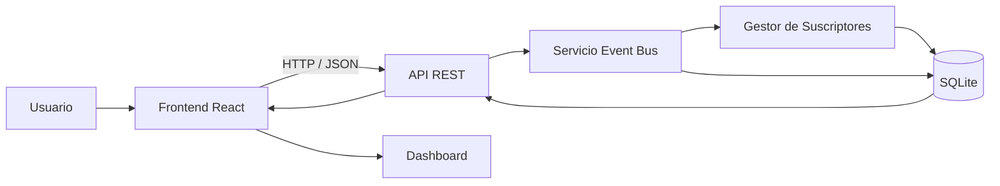
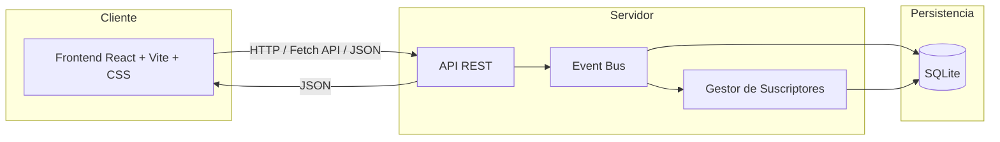
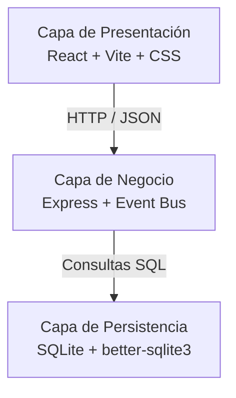
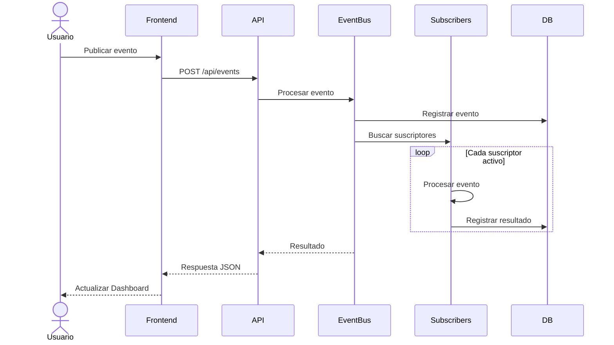
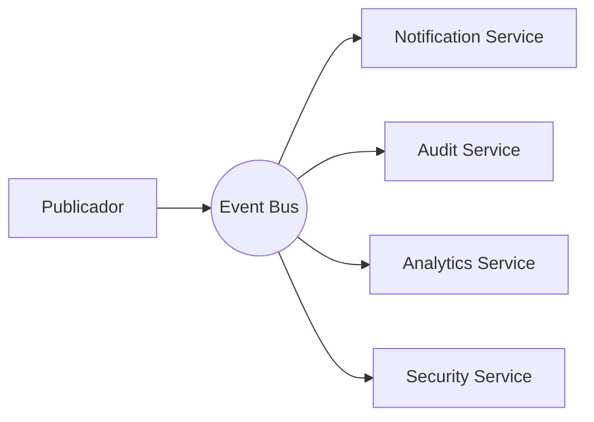
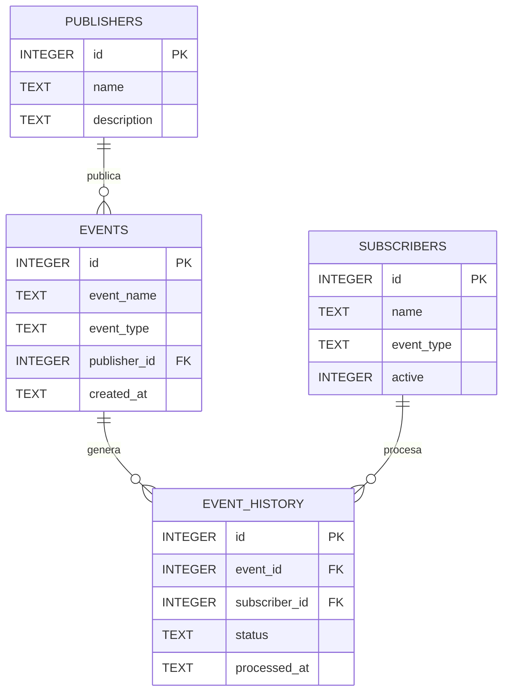
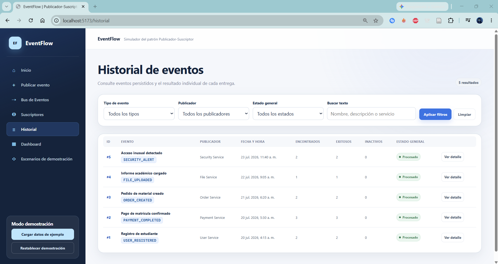
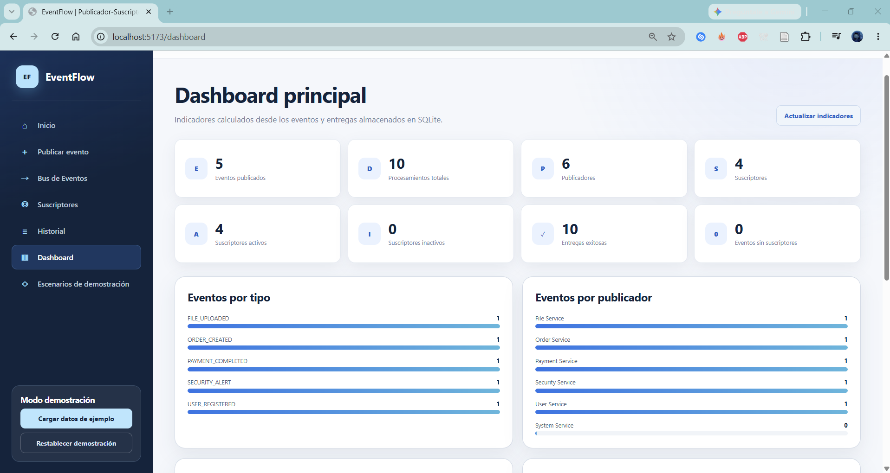

> [0. Acerca del Grupo](../../0.md) › [0.8. Tema Individual: Patrones Cloud](../0.8.md) › [0.8.5. Integrante 5](0.8.5.md)

# 0.8.5. Integrante 5

# Patrón Cloud: Publicador-Suscriptor

## EventFlow

**Publisher-Subscriber Simulation Platform**

# 1. Introducción

## 1.1 Descripción general

Las aplicaciones modernas están compuestas por múltiples componentes que necesitan intercambiar información constantemente. En muchos casos, una sola acción dentro del sistema debe ser procesada por varios servicios diferentes, como sistemas de notificaciones, auditoría, monitoreo o analítica.

Cuando estos componentes se comunican mediante llamadas directas, el sistema adquiere un alto nivel de dependencia entre sus módulos. Esto dificulta el mantenimiento, incrementa el acoplamiento y limita la posibilidad de incorporar nuevas funcionalidades sin modificar el código existente.

El patrón **Publicador-Suscriptor (Publisher-Subscriber)** propone un modelo de comunicación orientado a eventos que desacopla completamente a los componentes productores de información de aquellos encargados de procesarla.

En este patrón, un componente denominado **Publicador** genera un evento y lo envía a un intermediario conocido como **Bus de Eventos**. Posteriormente, dicho intermediario distribuye el evento únicamente a los componentes que se encuentran suscritos a ese tipo de mensaje.

Con el propósito de demostrar este comportamiento, se desarrolló **EventFlow**, un prototipo web académico que simula el funcionamiento del patrón Publicador-Suscriptor mediante la generación, distribución y procesamiento de eventos.

La plataforma permite publicar distintos tipos de eventos, visualizar el recorrido realizado por cada mensaje, administrar suscriptores, consultar el historial de eventos procesados y observar estadísticas generales desde un Dashboard centralizado.

Todas las operaciones realizadas por EventFlow son demostrativas. La aplicación no utiliza servicios cloud reales ni brokers de mensajería externos como Azure Service Bus, RabbitMQ o Apache Kafka. El comportamiento del patrón se representa mediante componentes desarrollados para fines académicos.

---

## 1.2 ¿Qué es el patrón Publicador-Suscriptor?

El patrón Publicador-Suscriptor es un patrón de arquitectura orientado a eventos cuyo objetivo principal es reducir el acoplamiento entre los componentes de un sistema distribuido.

En este modelo existen tres elementos principales:

- **Publicadores**, responsables de generar eventos.
- **Bus de Eventos**, encargado de distribuir los mensajes.
- **Suscriptores**, componentes interesados en determinados tipos de eventos.

Una característica importante del patrón es que el publicador nunca conoce directamente quién recibirá sus eventos.

En lugar de enviar mensajes individualmente a cada componente, simplemente publica el evento en el Bus de Eventos. Posteriormente, el intermediario identifica qué suscriptores se encuentran registrados y distribuye automáticamente una copia del evento a cada uno de ellos.

Este mecanismo permite incorporar nuevos consumidores sin modificar la lógica del publicador, facilitando la evolución del sistema y reduciendo las dependencias entre componentes.

---

## 1.3 Objetivo del proyecto

Diseñar e implementar un prototipo web que simule el funcionamiento del patrón cloud Publicador-Suscriptor mediante la generación, distribución y procesamiento de eventos entre componentes desacoplados, permitiendo visualizar el recorrido de los mensajes y comprender las ventajas arquitectónicas del modelo orientado a eventos.

---

## 1.4 Alcance

EventFlow incorpora las siguientes funcionalidades:

- Publicación manual de eventos.
- Simulación de múltiples publicadores.
- Bus de Eventos centralizado.
- Administración de suscriptores.
- Activación y desactivación de suscriptores.
- Distribución automática de eventos.
- Historial de eventos procesados.
- Dashboard con estadísticas.
- Registro de eventos procesados correctamente.
- Registro de eventos procesados parcialmente.
- Simulación de fallos de suscriptores.
- Reinicio de la demostración mediante un endpoint.

Para mantener el proyecto dentro de un alcance académico, se implementan cuatro escenarios principales:

- Publicación de un evento con múltiples suscriptores.
- Publicación de un evento sin suscriptores registrados.
- Publicación con un suscriptor desconectado.
- Incorporación dinámica de un nuevo suscriptor.

La plataforma no utiliza brokers reales de mensajería ni servicios cloud. Todos los eventos se almacenan localmente para fines demostrativos.

---

## 1.5 Tecnologías utilizadas

| Tecnología | Uso |
|------------|-----|
| React | Construcción de la interfaz de usuario. |
| Vite | Entorno de desarrollo del frontend. |
| JavaScript | Implementación del frontend y backend. |
| CSS | Diseño visual de la aplicación. |
| Fetch API | Comunicación HTTP entre cliente y servidor. |
| Node.js | Entorno de ejecución del backend. |
| Express | Implementación de la API REST. |
| CORS | Comunicación entre frontend y backend. |
| better-sqlite3 | Acceso a la base de datos. |
| SQLite | Persistencia local de eventos, publicadores y suscriptores. |

La demostración no utiliza Azure Service Bus, RabbitMQ, Apache Kafka, Docker, microservicios, TypeScript ni APIs externas, ya que el objetivo es representar el comportamiento conceptual del patrón mediante una aplicación sencilla.

---

# 2. Problema

## 2.1 Contexto

Las aplicaciones modernas suelen estar compuestas por múltiples componentes que colaboran para ejecutar una misma operación. En arquitecturas distribuidas es común que una acción realizada por un usuario deba ser procesada por diferentes servicios de manera simultánea.

Por ejemplo, al completarse una compra en una tienda virtual, el sistema podría necesitar enviar una notificación al cliente, actualizar el inventario, registrar la transacción para auditoría, generar estadísticas y emitir una factura electrónica.

Cuando estos componentes se comunican mediante llamadas directas, cada servicio debe conocer la ubicación, la interfaz y la disponibilidad de los demás. A medida que la aplicación crece, esta dependencia aumenta la complejidad del sistema y dificulta su evolución.

---

## 2.2 Problema identificado

La comunicación directa entre componentes presenta diversas limitaciones:

- Alto acoplamiento entre módulos.
- Dependencia de la disponibilidad de otros servicios.
- Mayor complejidad para incorporar nuevas funcionalidades.
- Incremento del mantenimiento del código.
- Riesgo de fallas en cascada.
- Dificultad para reutilizar componentes.
- Escasa flexibilidad para modificar el flujo de procesamiento.

Por ejemplo, si un servicio necesita informar un evento a cuatro componentes diferentes, deberá realizar cuatro llamadas independientes.

Si posteriormente se incorpora un quinto componente, será necesario modificar nuevamente el código del publicador.

---

## 2.3 Flujo tradicional



En este modelo el servicio principal conoce directamente a todos los consumidores.

Si alguno de estos servicios cambia su interfaz o deja de estar disponible, el componente principal también debe modificarse o gestionar errores adicionales.

---

## 2.4 Necesidad de desacoplamiento

Una alternativa consiste en eliminar las dependencias directas entre los componentes.

En lugar de comunicarse individualmente con cada consumidor, el servicio únicamente debería informar que ocurrió un evento.

Posteriormente, un componente intermediario sería el responsable de identificar qué módulos desean recibir dicho evento y distribuirlo automáticamente.

Este enfoque reduce el acoplamiento y permite que los consumidores evolucionen independientemente del componente que originó el mensaje.

---

## 2.5 Objetivo de la solución

La solución propuesta debe ser capaz de:

- Permitir que un componente publique eventos.
- Distribuir automáticamente cada evento.
- Entregar los mensajes únicamente a los suscriptores interesados.
- Evitar dependencias directas entre productores y consumidores.
- Registrar el recorrido de cada evento.
- Mostrar el procesamiento realizado por cada suscriptor.
- Mantener un historial de eventos publicados.
- Mostrar estadísticas generales desde un Dashboard.

---

## 2.6 Escenarios considerados

Con el propósito de demostrar el funcionamiento del patrón, se implementan los siguientes escenarios:

| Escenario | Objetivo |
|-----------|----------|
| Publicación normal | Demostrar la distribución de un evento hacia múltiples suscriptores. |
| Evento sin suscriptores | Verificar que el sistema procese correctamente un evento aunque ningún componente esté registrado para recibirlo. |
| Suscriptor desconectado | Mostrar que la falla de un consumidor no impide que los demás procesen el evento. |
| Nuevo suscriptor | Incorporar dinámicamente un consumidor sin modificar el publicador. |

Estos escenarios permiten representar el comportamiento principal del patrón Publicador-Suscriptor sin requerir infraestructura cloud ni brokers de mensajería externos.

---

## 2.7 ¿Cómo resuelve este problema el patrón Publicador-Suscriptor?

El patrón Publicador-Suscriptor propone reemplazar las múltiples llamadas directas por un único punto de comunicación denominado **Bus de Eventos**.

Cuando ocurre una acción importante dentro del sistema:

1. El publicador genera un evento.
2. Envía dicho evento al Bus.
3. El Bus identifica qué componentes están suscritos.
4. Distribuye automáticamente el mensaje.
5. Cada suscriptor procesa el evento de manera independiente.



De esta forma, el publicador deja de conocer directamente a los consumidores.

Si posteriormente se incorpora un nuevo servicio, únicamente será necesario registrarlo como suscriptor del evento correspondiente, sin modificar el código del publicador.

---

## 2.8 Beneficios esperados

La aplicación del patrón Publicador-Suscriptor permite obtener diversas ventajas arquitectónicas:

- Reducción del acoplamiento entre componentes.
- Mayor facilidad para incorporar nuevos consumidores.
- Mejor organización de la comunicación basada en eventos.
- Mayor escalabilidad del sistema.
- Mejor mantenibilidad del código.
- Posibilidad de procesar eventos de manera asíncrona.
- Mayor flexibilidad para ampliar la arquitectura.
- Mejor reutilización de componentes.

Estos beneficios constituyen la motivación principal para desarrollar **EventFlow**, cuyo propósito es demostrar visualmente el funcionamiento de este patrón cloud mediante una aplicación web interactiva.

---

# 3. Solución propuesta

## 3.1 Descripción de la solución

**EventFlow** es una aplicación web académica desarrollada para demostrar el funcionamiento del patrón cloud **Publicador-Suscriptor (Publisher-Subscriber)** mediante una simulación interactiva de comunicación basada en eventos.

La plataforma permite que un usuario genere diferentes tipos de eventos desde la interfaz. Cada evento es enviado a un Bus de Eventos, el cual identifica automáticamente los suscriptores registrados y distribuye el mensaje únicamente a aquellos interesados en procesarlo.

Durante la demostración es posible observar el recorrido completo del evento, desde su publicación hasta el procesamiento realizado por cada suscriptor. Asimismo, la plataforma registra el historial de eventos, mantiene estadísticas generales y permite activar o desactivar suscriptores para analizar distintos escenarios de funcionamiento.

El propósito principal de EventFlow no es implementar un broker de mensajería real, sino representar visualmente el comportamiento del patrón Publicador-Suscriptor y facilitar su comprensión dentro de un entorno académico.

---

## 3.2 Flujo general de EventFlow



El flujo comienza cuando el usuario publica un nuevo evento desde la interfaz.

El frontend envía la información al backend mediante una solicitud HTTP. Posteriormente, el Bus de Eventos procesa el mensaje, identifica los suscriptores correspondientes y registra el resultado del procesamiento en la base de datos.

Finalmente, el Dashboard actualiza automáticamente la información mostrada al usuario.

---

## 3.3 Componentes de la plataforma

| Componente | Responsabilidad |
|------------|-----------------|
| **Frontend** | Presentar la interfaz, capturar acciones del usuario y consumir la API REST. |
| **API REST** | Recibir solicitudes HTTP y devolver respuestas en formato JSON. |
| **Event Bus** | Recibir eventos y distribuirlos entre los suscriptores registrados. |
| **Gestor de Suscriptores** | Mantener la lista de suscriptores activos y determinar quién debe recibir cada evento. |
| **SQLite** | Almacenar eventos, publicadores, suscriptores y registros históricos. |
| **Dashboard** | Mostrar estadísticas generales y actividad reciente del sistema. |

Todos estos componentes forman parte de una única aplicación cliente-servidor.

---

## 3.4 Funcionamiento del Bus de Eventos

El Bus de Eventos constituye el componente principal de la aplicación.

Su funcionamiento general es el siguiente:

1. Recibe un evento generado por un publicador.
2. Identifica el tipo de evento.
3. Consulta la lista de suscriptores registrados.
4. Verifica cuáles se encuentran activos.
5. Distribuye una copia del evento a cada suscriptor compatible.
6. Registra el resultado del procesamiento.
7. Devuelve la información al frontend para actualizar la interfaz.

Si no existen suscriptores registrados para un determinado evento, el sistema registra esta situación en el historial sin generar errores.

De igual forma, si alguno de los suscriptores se encuentra desactivado, el Bus continúa entregando el evento a los demás consumidores disponibles.

---

## 3.5 Escenarios implementados

| Escenario | Evento | Resultado esperado |
|-----------|--------|--------------------|
| **Publicación normal** | `PAYMENT_COMPLETED` | El evento es distribuido a todos los suscriptores registrados. |
| **Evento sin suscriptores** | `SYSTEM_UPDATE` | El evento se registra sin ser procesado por ningún componente. |
| **Suscriptor desconectado** | `USER_REGISTERED` | Los demás consumidores reciben el evento mientras el suscriptor inactivo no participa en el procesamiento. |
| **Nuevo suscriptor** | `ORDER_CREATED` | El nuevo componente comienza a recibir eventos sin modificar el publicador. |

Cada escenario fue diseñado para representar una característica específica del patrón Publicador-Suscriptor.

---

## 3.6 Tipos de eventos implementados

La aplicación incorpora distintos tipos de eventos para representar situaciones comunes dentro de una arquitectura distribuida.

| Evento | Descripción |
|---------|-------------|
| `USER_REGISTERED` | Registro de un nuevo usuario. |
| `ORDER_CREATED` | Creación de un pedido. |
| `PAYMENT_COMPLETED` | Confirmación de un pago. |
| `FILE_UPLOADED` | Carga de un archivo al sistema. |
| `SECURITY_ALERT` | Detección de un evento de seguridad. |
| `SYSTEM_UPDATE` | Actualización del sistema. |

Cada evento puede ser procesado por uno o varios suscriptores dependiendo de la configuración registrada.

---

## 3.7 Suscriptores implementados

Para la demostración se implementan cuatro suscriptores principales.

| Suscriptor | Función |
|------------|---------|
| **Notification Service** | Simula el envío de notificaciones. |
| **Audit Service** | Registra todas las operaciones realizadas. |
| **Analytics Service** | Actualiza las estadísticas generales del sistema. |
| **Security Service** | Procesa eventos relacionados con seguridad. |

Cada uno de ellos puede activarse o desactivarse desde la interfaz para demostrar el desacoplamiento entre los componentes.

---

## 3.8 Beneficios de la solución

La implementación de EventFlow permite observar las principales ventajas del patrón Publicador-Suscriptor:

- Desacoplamiento entre productores y consumidores.
- Distribución automática de eventos.
- Facilidad para incorporar nuevos suscriptores.
- Procesamiento independiente de cada componente.
- Mejor organización del flujo de comunicación.
- Mayor flexibilidad para extender el sistema.
- Visualización completa del recorrido de los eventos.
- Registro centralizado de todas las operaciones.

---

## 3.9 Limitaciones

EventFlow es un prototipo académico.

Por esta razón:

- No utiliza un broker de mensajería real.
- No implementa Azure Service Bus ni Azure Event Grid.
- No utiliza Apache Kafka.
- No implementa RabbitMQ.
- No realiza procesamiento distribuido.
- No utiliza microservicios.
- No representa el rendimiento de una infraestructura cloud real.
- Su finalidad es exclusivamente educativa y demostrativa.

No obstante, la arquitectura implementada reproduce los conceptos fundamentales del patrón Publicador-Suscriptor y facilita comprender su funcionamiento antes de aplicarlo en sistemas distribuidos de mayor complejidad.

---

# 4. Arquitectura del sistema

## 4.1 Visión general

EventFlow utiliza una arquitectura cliente-servidor organizada en tres capas: presentación, negocio y persistencia.

El frontend fue desarrollado con React y se comunica con el backend mediante solicitudes HTTP utilizando Fetch API. El backend, implementado con Node.js y Express, expone una API REST y contiene la lógica del Bus de Eventos, responsable de distribuir los mensajes entre los diferentes suscriptores registrados.

La persistencia se implementa mediante SQLite y consultas SQL directas utilizando better-sqlite3. En ella se almacenan los eventos publicados, los publicadores, los suscriptores y el historial de procesamiento.

---

## 4.2 Arquitectura cliente-servidor



El frontend no accede directamente a la base de datos. Todas las operaciones relacionadas con la publicación y distribución de eventos se realizan mediante la API REST implementada en el backend.

---

## 4.3 Arquitectura de tres capas



### Capa de presentación

La capa de presentación constituye la interfaz utilizada por el usuario para interactuar con la plataforma.

Entre sus principales responsabilidades se encuentran:

- Publicar nuevos eventos.
- Visualizar el Bus de Eventos.
- Consultar los suscriptores.
- Activar o desactivar suscriptores.
- Revisar el historial de eventos.
- Consultar las estadísticas generales.
- Mostrar mensajes de éxito o error.

---

### Capa de negocio

La lógica principal de EventFlow se encuentra concentrada en el backend.

Sus responsabilidades incluyen:

- Exponer la API REST.
- Validar las solicitudes recibidas.
- Gestionar el Bus de Eventos.
- Identificar el tipo de evento.
- Consultar los suscriptores registrados.
- Distribuir los eventos.
- Registrar el resultado del procesamiento.
- Generar la información del Dashboard.

---

### Capa de persistencia

La persistencia utiliza SQLite para almacenar toda la información necesaria durante la demostración.

Entre los datos almacenados se encuentran:

- Eventos publicados.
- Publicadores registrados.
- Suscriptores.
- Historial del procesamiento.
- Estadísticas generales.

---

## 4.4 Secuencia de procesamiento de un evento



El proceso comienza cuando el usuario publica un evento desde la interfaz.

El backend registra inicialmente el evento y posteriormente consulta qué suscriptores se encuentran registrados para dicho tipo de mensaje.

Cada consumidor procesa el evento de forma independiente y finalmente el sistema registra el resultado del procesamiento.

---

## 4.5 Arquitectura basada en eventos

La arquitectura implementada en EventFlow sigue un modelo orientado a eventos.

En lugar de establecer llamadas directas entre componentes, toda la comunicación se realiza mediante el Bus de Eventos.



Esta arquitectura reduce significativamente las dependencias entre los componentes, ya que el publicador únicamente conoce al Bus de Eventos.

Los consumidores pueden agregarse, eliminarse o modificarse sin alterar la lógica del componente que genera el evento.

---

## 4.6 Decisiones arquitectónicas

### Separación por capas

La aplicación divide claramente la presentación, la lógica de negocio y la persistencia.

Esta organización facilita localizar responsabilidades específicas y mejora la mantenibilidad del proyecto.

---

### API REST

La comunicación entre frontend y backend se realiza exclusivamente mediante solicitudes HTTP y respuestas JSON.

Esta decisión evita que el frontend acceda directamente a la base de datos y centraliza toda la lógica del sistema.

---

### Event Bus como componente central

Toda la comunicación entre productores y consumidores se realiza mediante un único Bus de Eventos.

Esto evita dependencias directas entre componentes y facilita la incorporación de nuevos suscriptores.

---

### Gestión dinámica de suscriptores

Los suscriptores pueden activarse o desactivarse desde la interfaz.

Esta funcionalidad permite demostrar cómo el Bus distribuye únicamente los eventos hacia los consumidores activos.

---

### Persistencia local

SQLite permite mantener el proyecto sencillo y fácil de ejecutar.

La información permanece disponible durante toda la demostración sin requerir servidores externos.

---

## 4.7 Atributos de calidad considerados

| Atributo | Soporte en EventFlow |
|----------|----------------------|
| **Modificabilidad** | Es posible incorporar nuevos suscriptores sin modificar el código del publicador. |
| **Escalabilidad** | La incorporación de nuevos consumidores no afecta al resto de componentes. |
| **Mantenibilidad** | La separación en capas facilita localizar y modificar responsabilidades específicas. |
| **Disponibilidad** | La desconexión de un suscriptor no impide que los demás procesen el evento. |
| **Usabilidad** | La interfaz permite visualizar claramente el recorrido de cada evento. |
| **Interoperabilidad** | Frontend y backend intercambian información mediante HTTP y JSON. |
| **Trazabilidad** | Todos los eventos y resultados quedan registrados en SQLite. |

---

## 4.8 Justificación del patrón Publicador-Suscriptor

El patrón Publicador-Suscriptor fue seleccionado porque permite representar de forma sencilla uno de los principios más importantes de las arquitecturas modernas: la comunicación desacoplada mediante eventos.

A diferencia de una arquitectura basada en llamadas directas entre servicios, este patrón permite que un mismo evento sea procesado por múltiples componentes sin que el publicador conozca la existencia de dichos consumidores.

Gracias al Bus de Eventos, la plataforma puede distribuir automáticamente los mensajes y mantener separados los distintos módulos de procesamiento.

Esta característica convierte al patrón en una solución ampliamente utilizada en arquitecturas cloud, sistemas orientados a eventos y plataformas basadas en microservicios.

---

# 5. Diseño e implementación

## 5.1 Organización del proyecto

```text
eventflow/
├── frontend/
│   ├── src/
│   │   ├── components/
│   │   ├── pages/
│   │   ├── services/
│   │   ├── App.jsx
│   │   ├── main.jsx
│   │   └── styles.css
│   ├── index.html
│   ├── package.json
│   └── vite.config.js
│
├── backend/
│   ├── src/
│   │   ├── config/
│   │   ├── database/
│   │   ├── routes/
│   │   ├── services/
│   │   ├── app.js
│   │   └── server.js
│   ├── .env.example
│   └── package.json
│
├── .gitignore
└── README.md
```

La estructura separa claramente el frontend del backend. Cada sección organiza sus componentes, páginas, servicios y configuraciones de manera independiente, facilitando el mantenimiento del proyecto y la incorporación de nuevas funcionalidades.

---

## 5.2 Diseño del frontend

El frontend fue desarrollado utilizando React, Vite, JavaScript y CSS.

La interfaz fue diseñada para representar visualmente el funcionamiento del patrón Publicador-Suscriptor mediante una navegación sencilla y un Dashboard centralizado.

Las principales vistas son:

| Vista | Función |
|--------|----------|
| **Inicio** | Presenta una descripción del patrón Publicador-Suscriptor. |
| **Publicadores** | Permite seleccionar un publicador y generar nuevos eventos. |
| **Bus de Eventos** | Visualiza el recorrido de los eventos publicados. |
| **Suscriptores** | Muestra los consumidores registrados y permite activarlos o desactivarlos. |
| **Historial** | Presenta todos los eventos procesados durante la demostración. |
| **Dashboard** | Resume estadísticas generales del sistema. |

La interfaz utiliza tarjetas, tablas, etiquetas de estado, indicadores visuales y animaciones sencillas para representar el flujo de los eventos entre los componentes.

---

## 5.3 Diseño del backend

El backend fue desarrollado con Node.js, Express y JavaScript.

Su responsabilidad principal consiste en implementar el comportamiento del Bus de Eventos y distribuir los mensajes entre los suscriptores correspondientes.

| Elemento | Responsabilidad |
|-----------|-----------------|
| **Config** | Gestionar parámetros generales del sistema. |
| **Database** | Crear la base de datos y ejecutar consultas SQL. |
| **Routes** | Definir los endpoints de la API REST. |
| **Services** | Implementar la lógica del Bus de Eventos y la distribución de mensajes. |
| **app.js** | Configurar Express, CORS y middleware. |
| **server.js** | Iniciar el servidor HTTP. |

Toda la lógica relacionada con el procesamiento de eventos se encuentra concentrada dentro del servicio Event Bus.

---

## 5.4 Modelo de datos

La base de datos contiene cuatro tablas principales:

- `publishers`
- `subscribers`
- `events`
- `event_history`



---

### Descripción de las tablas

| Tabla | Información almacenada |
|---------|-----------------------|
| `publishers` | Componentes que generan eventos. |
| `subscribers` | Componentes registrados para recibir eventos. |
| `events` | Eventos publicados durante la demostración. |
| `event_history` | Resultado del procesamiento realizado por cada suscriptor. |

---

## 5.5 Publicadores implementados

Para representar distintos escenarios se implementan varios publicadores.

| Publicador | Evento principal |
|-------------|------------------|
| User Service | USER_REGISTERED |
| Payment Service | PAYMENT_COMPLETED |
| Order Service | ORDER_CREATED |
| File Service | FILE_UPLOADED |
| Security Service | SECURITY_ALERT |

Cada publicador únicamente genera eventos.

No conoce qué componentes recibirán posteriormente dichos mensajes.

---

## 5.6 Suscriptores implementados

Los consumidores registrados durante la demostración son los siguientes:

| Suscriptor | Eventos procesados |
|-------------|-------------------|
| Notification Service | USER_REGISTERED, PAYMENT_COMPLETED |
| Audit Service | Todos los eventos |
| Analytics Service | ORDER_CREATED, PAYMENT_COMPLETED |
| Security Service | SECURITY_ALERT |

Cada suscriptor puede activarse o desactivarse desde la interfaz para demostrar el desacoplamiento proporcionado por el patrón.

---

## 5.7 API REST

| Método | Endpoint | Descripción |
|----------|--------------------------|--------------------------------|
| GET | `/api/dashboard` | Obtiene estadísticas generales. |
| GET | `/api/events` | Devuelve todos los eventos publicados. |
| POST | `/api/events` | Publica un nuevo evento. |
| GET | `/api/publishers` | Lista los publicadores disponibles. |
| GET | `/api/subscribers` | Lista los suscriptores registrados. |
| PATCH | `/api/subscribers/:id/toggle` | Activa o desactiva un suscriptor. |
| GET | `/api/history` | Devuelve el historial de procesamiento. |
| DELETE | `/api/demo/reset` | Reinicia toda la demostración. |

Todas las solicitudes utilizan HTTP y las respuestas son enviadas en formato JSON.

---

## 5.8 Reglas de negocio

El comportamiento principal de EventFlow se basa en las siguientes reglas:

### Publicación de eventos

Cada evento publicado debe almacenarse inicialmente en la base de datos antes de iniciar su distribución.

---

### Distribución

El Bus de Eventos identifica automáticamente qué suscriptores procesan el tipo de evento recibido.

Únicamente los consumidores activos reciben el mensaje.

---

### Procesamiento

Cada suscriptor registra el resultado de su procesamiento de manera independiente.

El fallo de un consumidor no impide que los demás continúen procesando el mismo evento.

---

### Incorporación de nuevos consumidores

Es posible registrar nuevos suscriptores sin modificar el código de los publicadores.

Esta característica representa el principal beneficio del patrón Publicador-Suscriptor.

---

## 5.9 Dashboard

El Dashboard resume toda la actividad realizada durante la demostración.

Entre la información presentada se incluye:

- Total de eventos publicados.
- Total de eventos procesados.
- Número de publicadores.
- Número de suscriptores activos.
- Número de suscriptores inactivos.
- Eventos recientes.
- Historial de procesamiento.
- Distribución de eventos por tipo.
- Distribución de eventos por publicador.

Toda esta información es obtenida mediante el endpoint:

```
GET /api/dashboard
```

---

## 5.10 Consideraciones de implementación

Durante el desarrollo de EventFlow se consideraron las siguientes prácticas:

- Separación entre frontend, backend y persistencia.
- Componentes reutilizables en React.
- Comunicación mediante Fetch API.
- Uso de una API REST para centralizar la lógica.
- Consultas SQL directas mediante better-sqlite3.
- Organización modular del Bus de Eventos.
- Persistencia del historial de eventos.
- Activación y desactivación dinámica de suscriptores.
- Registro individual del procesamiento realizado por cada consumidor.
- Endpoint de reinicio para repetir fácilmente la demostración.

---

# 6. Demostración

## 6.1 Objetivo de la demostración

La demostración tiene como propósito evidenciar el funcionamiento del patrón **Publicador-Suscriptor** mediante una aplicación web interactiva.

Durante la ejecución se observa cómo un evento generado por un publicador es recibido por el Bus de Eventos, distribuido automáticamente hacia los suscriptores correspondientes y registrado en la base de datos para su posterior visualización en el Dashboard.

Todos los escenarios fueron diseñados para representar el comportamiento conceptual del patrón sin depender de un servicio cloud o de un broker de mensajería externo.

---

## 6.2 Pantalla de inicio

La página principal presenta una breve descripción del proyecto EventFlow y del patrón Publicador-Suscriptor.

Desde esta pantalla el usuario puede acceder a los distintos módulos de la aplicación.

**Figura 6.1. Pantalla principal de EventFlow**


---

## 6.3 Publicación de un evento

En esta sección el usuario selecciona un publicador y el tipo de evento que desea generar.

Después de completar la información, el evento es enviado al backend mediante una solicitud HTTP hacia la API REST.

**Figura 6.2. Publicación de un nuevo evento**


Al confirmar la operación, el sistema registra el evento en la base de datos y lo envía automáticamente al Bus de Eventos para iniciar su distribución.

---

## 6.4 Procesamiento por el Bus de Eventos

Una vez recibido el evento, el Bus identifica el tipo de mensaje y consulta la lista de suscriptores registrados.

Posteriormente distribuye el evento únicamente a los consumidores activos compatibles con dicho tipo de mensaje.


Durante este proceso el usuario puede observar visualmente el flujo seguido por el evento hasta llegar a cada suscriptor.

---

## 6.5 Procesamiento por los suscriptores

Cada suscriptor procesa el evento de manera independiente.

La plataforma muestra el estado del procesamiento realizado por cada componente.

Entre los posibles estados se encuentran:

- Procesado correctamente.
- Suscriptor inactivo.
- Evento ignorado por incompatibilidad.
- Error durante el procesamiento (simulado).

**Figura 6.4. Procesamiento realizado por los suscriptores**


---

## 6.6 Historial de eventos

Todos los eventos publicados quedan almacenados en la base de datos.

El historial muestra información relevante como:

- Tipo de evento.
- Publicador.
- Fecha y hora.
- Número de suscriptores.
- Estado del procesamiento.

**Figura 6.5. Historial de eventos**



Este registro permite consultar posteriormente todo el recorrido realizado por cada evento.

---

## 6.7 Dashboard

El Dashboard resume el comportamiento general del sistema durante la demostración.

Entre los indicadores mostrados se encuentran:

- Eventos publicados.
- Eventos procesados.
- Publicadores registrados.
- Suscriptores activos.
- Suscriptores inactivos.
- Eventos recientes.
- Distribución por tipo de evento.

**Figura 6.6. Dashboard principal**




Toda la información es obtenida dinámicamente desde el backend mediante la API REST.

---

## 6.8 Escenario 1: Publicación normal

En el primer escenario se publica un evento de tipo **PAYMENT_COMPLETED**.

El Bus de Eventos identifica los suscriptores registrados para este tipo de evento y distribuye automáticamente una copia del mensaje a cada uno de ellos.

El historial registra correctamente el procesamiento realizado por todos los consumidores.

**Figura 6.7. Publicación normal**


---

## 6.9 Escenario 2: Evento sin suscriptores

En este escenario se genera un evento que no posee consumidores registrados.

El sistema registra correctamente el evento sin generar errores, demostrando que el Bus puede gestionar este tipo de situaciones de manera transparente.

**Figura 6.8. Evento sin suscriptores**


---

## 6.10 Escenario 3: Suscriptor desconectado

Uno de los suscriptores es desactivado desde la interfaz.

Posteriormente se publica un nuevo evento.

El Bus distribuye el mensaje únicamente hacia los consumidores activos, mientras que el historial registra que el suscriptor deshabilitado no participó en el procesamiento.

**Figura 6.9. Suscriptor desactivado**


Este comportamiento evidencia el desacoplamiento existente entre los componentes.

---

## 6.11 Escenario 4: Incorporación dinámica de un nuevo suscriptor

Finalmente se registra un nuevo consumidor para un tipo específico de evento.

A partir de ese momento el Bus comienza a enviar automáticamente los nuevos mensajes hacia dicho suscriptor sin necesidad de modificar el código del publicador.

**Figura 6.10. Nuevo suscriptor**


Este escenario representa una de las principales ventajas del patrón Publicador-Suscriptor: la facilidad para extender el sistema incorporando nuevos consumidores de forma independiente.

---

## 6.12 Resumen de la demostración

Durante la demostración se comprobó el correcto funcionamiento de los principales elementos del patrón:

| Funcionalidad | Resultado |
|--------------|-----------|
| Publicación de eventos | Correcta |
| Distribución mediante Event Bus | Correcta |
| Gestión de suscriptores | Correcta |
| Activación y desactivación dinámica | Correcta |
| Registro del historial | Correcto |
| Actualización del Dashboard | Correcta |

Los escenarios implementados permiten comprender el comportamiento general del patrón Publicador-Suscriptor y evidencian cómo el uso de un Bus de Eventos reduce el acoplamiento entre los componentes del sistema.

---

# 7. Resultados

## 7.1 Resultados obtenidos

La implementación de EventFlow permitió comprobar el funcionamiento del patrón **Publicador-Suscriptor** en un entorno controlado, representando correctamente la comunicación basada en eventos entre componentes desacoplados.

Durante las pruebas realizadas, el sistema publicó y distribuyó eventos de forma consistente, registró el historial de procesamiento y actualizó la información mostrada en el Dashboard sin necesidad de establecer comunicación directa entre los publicadores y los consumidores.

Cada escenario implementado permitió observar una característica específica del patrón, evidenciando las ventajas de utilizar un Bus de Eventos como intermediario para la distribución de mensajes.

---

## 7.2 Resultados por escenario

| Escenario | Resultado obtenido |
|-----------|--------------------|
| Publicación normal | El evento fue distribuido correctamente a todos los suscriptores activos. |
| Evento sin suscriptores | El sistema registró el evento sin generar errores ni afectar el funcionamiento general. |
| Suscriptor desactivado | Los demás consumidores continuaron procesando el evento de forma independiente. |
| Nuevo suscriptor | El nuevo componente comenzó a recibir eventos inmediatamente sin modificar el código del publicador. |

Los resultados obtenidos demuestran que el comportamiento esperado del patrón fue reproducido correctamente durante la demostración.

---

## 7.3 Evaluación del patrón Publicador-Suscriptor

La implementación permitió identificar diversas ventajas propias de una arquitectura orientada a eventos.

En primer lugar, el desacoplamiento entre productores y consumidores facilita la evolución del sistema, ya que los publicadores no requieren conocer la existencia ni la cantidad de suscriptores registrados.

Asimismo, la incorporación de nuevos consumidores puede realizarse sin modificar la lógica existente, reduciendo el impacto de futuras ampliaciones.

Finalmente, la existencia de un Bus de Eventos centraliza la distribución de mensajes y simplifica la comunicación entre componentes.

---

## 7.4 Atributos de calidad soportados

La arquitectura implementada favorece distintos atributos de calidad definidos en la disciplina de Arquitectura de Software.

| Atributo | Evidencia en EventFlow |
|----------|------------------------|
| **Modificabilidad** | Es posible agregar nuevos suscriptores sin modificar los publicadores existentes. |
| **Escalabilidad** | Nuevos consumidores pueden incorporarse al sistema manteniendo el mismo mecanismo de distribución de eventos. |
| **Mantenibilidad** | La separación entre frontend, backend, Event Bus y base de datos facilita localizar y modificar componentes específicos. |
| **Disponibilidad** | La desactivación de un suscriptor no impide que los demás continúen procesando el evento. |
| **Interoperabilidad** | Los componentes intercambian información mediante HTTP y JSON, permitiendo una comunicación estandarizada. |
| **Trazabilidad** | Cada evento publicado queda registrado junto con el resultado del procesamiento realizado por cada suscriptor. |

Estos atributos reflejan las principales ventajas del patrón Publicador-Suscriptor dentro de arquitecturas distribuidas.

---

## 7.5 Comparación con una arquitectura tradicional

La siguiente tabla resume las diferencias observadas entre una arquitectura basada en comunicación directa y la solución implementada mediante el patrón Publicador-Suscriptor.

| Comunicación directa | Publicador-Suscriptor |
|----------------------|-----------------------|
| Alto acoplamiento entre componentes. | Bajo acoplamiento mediante el Bus de Eventos. |
| El publicador conoce a todos los consumidores. | El publicador únicamente conoce al Bus de Eventos. |
| Incorporar nuevos consumidores requiere modificar el publicador. | Los nuevos consumidores solo necesitan registrarse como suscriptores. |
| Mayor dependencia entre servicios. | Componentes independientes. |
| Menor flexibilidad para evolucionar el sistema. | Arquitectura fácilmente extensible. |

Esta comparación evidencia cómo el patrón mejora la organización de la comunicación entre los componentes del sistema.

---

## 7.6 Limitaciones observadas

Debido al carácter académico del proyecto, la implementación presenta algunas limitaciones.

- El Bus de Eventos fue desarrollado como un componente propio y no corresponde a un broker de mensajería real.
- La comunicación se realiza mediante solicitudes HTTP dentro de una única aplicación cliente-servidor.
- No se implementó procesamiento distribuido ni ejecución concurrente entre múltiples servidores.
- SQLite fue utilizada como base de datos local para simplificar la instalación y la ejecución del proyecto.
- El comportamiento del patrón representa una simulación conceptual y no una infraestructura cloud de producción.

Estas limitaciones no afectan el objetivo principal del proyecto, que consiste en comprender el funcionamiento y las ventajas del patrón Publicador-Suscriptor.

---

## 7.7 Discusión

Los resultados obtenidos muestran que el uso de un Bus de Eventos permite reducir significativamente el acoplamiento entre los componentes del sistema.

La posibilidad de incorporar nuevos consumidores sin modificar los publicadores facilita la evolución de la arquitectura y reduce el impacto de futuras modificaciones.

Además, la independencia entre los suscriptores permite que un fallo en uno de ellos no impida el procesamiento del evento por parte de los demás consumidores, incrementando la flexibilidad y la disponibilidad del sistema.

En conjunto, la implementación de EventFlow demuestra de manera práctica cómo el patrón Publicador-Suscriptor contribuye a construir aplicaciones más modulares, mantenibles y preparadas para crecer conforme aumentan las necesidades del sistema.

---

# 8. Conclusiones

## 8.1 Conclusiones generales

El desarrollo de **EventFlow** permitió demostrar de manera práctica el funcionamiento del patrón cloud **Publicador-Suscriptor**, evidenciando cómo una arquitectura basada en eventos reduce el acoplamiento entre los diferentes componentes de un sistema.

La implementación confirmó que los publicadores pueden generar eventos sin necesidad de conocer qué consumidores los procesarán posteriormente, delegando esta responsabilidad al Bus de Eventos como componente intermediario.

Asimismo, la plataforma permitió representar visualmente el recorrido completo de cada evento, facilitando la comprensión del patrón mediante una demostración interactiva y accesible para fines académicos.

---

## 8.2 Cumplimiento del objetivo

El objetivo planteado al inicio del proyecto fue cumplido satisfactoriamente.

Se diseñó e implementó una aplicación web capaz de simular la publicación, distribución y procesamiento de eventos utilizando una arquitectura basada en el patrón Publicador-Suscriptor.

Durante las pruebas realizadas fue posible observar el flujo completo de los mensajes, desde su generación por parte del publicador hasta su procesamiento por los diferentes suscriptores registrados.

Los distintos escenarios implementados permitieron validar el comportamiento esperado del patrón y demostrar sus principales ventajas arquitectónicas.

---

## 8.3 Beneficios observados

La implementación permitió identificar diversos beneficios derivados del uso del patrón Publicador-Suscriptor.

Entre los principales destacan:

- Reducción del acoplamiento entre componentes.
- Mayor facilidad para extender el sistema.
- Incorporación dinámica de nuevos consumidores.
- Distribución automática de eventos.
- Separación clara de responsabilidades.
- Mejor organización de la lógica de negocio.
- Registro centralizado del procesamiento de eventos.
- Mayor flexibilidad para futuras ampliaciones.

Estos beneficios convierten al patrón en una alternativa ampliamente utilizada dentro de arquitecturas cloud y sistemas distribuidos.

---

## 8.4 Limitaciones

Aunque la aplicación reproduce correctamente el comportamiento conceptual del patrón, existen algunas limitaciones propias del alcance académico del proyecto.

La plataforma no utiliza un broker de mensajería real como Azure Service Bus, RabbitMQ o Apache Kafka, por lo que la distribución de eventos se realiza mediante una simulación implementada en el backend.

Asimismo, la aplicación se ejecuta sobre una arquitectura cliente-servidor sencilla utilizando SQLite como base de datos local, sin incorporar procesamiento distribuido, balanceo de carga ni infraestructura cloud.

Estas decisiones fueron tomadas con el propósito de simplificar la implementación y centrar el proyecto en la comprensión del patrón arquitectónico.

---

## 8.5 Trabajo futuro

Como líneas de mejora se propone ampliar EventFlow incorporando tecnologías utilizadas en entornos de producción.

Entre las principales mejoras posibles se encuentran:

- Integrar Azure Event Grid o Azure Service Bus como Bus de Eventos.
- Incorporar RabbitMQ o Apache Kafka para la distribución real de mensajes.
- Desplegar la aplicación sobre Microsoft Azure.
- Separar los consumidores en microservicios independientes.
- Implementar procesamiento completamente asíncrono.
- Incorporar autenticación y autorización mediante JWT.
- Añadir monitoreo de eventos y métricas en tiempo real.
- Implementar mecanismos de reintento y recuperación ante fallos.

Estas mejoras permitirían aproximar la aplicación a escenarios empresariales de mayor complejidad.

---

## 8.6 Reflexión final

El patrón **Publicador-Suscriptor** constituye una de las bases fundamentales de las arquitecturas orientadas a eventos utilizadas actualmente en plataformas cloud.

A través de la implementación de EventFlow fue posible comprender cómo un Bus de Eventos permite desacoplar productores y consumidores, simplificando la comunicación entre componentes y favoreciendo atributos de calidad como la modificabilidad, la escalabilidad y la mantenibilidad.

Más allá de representar un ejercicio académico, el proyecto demuestra la importancia de seleccionar patrones arquitectónicos adecuados para construir aplicaciones flexibles, extensibles y preparadas para evolucionar conforme aumentan las necesidades del sistema.

La experiencia obtenida durante el desarrollo de EventFlow permitió reforzar los conceptos estudiados en el curso de Arquitectura de Software y comprender la aplicación práctica del patrón Publicador-Suscriptor dentro del contexto de las arquitecturas cloud modernas.

---

[⬅️ Anterior](../0.8.4/0.8.4.md) | [🏠 Home](../../../README.md) | [Siguiente ➡️](../0.8.6/0.8.6.md)
