> [0. Acerca del Grupo](../../0.md) › [0.9. Temas Individuales (Parte 2)](../0.9.md) › [0.9.1. Integrante 1](0.9.1.md)

# Synthetic Data Generator

## Introducción

La **generación de datos sintéticos (Synthetic Data Generation)** consiste en crear información artificial que conserva la estructura y características de datos reales sin representar información perteneciente a personas u organizaciones. Esta técnica es ampliamente utilizada durante el desarrollo de software para poblar bases de datos, ejecutar pruebas funcionales, validar reglas de negocio y realizar pruebas de rendimiento de forma segura.

A diferencia del uso de información proveniente de ambientes productivos, los datos sintéticos eliminan los riesgos asociados a la exposición de datos sensibles, permitiendo construir ambientes de desarrollo completamente independientes y reproducibles.

En esta demostración se implementó un **Synthetic Data Generator**, desarrollado con **React**, **Express.js**, **Faker.js**, **PostgreSQL** y **Docker**, cuyo propósito es generar automáticamente registros sintéticos para la entidad **USER** del proyecto DriveShare, almacenarlos en una base de datos PostgreSQL y exportarlos en formato CSV para facilitar diferentes escenarios de prueba.

### ¿Para qué sirve?

- Poblar automáticamente bases de datos de desarrollo.
- Evitar el uso de información real durante las pruebas.
- Automatizar la generación de grandes volúmenes de datos.
- Facilitar pruebas funcionales, de integración y rendimiento.
- Exportar conjuntos de datos reutilizables en formato CSV.

### Herramientas relacionadas

| Herramienta | Rol en la generación de datos sintéticos |
|---|---|
| **Faker.js** | Biblioteca para JavaScript que permite generar datos sintéticos de forma programática e integrarlos directamente en aplicaciones Node.js. |
| **Mockaroo** | Plataforma web que permite diseñar y exportar conjuntos de datos sintéticos mediante una interfaz gráfica, sin necesidad de programar. |
| **Syntho** | Plataforma empresarial orientada a la generación de datos sintéticos mediante inteligencia artificial para escenarios donde la privacidad y la protección de datos son críticas. |

---

## 1. Problema

### Escenario típico

Imagina un equipo de desarrollo que necesita probar una aplicación cuya base de datos almacena información de usuarios. Para validar funcionalidades como autenticación, filtros, búsquedas, paginación o reportes, es necesario contar con cientos o incluso miles de registros que representen diferentes escenarios de uso.

La solución más directa consiste en crear los registros manualmente o reutilizar información proveniente de ambientes de producción. Sin embargo, este enfoque presenta diversos inconvenientes:

- **Uso de datos reales:** utilizar información de producción puede comprometer la privacidad de los usuarios y generar riesgos relacionados con la protección de datos.
- **Generación manual:** crear registros uno por uno consume tiempo y dificulta poblar la base de datos con grandes volúmenes de información.
- **Escalabilidad limitada:** aumentar la cantidad de registros para realizar pruebas de rendimiento o estrés requiere un esfuerzo considerable.
- **Falta de automatización:** cada nuevo ambiente de desarrollo o pruebas necesita repetir el proceso de creación de datos, incrementando el tiempo de preparación del entorno.

### Diagrama del problema

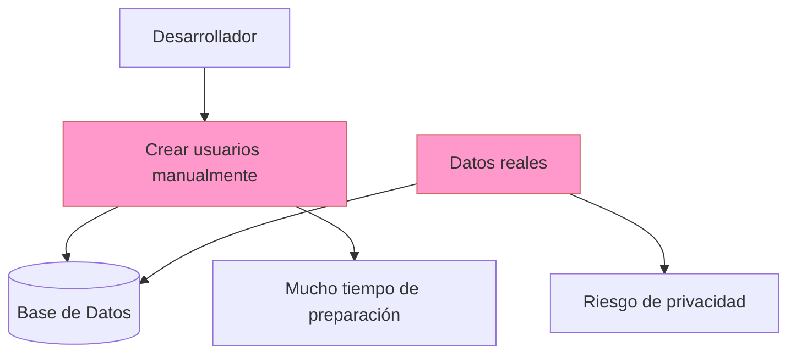

> **Recordar:** Poblar una base de datos manualmente o mediante datos reales incrementa el tiempo de preparación del entorno de pruebas y puede comprometer la privacidad de la información utilizada.

---

## 2. Solución — Generación de Datos Sintéticos

### Explicación de la solución

La **generación de datos sintéticos (Synthetic Data Generation)** propone reemplazar el uso de información real por datos creados artificialmente que mantienen la estructura, el formato y las restricciones esperadas por la aplicación.

En lugar de crear registros manualmente o reutilizar información proveniente de ambientes de producción, un generador de datos sintéticos produce automáticamente grandes volúmenes de información consistente, permitiendo poblar bases de datos de desarrollo y pruebas sin comprometer la privacidad de los usuarios.

Para esta demostración se utilizó **Faker.js**, una biblioteca para JavaScript que permite generar datos sintéticos de forma programática e integrarse directamente con aplicaciones desarrolladas en Node.js.

### ¿Cómo funciona?

1. El usuario indica la cantidad de registros que desea generar desde la interfaz web.
2. El frontend envía una solicitud HTTP al backend mediante la API REST.
3. El backend utiliza Faker.js para generar automáticamente los datos sintéticos de la entidad **USER**.
4. Los registros generados son almacenados en PostgreSQL mediante Sequelize.
5. Los mismos registros son exportados automáticamente a un archivo CSV.
6. Finalmente, el backend devuelve la información al frontend para mostrar estadísticas, la lista de archivos generados y una vista previa de los usuarios creados.

### Diagrama de la solución

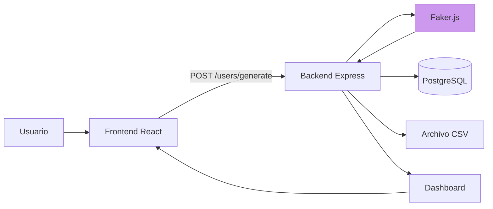

> El backend centraliza el proceso de generación de datos sintéticos utilizando Faker.js, almacenando la información en PostgreSQL y exportándola automáticamente en formato CSV antes de responder al frontend.

### Componentes clave

| Componente | Rol |
|---|---|
| Frontend (React) | Permite al usuario indicar la cantidad de registros a generar y visualizar los resultados obtenidos. |
| Backend (Express.js) | Coordina el flujo completo de generación, almacenamiento y exportación de datos sintéticos. |
| Faker.js | Biblioteca encargada de generar automáticamente información sintética para cada atributo de la entidad **USER**. |
| PostgreSQL | Almacena los registros generados para su posterior consulta y utilización durante las pruebas. |
| Exportador CSV | Genera automáticamente un archivo CSV con los registros creados para facilitar su reutilización. |

### Beneficios

- **Protección de la privacidad:** evita utilizar información proveniente de ambientes productivos.
- **Automatización:** permite generar cientos o miles de registros en pocos segundos.
- **Escalabilidad:** facilita la creación de grandes volúmenes de información para pruebas funcionales y de rendimiento.
- **Integración:** Faker.js se incorpora directamente al backend, automatizando el flujo completo de generación, almacenamiento y exportación.
- **Repetibilidad:** cada ejecución permite poblar nuevamente la base de datos de forma rápida y consistente.

### Consideraciones y limitaciones

- **Datos no reales:** aunque los registros poseen un formato válido, no representan personas existentes ni relaciones reales entre entidades.
- **Reglas de negocio complejas:** algunas restricciones específicas del dominio pueden requerir lógica adicional para generar datos consistentes.
- **Dependencia de la configuración:** la calidad de los datos generados depende de cómo se configure Faker.js y de las reglas implementadas en la aplicación.

**¿Cuándo NO utilizarlo?**

- Cuando sea indispensable trabajar con datos reales previamente anonimizados para validar escenarios específicos.
- Cuando las pruebas dependan de relaciones históricas complejas que no puedan generarse mediante reglas sintéticas.
- Cuando el objetivo sea realizar análisis estadísticos sobre información real proveniente de ambientes productivos.

---
## 3. Casos de aplicación

### Caso 1 — Desarrollo de Software

**Contexto:** durante el desarrollo de una aplicación es necesario poblar la base de datos para validar funcionalidades como autenticación, búsquedas, filtros, paginación y visualización de información. Crear estos registros manualmente consume tiempo y dificulta mantener ambientes de desarrollo consistentes.

**Solución:** utilizar un generador de datos sintéticos como **Faker.js** para crear automáticamente cientos o miles de registros con información ficticia, permitiendo poblar la base de datos de manera rápida y repetible.

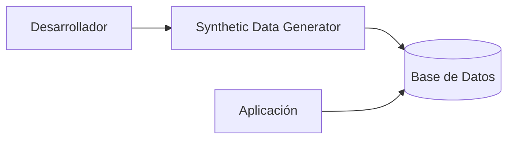

**Beneficio clave:** permite preparar ambientes de desarrollo en pocos segundos sin utilizar información proveniente de sistemas reales.

---

### Caso 2 — Pruebas Funcionales y de Rendimiento

**Contexto:** antes de publicar una aplicación es necesario validar que el sistema continúe funcionando correctamente cuando la base de datos contiene cientos o miles de registros.

**Solución:** generar automáticamente grandes volúmenes de datos sintéticos para ejecutar pruebas funcionales, pruebas de carga y validaciones de rendimiento sin necesidad de crear los registros manualmente.

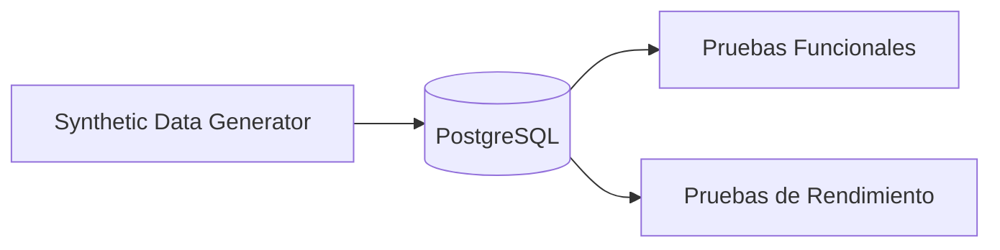

**Beneficio clave:** facilita la evaluación del comportamiento del sistema bajo diferentes volúmenes de información antes de su despliegue en producción.

---

### Caso 3 — Demostraciones y Capacitación

**Contexto:** durante una presentación o capacitación es frecuente necesitar información realista para mostrar el funcionamiento de una aplicación sin utilizar datos pertenecientes a usuarios reales.

**Solución:** generar conjuntos de datos sintéticos que simulen escenarios reales, permitiendo realizar demostraciones, capacitaciones o pruebas de aceptación sin comprometer la privacidad de la información.

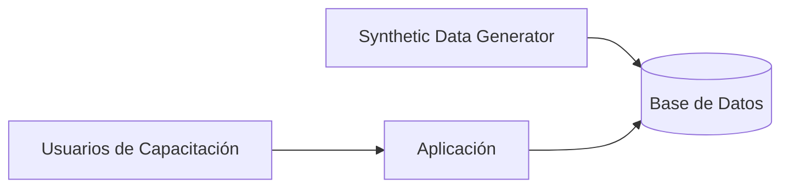

**Beneficio clave:** proporciona información consistente y segura para demostraciones académicas, pruebas de aceptación y procesos de capacitación.

---

## 4. Propuesta de implementación

### Contexto

La herramienta **Synthetic Data Generator** fue desarrollada como una solución independiente para automatizar la generación de datos sintéticos durante las fases de desarrollo y pruebas de software. Su arquitectura permite integrarla fácilmente en proyectos que requieran poblar bases de datos con información de prueba y, además, reutilizar los registros generados en un ambiente de demostración (**DriveShare Demo Environment**), permitiendo validar funcionalidades y realizar presentaciones sin utilizar información de usuarios reales.

Como escenario de aplicación se propone su utilización en el proyecto **DriveShare**, específicamente para poblar la entidad **USER**, permitiendo generar automáticamente registros sintéticos compatibles con la estructura de la base de datos.

La entidad **USER** almacena información relacionada con:

- Datos personales.
- Información de autenticación.
- Roles de usuario.
- Información de contacto.
- Documentación.
- Licencias de conducir.
- Calificaciones de reputación.

Generar manualmente esta información representa una tarea repetitiva y poco escalable, especialmente durante las fases de desarrollo, pruebas e integración.

---

### Propuesta de implementación

La propuesta consiste en utilizar el **Synthetic Data Generator** como una herramienta auxiliar para poblar automáticamente la tabla **USER** antes de ejecutar pruebas funcionales, de integración o demostraciones del sistema. Los datos generados pueden ser consumidos posteriormente por un ambiente demo que represente el funcionamiento de la aplicación sin depender de información proveniente de clientes reales.

| Componente | Responsabilidad |
|---|---|
| **Frontend** | Permite indicar la cantidad de usuarios sintéticos que se desea generar y visualizar los resultados obtenidos. |
| **Backend** | Coordina el proceso de generación de datos, almacenamiento en PostgreSQL y exportación del archivo CSV. |
| **Faker.js** | Genera automáticamente información sintética compatible con la estructura de la entidad **USER**. |
| **PostgreSQL** | Almacena los registros generados para ser utilizados durante las pruebas del sistema. |
| **CSV Export** | Genera un archivo CSV con todos los registros creados para facilitar su reutilización. |
| **DriveShare Demo Environment** | Consume los datos sintéticos almacenados en PostgreSQL para demostrar el funcionamiento de la aplicación mediante un entorno de demostración seguro. |


---

### Arquitectura propuesta

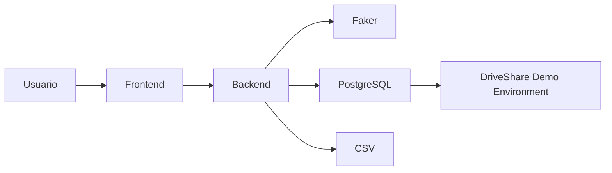

La arquitectura propuesta mantiene la generación de datos sintéticos completamente desacoplada de la aplicación principal, permitiendo reutilizar la herramienta en diferentes proyectos que requieran poblar bases de datos con información de prueba.

---

### Beneficios esperados

- Automatización del proceso de generación de datos.
- Reducción del tiempo necesario para preparar ambientes de desarrollo.
- Eliminación del uso de información real durante las pruebas.
- Integración sencilla con proyectos desarrollados en Node.js.
- Reutilización de la herramienta en diferentes aplicaciones.
- Posibilidad de poblar automáticamente un ambiente demo para demostraciones y capacitación sin utilizar información de clientes reales.

---

### Escenarios de validación

| Escenario | Qué se verifica |
|---|---|
| Generación de usuarios | Se crean automáticamente los registros sintéticos solicitados. |
| Almacenamiento en PostgreSQL | Los usuarios generados se almacenan correctamente en la tabla **USER**. |
| Exportación CSV | Se genera automáticamente un archivo CSV con los registros creados. |
| Descarga del archivo | El usuario puede descargar el CSV desde la interfaz web. |
| Reinicio del entorno | La base de datos puede limpiarse y volver a poblarse para repetir las pruebas. |
| Visualización en el ambiente demo | Los datos sintéticos almacenados son consultados correctamente por el **DriveShare Demo Environment** y se presentan mediante el Dashboard, la lista de usuarios y el perfil de usuario. |


---

# 5. Demo del Synthetic Data Generator

# 5.1. Contexto

La demostración consiste en una aplicación desarrollada para automatizar la generación de datos sintéticos de la entidad **USER**, permitiendo poblar una base de datos PostgreSQL con información ficticia compatible con el modelo utilizado en el proyecto DriveShare.

La solución integra un frontend desarrollado en React, un backend construido con Express.js y Faker.js para la generación de datos, PostgreSQL como sistema de almacenamiento y Docker Compose para desplegar todos los servicios de forma conjunta.

---

# 5.2. Objetivo de la Demo

Demostrar que el **Synthetic Data Generator** permite generar datos sintéticos que posteriormente pueden utilizarse en un ambiente de demostración (**DriveShare Demo Environment**), validando el funcionamiento del sistema sin utilizar información de usuarios reales.

- Generar automáticamente usuarios sintéticos.
- Almacenar los registros en PostgreSQL.
- Exportar automáticamente los datos a archivos CSV.
- Descargar los archivos generados desde la interfaz web.
- Reiniciar el entorno de pruebas eliminando los registros almacenados.

---

# 5.3. Flujo de Generación

El proceso de generación de datos sintéticos sigue las siguientes etapas:

1. El usuario ingresa la cantidad de registros que desea generar.
2. El frontend envía la solicitud al backend mediante la API REST.
3. Faker.js genera automáticamente los usuarios sintéticos.
4. Sequelize almacena los registros en PostgreSQL.
5. Se genera un archivo CSV con los usuarios creados.
6. El backend devuelve la respuesta al frontend mostrando estadísticas y una vista previa de los datos generados.
7. El DriveShare Demo Environment consulta la información almacenada para simular un escenario funcional utilizando únicamente datos sintéticos.

---

# 5.4. Arquitectura de la Solución

La solución está compuesta por los siguientes componentes principales, desplegados mediante **Docker Compose**.

## Frontend (Synthetic Data Generator)

Responsable de:

- Solicitar la generación de usuarios.
- Mostrar estadísticas de generación.
- Visualizar los usuarios generados.
- Descargar archivos CSV.

**Puerto del servicio:** `5173`  
**Puerto publicado:** `5173`

---

## Backend

Responsable de:

- Recibir solicitudes HTTP.
- Generar datos sintéticos mediante Faker.js.
- Almacenar información en PostgreSQL.
- Exportar archivos CSV.

**Puerto del servicio:** `3200`  
**Puerto publicado:** `3200`

---

## PostgreSQL

Responsable de almacenar los registros sintéticos generados y servir como fuente de datos para el ambiente demo.

**Puerto del servicio:** `5432`  
**Puerto publicado:** `5438`

---

## DriveShare Demo Environment

Aplicación web que consume los datos sintéticos almacenados en PostgreSQL para demostrar el funcionamiento del sistema mediante un Dashboard, una lista de usuarios y un perfil de usuario.

**Puerto del servicio:** `5174`  
**Puerto publicado:** `5174`

---

## pgAdmin

Responsable de administrar y consultar la base de datos PostgreSQL.

**Puerto del servicio:** `80`  
**Puerto publicado:** `5058`

---

# 5.5. Diagrama de Arquitectura

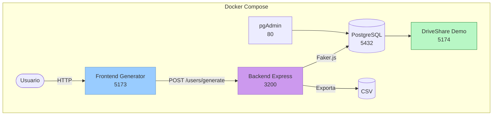

---

# 5.6. Estructura del Proyecto

```text
synthetic-data-generator/

├── frontend/
│   ├── src/
│   ├── components/
│   ├── services/
│   ├── Dockerfile
│   └── package.json
│
├── backend/
│   ├── config/
│   ├── controllers/
│   ├── generated-files/
│   ├── models/
│   ├── repositories/
│   ├── routes/
│   ├── services/
│   ├── Dockerfile
│   └── package.json
│
├── demo-app/
│   ├── src/
│   │   ├── components/
│   │   ├── pages/
│   │   ├── routes/
│   │   └── services/
│   ├── Dockerfile
│   └── package.json
│
├── docker-compose.yml
│
└── tests.http
```

---

# 5.7. Levantamiento del Entorno

## Compilando Docker y Desplegando los Servicios

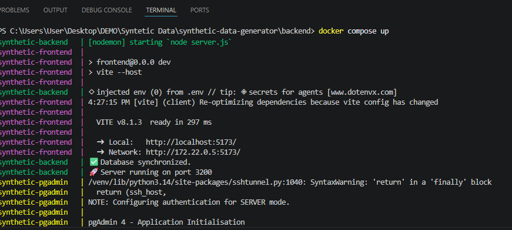

Ejecutar:

```bash
docker compose up --build
```

Resultado esperado:

- PostgreSQL iniciado correctamente.
- Backend iniciado correctamente.
- Frontend iniciado correctamente.
- pgAdmin iniciado correctamente.

---

## Contenedores en Ejecución

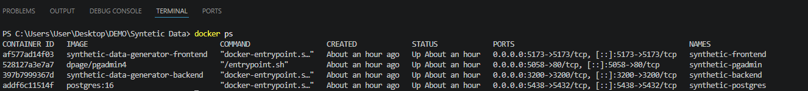

Verificar:

```bash
docker ps
```

Resultado esperado:

- synthetic-postgres
- synthetic-backend
- synthetic-frontend
- synthetic-pgadmin
-synthetic-demo-app

La salida confirma que todos los componentes fueron desplegados correctamente mediante Docker Compose y se encuentran listos para iniciar la generación de datos sintéticos.

---

# 5.8. Base de Datos

## Tabla USER

La tabla **USER** almacena los registros sintéticos generados por Faker.js.

Campos principales:

- id_user
- email
- provider
- name
- lastname
- phone
- gender
- role
- status
- nationality
- created_at

---

# 5.9. Casos de Prueba

Los siguientes escenarios permiten validar el funcionamiento del **Synthetic Data Generator** y comprobar que los datos sintéticos son generados, almacenados y exportados correctamente.

## Caso 1 — Generación de Usuarios

Solicitud:

```http
POST /api/users/generate
```

Body:

```json
{
    "amount": 100
}
```

Resultado esperado:

- Se generan 100 usuarios sintéticos.
- Los registros se almacenan en PostgreSQL.
- Se genera automáticamente un archivo CSV.
- El frontend muestra las estadísticas obtenidas.

### Evidencia

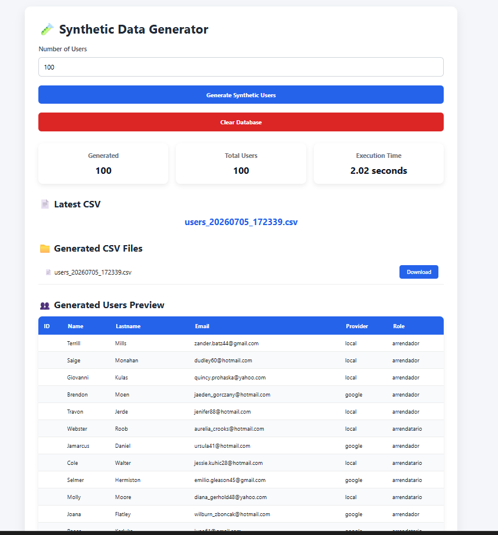

---

## Caso 2 — Verificación en PostgreSQL

Resultado esperado:

- Los registros generados se encuentran almacenados correctamente en la tabla USER.

### Evidencia

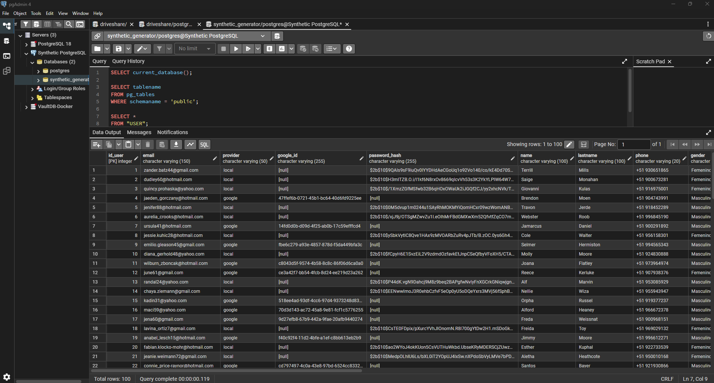

---

## Caso 3 — Descarga del Archivo CSV

Resultado esperado:

- El usuario puede descargar el archivo CSV generado desde la interfaz web.

### Evidencia

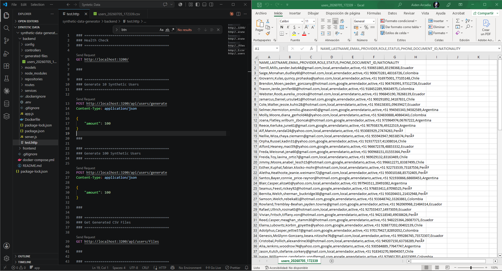

---

## Caso 4 — Reinicio de la Base de Datos

Resultado esperado:

- Todos los registros son eliminados.
- El identificador autoincremental vuelve a iniciar desde 1.

### Evidencia

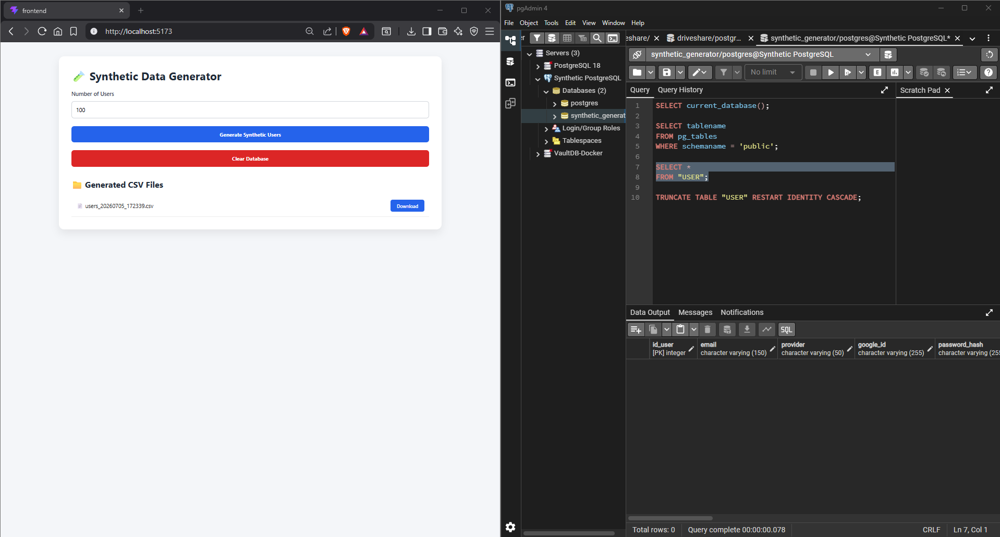

# 5.10. Ambiente Demo para DriveShare

Como complemento al **Synthetic Data Generator**, se desarrolló un **DriveShare Demo Environment**, cuya finalidad es demostrar cómo los datos sintéticos generados pueden utilizarse para poblar un entorno de demostración funcional sin emplear información perteneciente a usuarios reales.

Este ambiente consume los datos sintéticos almacenados en PostgreSQL y permite visualizar la información generada mediante una interfaz web, simulando un escenario funcional basado exclusivamente en datos sintéticos. De esta manera, desarrolladores, personal de pruebas o personal encargado de realizar demostraciones pueden presentar el sistema utilizando únicamente datos sintéticos.

---

## Flujo de funcionamiento

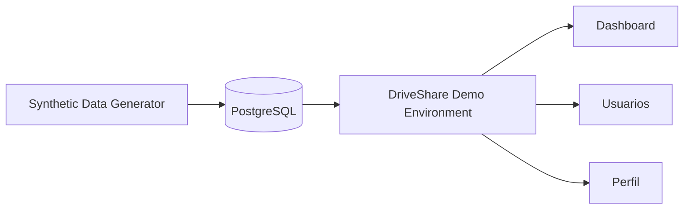

---

## Escenario de demostración

El ambiente demo permite validar el siguiente flujo:

1. Se generan usuarios sintéticos mediante el **Synthetic Data Generator**.
2. Los registros son almacenados automáticamente en PostgreSQL.
3. El **DriveShare Demo Environment** consulta la información almacenada.
4. El Dashboard muestra estadísticas calculadas a partir de los datos sintéticos.
5. El módulo de usuarios presenta la lista de registros generados.
6. Finalmente, es posible consultar el perfil individual de cada usuario.

---

## Evidencias

### Inicio de sesión del ambiente demo

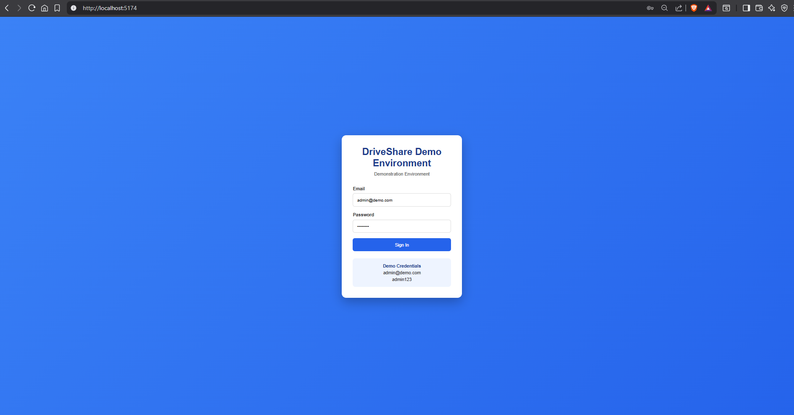

---

### Dashboard del ambiente demo

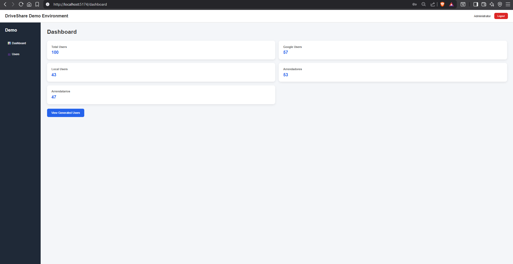

---

### Consulta de usuarios

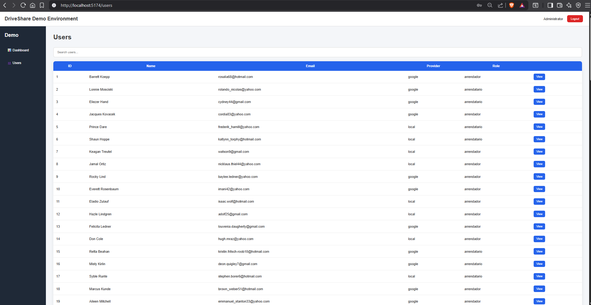

---

### Perfil de usuario

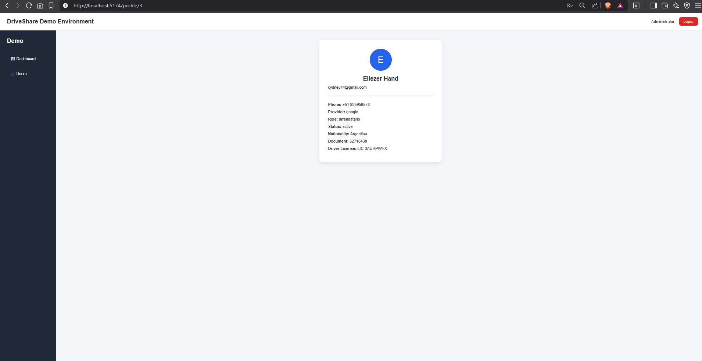

---

## Beneficios

- Permite realizar demostraciones sin utilizar información de clientes reales.
- Facilita la preparación de ambientes de capacitación y pruebas.
- Reutiliza los datos sintéticos generados previamente por el **Synthetic Data Generator**.
- Demuestra el uso práctico de los datos sintéticos dentro de una aplicación funcional.

> **Nota:** El DriveShare Demo Environment utiliza credenciales de demostración y datos sintéticos generados previamente. Su propósito es facilitar demostraciones funcionales y procesos de capacitación, sin reemplazar el mecanismo de autenticación del sistema final.

# 6. Resultados obtenidos

Durante la implementación del **Synthetic Data Generator** se logró validar el funcionamiento completo del flujo de generación y utilización de datos sintéticos dentro de un ambiente de demostración.

Los principales resultados obtenidos fueron:

- Generación automática de usuarios sintéticos utilizando Faker.js.
- Almacenamiento correcto de los registros en PostgreSQL mediante Sequelize.
- Exportación automática de los registros a archivos CSV.
- Descarga de los archivos CSV desde la interfaz web.
- Visualización de estadísticas y vista previa de los usuarios generados.
- Despliegue completo del entorno mediante Docker Compose.
- Integración de un **DriveShare Demo Environment** que consume los datos sintéticos almacenados en PostgreSQL para simular un escenario de uso real sin utilizar información de clientes.

Las pruebas realizadas demostraron que la solución permite poblar rápidamente la entidad **USER** con información sintética consistente y reutilizar dichos datos en un ambiente de demostración funcional, reduciendo significativamente el tiempo necesario para preparar escenarios de desarrollo, pruebas y capacitación.

### Evidencias

- Generación correcta de usuarios sintéticos.
- Inserción de registros en PostgreSQL.
- Exportación automática a archivos CSV.
- Descarga de archivos desde el frontend.
- Reinicio de la base de datos para nuevas pruebas.
- Visualización de la información generada en el **DriveShare Demo Environment**.

# 7. Conclusiones

- La generación de datos sintéticos constituye una alternativa segura para poblar bases de datos utilizadas en ambientes de desarrollo y pruebas, evitando el uso de información real.

- Faker.js permitió integrar la generación de datos directamente en el backend desarrollado con Express.js, automatizando completamente el proceso de creación de registros.

- La utilización de PostgreSQL y Sequelize permitió almacenar los datos sintéticos de forma estructurada, manteniendo compatibilidad con la entidad **USER** utilizada en el proyecto DriveShare.

- La exportación automática a archivos CSV facilita la reutilización de los datos generados en diferentes escenarios de prueba.

- La incorporación de un **DriveShare Demo Environment** permitió demostrar cómo los datos sintéticos pueden utilizarse para poblar un entorno funcional destinado a demostraciones, capacitación y validación del sistema sin comprometer la privacidad de los usuarios.

- Docker Compose permitió desplegar toda la solución mediante un único comando, simplificando la instalación, reproducción y demostración del entorno completo.

# **Video de demostración:**  
Enlace de video: https://youtu.be/6dAWIVaoPvs

[🏠 Home](../../../README.md) | [Siguiente ➡️](../0.9.2/0.9.2.md)