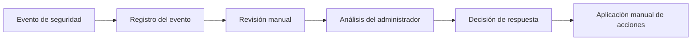
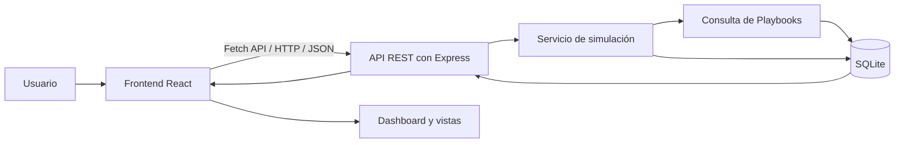
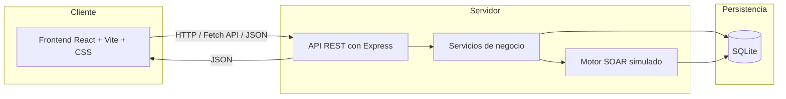
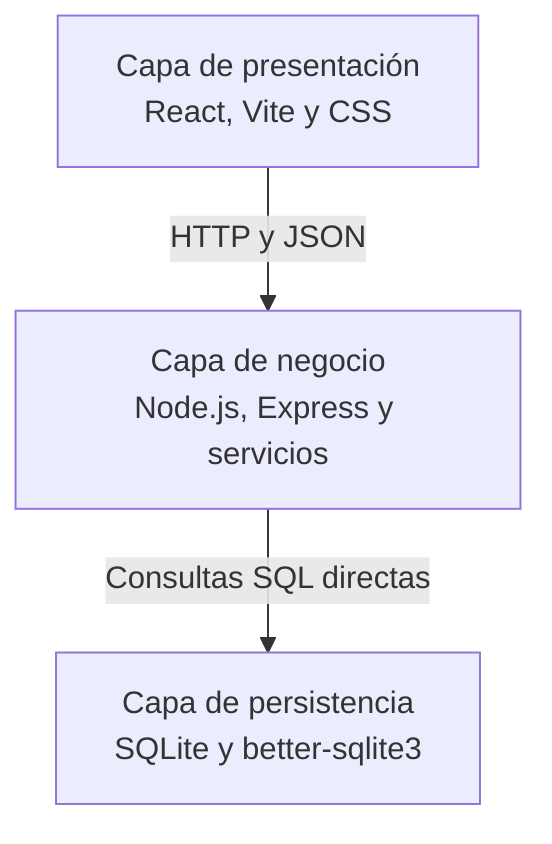
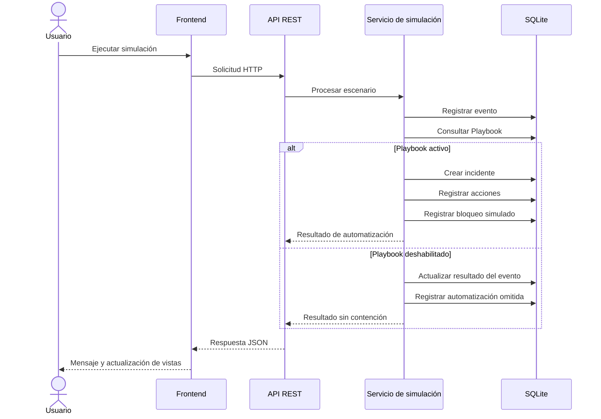
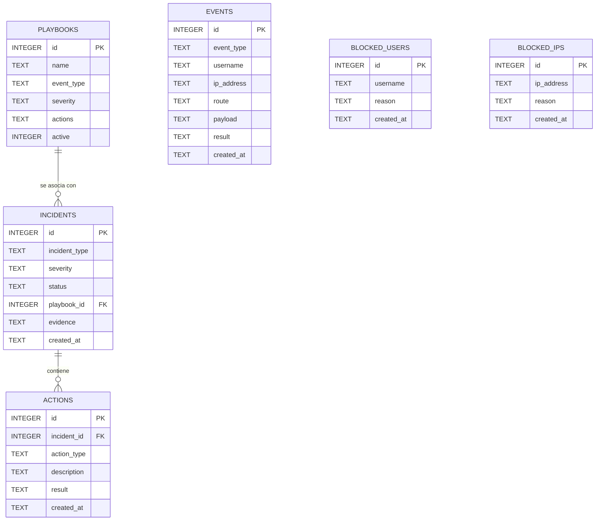

> [0. Acerca del Grupo](../../0.md) › [0.9. Temas Individuales (Parte 2)](../0.9.md) › [0.9.5. Integrante 5](0.9.5.md)

# 0.9.5. Integrante 5

# Automatización de Respuesta a Incidentes (SOAR)

## AegisSOAR

**Security Automation Platform**

# 1. Introducción

## 1.1 Descripción general

La creciente digitalización de los servicios ha incrementado la cantidad de eventos de seguridad generados por las aplicaciones web. Intentos fallidos de autenticación, accesos sospechosos, ataques de inyección SQL y otras actividades anómalas producen registros que deben ser revisados para identificar posibles incidentes.

Cuando este análisis se realiza exclusivamente de forma manual, la detección y la respuesta pueden retrasarse. Además, las tareas repetitivas aumentan la carga operativa y la posibilidad de aplicar respuestas inconsistentes frente a eventos similares.

Las plataformas **Security Orchestration, Automation and Response (SOAR)** permiten organizar y automatizar parte de este proceso mediante reglas previamente definidas, conocidas como **Playbooks**. Estas reglas determinan qué acciones deben ejecutarse cuando se detecta un evento o patrón específico.

Con el propósito de demostrar este enfoque, se desarrolló **AegisSOAR**, un prototipo web académico que simula el funcionamiento básico de una plataforma SOAR. La aplicación permite generar eventos de seguridad simulados, consultar Playbooks configurables, crear incidentes, registrar acciones de contención y visualizar los resultados desde un Dashboard centralizado.

Todas las acciones realizadas por AegisSOAR son demostrativas. El sistema no se conecta con firewalls, herramientas SIEM, Active Directory ni otros servicios externos.

---

## 1.2 Objetivo del proyecto

Diseñar e implementar un prototipo web que simule el funcionamiento de una plataforma SOAR mediante la automatización de respuestas frente a eventos de seguridad, permitiendo demostrar el uso de Playbooks, la creación de incidentes, el registro de acciones y la visualización centralizada de resultados.

---

## 1.3 Alcance

AegisSOAR incluye las siguientes funcionalidades:

- Login simulado.
- Dashboard centralizado.
- Simulador de incidentes.
- Registro de eventos.
- Creación automática de incidentes.
- Ejecución simulada de Playbooks.
- Activación y desactivación de Playbooks.
- Registro de usuarios bloqueados.
- Registro de direcciones IP bloqueadas.
- Historial auditable de acciones.
- Distribución de incidentes por severidad.
- Reinicio de los datos de demostración mediante un endpoint.

Para mantener el proyecto dentro de un alcance académico, se implementaron tres escenarios:

- Ataque de fuerza bruta.
- Intento de SQL Injection.
- SQL Injection con el Playbook deshabilitado.

La plataforma no ejecuta bloqueos reales ni interactúa con infraestructura externa. Los eventos, incidentes y acciones se almacenan localmente en una base de datos SQLite.

---

## 1.4 Tecnologías utilizadas

| Tecnología | Uso |
|------------|-----|
| React | Construcción de la interfaz de usuario. |
| Vite | Entorno de desarrollo y construcción del frontend. |
| JavaScript | Lógica del frontend y del backend. |
| CSS | Diseño visual y adaptación de la interfaz. |
| Fetch API | Comunicación HTTP desde el frontend. |
| Node.js | Entorno de ejecución del backend. |
| Express | Implementación de la API REST. |
| CORS | Habilitación de la comunicación entre frontend y backend. |
| better-sqlite3 | Acceso directo a la base de datos. |
| SQLite | Persistencia local de eventos, incidentes, Playbooks y acciones. |

La solución no utiliza TypeScript, Tailwind CSS, PostgreSQL, Docker, microservicios, WebSockets, JWT, ORM ni APIs externas.

---

# 2. Problema

## 2.1 Contexto

Las aplicaciones web generan continuamente eventos relacionados con la autenticación, el acceso a recursos y la ejecución de operaciones. Estos eventos pueden almacenarse en archivos de log o bases de datos y constituyen una fuente importante de información para identificar comportamientos sospechosos.

En un proceso manual, un administrador debe revisar los registros, interpretar lo ocurrido y decidir qué acciones realizar. Cuando existen muchos eventos, este procedimiento puede ser lento y propenso a errores.

---

## 2.2 Problema identificado

La dependencia de una supervisión manual presenta las siguientes limitaciones:

- Retrasos en la detección de incidentes.
- Mayor carga de trabajo para los responsables de seguridad.
- Riesgo de errores humanos durante el análisis.
- Respuestas diferentes ante incidentes similares.
- Ausencia de mecanismos automáticos de contención.
- Dificultad para mantener un historial centralizado de las acciones realizadas.

Por ejemplo, ante varios intentos fallidos de autenticación sobre una misma cuenta, un sistema tradicional puede limitarse a registrar cada evento. La respuesta se produce únicamente cuando una persona revisa los registros y decide bloquear al usuario o a la dirección IP.

---

## 2.3 Flujo manual del problema



En este enfoque, el tiempo de respuesta depende de la disponibilidad y del criterio de la persona encargada del análisis.

---

## 2.4 Necesidad de automatización

Para reducir el tiempo de reacción es útil contar con un mecanismo que procese eventos, consulte reglas previamente configuradas y registre acciones de manera consistente.

Una plataforma SOAR permite representar este comportamiento mediante Playbooks. Cada Playbook asocia un tipo de evento con una severidad y un conjunto de acciones. En AegisSOAR, dichas acciones se simulan y se almacenan localmente para fines académicos.

---

## 2.5 Objetivo de la solución

La solución propuesta debe ser capaz de:

- Recibir eventos generados desde el simulador.
- Identificar el tipo de evento.
- Consultar el Playbook correspondiente.
- Verificar si el Playbook está activo.
- Crear incidentes cuando corresponda.
- Registrar acciones simuladas de contención.
- Mantener un historial auditable.
- Mostrar información consolidada desde un Dashboard.

---

## 2.6 Escenarios considerados

| Escenario | Objetivo |
|-----------|----------|
| Fuerza bruta | Generar cinco intentos fallidos y ejecutar una respuesta simulada mediante el Playbook correspondiente. |
| SQL Injection | Simular una solicitud maliciosa y registrar un incidente crítico con evidencia. |
| Playbook deshabilitado | Verificar que el evento sea registrado sin generar incidente ni ejecutar contención. |

Estos escenarios permiten demostrar el flujo principal de automatización sin requerir integraciones externas.

---

# 3. Solución propuesta

## 3.1 Descripción de la solución

**AegisSOAR** es una aplicación web académica que simula una plataforma de automatización de respuesta a incidentes. El usuario puede iniciar sesión mediante un control de acceso demostrativo, revisar el Dashboard, ejecutar simulaciones, consultar eventos e incidentes, administrar Playbooks y revisar usuarios o direcciones IP bloqueadas.

El backend procesa cada simulación mediante un servicio interno que representa el motor SOAR. Este servicio registra los eventos, consulta los Playbooks almacenados en SQLite y ejecuta las acciones simuladas definidas para cada escenario.

---

## 3.2 Flujo general de AegisSOAR



El flujo comienza cuando el usuario ejecuta una simulación. El frontend envía una solicitud HTTP al backend, el servicio de simulación procesa el evento, consulta el Playbook correspondiente y registra los resultados en SQLite. Finalmente, el frontend actualiza la información mostrada.

---

## 3.3 Componentes de la plataforma

| Componente | Responsabilidad |
|------------|-----------------|
| **Frontend** | Presentar las vistas, capturar acciones del usuario y consumir la API REST. |
| **API REST** | Recibir solicitudes, validar datos y devolver respuestas en formato JSON. |
| **Servicio de simulación** | Representar el motor SOAR, analizar eventos y ejecutar acciones simuladas. |
| **Gestión de Playbooks** | Consultar, activar y desactivar reglas de automatización. |
| **SQLite** | Almacenar eventos, incidentes, Playbooks, acciones y entidades bloqueadas. |
| **Dashboard** | Consolidar estadísticas y registros recientes. |

Todos estos elementos forman parte de una única aplicación cliente-servidor. No se implementan microservicios ni despliegues independientes.

---

## 3.4 Funcionamiento del motor SOAR simulado

El motor SOAR está representado por un servicio interno del backend. Su funcionamiento general es el siguiente:

1. Recibe la solicitud de simulación.
2. Genera y registra el evento correspondiente.
3. Identifica el tipo de evento.
4. Consulta el Playbook asociado en SQLite.
5. Comprueba si el Playbook está activo.
6. Crea un incidente cuando corresponde.
7. Registra las acciones simuladas.
8. Actualiza usuarios o direcciones IP bloqueadas.
9. Devuelve el resultado al frontend.

Si el Playbook se encuentra deshabilitado, el evento se almacena, pero no se crea un incidente ni se ejecutan acciones de contención.

---

## 3.5 Escenarios implementados

| Escenario | Evento | Respuesta simulada |
|-----------|--------|--------------------|
| **Fuerza bruta** | `LOGIN_FAILED` | Después del quinto intento crea un incidente `HIGH`, bloquea al usuario y a la IP, y registra las acciones. |
| **SQL Injection** | `SQL_INJECTION` | Crea un incidente `CRITICAL`, bloquea la IP y registra evidencia y acciones. |
| **Playbook deshabilitado** | `SQL_INJECTION` | Registra el evento con el resultado “Playbook deshabilitado” y omite la automatización. |

---

## 3.6 Beneficios de la solución

- Centraliza la información sobre eventos e incidentes.
- Reduce la cantidad de pasos manuales en escenarios repetitivos.
- Aplica reglas consistentes mediante Playbooks.
- Mantiene trazabilidad sobre las acciones simuladas.
- Permite activar o desactivar automatizaciones desde la interfaz.
- Facilita la incorporación futura de nuevos escenarios dentro del mismo backend.

---

## 3.7 Limitaciones

AegisSOAR es un prototipo académico. Por esta razón:

- No procesa tráfico real.
- No recibe eventos desde un SIEM.
- No se conecta con firewalls.
- No bloquea cuentas o direcciones IP fuera de la aplicación.
- No implementa autenticación empresarial.
- No utiliza analítica avanzada ni inteligencia artificial.
- No sustituye a una plataforma SOAR comercial.

---

# 4. Arquitectura del sistema

## 4.1 Visión general

AegisSOAR utiliza una arquitectura cliente-servidor organizada en tres capas: presentación, negocio y persistencia.

El frontend está implementado con React y se comunica con el backend mediante solicitudes HTTP utilizando Fetch API. El backend, desarrollado con Node.js y Express, expone una API REST y contiene la lógica de procesamiento. La persistencia se implementa con SQLite y consultas SQL directas mediante better-sqlite3.

---

## 4.2 Arquitectura cliente-servidor



El frontend no accede directamente a la base de datos. Toda operación se realiza a través de la API REST.

---

## 4.3 Arquitectura de tres capas



### Capa de presentación

Responsabilidades:

- Mostrar el login simulado.
- Presentar el Dashboard.
- Ejecutar simulaciones.
- Mostrar eventos e incidentes.
- Administrar Playbooks.
- Consultar usuarios e IP bloqueadas.
- Mostrar el historial de acciones.
- Gestionar estados de carga y mensajes visuales.

### Capa de negocio

Responsabilidades:

- Exponer la API REST.
- Validar las solicitudes.
- Procesar los escenarios simulados.
- Consultar los Playbooks.
- Crear incidentes.
- Registrar acciones de contención.
- Generar las estadísticas del Dashboard.
- Gestionar el reinicio de los datos de demostración.

### Capa de persistencia

Responsabilidades:

- Almacenar eventos.
- Almacenar incidentes.
- Mantener los Playbooks.
- Registrar acciones.
- Almacenar usuarios bloqueados.
- Almacenar direcciones IP bloqueadas.
- Evitar duplicados en las tablas de bloqueados.

---

## 4.4 Secuencia de procesamiento de un evento



---

## 4.5 Decisiones arquitectónicas

### Separación por capas

La interfaz, la lógica de negocio y la persistencia se organizan en secciones diferentes. Esto reduce la mezcla de responsabilidades y facilita localizar los cambios.

### API REST como interfaz de comunicación

El frontend utiliza exclusivamente endpoints HTTP. Esta decisión evita el acceso directo a SQLite desde la interfaz y centraliza las reglas de negocio en el backend.

### Motor SOAR como servicio interno

La lógica de automatización se concentra en un servicio del backend. No se trata de un microservicio independiente, sino de un módulo encargado de procesar eventos, consultar Playbooks y registrar resultados.

### Persistencia local con SQLite

SQLite permite mantener la solución pequeña y fácil de ejecutar. better-sqlite3 ofrece acceso directo mediante consultas SQL sin incorporar un ORM.

### Playbooks configurables

Los Playbooks se almacenan en la base de datos y pueden activarse o desactivarse desde la interfaz. De esta manera, la respuesta a un evento depende de una configuración persistente y no únicamente de valores escritos directamente en la interfaz.

### Control de acceso demostrativo

El login utiliza las credenciales `admin` y `admin123`. Cuando son correctas, se guarda un indicador sencillo en `localStorage`. Este mecanismo se utiliza exclusivamente para la demostración y no representa un sistema de autenticación seguro.

---

## 4.6 Atributos de calidad considerados

| Atributo | Soporte en AegisSOAR |
|----------|----------------------|
| **Modificabilidad** | La separación entre páginas, rutas, servicios y acceso a datos facilita agregar nuevos escenarios o vistas. |
| **Mantenibilidad** | La organización en tres capas permite localizar la lógica correspondiente a cada responsabilidad. |
| **Usabilidad** | La interfaz incluye navegación lateral, tarjetas, tablas, mensajes y estados de carga. |
| **Trazabilidad** | Los eventos, incidentes y acciones quedan registrados en SQLite. |
| **Interoperabilidad** | El frontend y el backend intercambian información mediante HTTP y JSON. |
| **Seguridad demostrativa** | El sistema representa respuestas ante eventos, aunque no implementa controles empresariales ni bloqueos reales. |

No se afirma que la aplicación sea escalable de forma independiente, debido a que todos los componentes pertenecen a una misma solución cliente-servidor.

---

# 5. Diseño e implementación

## 5.1 Organización del proyecto

```text
aegis-soar/
├── frontend/
│   ├── src/
│   │   ├── components/
│   │   ├── pages/
│   │   ├── services/
│   │   ├── App.jsx
│   │   ├── main.jsx
│   │   └── styles.css
│   ├── index.html
│   ├── package.json
│   └── vite.config.js
├── backend/
│   ├── src/
│   │   ├── config/
│   │   ├── database/
│   │   ├── routes/
│   │   ├── services/
│   │   ├── app.js
│   │   └── server.js
│   ├── .env.example
│   └── package.json
├── .gitignore
└── README.md
```

La estructura separa el frontend del backend. Dentro de cada sección se organizan las vistas, los componentes, los servicios y la configuración necesarios para mantener el código comprensible.

---

## 5.2 Diseño del frontend

El frontend fue desarrollado con React, Vite, JavaScript y CSS.

Las principales vistas son:

| Vista | Función |
|-------|---------|
| **Login** | Validar las credenciales demostrativas y guardar el acceso en `localStorage`. |
| **Dashboard** | Mostrar estadísticas, registros recientes y distribución por severidad. |
| **Simulador** | Ejecutar los tres escenarios implementados. |
| **Eventos** | Consultar todos los eventos registrados. |
| **Incidentes** | Consultar los incidentes generados. |
| **Playbooks** | Visualizar y cambiar el estado activo de los Playbooks. |
| **Bloqueados** | Mostrar usuarios y direcciones IP bloqueadas de forma simulada. |
| **Historial** | Mostrar las acciones registradas por el motor SOAR. |

La interfaz presenta un tema oscuro inspirado en un centro de operaciones de seguridad. Utiliza barra lateral, encabezado, tarjetas, tablas, etiquetas de severidad, botones y mensajes de estado.

La distribución de incidentes por severidad se representa con barras horizontales creadas con HTML y CSS, sin librerías externas de gráficos.

---

## 5.3 Diseño del backend

El backend utiliza Node.js, Express, JavaScript y CORS.

| Elemento | Responsabilidad |
|----------|-----------------|
| **Config** | Gestionar variables y valores de configuración. |
| **Database** | Crear la base de datos, las tablas y las consultas SQL. |
| **Routes** | Definir los endpoints de la API REST. |
| **Services** | Implementar simulaciones, Playbooks y estadísticas. |
| **app.js** | Configurar Express, CORS, JSON y rutas. |
| **server.js** | Iniciar el servidor HTTP. |

El servicio de simulación concentra la lógica asociada con fuerza bruta, SQL Injection y Playbook deshabilitado.

---

## 5.4 Modelo de datos

La base de datos contiene seis tablas principales:

- `events`
- `incidents`
- `playbooks`
- `actions`
- `blocked_users`
- `blocked_ips`



Los eventos pueden originar conceptualmente incidentes, pero la implementación no requiere una clave foránea directa entre `events` e `incidents`.

### Descripción de las tablas

| Tabla | Información almacenada |
|-------|------------------------|
| `events` | Tipo, usuario, IP, ruta, payload, resultado y fecha. |
| `incidents` | Tipo, severidad, estado, Playbook, evidencia y fecha. |
| `playbooks` | Nombre, evento, severidad, acciones y estado activo. |
| `actions` | Incidente, tipo de acción, descripción, resultado y fecha. |
| `blocked_users` | Usuario, motivo y fecha. |
| `blocked_ips` | Dirección IP, motivo y fecha. |

No existe una tabla general de usuarios. El valor del usuario involucrado se almacena directamente en los eventos y en la tabla de bloqueados.

---

## 5.5 Playbooks iniciales

### Brute Force Protection

| Campo | Valor |
|-------|-------|
| Evento | `LOGIN_FAILED` |
| Severidad | `HIGH` |
| Estado inicial | Activo |
| Acciones | Bloquear usuario, bloquear IP y crear incidente. |

### SQL Injection Response

| Campo | Valor |
|-------|-------|
| Evento | `SQL_INJECTION` |
| Severidad | `CRITICAL` |
| Estado inicial | Activo |
| Acciones | Bloquear IP, crear incidente y registrar evidencia. |

Ambos Playbooks se almacenan en SQLite y pueden activarse o desactivarse desde la interfaz.

---

## 5.6 API REST

| Método | Endpoint | Descripción |
|--------|----------|-------------|
| `GET` | `/api/dashboard` | Obtiene estadísticas y registros recientes. |
| `GET` | `/api/events` | Obtiene todos los eventos. |
| `POST` | `/api/events/brute-force` | Ejecuta la simulación de fuerza bruta. |
| `POST` | `/api/events/sql-injection` | Ejecuta la simulación de SQL Injection. |
| `POST` | `/api/events/sql-injection-disabled` | Ejecuta SQL Injection con el Playbook deshabilitado. |
| `GET` | `/api/incidents` | Obtiene los incidentes. |
| `GET` | `/api/playbooks` | Obtiene los Playbooks. |
| `PATCH` | `/api/playbooks/:id/toggle` | Activa o desactiva un Playbook. |
| `GET` | `/api/blocked-users` | Obtiene los usuarios bloqueados. |
| `GET` | `/api/blocked-ips` | Obtiene las direcciones IP bloqueadas. |
| `GET` | `/api/actions` | Obtiene el historial de acciones. |
| `DELETE` | `/api/demo/reset` | Limpia los datos de demostración y reactiva los Playbooks. |

Las solicitudes y respuestas utilizan JSON.

---

## 5.7 Reglas de negocio

### Fuerza bruta

La simulación genera cinco eventos `LOGIN_FAILED` asociados con:

- Usuario: `demo.user`
- Dirección IP: `192.168.1.50`

Después del quinto evento, el servicio consulta el Playbook **Brute Force Protection**.

Si está activo:

- Crea un único incidente `HIGH`.
- Asigna el estado `CONTAINED`.
- Registra el bloqueo simulado del usuario.
- Registra el bloqueo simulado de la dirección IP.
- Registra las acciones ejecutadas.
- Evita duplicar el usuario y la IP en las tablas de bloqueados.

### SQL Injection

La simulación genera un evento `SQL_INJECTION` con:

- Dirección IP: `10.0.0.25`
- Ruta: `/api/users`
- Payload: `' OR 1=1 --`

Si el Playbook **SQL Injection Response** está activo:

- Crea un incidente `CRITICAL`.
- Asigna el estado `CONTAINED`.
- Bloquea la dirección IP de forma simulada.
- Registra como evidencia la ruta, el payload y la IP.
- Registra las acciones ejecutadas.

### Playbook deshabilitado

La simulación:

1. Desactiva el Playbook **SQL Injection Response**.
2. Genera un evento `SQL_INJECTION`.
3. Registra el resultado “Playbook deshabilitado”.
4. No crea un incidente.
5. No bloquea la dirección IP.
6. Registra que la automatización fue omitida.

---

## 5.8 Dashboard

El Dashboard muestra:

- Total de eventos.
- Total de incidentes.
- Playbooks ejecutados.
- Usuarios bloqueados.
- Direcciones IP bloqueadas.
- Incidentes críticos.
- Eventos recientes.
- Incidentes recientes.
- Distribución por severidad: `LOW`, `MEDIUM`, `HIGH` y `CRITICAL`.

La información se obtiene mediante `GET /api/dashboard`.

---

## 5.9 Consideraciones de implementación

Durante el desarrollo se consideraron las siguientes prácticas:

- Separación entre frontend, backend y persistencia.
- Componentes reutilizables en React.
- Uso de Fetch API para las solicitudes HTTP.
- Consultas SQL directas sin ORM.
- Manejo básico de errores en la API.
- Estados de carga en la interfaz.
- Mensajes de éxito, advertencia y error.
- Prevención de duplicados en usuarios e IP bloqueadas.
- Persistencia del estado de los Playbooks.
- Endpoint de reinicio para repetir la demostración.

---

# 6. Demostración

## 6.1 Objetivo de la demostración

La demostración tiene como propósito mostrar el flujo completo de AegisSOAR, desde la generación de un evento hasta el registro del incidente y de las acciones simuladas.

No se plantean pruebas exhaustivas de seguridad ni rendimiento. La demostración se centra en verificar visualmente que las funcionalidades principales se comportan de acuerdo con las reglas definidas.

---

## 6.2 Login simulado

El acceso se realiza con las siguientes credenciales:

- Usuario: `admin`
- Contraseña: `admin123`

Cuando las credenciales son correctas, se guarda un indicador en `localStorage` y se muestra el Dashboard.

> **Figura 6.1. Pantalla de login de AegisSOAR**


---

## 6.3 Dashboard principal

El Dashboard presenta las tarjetas de estadísticas, los eventos recientes, los incidentes recientes y la distribución por severidad.

> **Figura 6.2. Dashboard principal**


---

## 6.4 Simulador de incidentes

La vista del simulador contiene tres opciones:

- Simular fuerza bruta.
- Simular SQL Injection.
- Simular SQL Injection con Playbook deshabilitado.

Cada botón muestra un estado de carga durante el procesamiento y un mensaje con el resultado.

> **Figura 6.3. Simulador de incidentes**


---

## 6.5 Escenario 1: Fuerza bruta

Al ejecutar la simulación se generan cinco eventos `LOGIN_FAILED` para `demo.user` desde `192.168.1.50`.

Con el Playbook activo, el resultado observable es:

- Creación de un incidente `HIGH`.
- Estado del incidente: `CONTAINED`.
- Registro del usuario bloqueado.
- Registro de la IP bloqueada.
- Registro de las acciones ejecutadas.
- Actualización de las estadísticas.

> **Figura 6.4. Mensaje de resultado de fuerza bruta**


> **Figura 6.5. Usuario e IP bloqueados**


---

## 6.6 Escenario 2: SQL Injection

La simulación genera un evento con la ruta `/api/users`, el payload `' OR 1=1 --` y la dirección IP `10.0.0.25`.

Con el Playbook activo, el resultado observable es:

- Creación de un incidente `CRITICAL`.
- Estado del incidente: `CONTAINED`.
- Registro del bloqueo simulado de la IP.
- Registro de evidencia.
- Registro de las acciones ejecutadas.

> **Figura 6.6. Mensaje de resultado de SQL Injection**


> **Figura 6.7. Incidente crítico registrado**


---

## 6.7 Escenario 3: Playbook deshabilitado

El escenario desactiva **SQL Injection Response** y genera un nuevo evento `SQL_INJECTION`.

El resultado observable es:

- El evento queda registrado.
- El resultado indica “Playbook deshabilitado”.
- No se crea un incidente.
- No se bloquea la dirección IP.
- Se registra que la automatización fue omitida.

> **Figura 6.8. Playbook SQL Injection Response deshabilitado**


> **Figura 6.9. Evento registrado sin automatización**


---

## 6.8 Historial de acciones

La vista de historial permite consultar las acciones registradas por los escenarios ejecutados, incluyendo el tipo de acción, su descripción, el resultado y la fecha.

> **Figura 6.10. Historial auditable de acciones**


---

## 6.9 Resumen de la demostración

| Escenario | Resultado observable |
|-----------|----------------------|
| Fuerza bruta | Cinco eventos, un incidente `HIGH`, usuario e IP bloqueados de forma simulada. |
| SQL Injection | Un evento, un incidente `CRITICAL`, evidencia y bloqueo simulado de IP. |
| Playbook deshabilitado | Evento registrado sin incidente ni bloqueo. |

---

# 7. Resultados

AegisSOAR permite observar el funcionamiento de un flujo SOAR simplificado dentro de un entorno académico.

Durante la demostración pueden verificarse los siguientes resultados:

- Los eventos generados se almacenan en SQLite.
- Los Playbooks determinan si se ejecuta una automatización.
- La fuerza bruta genera un único incidente después del quinto intento.
- SQL Injection registra un incidente crítico y evidencia.
- Los incidentes creados quedan en estado `CONTAINED`.
- Los bloqueos de usuarios e IP se registran únicamente dentro de la aplicación.
- La interfaz permite activar o desactivar Playbooks.
- El historial conserva las acciones realizadas.
- El Dashboard consolida la información registrada.
- El endpoint de reinicio permite limpiar la demostración y reactivar los Playbooks.

| Escenario | Estado esperado | Resultado |
|-----------|:---------------:|-----------|
| Fuerza bruta | Correcto | Se registra un incidente `HIGH`, un usuario bloqueado y una IP bloqueada. |
| SQL Injection | Correcto | Se registra un incidente `CRITICAL`, evidencia y una IP bloqueada. |
| Playbook deshabilitado | Correcto | Se registra el evento y se omite la automatización. |

Estos resultados deben entenderse como observables durante la demostración funcional del prototipo. No representan una evaluación formal de rendimiento, penetración o seguridad empresarial.

---

# 8. Conclusiones

1. AegisSOAR permitió representar, de forma académica, el flujo básico de una plataforma SOAR mediante eventos, Playbooks, incidentes y acciones de contención simuladas.

2. La arquitectura cliente-servidor organizada en tres capas separa la interfaz, la lógica de negocio y la persistencia, lo que mejora la claridad y mantenibilidad del proyecto.

3. El uso de una API REST permite que el frontend consuma las funcionalidades del backend sin acceder directamente a la base de datos.

4. Los Playbooks almacenados en SQLite permiten modificar el comportamiento de la automatización desde la interfaz, como se demuestra en el escenario de Playbook deshabilitado.

5. El historial de eventos, incidentes y acciones proporciona trazabilidad sobre el comportamiento del prototipo y facilita su explicación durante la demostración.

6. SQLite y better-sqlite3 resultan adecuados para el alcance del proyecto porque permiten mantener una persistencia local sencilla, sin requerir un servidor de base de datos ni un ORM.

7. Los bloqueos representados por la aplicación son únicamente simulados. Por lo tanto, el prototipo no debe interpretarse como una solución de seguridad lista para entornos reales.

8. Como trabajo futuro, podrían incorporarse nuevos tipos de eventos, más Playbooks y mecanismos de autenticación adecuados, manteniendo la misma separación de responsabilidades.

---

[⬅️ Anterior](../0.9.4/0.9.4.md) | [🏠 Home](../../../README.md) | [Siguiente ➡️](../0.9.6/0.9.6.md)
