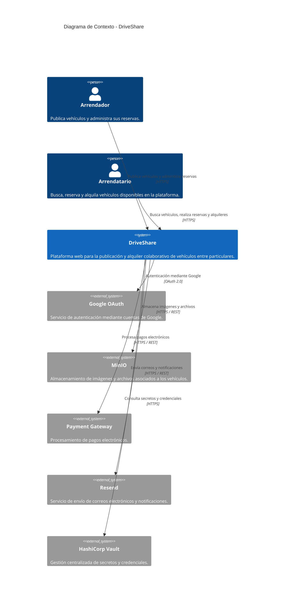

> [10. Vistas de Arquitectura (Diagramas C4) - Versión Final](../10.md) › [10.1. Diagrama de Contexto](10.1.md)

# 10.1. Diagrama de Contexto — Versión Final

El diagrama de contexto corresponde al **Nivel 1 del Modelo C4**. Presenta **DriveShare** como un único sistema de software e identifica los actores que interactúan con la plataforma, así como los sistemas externos necesarios para brindar los servicios de autenticación, almacenamiento de archivos, procesamiento de pagos, envío de correos electrónicos y gestión segura de credenciales. Esta versión final representa la arquitectura propuesta para el prototipo funcional desarrollado durante el curso y mantiene coherencia con las decisiones arquitectónicas adoptadas durante el proceso de diseño.

## Diferencias respecto al bosquejo inicial

| Aspecto | Bosquejo inicial | Versión final |
|----------|------------------|---------------|
| Descripción del sistema | Presentación general de la plataforma | Incluye el alcance del prototipo funcional y los servicios externos utilizados por la arquitectura. |
| Actores | Identificación preliminar de usuarios | Se definen los roles de Arrendador y Arrendatario como únicos actores externos del sistema. |
| Sistemas externos | Definición conceptual | Se incorporan los servicios de autenticación, almacenamiento, pagos, correo electrónico y gestión de secretos. |
| Relaciones | Comunicación general | Se especifican las interacciones entre DriveShare y cada servicio externo utilizado por la plataforma. |

## Actores y sistemas externos

| Elemento | Tipo | Descripción |
|----------|------|-------------|
| Arrendador | Usuario (Persona) | Propietario de uno o más vehículos registrados en la plataforma. Puede publicar vehículos, administrar su disponibilidad y gestionar las reservas recibidas. |
| Arrendatario | Usuario (Persona) | Usuario que consulta vehículos disponibles, realiza reservas y gestiona el proceso de alquiler mediante la plataforma. |
| Google OAuth | Sistema Externo | Servicio utilizado para la autenticación mediante cuentas de Google como mecanismo alternativo de inicio de sesión. |
| MinIO | Sistema Externo | Servicio encargado del almacenamiento de imágenes y archivos asociados a los vehículos publicados. |
| Payment Gateway | Sistema Externo | Servicio responsable del procesamiento de pagos electrónicos realizados durante el alquiler de vehículos. |
| Resend | Sistema Externo | Servicio utilizado para el envío de correos electrónicos y notificaciones a los usuarios de la plataforma. |
| HashiCorp Vault | Sistema Externo | Servicio destinado a la gestión centralizada de secretos, credenciales y claves utilizadas por la aplicación. |

> **Alcance del prototipo:** La primera versión de DriveShare corresponde a una **aplicación web**, cuyo objetivo es demostrar la arquitectura propuesta y validar el flujo principal de interacción entre los usuarios y la plataforma. En esta versión únicamente participan los actores **Arrendador** y **Arrendatario**.

## Diagrama

## Relaciones

| De | Hacia | Descripción | Tecnología |
|----|-------|-------------|------------|
| Arrendador | DriveShare | Publica vehículos, administra su disponibilidad y gestiona las reservas recibidas. | HTTPS |
| Arrendatario | DriveShare | Consulta vehículos, realiza reservas y gestiona el proceso de alquiler. | HTTPS |
| DriveShare | Google OAuth | Permite la autenticación mediante cuentas de Google. | OAuth 2.0 |
| DriveShare | MinIO | Almacena imágenes y archivos asociados a los vehículos. | HTTPS / REST |
| DriveShare | Payment Gateway | Procesa los pagos electrónicos generados durante el alquiler. | HTTPS / REST |
| DriveShare | Resend | Envía correos electrónicos y notificaciones relacionadas con el uso de la plataforma. | HTTPS / REST |
| DriveShare | HashiCorp Vault | Obtiene secretos y credenciales utilizados por la aplicación. | HTTPS |

## Restricciones reflejadas en este diagrama

| Restricción | Reflejo en el contexto |
|-------------|------------------------|
| Aplicación Web | El acceso al sistema se realiza exclusivamente mediante un navegador web. |
| Arquitectura basada en API REST | Toda comunicación con los servicios externos se realiza a través de la API de DriveShare. |
| Autenticación segura | La autenticación se realiza mediante JWT y Google OAuth como mecanismo alternativo. |
| Gestión centralizada de secretos | Las credenciales y claves de la aplicación son administradas mediante HashiCorp Vault. |
| Almacenamiento externo de archivos | Las imágenes de los vehículos se almacenan en MinIO para desacoplar el almacenamiento del servidor de aplicaciones. |

---

[🏠 Home](../../README.md) | [Siguiente ➡️](../10.2/10.2.md)