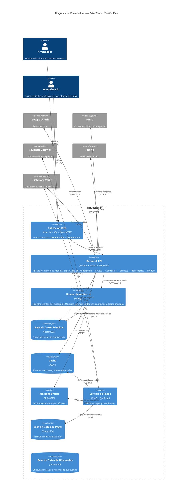

> [10. Vistas de Arquitectura (Diagramas C4) - Versión Final](../10.md) › [10.2. Diagrama de Contenedores](10.2.md)

# 10.2. Diagrama de Contenedores — Versión Final

El diagrama de contenedores corresponde al **Nivel 2 del Modelo C4**. Presenta la arquitectura objetivo de DriveShare, identificando los principales contenedores de software, sus responsabilidades y las relaciones de comunicación entre ellos y con los servicios externos utilizados por la plataforma.

La solución adopta una **arquitectura monolítica modular** para la aplicación principal, organizada mediante las capas **Middleware → Routes → Controllers → Services → Repositories → Models**. Sobre esta arquitectura se integran componentes de soporte como caché, mensajería, almacenamiento distribuido, procesamiento de pagos y un **Sidecar de Auditoría**, los cuales permiten mejorar el rendimiento, la escalabilidad, la mantenibilidad y la observabilidad del sistema.

---

## Diferencias respecto al bosquejo inicial (Sección 6.2)

| Aspecto | Bosquejo inicial (6.2) | Versión final (10.2) |
|----------|------------------------|----------------------|
| Organización del Backend | Definición general | Se documenta como una aplicación monolítica modular organizada por capas. |
| Sidecar | No considerado | Se incorpora un Sidecar de Auditoría para el módulo de Usuarios. |
| Responsabilidades | Descripción básica | Se detallan las responsabilidades de cada contenedor. |
| Comunicación | Relaciones generales | Se especifican protocolos y tecnologías utilizadas entre los contenedores. |
| Arquitectura | Conceptual | Consolidada como arquitectura objetivo de DriveShare. |

---

# Contenedores del sistema

| Contenedor | Tecnología | Responsabilidad principal |
|------------|------------|---------------------------|
| **Aplicación Web** | React 18 + Vite + TailwindCSS | Interfaz utilizada por arrendadores y arrendatarios para acceder a las funcionalidades de DriveShare. Consume exclusivamente la API REST mediante HTTPS. |
| **Backend API** | Node.js 20 + Express + Sequelize | Aplicación monolítica modular organizada mediante Middleware → Routes → Controllers → Services → Repositories → Models. Centraliza la lógica de negocio de los módulos Usuarios, Catálogo, Reservas, Pagos y Reseñas. |
| **Sidecar de Auditoría** | Node.js | Componente auxiliar encargado de registrar eventos y actividades del módulo de Usuarios sin modificar la lógica principal del Backend. |
| **Base de Datos Principal** | PostgreSQL | Fuente principal de persistencia. Almacena usuarios, vehículos, reservas, pagos y reseñas. |
| **Cache** | Redis | Almacena información temporal como sesiones, disponibilidad de vehículos, búsquedas frecuentes y datos de reputación para optimizar el rendimiento del sistema. |
| **Message Broker** | RabbitMQ | Gestiona la comunicación asíncrona entre los distintos módulos mediante eventos de negocio. |
| **Servicio de Pagos** | NestJS + TypeScript | Procesa pagos, retenciones, reembolsos y coordina la integración con la pasarela de pagos. |
| **Base de Datos de Pagos** | PostgreSQL | Almacena transacciones, historial de pagos, reembolsos y estados financieros. |
| **Base de Datos de Búsquedas** | Cassandra | Gestiona historiales de búsqueda y consultas de alto volumen relacionadas con el catálogo de vehículos. |

---

# Diagrama

---

# Asignación de módulos funcionales

| Módulo | Frontend | Backend | Persistencia |
|---------|----------|----------|--------------|
| **M1 – Usuarios** | Registro, autenticación y perfiles | Usuarios + Sidecar de Auditoría | PostgreSQL |
| **M2 – Catálogo** | Gestión y búsqueda de vehículos | Catálogo | PostgreSQL + Cassandra |
| **M3 – Reservas** | Gestión de reservas | Reservas | PostgreSQL + Redis |
| **M4 – Pagos** | Gestión de pagos | Servicio de Pagos | PostgreSQL |
| **M5 – Reseñas** | Calificaciones y reputación | Reseñas | PostgreSQL |

---

# Restricciones reflejadas en este diagrama

| Restricción | Reflejo en los contenedores |
|-------------|----------------------------|
| Arquitectura Monolítica Modular | El Backend API concentra la lógica de negocio organizada mediante una arquitectura por capas. |
| API REST | Toda la comunicación entre la SPA y el Backend se realiza mediante servicios REST sobre HTTPS. |
| Persistencia principal | PostgreSQL constituye la fuente principal de datos de la plataforma. |
| Procesamiento asíncrono | RabbitMQ coordina la comunicación mediante eventos entre los módulos. |
| Optimización de rendimiento | Redis almacena información temporal para reducir tiempos de respuesta. |
| Gestión segura de credenciales | HashiCorp Vault administra los secretos y credenciales utilizados por la aplicación. |
| Auditoría desacoplada | El Sidecar registra eventos del módulo de Usuarios sin modificar la lógica principal del Backend. |
---

[⬅️ Anterior](../10.1/10.1.md) | [🏠 Home](../../README.md) | [Siguiente ➡️](../10.3/10.3.md)