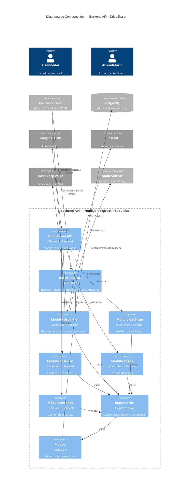

> [10. Vistas de Arquitectura (Diagramas C4) - Versión Final](../10.md) › [10.3. Diagrama de Componentes](10.3.md)

# 10.3. Diagrama de Componentes — Versión Final

El diagrama de componentes corresponde al **Nivel 3 del Modelo C4**. Describe la organización interna del contenedor **Backend API**, identificando los principales componentes que implementan la lógica de negocio de DriveShare, sus responsabilidades y las relaciones existentes entre ellos y con los servicios externos.

La implementación sigue una **arquitectura monolítica modular organizada por capas**, donde cada componente posee una responsabilidad claramente definida. La comunicación entre capas sigue el flujo:

**Middleware → Routes → Controllers → Services → Repositories → Models**

Esta estructura facilita la mantenibilidad, reutilización del código y separación de responsabilidades, permitiendo incorporar nuevas funcionalidades sin afectar el resto del sistema.

---

## Diferencias respecto al bosquejo inicial (Sección 6.3)

| Aspecto | Bosquejo (6.3) | Versión final (10.3) |
|----------|----------------|----------------------|
| Arquitectura interna | Componentes conceptuales | Componentes basados en la implementación real del Backend API. |
| Persistencia | Acceso genérico a BD | Acceso mediante Sequelize ORM y modelos del dominio. |
| Auditoría | No considerada | Se incorpora el Sidecar de Auditoría como componente desacoplado. |
| Integraciones | Definición general | Se documentan Google OAuth, Resend y HashiCorp Vault como integraciones externas implementadas. |

---

# Componentes del Backend API

| Componente | Categoría | Responsabilidad |
|------------|-----------|-----------------|
| **Middleware JWT** | Transversal | Valida el token JWT y protege las rutas privadas del sistema. |
| **Middleware Google OAuth** | Transversal | Gestiona la autenticación mediante Google OAuth utilizando Passport.js. |
| **Rutas Públicas** | Usuarios | Registro de usuarios, inicio de sesión, autenticación con Google y recuperación de contraseña. |
| **Módulo Usuarios** | Funcional | Gestiona el registro de usuarios, autenticación, perfiles, recuperación de contraseña y administración de credenciales. |
| **Módulo Catálogo** | Funcional | Administra la información de vehículos, disponibilidad, imágenes y consultas del catálogo. |
| **Módulo Reservas** | Funcional | Gestiona el ciclo de vida de las reservas y valida la disponibilidad de los vehículos. |
| **Módulo Pagos** | Funcional | Coordina el proceso de pagos asociado a las reservas. |
| **Módulo Reseñas** | Funcional | Gestiona las calificaciones y comentarios entre arrendadores y arrendatarios. |
| **Integración Google OAuth** | Integración | Encapsula la comunicación con Google para autenticación federada. |
| **Integración Resend** | Integración | Gestiona el envío de correos electrónicos y notificaciones. |
| **Integración Vault** | Integración | Obtiene secretos y credenciales almacenados en HashiCorp Vault. |
| **Capa de Repositorios** | Persistencia | Centraliza el acceso a PostgreSQL mediante Sequelize ORM. |
| **Models** | Persistencia | Representan las entidades persistentes y el mapeo objeto-relacional mediante Sequelize. |
| **Sidecar de Auditoría** | Transversal | Registra eventos y acciones relevantes del módulo de Usuarios sin afectar la lógica principal del Backend. |

---

# Diagrama

---

# Componentes de la Aplicación Web

| Elemento | Tipo | Responsabilidad |
|----------|------|-----------------|
| **Pages** | Página | Pantallas de autenticación, catálogo, reservas, pagos y reseñas. |
| **Components** | Componente React | Componentes reutilizables utilizados por toda la interfaz. |
| **Contexts** | Estado global | Gestionan autenticación, sesión y estado compartido de la aplicación. |
| **Services** | Cliente HTTP | Encapsulan el consumo de la API REST utilizando Axios o Fetch. |
| **React Router** | Navegación | Gestiona el enrutamiento entre las distintas vistas del sistema. |

---

# Trazabilidad de funcionalidad primaria

| Historia de Usuario         | Módulo        | Componente Frontend  | Ruta Frontend                             | Servicio Backend          | Repositorio             | Tabla(s)                   |
| --------------------------- | ------------- | -------------------- | ----------------------------------------- | ------------------------- | ----------------------- | -------------------------- |
| Registro de usuario         | M1 – Usuarios | `RegisterPage`       | `/register`                               | `UsuarioService`          | `UsuarioRepository`     | `USER`                     |
| Inicio de sesión            | M1 – Usuarios | `LoginPage`          | `/login`                                  | `AuthService`             | `UsuarioRepository`     | `USER`                     |
| Recuperar contraseña        | M1 – Usuarios | `ForgotPasswordPage` | `/forgot-password`                        | `PasswordRecoveryService` | `UsuarioRepository`     | `USER`                     |
| Restablecer contraseña      | M1 – Usuarios | `ResetPasswordPage`  | `/reset-password`                         | `PasswordRecoveryService` | `UsuarioRepository`     | `USER`                     |
| Verificar cuenta            | M1 – Usuarios | `VerificationPage`   | `/verificar-cuenta`                       | `VerificationService`     | `UsuarioRepository`     | `USER`                     |
| Inicio de sesión con Google | M1 – Usuarios | `OAuthSuccessPage`   | `/oauth-success`                          | `GoogleAuthService`       | `UsuarioRepository`     | `USER`                     |
| Completar perfil            | M1 – Usuarios | `OnboardingPage`     | `/usuario/onboarding`                     | `UsuarioService`          | `UsuarioRepository`     | `USER`                     |
| Consultar perfil            | M1 – Usuarios | `ProfilePage`        | `/usuario/perfil`                         | `UsuarioService`          | `UsuarioRepository`     | `USER`                     |
| Editar perfil               | M1 – Usuarios | `EditProfilePage`    | `/usuario/perfil/editar`                  | `UsuarioService`          | `UsuarioRepository`     | `USER`                     |
| Cambiar contraseña          | M1 – Usuarios | `ChangePasswordPage` | `/usuario/perfil/cambiar-password`        | `UsuarioService`          | `UsuarioRepository`     | `USER`                     |
| Consultar vehículos         | M2 – Catálogo | `VehiclesPage`       | `/vehiculos`                              | `VehicleService`          | `VehicleRepository`     | `VEHICLE`                  |
| Ver detalle de vehículo     | M2 – Catálogo | `VehicleDetailPage`  | `/vehiculos/:vehicleId`                   | `VehicleService`          | `VehicleRepository`     | `VEHICLE`, `VEHICLE_IMAGE` |
| Buscar vehículos            | M2 – Catálogo | `SearchVehiclesPage` | `/vehiculos/busqueda/:search`             | `VehicleService`          | `VehicleRepository`     | `VEHICLE`                  |
| Publicar vehículo           | M2 – Catálogo | `PublishVehiclePage` | `/arrendador/vehiculos/publicar`          | `VehicleService`          | `VehicleRepository`     | `VEHICLE`, `VEHICLE_IMAGE` |
| Editar vehículo             | M2 – Catálogo | `EditVehiclePage`    | `/arrendador/vehiculos/editar/:vehicleId` | `VehicleService`          | `VehicleRepository`     | `VEHICLE`                  |
| Mis vehículos               | M2 – Catálogo | `MyVehiclesPage`     | `/arrendador/mis-vehiculos`               | `VehicleService`          | `VehicleRepository`     | `VEHICLE`                  |
| Registrar reserva           | M3 – Reservas | `ReservationPage`    | `/vehiculos/:vehicleId/reservar`          | `ReservationService`      | `ReservationRepository` | `RESERVATION`              |
| Mis reservas                | M3 – Reservas | `MyReservationsPage` | `/usuario/mis-reservas`                   | `ReservationService`      | `ReservationRepository` | `RESERVATION`              |
| Seleccionar método de pago  | M4 – Pagos    | `PaymentPage`        | `/usuario/pago`                           | `PaymentService`          | `PaymentRepository`     | `PAYMENT`                  |
| Pago con tarjeta            | M4 – Pagos    | `CardPaymentPage`    | `/usuario/pago/tarjeta`                   | `PaymentService`          | `PaymentRepository`     | `PAYMENT`                  |
| Pago con Yape               | M4 – Pagos    | `YapePaymentPage`    | `/usuario/pago/yape`                      | `PaymentService`          | `PaymentRepository`     | `PAYMENT`                  |
| Pago con Plin               | M4 – Pagos    | `PlinPaymentPage`    | `/usuario/pago/plin`                      | `PaymentService`          | `PaymentRepository`     | `PAYMENT`                  |

---

# Restricciones reflejadas en este diagrama

| Restricción / Decisión | Reflejo en los componentes |
|-------------------------|----------------------------|
| **Hash seguro de contraseñas** | El componente **AuthService** utiliza **bcrypt** para el hash de contraseñas antes de almacenarlas en PostgreSQL. En ningún caso las contraseñas se almacenan en texto plano. |
| **Cifrado asimétrico de información sensible** | La información sensible se cifra mediante **RSA-OAEP con SHA-256** utilizando la llave pública obtenida desde HashiCorp Vault. El descifrado únicamente puede realizarse mediante la llave privada almacenada en Vault. |
| **Gestión centralizada de secretos** | El componente **Vault Integration** obtiene las claves criptográficas y demás credenciales desde **HashiCorp Vault**, evitando almacenar secretos directamente en el código fuente o archivos de configuración. |
| **Arquitectura por capas** | El Backend implementa la separación **Middleware → Routes → Controllers → Services → Repositories → Models**, desacoplando la lógica de negocio del acceso a datos. |
| **Controladores delgados** | Los **Controllers** únicamente reciben y validan las solicitudes HTTP, delegando toda la lógica de negocio a los **Services**. |
| **Persistencia desacoplada** | Ningún **Service** realiza consultas SQL directamente. Todo acceso a PostgreSQL se realiza mediante la capa **Repositories** utilizando **Sequelize ORM**. |
| **Auditoría desacoplada** | El **Audit Sidecar** registra los eventos relevantes del módulo de Usuarios sin modificar la lógica principal del Backend, implementando el patrón arquitectónico Sidecar. |
| **Autenticación federada** | La integración con **Google OAuth** se encuentra encapsulada en un componente específico, permitiendo desacoplar el proveedor de autenticación del resto de la aplicación. |
---

[⬅️ Anterior](../10.2/10.2.md) | [🏠 Home](../../README.md) | [Siguiente ➡️](../10.4/10.4.md)