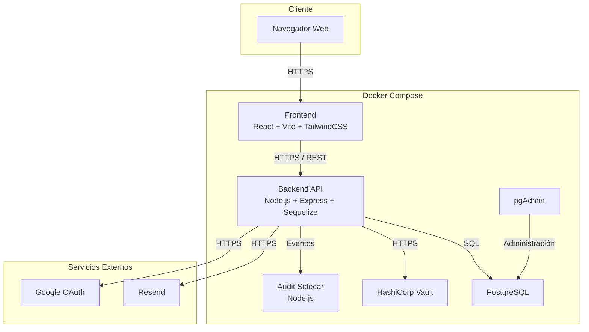
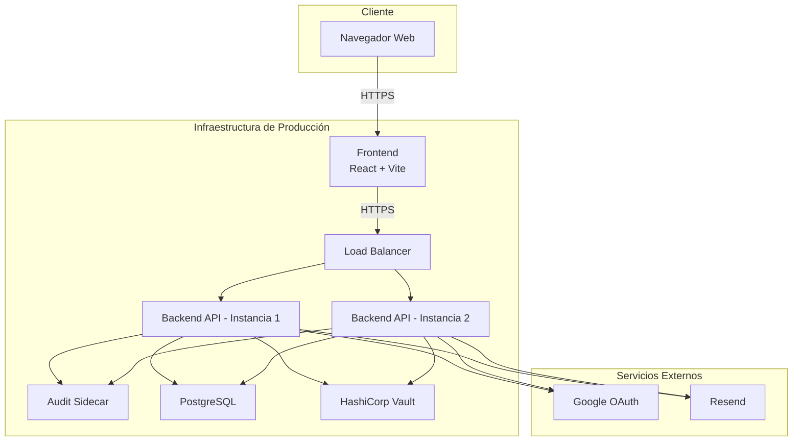
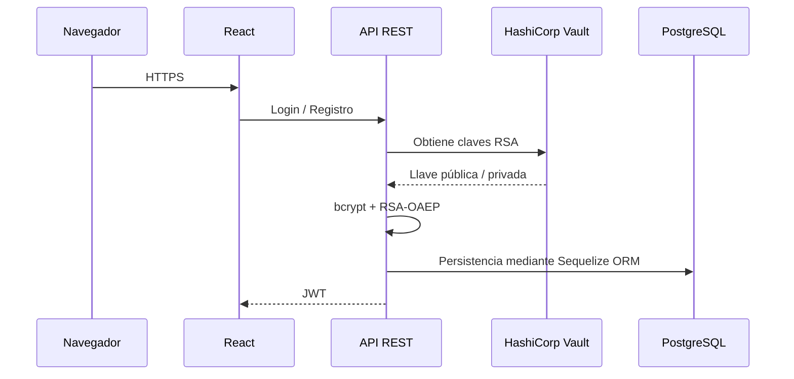

> [10. Vistas de Arquitectura (Diagramas C4) - Versión Final](../10.md) › [10.4. Diagrama de Despliegue](10.4.md)

# 10.4. Diagrama de Despliegue — Versión Final

La vista de despliegue corresponde al **Nivel 4 del Modelo C4** y presenta cómo los principales contenedores de DriveShare son desplegados sobre la infraestructura de ejecución. Esta versión considera dos escenarios: el primero representa el **prototipo funcional** desarrollado durante el curso y desplegado mediante Docker Compose, mientras que el segundo describe la **arquitectura objetivo de producción**, diseñada para responder a los principales atributos de calidad priorizados durante el proceso ADD, especialmente disponibilidad, seguridad, escalabilidad, fiabilidad y mantenibilidad.

---

# Escenario A — Despliegue del Prototipo Funcional

El prototipo funcional utiliza **Docker Compose** para orquestar todos los servicios requeridos por la aplicación. Este entorno permite reproducir localmente la arquitectura del sistema utilizando un único comando (`docker compose up`) y constituye el entorno empleado para las pruebas de integración del proyecto.

## Notas del prototipo

- Todos los componentes son desplegados mediante **Docker Compose**, permitiendo reproducir el entorno de ejecución con un único comando.
- La autenticación utiliza **JWT**, **Google OAuth** y **bcrypt** para proteger las credenciales de los usuarios.
- La información sensible se cifra mediante **RSA-OAEP con SHA-256**, utilizando las claves criptográficas almacenadas en **HashiCorp Vault**.
- El **Audit Sidecar** implementa el patrón Sidecar para registrar eventos de auditoría sin afectar la lógica principal del Backend.
- PostgreSQL constituye la fuente principal de persistencia para todos los módulos del sistema.

---

# Escenario B — Arquitectura Objetivo de Producción

Para una futura puesta en producción, DriveShare podrá evolucionar hacia una arquitectura distribuida que permita responder a mayores niveles de concurrencia y disponibilidad, manteniendo la misma organización lógica de la aplicación.

---

# Infraestructura del despliegue

| Nodo | Tecnología | Responsabilidad | Atributo de calidad |
|------|------------|-----------------|---------------------|
| Frontend | React + Vite + TailwindCSS | Aplicación SPA utilizada por arrendadores y arrendatarios. | CONS-03 (Usabilidad) |
| Backend API | Node.js + Express + Sequelize | Implementa la lógica de negocio y expone la API REST. | CONS-14 (Mantenibilidad) |
| PostgreSQL | PostgreSQL | Fuente principal de persistencia del sistema. | CONS-11 (Fiabilidad) |
| HashiCorp Vault | Vault | Gestión centralizada de secretos y claves RSA. | CONS-01 (Seguridad) |
| Audit Sidecar | Node.js | Registro desacoplado de eventos y auditorías. | CONS-14 (Mantenibilidad) |
| Google OAuth | Servicio Externo | Autenticación federada de usuarios. | CONS-02 (Disponibilidad) |
| Resend | Servicio Externo | Envío de correos electrónicos y notificaciones. | CONS-02 (Disponibilidad) |

---

# Flujo de seguridad durante el despliegue

---

# Restricciones reflejadas en el despliegue

| Restricción | Reflejo en el despliegue |
|-------------|--------------------------|
| CONS-01 — Seguridad | HashiCorp Vault centraliza la gestión de secretos y claves criptográficas utilizadas por la aplicación. |
| CONS-02 — Disponibilidad | Google OAuth y Resend se integran como servicios independientes del Backend, permitiendo desacoplar la autenticación y las notificaciones. |
| CONS-11 — Fiabilidad | PostgreSQL constituye la fuente principal de persistencia para todas las operaciones del sistema. |
| CONS-14 — Mantenibilidad | El Backend implementa una arquitectura monolítica modular organizada por capas y el Audit Sidecar desacopla la funcionalidad de auditoría. |

---

# Mecanismos de resiliencia y atributos de calidad

| Mecanismo | Componente | Escenario de calidad atendido |
|-----------|------------|-------------------------------|
| Arquitectura por capas | Backend API | CONS-14 — Facilita la evolución y mantenimiento del sistema. |
| Sidecar de Auditoría | Audit Sidecar | CONS-14 — Permite incorporar funcionalidades transversales sin modificar la lógica principal. |
| HashiCorp Vault | Backend API | CONS-01 — Protege secretos y claves criptográficas del sistema. |
| Cifrado RSA + bcrypt | Módulo Usuarios | CONS-01 — Protege credenciales e información sensible de los usuarios. |
| PostgreSQL | Base de Datos | CONS-11 — Garantiza la persistencia e integridad de la información. |
| Balanceador de carga (producción) | Backend API | CONS-07 — Permite escalar horizontalmente el servicio ante incrementos de demanda. |
| Réplicas del Backend | Backend API | CONS-09 — Incrementa la disponibilidad del sistema ante fallos de una instancia. |
---

[⬅️ Anterior](../10.3/10.3.md) | [🏠 Home](../../README.md) | [Siguiente ➡️](../10.5/10.5.md)