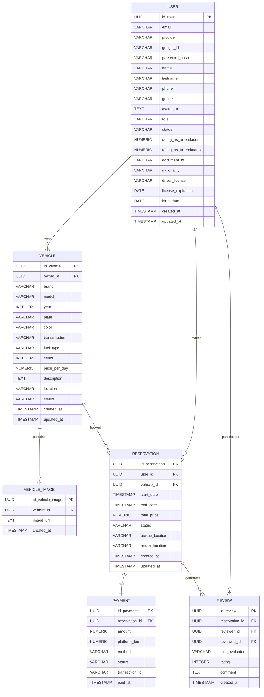
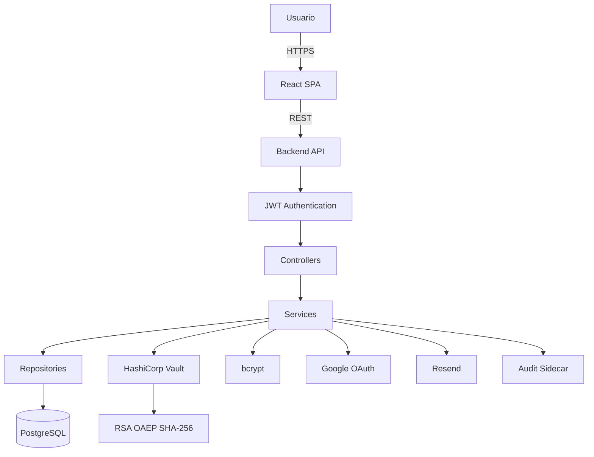
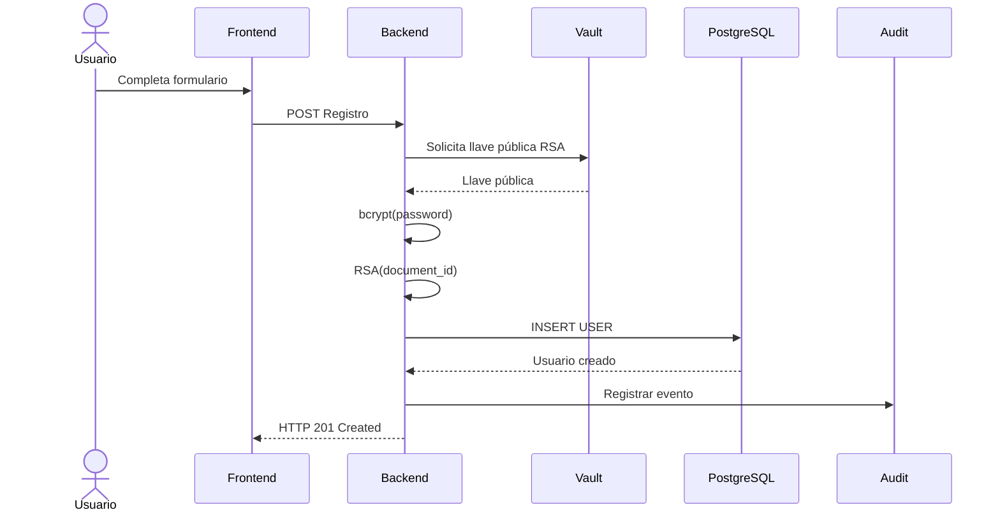
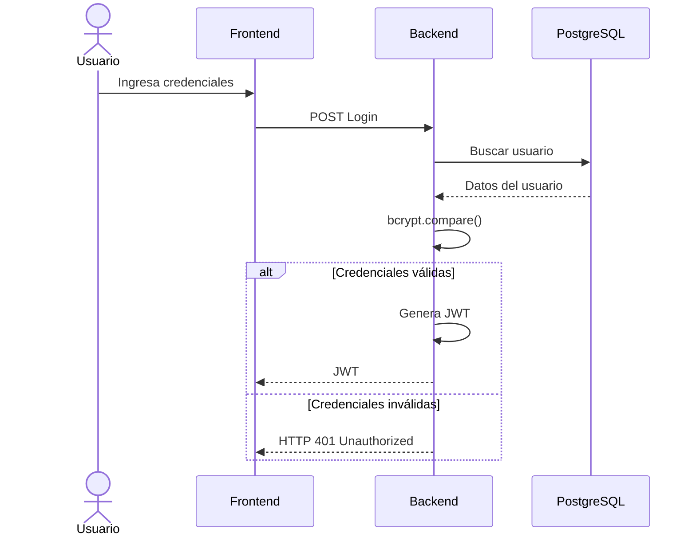

> [10. Vistas de Arquitectura (Diagramas C4) - Versión Final](../10.md) › [10.5. Otras Vistas](10.5.md)

# 10.5. Otras Vistas

Además de las vistas principales del Modelo C4, se incluyen vistas complementarias que permiten describir aspectos específicos de la arquitectura de DriveShare relacionados con el modelo de datos, la seguridad y los principales flujos funcionales implementados en el prototipo.

Estas vistas complementan la documentación arquitectónica mostrando cómo las decisiones de diseño se reflejan en la implementación del sistema y cómo contribuyen al cumplimiento de los atributos de calidad priorizados durante el proceso ADD.

---

# 10.5.1 Vista del Modelo de Datos

El siguiente diagrama muestra las principales entidades persistentes utilizadas por DriveShare durante la Fase 1. PostgreSQL constituye la fuente principal de persistencia del sistema y almacena la información correspondiente a usuarios, vehículos, reservas, pagos y reseñas.

## Restricciones del modelo de datos

| Entidad | Restricción |
|----------|-------------|
| USER | El correo electrónico debe ser único dentro del sistema. |
| USER | Las contraseñas se almacenan únicamente mediante bcrypt. |
| VEHICLE | Todo vehículo pertenece a un único arrendador. |
| RESERVATION | Cada reserva referencia obligatoriamente un usuario y un vehículo. |
| PAYMENT | Todo pago pertenece a una única reserva. |
| REVIEW | Una reseña solo puede existir asociada a una reserva finalizada. |

---

# 10.5.2 Vista de Seguridad

La seguridad de DriveShare se implementa mediante un conjunto de mecanismos distribuidos entre el Frontend, Backend y servicios externos especializados.

## Controles de seguridad implementados

| Mecanismo | Implementación |
|------------|----------------|
| Transporte seguro | HTTPS |
| Autenticación | JWT |
| Autenticación federada | Google OAuth |
| Protección de contraseñas | bcrypt |
| Cifrado de datos sensibles | RSA-OAEP con SHA-256 |
| Gestión de secretos | HashiCorp Vault |
| Auditoría | Audit Sidecar |
| Persistencia | PostgreSQL + Sequelize ORM |

---

# 10.5.3 Vista de Secuencia — Registro de Usuario

El siguiente flujo representa el proceso completo de registro de un usuario dentro de DriveShare.

---

# 10.5.4 Vista de Secuencia — Inicio de Sesión

Este flujo muestra el proceso de autenticación utilizando JWT.

---

# Relación con los atributos de calidad

| Vista | Atributo de calidad relacionado |
|--------|---------------------------------|
| Vista de Seguridad | CONS-01 — Seguridad |
| Registro de Usuario | CONS-01 — Seguridad |
| Inicio de Sesión | CONS-01 — Seguridad |
| Arquitectura por capas | CONS-14 — Mantenibilidad |
| Audit Sidecar | CONS-14 — Mantenibilidad |
| Google OAuth | CONS-02 — Disponibilidad |
| HashiCorp Vault | CONS-01 — Seguridad |

---

[⬅️ Anterior](../10.4/10.4.md) | [🏠 Home](../../README.md)