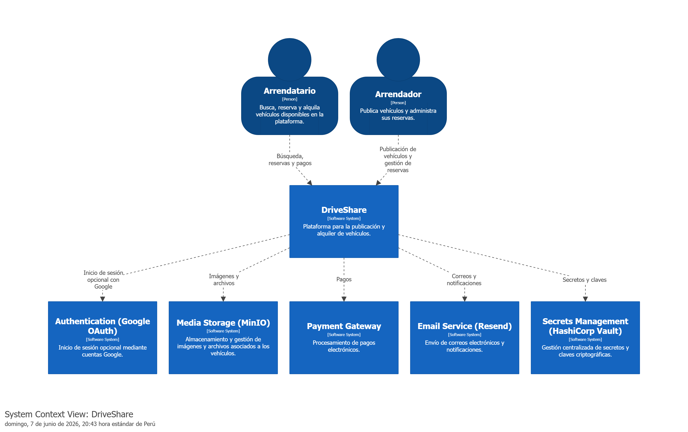

> [6. Documentación de Arquitectura (Bosquejo)](../6.md) › [6.1. Diagrama de Contexto](6.1.md)

# 6.1. Diagrama de Contexto

### Descripción

La plataforma DriveShare es utilizada por dos actores principales:

- **Arrendador**, quien publica vehículos y administra sus reservas a través de la plataforma.
- **Arrendatario**, quien busca vehículos disponibles, realiza reservas y efectúa pagos.

Para soportar sus funcionalidades principales, DriveShare interactúa con los siguientes sistemas externos:

- **Google OAuth**, utilizado para ofrecer autenticación opcional mediante cuentas Google.
- **MinIO**, encargado del almacenamiento y recuperación de imágenes y archivos asociados a los vehículos.
- **Payment Gateway**, responsable del procesamiento de pagos realizados mediante tarjeta bancaria, Yape o Plin.
- **Resend**, utilizado para el envío de correos electrónicos y notificaciones de la plataforma.
- **HashiCorp Vault**, encargado de la gestión segura de secretos, credenciales y claves criptográficas utilizadas.
---

[🏠 Home](../../README.md) | [Siguiente ➡️](../6.2/6.2.md)