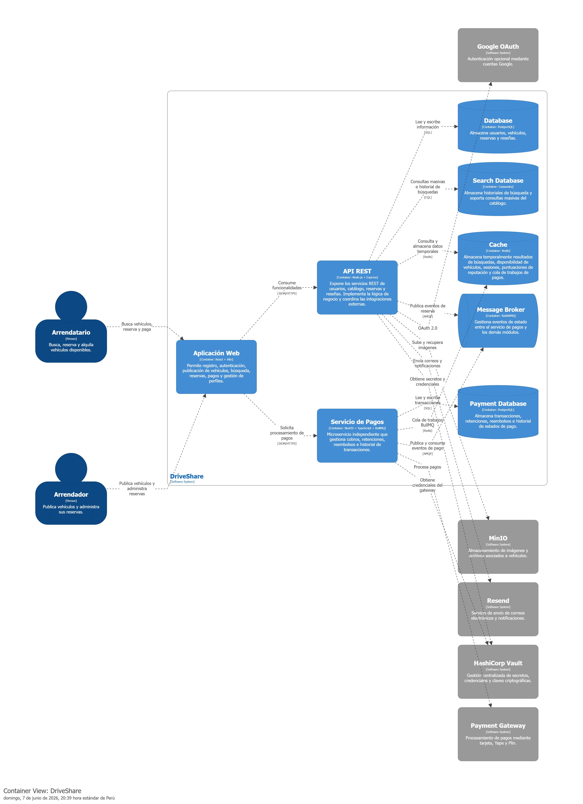

> [6. Documentación de Arquitectura (Bosquejo)](../6.md) › [6.2. Diagrama de Contenedores](6.2.md)

# 6.2. Diagrama de Contenedores

### Descripción

Los usuarios interactúan con el sistema a través de la **Aplicación Web**, desarrollada con **React + Vite**, desde donde pueden registrarse, autenticarse, publicar vehículos, realizar búsquedas, gestionar reservas, efectuar pagos y administrar sus perfiles.

La aplicación web consume los servicios expuestos por la **API REST**, implementada con **Node.js y Express**, la cual centraliza la lógica de negocio relacionada con usuarios, catálogo de vehículos, reservas y reseñas. Para el procesamiento de transacciones económicas, la aplicación web se comunica directamente con el **Servicio de Pagos**, implementado como microservicio independiente con **NestJS y TypeScript**, lo que permite aislarlo del resto del sistema, escalar de forma autónoma y proteger los datos financieros con controles de acceso diferenciados.

La coordinación entre el Servicio de Pagos y los demás módulos se realiza a través de un **Message Broker** implementado con **RabbitMQ**, que gestiona los eventos de estado de forma asíncrona mediante el patrón publicación/suscripción.

Para la persistencia de información se utilizan tres mecanismos diferenciados. La **API REST** utiliza **PostgreSQL** para almacenar usuarios, vehículos, reservas y reseñas, y **Cassandra** para el historial de búsquedas y consultas masivas del catálogo. El **Servicio de Pagos** cuenta con su propia instancia de **PostgreSQL** para almacenar transacciones, retenciones, reembolsos e historial de estados de pago, garantizando el aislamiento de los datos financieros. Complementariamente, se emplea **Redis** como mecanismo de caché compartido para disponibilidad de vehículos, sesiones, puntuaciones de reputación y cola de trabajos de pagos mediante BullMQ.

---

[⬅️ Anterior](../6.1/6.1.md) | [🏠 Home](../../README.md) | [Siguiente ➡️](../6.3/6.3.md)