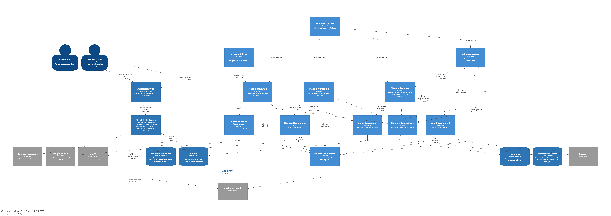

> [6. Documentación de Arquitectura (Bosquejo)](../6.md) › [6.3. Diagrama de Componentes](6.3.md)

# 6.3. Diagrama de Componentes
| Componente               | Tipo         | Descripción                                                                                                        |
| ------------------------ | ------------ | ------------------------------------------------------------------------------------------------------------------ |
| Middleware JWT           | Transversal  | Valida los tokens JWT y controla el acceso a los módulos protegidos de la API.                                     |
| Rutas Públicas           | Transversal  | Endpoints accesibles sin autenticación, como registro, inicio de sesión y recuperación de contraseña.              |
| Módulo Usuarios          | Negocio      | Gestiona usuarios, perfiles, autenticación local y recuperación de contraseña.                                     |
| Módulo Vehículos         | Negocio      | Administra la publicación, actualización, disponibilidad e imágenes de los vehículos.                              |
| Módulo Reservas          | Negocio      | Gestiona la creación, validación, seguimiento y notificación de reservas realizadas por los usuarios.              |
| Módulo Reseñas           | Negocio      | Permite registrar y consultar comentarios y calificaciones, validando que correspondan a reservas finalizadas.     |
| Authentication Component | Integración  | Gestiona la autenticación mediante Google OAuth.                                                                   |
| Storage Component        | Integración  | Gestiona el almacenamiento y recuperación de imágenes mediante MinIO.                                              |
| Email Component          | Integración  | Gestiona el envío de correos electrónicos utilizando Resend.                                                       |
| Secrets Component        | Integración  | Obtiene y administra secretos, credenciales y configuraciones seguras desde HashiCorp Vault.                       |
| Cache Component          | Integración  | Gestiona el uso de Redis para almacenar información temporal relacionada con disponibilidad, reservas y puntuaciones de reputación. |
| Capa de Repositorios     | Persistencia | Centraliza el acceso a PostgreSQL y Cassandra, abstrayendo las operaciones de lectura y escritura de datos.        |

## Componentes de la API REST

El diagrama de componentes profundiza en el contenedor **API REST**, mostrando los principales módulos funcionales, componentes de integración y elementos transversales que colaboran para proporcionar la funcionalidad de la plataforma.

La API sigue una arquitectura modular basada en **Node.js y Express**, donde las solicitudes protegidas son validadas mediante JWT antes de acceder a los distintos módulos de negocio. Estos módulos gestionan las funcionalidades principales de la plataforma relacionadas con usuarios, vehículos, reservas y reseñas. El procesamiento de pagos es responsabilidad exclusiva del **Servicio de Pagos**, un microservicio independiente que no forma parte de este contenedor.

Adicionalmente, la API incorpora componentes especializados para la integración con servicios externos: autenticación mediante Google OAuth, almacenamiento de imágenes en MinIO, envío de correos electrónicos mediante Resend y gestión segura de secretos mediante HashiCorp Vault. La persistencia de datos estructurados se realiza en PostgreSQL, mientras que Cassandra soporta consultas masivas e historial de búsquedas del catálogo. Redis es utilizado como mecanismo de caché para optimizar consultas frecuentes de disponibilidad, reservas y puntuaciones de reputación.

---

[⬅️ Anterior](../6.2/6.2.md) | [🏠 Home](../../README.md) | [Siguiente ➡️](../6.4/6.4.md)