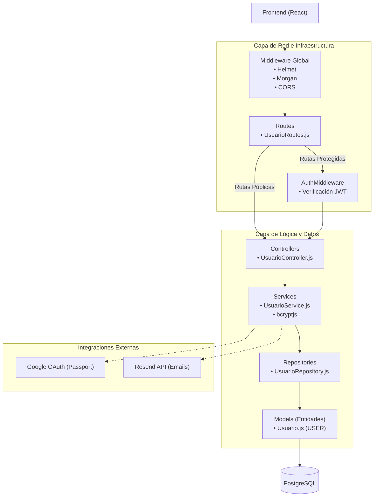
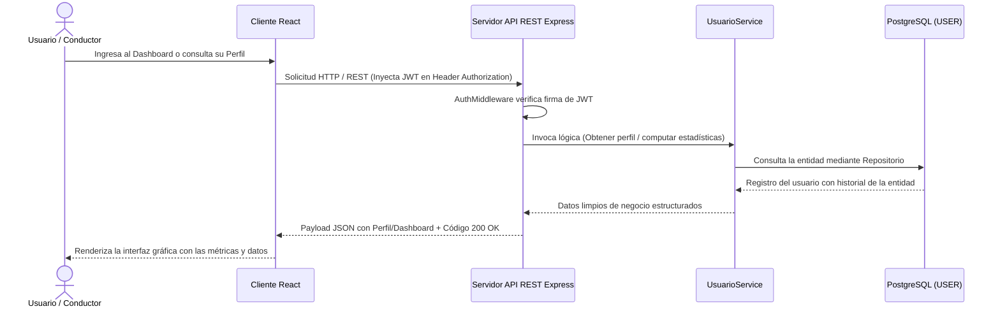
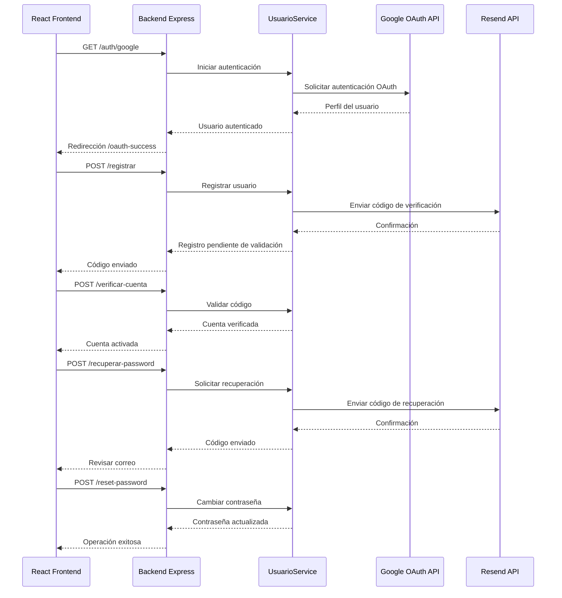
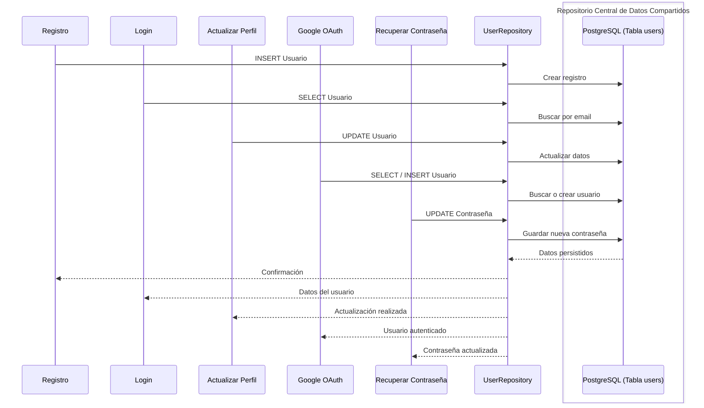
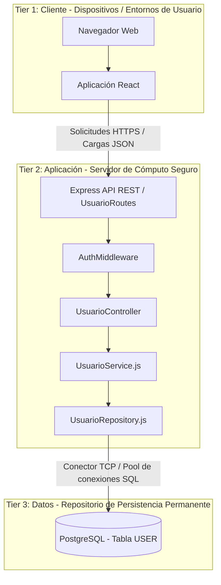

> [8. Aplicación de Patrones Arquitecturales](../8.md) › [8.1. Módulo 1 / Integrante 1](8.1.md)

# 8.1. Módulo 1- Módulo de Usuarios

El módulo de Usuarios es el encargado de gestionar el registro, autenticación y administración de los usuarios de DriveShare. Permite que los usuarios puedan crear una cuenta mediante correo electrónico o autenticarse utilizando Google OAuth, actualizar su información personal, administrar su perfil y acceder a las funcionalidades de la plataforma según su rol (arrendador o arrendatario).

Para garantizar una arquitectura mantenible, escalable y desacoplada, se seleccionaron patrones arquitectónicos pertenecientes a las categorías de Módulo, Componente-Conector y Asignación.

---

# Resumen de decisiones de patrones (ADR)

| Código | Categoría | Patrones evaluados | Patrón seleccionado | Justificación |
|----------|-----------|-------------------|---------------------|---------------|
| ADR-01 | Patrón de Módulo | Arquitectura en Capas vs Descomposición por Dominio | Arquitectura en Capas | Facilita la separación entre presentación, negocio y acceso a datos, favoreciendo la mantenibilidad. |
| ADR-02 | Componente-Conector | Cliente-Servidor vs Peer-to-Peer | Cliente-Servidor | Centraliza la autenticación y administración de usuarios mediante servicios REST. |
| ADR-03 | Componente-Conector | SOA vs Broker | SOA (REST) | Permite integrar autenticación con Google OAuth y otros servicios externos mediante APIs independientes. |
| ADR-04| Componente-Conector | Pipe-and-Filter vs Datos Compartidos | Datos Compartidos | Permite almacenar y manipular la información del módulo de Usuarios mediante un repositorio central compartido, asegurando la persistencia de los datos y el acceso concurrente a través de PostgreSQL y Sequelize.|
| ADR-05 | Patrón de Asignación | Multi-Tier vs Map-Reduce | Multi-Tier | Permite desplegar Frontend, Backend y Base de Datos en servidores independientes mejorando la escalabilidad. |

---

# ADR-01 – Arquitectura en Capas

## Contexto

El módulo de Usuarios concentra la lógica relacionada con el registro, autenticación, recuperación de credenciales y administración del perfil del usuario.

Debido a que estas funcionalidades evolucionan constantemente, resulta necesario mantener una clara separación entre la interfaz de usuario, la lógica de negocio y el acceso a la información persistente.

Asimismo, el proyecto DriveShare contempla futuras integraciones con servicios externos como Google OAuth, Resend para envío de correos electrónicos.

---

## Problema

Si toda la lógica del módulo se implementa dentro de un único componente, cualquier modificación relacionada con la autenticación, reglas de negocio o acceso a la base de datos impactaría sobre el resto del sistema.

Esto incrementaría el acoplamiento entre componentes, dificultando el mantenimiento, las pruebas y la incorporación de nuevas funcionalidades.

---

### Alternativas Evaluadas

| Alternativa | Descripción | Ventaja | Desventaja |
| - | - | - | - |
| **Arquitectura en Capas** | Estructura el sistema en unidades jerárquicas llamadas "capas" con relaciones de uso permitido y unidireccional entre ellas. | Favorece directamente la **modificabilidad** y **reutilización** al permitir que los módulos evolucionen independientemente. | Incrementa las restricciones de diseño al obligar a que todo el software se ubique estrictamente dentro de una capa. |
| **Descomposición por Dominio** | Organiza y segmenta los componentes del software en torno a las áreas lógicas o verticales operativas del negocio. | Alinea la base de código directamente con el modelo mental y los requerimientos funcionales del negocio. | No define un mecanismo estructural para resolver el desacoplamiento técnico (como separar control, red o persistencia). |

### Decisión

Se decide adoptar el patrón de **Arquitectura en Capas** para estructurar la organización interna del diseño de este módulo, permitiendo aislar de forma estricta la lógica de infraestructura web, las reglas del dominio y el acceso físico a los datos. Con el fin de mitigar las rigurosas restricciones de diseño inherentes a este patrón, se implementa una comunicación jerárquica, lineal y de capas cerradas donde las dependencias de uso permitido fluyen exclusivamente en sentido descendente de la siguiente manera:

| Capa / Nivel | Responsabilidad Técnica | Elementos del Módulo |
| - | - | - |
| **Middlewares (Filtro)** | Interceptar de forma global las solicitudes en la frontera de la red para validar la autenticidad e integridad del token de sesión. | `AuthMiddleware.js` (Verificación estricta de `process.env.JWT_SECRET`) |
| **Rutas (Despacho)** | Mapear, agrupar y exponer formalmente los puntos de entrada lógicos públicos y privados del servidor. | `UsuarioRoutes.js` (Rutas REST y callbacks distribuidos de Google OAuth) |
| **Controladores (Aislamiento HTTP)** | Extraer parámetros de las peticiones web, validar la presencia de campos mandatorios y encapsular las respuestas de Express. | `UsuarioController.js` (Abstracción de objetos de red `req` y `res`, blindaje de APIs externas) |
| **Servicios de Negocio (Dominio)** | Centralizar las directrices operativas, validaciones de cuentas, flujos lógicos, mapas de activación y criptografía. | `UsuarioService.js` (Coordinación de `bcryptjs`, mapas lógicos en memoria e integraciones de `Resend`) |
| **Repositorios (Abstracción de Datos)** | Encapsular de forma absoluta las consultas directas hacia el ORM a través de una clase base común de persistencia. | `UsuarioRepository.js` (Funciones extendidas de acceso aislado como `findByEmail` o `findByGoogleId`) |
| **Modelos (Entidades)** | Definir la estructura relacional de datos, tipos, restricciones físicas y metadatos de auditoría para el motor físico. | `Usuario.js` (Mapeo explícito a la tabla relacional `USER` de PostgreSQL mediante Sequelize) |
---

## Instanciación en DriveShare

La implementación del módulo se organiza de la siguiente manera:

Cada capa posee responsabilidades claramente definidas.

## Beneficios obtenidos

- Separación clara de responsabilidades.
- Mayor facilidad para realizar pruebas unitarias.
- Menor acoplamiento entre componentes.
- Posibilidad de reemplazar PostgreSQL por otro gestor de bases de datos sin afectar la lógica del negocio.
- Facilita la integración con servicios externos como Google OAuth y Resend.
- Mayor mantenibilidad conforme el sistema evoluciona.

---

### Consecuencias 

* **Separación clara de responsabilidades (Consecuencia Positiva):** Permite que los niveles internos del backend (como las reglas de negocio en los servicios o las consultas SQL en los repositorios) evolucionen y se modifiquen de manera independiente sin afectar los contratos de la API ni desestabilizar la interfaz del cliente. Esto se contrarresta con las **restricciones estrictas de diseño**, ya que al obligar a que cada porción del software se ubique de manera exclusiva dentro de un único nivel y cumpla con las reglas jerárquicas establecidas, se reduce la flexibilidad de realizar desarrollos rápidos o acoplamientos directos e informales en el backend.

* **Mayor facilidad para realizar pruebas unitarias (Consecuencia Positiva):** Facilita la auditoría del flujo de la información, el rastreo de errores puntuales de infraestructura y la inyección limpia de pruebas de integración aislando cada capa mediante dobles de prueba (mocks). Como contraparte, esto produce un **incremento en la estructura inicial del sistema**, multiplicando la cantidad de componentes, archivos físicos, importaciones lógicas y dependencias, lo que requiere un mayor esfuerzo técnico para la configuración inicial y el mantenimiento de la arquitectura.

* **Menor acoplamiento entre componentes (Consecuencia Positiva):** Minimiza drásticamente el riesgo de que una alteración en la capa de enrutamiento o en los controladores web propague fallos hacia las reglas del dominio o la infraestructura profunda del servidor. Sin embargo, esto introduce **pasos adicionales en la comunicación**, debido a que la interacción estrictamente lineal de capas cerradas puede añadir una mínima sobrecarga en la red en memoria, obligando a que los datos transiten secuencialmente nivel por nivel al prohibir saltos directos.

* **Posibilidad de reemplazar PostgreSQL por otro gestor de bases de datos sin afectar la lógica del negocio (Consecuencia Positiva):** Garantiza la portabilidad y modificabilidad del almacenamiento al encapsular todo el acceso físico a los datos dentro de la capa de repositorios. El costo asumido es la **obligación de mantener un mapeo estricto de entidades**, requiriendo que los objetos y payloads de datos sean transformados explícitamente a medida que descienden o ascienden por el pipeline técnico.

* **Facilita la integración con servicios externos como Google OAuth y Resend (Consecuencia Positiva):** Permite aislar los SDKs, credenciales y lógicas de terceros exclusivamente dentro de la capa de servicios, protegiendo al resto del backend de cambios en proveedores externos. No obstante, esto demanda una **rigurosa gestión de dependencias e interfaces**, forzando al equipo a definir contratos de servicio muy claros para no acoplar la capa de negocio a las implementaciones nativas de dichas plataformas.

* **Mayor mantenibilidad conforme el sistema evoluciona (Consecuencia Positiva):** Asegura que el Módulo de Usuarios de DriveShare pueda escalar de forma ordenada y limpia, permitiendo incorporar nuevas características funcionales sin degradar la base de código existente. El trade-off aceptado es la **curva de aprendizaje y rigurosidad técnica en el desarrollo diario**, dado que cualquier cambio menor obligará a los desarrolladores a respetar y replicar la estructura jerárquica a través de todas las capas del sistema.

---

# ADR-02: Cliente-Servidor

## Categoría: Patrón de Componente y Conector

### Contexto
El Módulo de Usuarios requiere una arquitectura de comunicación distribuida que permita separar la lógica de presentación visual e interacción con el usuario en los dispositivos móviles o de escritorio, de la lógica de procesamiento centralizado, autenticación de identidades y persistencia de datos. 

Debido a que los usuarios interactúan con la plataforma desde interfaces dinámicas y demandan flujos como el registro de cuentas o la validación del onboarding, se necesita un esquema de conectores que ordene la red de manera estructurada. El sistema debe evitar que las aplicaciones cliente accedan directamente a la base de datos o realicen operaciones de dominio locales, garantizando que el servidor centralice de manera absoluta las validaciones de seguridad y el acceso físico a los recursos.

### Alternativas Evaluadas

| Alternativa | Descripción | Ventaja | Desventaja |
| - | - | - | - |
| **Cliente-Servidor** | Los clientes inician la interacción solicitando servicios a los servidores y esperando los resultados. La interacción es asimétrica: los clientes conocen la identidad del servicio para invocarlo, pero los servidores solo responden a las solicitudes sin conocer la identidad de los clientes. | Promueve la centralización del control de recursos compartidos para mejorar la escalabilidad y la disponibilidad de los datos de usuario. | Introduce un punto único de fallo en el backend y una alta dependencia de la conectividad de red para el funcionamiento de la aplicación cliente. |
| **Peer-to-Peer (P2P)** | Los componentes (entidades de cómputo) interactúan de manera directa como pares, en una organización horizontal donde todos tienen la misma importancia. Las interacciones son simétricas; cualquier par puede iniciar una solicitud, comportándose simultáneamente como "clientes" y "servidores". | Ofrece una alta tolerancia a fallos distribuidos al descentralizar el flujo de información entre los nodos de la red sin intermediarios obligatorios. | Complejiza críticamente la sincronización de estados concurrentes y no permite un control de acceso o autenticación centralizada para el registro de cuentas. |

### Decisión
Se decide implementar el patrón **Cliente-Servidor** para estructurar la interacción de componentes y conectores en este módulo. Bajo este esquema, la aplicación cliente actúa como el consumidor proactivo de servicios, restringiendo sus responsabilidades a la captura de datos, renderizado de vistas y control de estados visuales locales. 

El backend asume el rol de servidor centralizado exclusivo, exponiendo una API REST formal para atender y procesar las peticiones HTTP despachadas por el cliente. Toda comunicación se rige mediante un protocolo síncrono de solicitud-respuesta, asegurando que el servidor centralice y gobierne de manera absoluta los flujos de autenticación y la administración de los perfiles de usuario de DriveShare de forma asimétrica y segura.

### Instanciación del Patrón

El **componente cliente** será la aplicación móvil/web desarrollada en React . 
El **componente servidor** será el backend REST desarrollado en Node.js con Express. 
El **conector** de red será el protocolo síncrono HTTP/HTTPS empleando métodos estándar de la arquitectura REST:

| Operación del módulo | Método REST | Endpoint propuesto | Servicio que procesa |
| - | - | - | - |
| Iniciar sesión local | POST | `/login` | `UsuarioService` (Valida hash con `bcryptjs`) |
| Registrar cuenta nueva | POST | `/registrar` | `UsuarioService` (Crea cuenta inactiva) |
| Validar código por email | POST | `/verificar-cuenta` | `UsuarioService` (Activa la cuenta en el sistema) |
| Solicitar recuperación | POST | `/recuperar-password` | `UsuarioService` (Despacha email vía `Resend`) |
| Reestablecer credencial | POST | `/reset-password` | `UsuarioService` (Modifica la credencial física) |
| Procesar éxito OAuth | GET | `/oauth-success` | `UsuarioService` (Inyecta token de Google Passport) |
| Guardar Onboarding | PUT | `/usuario/onboarding` | `UsuarioService` (Completa DNI/Licencia en `USER`) |
| Obtener Métricas de Panel | GET | `/usuario/dashboard` | `UsuarioService` (Métricas de viajes y ratings) |
| Consultar Perfil | GET | `/usuario/perfil` | `UsuarioService` (Datos personales protegidos) |
| Editar Datos de Perfil | PUT | `/usuario/perfil/editar` | `UsuarioService` (Modifica teléfono o preferencias) |
| Cambiar Contraseña Interna | PUT | `/usuario/perfil/cambiar-password` | `UsuarioService` (Valida contraseña actual y actualiza) |

#### Diagrama de Interacción

### Beneficios Concretos

- **Centralización del control de recursos compartidos:** Al concentrar la verificación de estados de las cuentas (`pending`, `active`, `suspended`) y la gestión de los tokens de autenticación en un único servidor, se mejora el control de acceso, la disponibilidad y la escalabilidad del sistema.

- **Garantía de asimetría controlada:** Permite que los clientes inicien solicitudes al servidor y esperen respuestas deterministas, manteniendo completamente aisladas en el backend las operaciones sensibles como el cifrado de contraseñas con `bcryptjs` y la generación de tokens JWT.

- **Facilidad de mantenimiento y desacoplamiento:** Consolida una separación clara entre la interfaz de usuario desarrollada en React y la lógica de negocio implementada en Express, facilitando la evolución independiente de ambos componentes.

- **Predictibilidad operacional:** Garantiza un comportamiento uniforme en las respuestas del sistema al estandarizar los payloads JSON utilizados para comunicar operaciones exitosas, errores de validación o fallos durante el procesamiento de las solicitudes.

- **Respeto a las convenciones estándar:** Implementa de manera consistente las restricciones y principios del estilo arquitectónico REST, favoreciendo una comunicación homogénea, interoperable y fácilmente mantenible entre el cliente y el servidor.

### Consecuencias Aceptadas

* **Gobernanza y consistencia mediante protocolos estándar (Consecuencia Positiva):** El uso de interfaces síncronas bajo HTTP/REST agiliza el desarrollo y simplifica la integración de los componentes del sistema. Esto se contrarresta con la **exposición a cuellos de botella e indisponibilidad**, ya que concentrar la carga transaccional en un único nodo del backend exige implementar estrategias rigurosas de escalabilidad y monitoreo para evitar caídas del servicio que afecten a todos los clientes simultáneamente.

* **Centralización absoluta de las políticas de identidad (Consecuencia Positiva):** Asegura que todas las modificaciones en perfiles, contraseñas o datos confidenciales de onboarding sigan rigurosamente las reglas del dominio sin dispersión lógica. Como contraparte, esto produce una **dependencia estricta de la documentación y contratos de la API**, obligando a mantener sincronizados de manera estricta los esquemas de datos compartidos entre los desarrolladores del frontend y el backend para prevenir rupturas en la comunicación.

* **Trazabilidad y auditoría simplificada del ciclo de vida de usuarios (Consecuencia Positiva):** Permite registrar de manera unificada los accesos, firmas de tokens criptográficos y cambios de estado en las cuentas dentro de un solo entorno. Sin embargo, esto introduce la **obligación de robustecer los perímetros de seguridad e infraestructura**, forzando al sistema a blindar los endpoints centrales contra vectores de ataque comunes, inyecciones o sobrecargas concurrentes que degraden la experiencia del usuario final.
---
# ADR-03: Arquitectura Orientada a Servicios (SOA)

### Categoría: Patrón de Componente y Conector

### Contexto
- El Módulo de Usuarios de DriveShare requiere integrarse con plataformas y proveedores externos independientes para delegar la autenticación federada de identidades (Google OAuth) y automatizar el despacho de correos electrónicos transaccionales con códigos de verificación (API de Resend). 
- El problema arquitectónico consiste en decidir si el backend debe consumir estos servicios externos de manera directa interactuando con interfaces web estandarizadas, o si debe incorporar un componente intermediario centralizado que aísle y redireccione dinámicamente las solicitudes hacia los proveedores.

### Alternativas Evaluadas

| Alternativa | Descripción | Ventajas | Desventajas |
| - | - | - | - |
| **Arquitectura Orientada a Servicios (SOA)** | Describe una colección de componentes distribuidos que proveen y consumen servicios mediante interfaces bien definidas, independientemente del lenguaje o plataforma en que hayan sido desarrollados. | Permite integrar la autenticación con Google OAuth y otros servicios externos mediante APIs REST, facilitando la interoperabilidad y el desacoplamiento entre sistemas. | Depende de la disponibilidad de la red y del rendimiento de los servicios externos, lo que puede incrementar la latencia o afectar el funcionamiento si alguno de ellos presenta fallas. |
| **Broker** | Incorpora un intermediario encargado de recibir las solicitudes del cliente y redirigirlas al servicio correspondiente, ocultando la ubicación de los proveedores. | Desacopla completamente a los clientes de los servicios y facilita cambios en la infraestructura sin afectar a los consumidores. | Introduce una capa adicional de complejidad que no resulta necesaria cuando se consumen APIs REST públicas con interfaces bien definidas. |

---

### Decisión

Se decidió implementar el patrón **Arquitectura Orientada a Servicios (SOA)** utilizando el estilo arquitectónico **REST**, con intercambio de información en formato JSON para la comunicación con servicios externos.

Esta decisión se tomó porque Google OAuth y Resend exponen APIs REST públicas con contratos claramente definidos, permitiendo que el backend de DriveShare consuma dichos servicios de forma independiente del lenguaje o plataforma en que fueron desarrollados. De esta manera se mejora la interoperabilidad y se evita incorporar un Broker que agregaría complejidad sin aportar beneficios significativos al proyecto.

---

| Operación del módulo | Método REST | Endpoint del Backend | Servicio que procesa | Servicio Externo | Propósito del flujo |
| -------------------- | ----------- | -------------------- | -------------------- | ---------------- | ------------------- |
| Autenticación con Google | GET | `/auth/google` | `UsuarioService` | **Google OAuth API** | Inicia el flujo de autenticación mediante federación de identidad. |
| Callback de autenticación | GET | `/auth/google/callback` | `UsuarioService` | **Google OAuth API** | Recibe el perfil autenticado del usuario y completa el proceso de inicio de sesión. |
| Registro de cuenta nueva | POST | `/registrar` | `UsuarioService` | **Resend API** | Envía el código de verificación inicial al correo electrónico del usuario. |
| Validación de activación | POST | `/verificar-cuenta` | `UsuarioService` | **Ninguno (Proceso interno)** | Valida el código de verificación de seis dígitos enviado al correo electrónico. |
| Recuperación de contraseña | POST | `/recuperar-password` | `UsuarioService` | **Resend API** | Envía el código o token de recuperación al correo electrónico del usuario. |
| Restablecimiento de contraseña | POST | `/reset-password` | `UsuarioService` | **Ninguno (Proceso interno)** | Actualiza la contraseña del usuario después de validar correctamente el código de recuperación. |

#### Diagrama del Patrón (SOA)

---
### Beneficios Concretos

- Permite integrar de manera sencilla la autenticación mediante **Google OAuth** y el envío de correos electrónicos utilizando **Resend API**, manteniendo desacoplada la lógica de negocio de los servicios externos.
- Facilita la interoperabilidad entre el módulo de Usuarios y servicios distribuidos, independientemente de la tecnología o plataforma en la que hayan sido desarrollados.
- Expone interfaces claras y contratos bien definidos mediante endpoints REST, favoreciendo una comunicación estandarizada entre sistemas.
- Permite el intercambio de información utilizando el estilo arquitectónico **REST** y el formato **JSON**, logrando una integración ligera, flexible y ampliamente compatible.
- Evita la incorporación de una infraestructura intermediaria de tipo Broker, reduciendo la complejidad arquitectónica y simplificando el flujo de comunicación con los proveedores externos.

---

### Consecuencias Aceptadas

* **Integración flexible con servicios externos (Consecuencia Positiva):** La adopción de una Arquitectura Orientada a Servicios (SOA) permite integrar de forma sencilla proveedores externos como **Google OAuth** para la autenticación y **Resend** para el envío de correos electrónicos, reutilizando interfaces REST estandarizadas. Sin embargo, esto genera una **dependencia de la disponibilidad y el rendimiento de los servicios externos**, por lo que interrupciones o degradaciones en dichos proveedores pueden afectar temporalmente funcionalidades críticas del módulo de Usuarios.

* **Interoperabilidad mediante interfaces REST (Consecuencia Positiva):** El consumo de APIs REST con intercambio de datos en formato JSON facilita la comunicación entre sistemas desarrollados con tecnologías y plataformas diferentes, favoreciendo el desacoplamiento y la evolución independiente de los componentes. Como consecuencia, el sistema adquiere una **dependencia de los contratos de las APIs externas**, obligando a actualizar la implementación de `UsuarioService` cuando los proveedores modifiquen sus endpoints, formatos de respuesta o mecanismos de autenticación.

* **Arquitectura desacoplada y extensible (Consecuencia Positiva):** La lógica de negocio permanece separada de los servicios externos, permitiendo incorporar nuevos proveedores de autenticación, mensajería u otros servicios sin realizar cambios significativos en la arquitectura general del sistema. No obstante, esto implica una **mayor complejidad en el monitoreo y diagnóstico de errores**, ya que las fallas pueden originarse tanto en la aplicación como en la infraestructura de los proveedores externos, requiriendo mecanismos adicionales de registro, monitoreo y manejo de excepciones.

---
# ADR-04: Datos Compartidos

### Categoría: Patrón de Componente y Conector

### Contexto

- El Módulo de Usuarios de DriveShare requiere procesar múltiples flujos y solicitudes concurrentes de alta prioridad transaccional. Operaciones críticas como la verificación de credenciales cifradas con `bcryptjs`, la mutación del estado de la cuenta a activo en `verificarCuenta`, el registro de nuevos usuarios en `registrar`, y las consultas de búsqueda masiva o individual (`findAll`, `findOne`) deben garantizar persistencia física definitiva a largo plazo.

- El problema arquitectónico radica en seleccionar un patrón de componente y conector que permita a las distintas funciones lógicas de control del backend interactuar simultáneamente sobre los mismos conjuntos de información, asegurando la consistencia e integridad referencial de las identidades sin dispersar el estado de los usuarios.

### Alternativas Evaluadas

| Alternativa | Descripción | Ventajas | Desventajas |
| - | - | - | - |
| **Pipe-and-Filter (Tubería y Filtro)** | Su objetivo es transformar flujos de datos de forma sucesiva. Los datos ingresan por el puerto de entrada de un filtro, donde son transformados. Luego, los datos transformados pasan por el puerto de salida y viajan a través de una tubería (pipe) hacia el siguiente filtro. | Altamente eficiente para procesamientos por lotes o transformaciones continuas de streams de datos que no requieren conservar un estado global. | No provee un mecanismo para almacenar datos a largo plazo; imposibilita de forma crítica el acceso inmediato y concurrente a estados compartidos como las credenciales. |
| **Datos Compartidos** | Se utiliza para almacenar y manipular grandes volúmenes de datos a los que acceden múltiples componentes independientes. Las interacciones se realizan intercambiando datos a través de conectores de lectura y escritura hacia por lo menos un repositorio central de datos compartidos. | El repositorio provee la persistencia de los datos y gestiona el acceso concurrente mediante la administración de transacciones. | El repositorio unificado puede transformarse en un cuello de botella físico de rendimiento o en un punto único de falla si se pierde la conectividad con el nodo central. |

### Decisión

- Se decide aplicar el patrón de **Datos Compartidos** (implementado mediante el motor de base de datos relacional PostgreSQL y gestionado a través de Sequelize) para estructurar el almacenamiento, persistencia y acceso del Módulo de Usuarios.

- La razón es que todas las consultas y mutaciones lógicas del backend van dirigidas a interrogar e interactuar con la misma tabla o entidad común llamada `USER`. Funciones operativas independientes mapeadas en `UsuarioService.js` (como `login`, `registrar` o `verificarCuenta`) requieren manipular simultáneamente los mismos volúmenes de información confidencial. Este patrón garantiza que el repositorio central actúe como el único origen de la verdad, resguardando la permanencia de los perfiles y utilizando la administración de transacciones para aislar de forma segura los accesos paralelos.

### Instanciación del Patrón

El Módulo de Usuarios interactúa y delega el manejo masiva de datos directamente sobre el repositorio centralizado compartiendo la misma persistencia:

- **Componentes Independientes:** Las sub-funciones de negocio expuestas en `UsuarioService.js` operan como unidades de lógica independientes que no retienen los datos de los perfiles en su memoria local.
- **Repositorio Central de Datos Compartidos:** Representado por la base de datos PostgreSQL, la cual aloja centralizadamente la tabla física `USER` definida en el modelo `Usuario.js` (con sus respectivos esquemas de campos clínicos, credenciales, roles y auditoría).
- **Conectores de Lectura y Escritura:** Implementados a través de las abstracciones de consultas de Sequelize en `UsuarioRepository.js` (empleando conectores de lectura como `Usuario.findOne` para validar accesos, y conectores de escritura como `usuario.save()` en los flujos de activación y restablecimiento de contraseñas).

#### Diagrama de Interacción del Patrón

---
### Beneficios Concretos

- **Provisión de persistencia a largo plazo:** Garantiza que toda la información relacionada con los perfiles de usuario, estados de cuenta (`pending`, `active`, `suspended`) y credenciales permanezca almacenada de forma persistente en PostgreSQL, evitando pérdidas de información ante reinicios o fallos del servidor.

- **Gestión avanzada del acceso concurrente:** Delega el control de las operaciones simultáneas al motor de PostgreSQL, el cual administra las transacciones para mantener la integridad y consistencia de los datos almacenados en la tabla `users`.

- **Intercambio directo de información:** Permite que las distintas funcionalidades del módulo de Usuarios (registro, autenticación, recuperación de contraseña, actualización de perfil y autenticación con Google) compartan información mediante un único repositorio central, evitando inconsistencias entre componentes.

- **Optimización de recursos del sistema:** Reduce la duplicidad de información y elimina la necesidad de mantener copias locales o mecanismos adicionales de sincronización, simplificando la arquitectura y el mantenimiento del sistema.

- **Consistencia inmediata del estado:** Garantiza que cualquier modificación realizada sobre la información de un usuario esté disponible inmediatamente para el resto de las operaciones que consultan la misma entidad, manteniendo una única fuente de verdad.

---

### Consecuencias Aceptadas

* **Integridad y consistencia centralizada de la información (Consecuencia Positiva):** La utilización de un repositorio de datos compartido garantiza que todas las operaciones del módulo trabajen sobre una única fuente de información, asegurando la consistencia transaccional y evitando discrepancias entre los datos utilizados por las distintas funcionalidades. Sin embargo, esta arquitectura introduce un **punto único de falla (Single Point of Failure)**, ya que una indisponibilidad del servidor de base de datos impediría el funcionamiento de procesos críticos como la autenticación, el registro y la gestión de perfiles.

* **Acceso unificado a los datos del dominio (Consecuencia Positiva):** Todas las funcionalidades del módulo de Usuarios acceden al mismo repositorio central, simplificando la consulta y actualización de la información compartida entre los distintos componentes de la aplicación. Como consecuencia, el sistema requiere una **gestión eficiente del acceso concurrente**, mediante el uso adecuado de índices, optimización de consultas y administración del pool de conexiones para evitar degradaciones del rendimiento bajo cargas elevadas.

* **Desacoplamiento entre la lógica de negocio y el almacenamiento (Consecuencia Positiva):** La lógica implementada en `UsuarioService` permanece independiente de los mecanismos físicos de persistencia, facilitando el mantenimiento y la evolución del software. No obstante, cualquier **cambio estructural en el esquema de la base de datos** puede impactar directamente sobre los repositorios, modelos y consultas que dependen de la tabla `users`, requiriendo una adecuada planificación y control de las migraciones.

---
# ADR-05: Multi-Tier 

### Categoría: Patrón de Asignación (Despliegue)

### Contexto

- El Módulo de Usuarios de DriveShare requiere estructurar y delimitar la asignación física y lógica de sus componentes de software a unidades de ejecución de hardware independientes. Operaciones sensibles como la autenticación mediante tokens criptográficos, el procesamiento de credenciales protegidas con `bcryptjs` y la manipulación del estado de los perfiles en la base de datos no deben ejecutarse en el mismo entorno que la interfaz gráfica.

- El problema arquitectónico consiste en decidir si los componentes del módulo de usuarios se organizan asignándose a múltiples tiers de ejecución físicos/virtuales independientes, o si se despliegan sobre un clúster distribuido optimizado para el procesamiento paralelo de grandes volúmenes de datos.

### Alternativas Evaluadas

| Alternativa | Descripción | Ventajas | Desventajas |
| - | - | - | - |
| **Map-Reduce** | Patrón que procesa grandes volúmenes de datos distribuyendo las tareas de filtrado (Map) y agregación (Reduce) de forma paralela en múltiples nodos de cómputo. | Excelente para minería de datos masiva, análisis de logs históricos de geolocalización o big data. | No se alinea con el flujo transaccional e interactivo del Módulo de Usuarios, introduciendo una sobrecarga de infraestructura innecesaria para operaciones CRUD. |
| **Multi-Tier** | Organiza la estructura de ejecución del sistema en un conjunto de tiers físicamente independientes (o plataformas virtuales separadas), tales como el tier de cliente, el tier de aplicación y el tier de datos. | Separa estrictamente las responsabilidades de despliegue, restringe el acceso directo a la base de datos y permite escalar o sustituir componentes de hardware de forma independiente. | Incrementa la complejidad de despliegue, redes y costos operativos en comparación con ejecutar todo el software en un entorno único monolítico (Single-Tier). |

### Decisión

- Se decide aplicar el patrón de **Asignación Multi-Tier**, organizando el despliegue físico del Módulo de Usuarios en tres tiers de ejecución independientes: Tier de Cliente, Tier de Aplicación y Tier de Datos.

- La razón es que el Módulo de Usuarios no requiere procesar petabytes de información ni segmentar archivos masivos en múltiples nodos esclavos. Su flujo se centra en la gestión del ciclo de vida del usuario (tales como registro, login, verificación y onboarding). Multi-Tier se ajusta de forma ideal al entorno tecnológico de la aplicación, ya que permite ejecutar de forma aislada la interfaz móvil/web (React), las reglas del dominio en un servidor seguro (Express con `UsuarioService.js`) y el motor de persistencia relacional (PostgreSQL).

### Instanciación del Patrón

La asignación de software a las unidades de hardware de ejecución se divide formalmente en tres niveles:

| Tier | Componentes de software asignados | Unidad de ejecución / Infraestructura | Responsabilidad |
| - | - | - | - |
| **Tier Cliente** | Interfaz  web desarrollada en React. | Navegador web del usuario  | Capturar los datos de credenciales, renderizar pantallas de onboarding y enviar peticiones asíncronas seguras mediante HTTP. |
| **Tier Aplicación** | Servidor de Express, `UsuarioRoutes`, `UsuarioController`, `AuthMiddleware`, `UsuarioService` y `UsuarioRepository`. | Servidor de aplicaciones web en la nube (Vercel , AWS o contenedor Docker). | Interceptar solicitudes con JWT, aplicar la lógica de negocio (registro, inicio de sesión, hashing con `bcryptjs`) y coordinar llamadas a proveedores externos (Google OAuth / Resend). |
| **Tier Datos** | Base de Datos PostgreSQL, esquemas relacionales y modelo Sequelize `USER`. | Servidor dedicado de bases de datos o base de datos gestionada (ej. AWS RDS / Supabase). | Garantizar la persistencia definitiva de los perfiles de usuario, gestionar transacciones físicas concurrentes y resguardar la consistencia e integridad referencial. |

#### Diagrama de Asignación Física y Despliegue (Multi-Tier)

---
### Beneficios Concretos

- **Aislamiento perimetral de la base de datos:** Evita que la aplicación cliente desarrollada en React acceda directamente al motor PostgreSQL, obligando a que todas las solicitudes sean procesadas por el Tier de Aplicación, donde se realizan las validaciones de autenticación, autorización y reglas de negocio antes de acceder a los datos.

- **Protección de recursos confidenciales:** Permite ejecutar procesos sensibles, como la generación y validación de tokens JWT, el cifrado de contraseñas con `bcrypt` y la gestión de credenciales, dentro del servidor de aplicaciones, evitando que dicha lógica sea expuesta al cliente.

- **Monitoreo independiente del rendimiento:** Facilita supervisar de forma aislada el comportamiento de cada tier, permitiendo analizar el rendimiento del frontend, el consumo de recursos del servidor Express y el desempeño del motor PostgreSQL de manera independiente.

- **Escalabilidad independiente:** Permite incrementar la capacidad de procesamiento de cada tier según sus necesidades específicas. Por ejemplo, es posible escalar horizontalmente el servidor Node.js para atender un mayor número de autenticaciones sin modificar la infraestructura de la base de datos.

- **Alineación con la arquitectura tecnológica del proyecto:** Organiza físicamente la solución siguiendo la estructura natural del stack tecnológico de DriveShare (React → Express → PostgreSQL), favoreciendo un despliegue modular, mantenible y fácilmente escalable.

---

### Consecuencias Aceptadas

* **Despliegue modular y seguro (Consecuencia Positiva):** La separación del sistema en distintos tiers permite proteger los datos sensibles y aislar las responsabilidades de presentación, lógica de negocio y persistencia, incrementando la seguridad y facilitando el mantenimiento. Sin embargo, esta arquitectura introduce una **mayor latencia en la comunicación**, ya que todas las solicitudes deben atravesar la red entre el cliente, el servidor de aplicaciones y la base de datos.

* **Escalabilidad y flexibilidad de la infraestructura (Consecuencia Positiva):** Cada tier puede evolucionar, actualizarse o escalarse de forma independiente, permitiendo optimizar los recursos de acuerdo con la carga de trabajo de cada componente. Como consecuencia, aumenta la **complejidad en la administración de la infraestructura**, requiriendo una configuración adecuada de servidores, balanceadores de carga, variables de entorno, políticas de CORS y mecanismos de seguridad.

* **Mayor resiliencia y aislamiento entre componentes (Consecuencia Positiva):** La separación física de los diferentes niveles reduce el impacto de fallas localizadas y facilita la administración de los recursos de cada entorno de ejecución. No obstante, esta distribución hace que el **monitoreo y la trazabilidad de errores sean más complejos**, por lo que resulta necesario implementar herramientas de registro centralizado, monitoreo y observabilidad para seguir el flujo completo de las solicitudes entre los distintos tiers.
---

[🏠 Home](../../README.md) | [Siguiente ➡️](../8.2/8.2.md)