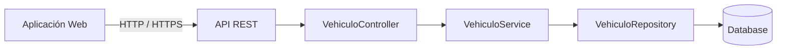
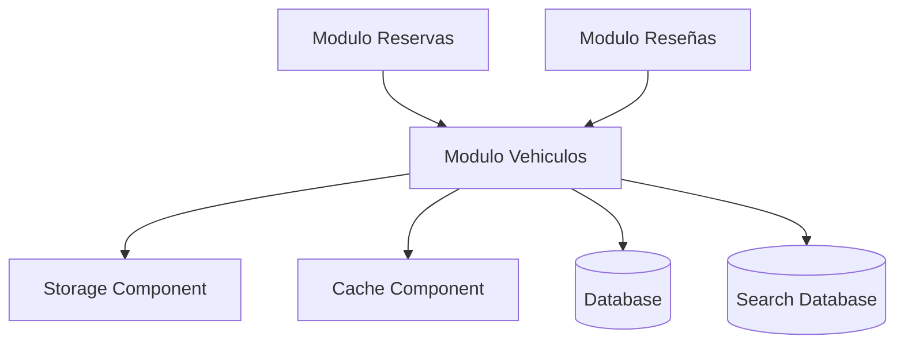
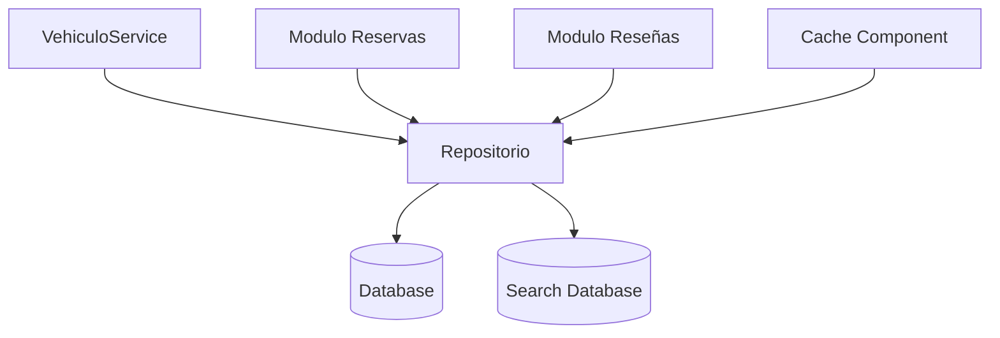
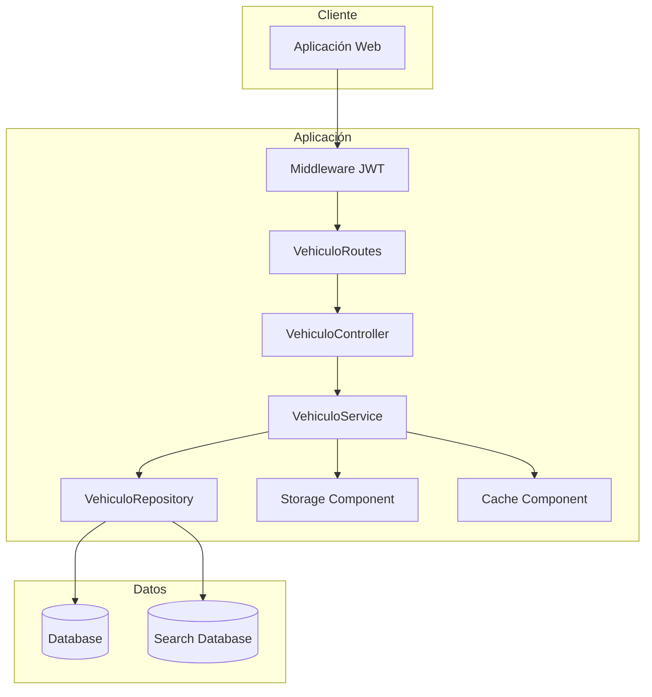

> [8. Aplicación de Patrones Arquitecturales](../8.md) › [8.2. Módulo 2 / Integrante 2](8.2.md)

# 8.2. Módulo 2 – Catálogo de Vehículos

El módulo de **Catálogo de Vehículos** es el encargado de gestionar el registro, publicación, consulta, actualización y administración de los vehículos disponibles dentro de la plataforma **DriveShare**. Este módulo constituye uno de los componentes centrales del sistema, ya que concentra la información utilizada por los arrendatarios para buscar vehículos y por los propietarios para administrar sus publicaciones.

Las funcionalidades del módulo permiten registrar vehículos, administrar imágenes, definir características, establecer disponibilidad, actualizar información, realizar búsquedas mediante diferentes criterios y mantener sincronizada la información con otros módulos como **Reservas** y **Reseñas**.

Desde el punto de vista arquitectónico, este módulo debe soportar un crecimiento continuo en el número de publicaciones y consultas, manteniendo tiempos de respuesta adecuados, una adecuada organización del software y una integración sencilla con el resto de componentes de la plataforma.

Con el propósito de garantizar una arquitectura mantenible, escalable y desacoplada, se seleccionaron patrones arquitectónicos pertenecientes a las categorías de **Módulo**, **Componente y Conector** y **Asignación**, siguiendo los patrones estudiados durante el curso y considerando la arquitectura implementada en DriveShare.

Cada decisión arquitectónica se documenta mediante un **Architecture Decision Record (ADR)**, donde se describen el contexto, las alternativas evaluadas, la decisión adoptada y las consecuencias derivadas de su implementación.

---

# Resumen de decisiones de patrones (ADR)

| Código | Categoría | Patrones evaluados | Patrón seleccionado | Justificación |
|---------|-----------|-------------------|---------------------|---------------|
| ADR-01 | Patrón de Módulo | Arquitectura en Capas vs Descomposición por Dominio | **Arquitectura en Capas** | Permite separar claramente la presentación, la lógica de negocio y el acceso a datos del catálogo, facilitando la mantenibilidad y evolución del sistema. |
| ADR-02 | Componente y Conector | Cliente-Servidor vs Peer-to-Peer | **Cliente-Servidor** | Centraliza la administración y consulta de vehículos mediante una API REST, manteniendo el control del acceso a la información. |
| ADR-03 | Componente y Conector | SOA vs Broker | **Arquitectura Orientada a Servicios (SOA)** | Facilita la comunicación entre el módulo de Vehículos y componentes especializados como Storage, Cache y otros módulos de la plataforma mediante servicios independientes. |
| ADR-04 | Componente y Conector | Pipe-and-Filter vs Datos Compartidos | **Datos Compartidos** | Permite que todos los componentes del módulo trabajen sobre un repositorio común garantizando consistencia, persistencia y acceso concurrente a la información del catálogo. |
| ADR-05 | Patrón de Asignación | Multi-Tier vs Map-Reduce | **Multi-Tier** | Distribuye el sistema en capas físicas independientes (cliente, aplicación y datos), mejorando la seguridad, mantenibilidad y escalabilidad de la plataforma. |

---

# ADR-01 – Arquitectura en Capas

## Categoría

**Patrón de Módulo**

---

## Contexto

El módulo de Catálogo de Vehículos concentra toda la lógica relacionada con el registro, actualización, consulta y administración de los vehículos publicados dentro de DriveShare.

Entre sus principales responsabilidades se encuentran:

- Registrar nuevos vehículos.
- Actualizar la información del vehículo.
- Gestionar la disponibilidad.
- Administrar imágenes.
- Consultar vehículos mediante diferentes filtros.
- Mostrar el detalle de cada publicación.
- Compartir información con los módulos de Reservas y Reseñas.

Debido a que estas funcionalidades evolucionarán constantemente conforme crezca la plataforma, resulta necesario organizar el software de forma que cada componente tenga responsabilidades claramente definidas y pueda evolucionar independientemente.

Asimismo, el módulo interactúa con otros componentes de la arquitectura como **Storage Component**, **Cache Component**, **Search Database**, **Database** y la **Capa de Repositorios**, por lo que mantener una adecuada separación de responsabilidades facilita la integración y reduce el acoplamiento entre componentes.

---

## Problema

Si toda la lógica del módulo de Vehículos se implementara dentro de un único componente, cualquier modificación relacionada con el registro de vehículos, consultas, disponibilidad o imágenes impactaría directamente sobre el resto del sistema.

Esta situación incrementaría el acoplamiento entre componentes, dificultaría el mantenimiento del código, aumentaría la complejidad de las pruebas y reduciría la capacidad de incorporar nuevas funcionalidades sin afectar componentes existentes.

---

## Alternativas Evaluadas

| Alternativa | Descripción | Ventaja | Desventaja |
|-------------|------------|---------|------------|
| Arquitectura en Capas | Organiza el software en capas jerárquicas con responsabilidades específicas y comunicación controlada entre ellas. | Favorece la separación de responsabilidades, la mantenibilidad y la reutilización del código. | Requiere respetar una estructura estricta entre capas, incrementando el número de componentes. |
| Descomposición por Dominio | Organiza el software alrededor de funcionalidades del negocio. | Facilita comprender el dominio funcional del sistema. | No establece explícitamente la separación entre presentación, lógica de negocio y persistencia, pudiendo aumentar el acoplamiento técnico. |

---

## Decisión

Se decide adoptar el patrón **Arquitectura en Capas** para estructurar internamente el módulo de Catálogo de Vehículos.

Bajo este enfoque, cada capa posee responsabilidades claramente definidas y únicamente puede interactuar con la capa inmediatamente inferior, reduciendo el acoplamiento y facilitando la evolución del sistema.

La organización general del módulo queda estructurada de la siguiente manera:

| Capa | Responsabilidad |
|------|-----------------|
| Middlewares | Validar autenticación, autorización y aspectos transversales antes de procesar una solicitud. |
| Rutas | Exponer los endpoints REST correspondientes al catálogo de vehículos. |
| Controladores | Recibir las solicitudes HTTP y coordinar la ejecución de la lógica del negocio. |
| Servicios | Implementar las reglas del negocio relacionadas con vehículos, búsquedas, disponibilidad e imágenes. |
| Repositorios | Centralizar el acceso a la información almacenada en la base de datos. |
| Modelos | Representar las entidades del dominio y su persistencia. |

---

## Instanciación en DriveShare

Dentro de DriveShare, el módulo de Catálogo de Vehículos se organiza siguiendo una estructura por capas donde cada componente cumple una función específica.

```text
Cliente Web

        │

        ▼

 Middleware JWT

        │

        ▼

 VehiculoRoutes

        │

        ▼

 VehiculoController

        │

        ▼

 VehiculoService

        │

        ▼

 VehiculoRepository

        │

        ▼

 Database
```

> **Figura 8.2.1.** Diagrama de Arquitectura en Capas del Módulo de Catálogo de Vehículos. *(Se incluirá el diagrama correspondiente en la versión final del documento).*

---

## Beneficios obtenidos

La adopción de una Arquitectura en Capas proporciona los siguientes beneficios para el módulo de Catálogo de Vehículos:

- Separación clara de responsabilidades entre los diferentes componentes.
- Reducción del acoplamiento entre la lógica del negocio y la persistencia de datos.
- Mayor facilidad para realizar pruebas unitarias e integración.
- Mejor organización del código fuente.
- Facilidad para incorporar nuevas funcionalidades sin afectar el resto del sistema.
- Mayor mantenibilidad conforme evolucione la plataforma.

---

## Consecuencias

### Separación de responsabilidades (Consecuencia positiva)

Cada capa concentra una única responsabilidad, permitiendo modificar la lógica de negocio, el acceso a datos o la interfaz sin afectar directamente las demás capas.

Como contraparte, esta organización incrementa el número de componentes del sistema y exige respetar estrictamente la comunicación jerárquica entre ellos.

---

### Facilidad de mantenimiento (Consecuencia positiva)

Los cambios relacionados con nuevas funcionalidades del catálogo, filtros de búsqueda o reglas de negocio pueden implementarse principalmente en la capa de servicios, reduciendo el impacto sobre el resto del sistema.

Como consecuencia, el desarrollo requiere mantener una adecuada organización de clases, interfaces y dependencias entre capas.

---

### Menor acoplamiento (Consecuencia positiva)

La arquitectura reduce la dependencia directa entre la interfaz de usuario, la lógica del negocio y la persistencia de datos, favoreciendo la reutilización de componentes y la evolución independiente de cada capa.

Sin embargo, la comunicación secuencial entre capas puede introducir una ligera sobrecarga respecto a implementaciones menos estructuradas, aceptándose este costo debido a los beneficios obtenidos en mantenibilidad y calidad del software.
---

> **Nota:** Para cada uno de los ADR presentados se cuenta con su respectivo diagrama arquitectónico (Arquitectura en Capas, Cliente-Servidor, SOA, Datos Compartidos y Multi-Tier), los cuales complementan la descripción de las decisiones arquitectónicas adoptadas para el módulo de Catálogo de Vehículos.


# ADR-02 – Cliente-Servidor

## Categoría

**Patrón de Componente y Conector**

---

## Contexto

El módulo de Catálogo de Vehículos requiere una arquitectura de comunicación distribuida que permita separar la interfaz utilizada por propietarios y arrendatarios de la lógica encargada de administrar la información del catálogo.

Los propietarios interactúan con la plataforma para registrar vehículos, actualizar información, administrar disponibilidad y gestionar imágenes. Por otro lado, los arrendatarios consultan el catálogo aplicando filtros de búsqueda y visualizan el detalle de los vehículos disponibles.

Debido a que múltiples usuarios pueden acceder simultáneamente al sistema desde diferentes dispositivos, es necesario centralizar el procesamiento de las solicitudes y garantizar que toda la lógica del negocio, las validaciones y el acceso a la información se ejecuten exclusivamente desde el servidor.

Esta arquitectura también permite que otros módulos de DriveShare, como **Reservas** y **Reseñas**, consulten la información del catálogo mediante servicios controlados, evitando accesos directos a la base de datos.

---

## Problema

Permitir que la aplicación cliente acceda directamente a la base de datos o implemente reglas del negocio generaría problemas de seguridad, inconsistencias en la información y un elevado acoplamiento entre los componentes del sistema.

Además, cualquier modificación en la estructura de los datos obligaría a actualizar todas las aplicaciones cliente, dificultando el mantenimiento y la evolución de la plataforma.

Se requiere una arquitectura donde el servidor concentre la lógica del negocio, las validaciones y el acceso a la información, mientras que los clientes únicamente consuman los servicios ofrecidos por la API.

---

## Alternativas Evaluadas

| Alternativa | Descripción | Ventaja | Desventaja |
|-------------|------------|---------|------------|
| Cliente-Servidor | Los clientes envían solicitudes al servidor mediante servicios REST. El servidor procesa la lógica del negocio, administra el acceso a los datos y devuelve la respuesta correspondiente. | Centraliza el control de la información, mejora la seguridad y facilita el mantenimiento del sistema. | El servidor representa un punto central cuya disponibilidad resulta crítica para el funcionamiento de la plataforma. |
| Peer-to-Peer (P2P) | Los nodos se comunican directamente entre sí compartiendo recursos y responsabilidades. | Alta descentralización y tolerancia a fallos distribuidos. | No permite centralizar el control de acceso ni resulta adecuado para administrar información crítica del catálogo. |

---

## Decisión

Se decide implementar el patrón **Cliente-Servidor** para estructurar la comunicación entre la aplicación web y el módulo de Catálogo de Vehículos.

La aplicación cliente será responsable únicamente de capturar la información ingresada por los usuarios, presentar los resultados de búsqueda y consumir los servicios expuestos por el backend.

El servidor concentrará toda la lógica relacionada con:

- Registro de vehículos.
- Actualización de información.
- Gestión de disponibilidad.
- Administración de imágenes.
- Búsquedas mediante filtros.
- Consultas del detalle de vehículos.
- Validaciones de negocio.
- Acceso a la base de datos.

De esta manera se garantiza que toda la información del catálogo permanezca centralizada y protegida.

---

## Instanciación del Patrón

Dentro de DriveShare, la interacción entre los componentes sigue el siguiente flujo:

| Operación del módulo | Método REST | Endpoint propuesto | Servicio responsable |
|----------------------|-------------|--------------------|----------------------|
| Registrar vehículo | POST | /vehiculos | VehiculoService |
| Obtener catálogo | GET | /vehiculos | VehiculoService |
| Consultar vehículo | GET | /vehiculos/{id} | VehiculoService |
| Actualizar vehículo | PUT | /vehiculos/{id} | VehiculoService |
| Eliminar vehículo | DELETE | /vehiculos/{id} | VehiculoService |
| Actualizar disponibilidad | PATCH | /vehiculos/{id}/disponibilidad | VehiculoService |
| Buscar vehículos | GET | /vehiculos/busqueda | VehiculoService |
| Registrar imágenes | POST | /vehiculos/{id}/imagenes | VehiculoService |

---

## Diagrama de Interacción



**Figura 8.2.2.** Patrón Cliente-Servidor implementado en el módulo de Catálogo de Vehículos.

---

## Beneficios Concretos

La implementación del patrón Cliente-Servidor proporciona los siguientes beneficios:

- Centraliza toda la lógica del negocio relacionada con el catálogo.
- Evita el acceso directo de los clientes a la base de datos.
- Facilita la aplicación de políticas de autenticación y autorización mediante Middleware JWT.
- Reduce el acoplamiento entre la interfaz de usuario y la lógica del negocio.
- Permite que otros módulos de la plataforma consuman información del catálogo mediante servicios REST.
- Favorece la reutilización de la API por aplicaciones web o móviles.

---

## Consecuencias Aceptadas

### Centralización del control del catálogo (Consecuencia positiva)

Toda la información relacionada con los vehículos es administrada exclusivamente por el servidor, garantizando que las validaciones y reglas del negocio se ejecuten de forma consistente antes de acceder a la base de datos.

Como contraparte, la disponibilidad del servidor resulta crítica para el funcionamiento del módulo, por lo que será necesario implementar mecanismos adecuados de monitoreo y escalabilidad.

---

### Mayor seguridad (Consecuencia positiva)

La aplicación cliente nunca accede directamente a la base de datos ni ejecuta reglas del negocio, reduciendo el riesgo de modificaciones no autorizadas sobre la información del catálogo.

Sin embargo, el servidor debe implementar mecanismos de autenticación, autorización y validación de solicitudes para proteger los servicios expuestos.

---

### Independencia entre cliente y servidor (Consecuencia positiva)

La separación entre la interfaz de usuario y la lógica del negocio permite evolucionar ambas aplicaciones de forma independiente, facilitando futuras mejoras del sistema.

Como consecuencia, resulta necesario mantener contratos estables entre el cliente y la API REST para evitar incompatibilidades durante la evolución del software.

# ADR-03 – Arquitectura Orientada a Servicios (SOA)

## Categoría

**Patrón de Componente y Conector**

---

## Contexto

El módulo de Catálogo de Vehículos no funciona de manera aislada dentro de DriveShare. Para ofrecer todas sus funcionalidades necesita interactuar con otros componentes especializados de la arquitectura, encargados de proporcionar servicios complementarios sin que el módulo conozca los detalles internos de su implementación.

Entre estas interacciones se encuentran el almacenamiento de imágenes de los vehículos mediante el **Storage Component**, la utilización del **Cache Component** para optimizar las consultas frecuentes, el acceso a la **Search Database** para mejorar las búsquedas y la comunicación con otros módulos del sistema como **Reservas** y **Reseñas**.

Debido a esta necesidad de integración entre componentes independientes, resulta conveniente utilizar una arquitectura que permita consumir servicios mediante interfaces claramente definidas, manteniendo un bajo acoplamiento entre los módulos del sistema.

---

## Problema

Si el módulo de Catálogo implementara directamente la lógica de almacenamiento de archivos, administración del caché o consultas especializadas, aumentaría significativamente el acoplamiento entre componentes.

Cualquier modificación en alguno de estos servicios obligaría a realizar cambios dentro del propio módulo de Vehículos, incrementando el esfuerzo de mantenimiento y reduciendo la capacidad de evolución de la arquitectura.

Asimismo, integrar directamente componentes especializados dificultaría la reutilización de dichos servicios por otros módulos de la plataforma.

---

## Alternativas Evaluadas

| Alternativa | Descripción | Ventaja | Desventaja |
|-------------|------------|---------|------------|
| Arquitectura Orientada a Servicios (SOA) | Organiza el sistema mediante servicios independientes que se comunican a través de interfaces bien definidas. | Favorece el desacoplamiento, la reutilización y la interoperabilidad entre módulos. | Depende de la disponibilidad de los servicios y puede incrementar ligeramente la latencia debido a la comunicación entre componentes. |
| Broker | Introduce un intermediario encargado de enrutar dinámicamente las solicitudes entre consumidores y proveedores de servicios. | Desacopla completamente los servicios y facilita arquitecturas altamente distribuidas. | Agrega una capa adicional de complejidad que no resulta necesaria para la arquitectura actual de DriveShare. |

---

## Decisión

Se decide implementar el patrón **Arquitectura Orientada a Servicios (SOA)** para estructurar la comunicación entre el módulo de Catálogo de Vehículos y los componentes especializados de la plataforma.

Cada servicio mantiene responsabilidades claramente definidas y expone interfaces que permiten ser consumidas por otros componentes sin exponer su implementación interna.

Bajo este enfoque, el módulo de Vehículos concentra únicamente las reglas del negocio relacionadas con el catálogo, delegando responsabilidades específicas a componentes especializados.

Los principales servicios utilizados son:

- **Storage Component**, encargado del almacenamiento de imágenes de los vehículos.
- **Cache Component**, responsable de almacenar temporalmente información consultada con alta frecuencia.
- **Search Database**, utilizada para optimizar búsquedas y filtrados del catálogo.
- **Database**, responsable de la persistencia principal de la información.
- **Módulo Reservas**, que consulta la disponibilidad de los vehículos.
- **Módulo Reseñas**, que consulta información relacionada con las valoraciones de cada vehículo.

Esta organización permite mantener una arquitectura modular, flexible y preparada para incorporar nuevos servicios sin afectar significativamente el funcionamiento del catálogo.

---

## Instanciación del Patrón

La interacción entre el módulo de Vehículos y los diferentes servicios se representa de la siguiente manera:

| Servicio | Función dentro del módulo |
|-----------|---------------------------|
| Storage Component | Gestiona el almacenamiento y recuperación de imágenes de los vehículos. |
| Cache Component | Optimiza consultas frecuentes reduciendo el acceso repetitivo a la base de datos. |
| Database | Almacena permanentemente la información del catálogo. |
| Search Database | Optimiza búsquedas mediante filtros y consultas especializadas. |
| Módulo Reservas | Consulta disponibilidad antes de generar una reserva. |
| Módulo Reseñas | Obtiene la valoración asociada a cada vehículo. |

---

## Diagrama de Interacción



**Figura 8.2.3. Arquitectura Orientada a Servicios implementada en el módulo de Catálogo de Vehículos.**

---

## Beneficios Concretos

La adopción del patrón SOA proporciona los siguientes beneficios al módulo:

- Favorece el desacoplamiento entre los distintos componentes de la plataforma.
- Permite reutilizar servicios especializados desde diferentes módulos.
- Facilita el mantenimiento al separar claramente las responsabilidades.
- Mejora la escalabilidad permitiendo evolucionar cada servicio de forma independiente.
- Reduce la complejidad del módulo de Vehículos al delegar funciones específicas a otros componentes.
- Facilita la incorporación de nuevos servicios sin modificar significativamente la lógica del catálogo.

---

## Consecuencias Aceptadas

### Desacoplamiento entre servicios (Consecuencia positiva)

Cada componente puede evolucionar de forma independiente siempre que mantenga estable la interfaz de comunicación utilizada por el resto del sistema.

Como consecuencia, resulta necesario mantener contratos claramente definidos entre consumidores y proveedores de servicios para evitar incompatibilidades durante futuras evoluciones.

---

### Reutilización de componentes (Consecuencia positiva)

Servicios como el almacenamiento de imágenes, la gestión del caché y las búsquedas pueden ser utilizados por distintos módulos de DriveShare, reduciendo la duplicidad de funcionalidades.

Sin embargo, esto incrementa la dependencia respecto a la disponibilidad de dichos servicios, por lo que deberán implementarse mecanismos adecuados de monitoreo y recuperación ante fallos.

---

### Escalabilidad de la plataforma (Consecuencia positiva)

Cada servicio puede incrementarse de capacidad de manera independiente de acuerdo con la carga de trabajo que soporte, optimizando el uso de los recursos de infraestructura.

Como contraparte, la comunicación entre múltiples servicios introduce una ligera sobrecarga de red respecto a una arquitectura completamente monolítica, costo aceptado debido a las ventajas obtenidas en mantenibilidad y escalabilidad.

# ADR-04 – Datos Compartidos

## Categoría

**Patrón de Componente y Conector**

---

## Contexto

El módulo de Catálogo de Vehículos administra toda la información relacionada con los vehículos publicados dentro de DriveShare. Las operaciones de registro, actualización, consulta, búsqueda, disponibilidad y administración de imágenes requieren acceder continuamente a un repositorio central de información.

Asimismo, otros módulos de la plataforma, como **Reservas** y **Reseñas**, necesitan consultar información del catálogo para validar la disponibilidad de los vehículos, obtener sus características y mostrar información adicional al usuario.

Debido a que múltiples componentes del sistema requieren acceder a la misma información de forma concurrente, resulta necesario disponer de un repositorio centralizado que garantice la consistencia, integridad y persistencia de los datos.

---

## Problema

Si cada componente almacenara su propia copia de la información del catálogo, se producirían inconsistencias entre los datos utilizados por los diferentes módulos de la plataforma.

Por ejemplo, un vehículo podría aparecer como disponible en el módulo de Catálogo mientras el módulo de Reservas ya lo considera reservado, generando errores durante el proceso de alquiler.

Asimismo, la duplicación de información incrementaría el costo de mantenimiento y dificultaría la sincronización de los datos conforme el sistema evolucione.

Se requiere una arquitectura que permita que todos los componentes compartan una única fuente de información confiable.

---

## Alternativas Evaluadas

| Alternativa | Descripción | Ventaja | Desventaja |
|-------------|------------|---------|------------|
| Pipe-and-Filter | Organiza el procesamiento mediante una secuencia de filtros que transforman la información progresivamente. | Muy eficiente para procesamiento por lotes y transformación de datos. | No proporciona un mecanismo adecuado para compartir información persistente entre múltiples componentes. |
| Datos Compartidos | Los distintos componentes acceden a un repositorio común encargado de administrar la persistencia y el acceso concurrente a la información. | Garantiza consistencia, integridad y reutilización de la información compartida por el sistema. | El repositorio central puede convertirse en un punto crítico que requiere mecanismos adecuados de disponibilidad y escalabilidad. |

---

## Decisión

Se decide adoptar el patrón **Datos Compartidos** para estructurar el almacenamiento de la información del módulo de Catálogo de Vehículos.

Bajo este enfoque, toda la información relacionada con los vehículos se almacena en un repositorio común administrado por la **Capa de Repositorios**, garantizando que todas las operaciones trabajen sobre una única fuente de información.

La persistencia principal del catálogo se realiza mediante la **Database**, mientras que las consultas especializadas y búsquedas optimizadas utilizan la **Search Database**, ambas coordinadas por la capa de acceso a datos.

Esta organización permite que todos los componentes de DriveShare consulten información consistente del catálogo sin mantener copias independientes de los datos.

---

## Instanciación del Patrón

Dentro de DriveShare, el patrón se implementa mediante una arquitectura donde los diferentes componentes acceden a la misma fuente de información utilizando la Capa de Repositorios.

Los principales consumidores del repositorio compartido son:

- VehiculoService
- Módulo Reservas
- Módulo Reseñas
- Cache Component
- Search Database

La persistencia de la información permanece centralizada, evitando inconsistencias entre los distintos módulos del sistema.

---

## Flujo de interacción



**Figura 8.2.4. Implementación del patrón Datos Compartidos en el módulo de Catálogo de Vehículos.**

---

## Beneficios Concretos

La implementación del patrón Datos Compartidos proporciona los siguientes beneficios:

- Garantiza una única fuente de verdad para toda la información del catálogo.
- Evita inconsistencias entre los diferentes módulos del sistema.
- Reduce la duplicidad de información.
- Facilita el acceso concurrente mediante mecanismos de persistencia centralizada.
- Simplifica el mantenimiento del sistema.
- Favorece la reutilización de la información por distintos componentes de la plataforma.

---

## Consecuencias Aceptadas

### Consistencia de la información (Consecuencia positiva)

Toda la información del catálogo permanece centralizada, garantizando que las consultas y actualizaciones realizadas por los diferentes módulos utilicen datos consistentes.

Como consecuencia, la disponibilidad del repositorio resulta crítica para el correcto funcionamiento del sistema, por lo que deberán implementarse mecanismos adecuados de respaldo y monitoreo.

---

### Compartición de información (Consecuencia positiva)

Los distintos módulos de DriveShare pueden acceder al mismo conjunto de información sin mantener copias independientes, reduciendo la duplicidad de datos y simplificando la administración del catálogo.

Sin embargo, el incremento de accesos concurrentes exige optimizar consultas, índices y mecanismos de acceso para mantener un buen rendimiento.

---

### Persistencia centralizada (Consecuencia positiva)

La utilización de un repositorio compartido facilita la administración de la información y simplifica futuras ampliaciones del sistema.

Como contraparte, cualquier modificación importante en la estructura del repositorio deberá planificarse cuidadosamente para minimizar el impacto sobre los componentes que dependen de él.

# ADR-05 – Multi-Tier

## Categoría

**Patrón de Asignación (Allocation)**

---

## Contexto

El módulo de Catálogo de Vehículos constituye uno de los componentes principales de DriveShare, ya que administra la información de los vehículos publicados por los propietarios y proporciona los datos necesarios para que los arrendatarios puedan consultar el catálogo y realizar reservas.

Debido a que la plataforma será utilizada simultáneamente por múltiples usuarios, resulta necesario distribuir los diferentes componentes del sistema en niveles de ejecución independientes, evitando que la interfaz de usuario tenga acceso directo a los servicios internos o a la base de datos.

Asimismo, el módulo interactúa con componentes especializados como **Storage Component**, **Cache Component**, **Database**, **Search Database** y la **Capa de Repositorios**, los cuales requieren ejecutarse en entornos separados para mejorar la seguridad, facilitar el mantenimiento y permitir el crecimiento futuro de la plataforma.

---

## Problema

Si todos los componentes del módulo fueran desplegados dentro de un único entorno de ejecución, cualquier incremento en la carga del sistema afectaría simultáneamente a la interfaz de usuario, la lógica del negocio y la persistencia de datos.

Además, esta arquitectura dificultaría el mantenimiento, incrementaría el riesgo de acceso no autorizado a la base de datos y limitaría la posibilidad de escalar únicamente aquellos componentes que presenten una mayor demanda.

Se requiere una estrategia de despliegue que permita distribuir los componentes del sistema en diferentes niveles, manteniendo una adecuada separación de responsabilidades.

---

## Alternativas Evaluadas

| Alternativa | Descripción | Ventaja | Desventaja |
|-------------|------------|---------|------------|
| Map-Reduce | Distribuye grandes volúmenes de procesamiento en múltiples nodos utilizando fases Map y Reduce. | Excelente para procesamiento masivo de datos y analítica distribuida. | No resulta adecuado para aplicaciones transaccionales como el catálogo de vehículos, ya que introduce una complejidad innecesaria. |
| Multi-Tier | Organiza el sistema en niveles independientes de presentación, lógica de negocio y datos. | Facilita la escalabilidad, seguridad, mantenibilidad y administración independiente de cada nivel. | Incrementa la complejidad de despliegue y administración de la infraestructura. |

---

## Decisión

Se decide adoptar el patrón **Multi-Tier** para organizar el despliegue físico del módulo de Catálogo de Vehículos.

Bajo este enfoque, la plataforma se divide en tres niveles claramente diferenciados:

- **Tier Cliente**, encargado de la interacción con los usuarios.
- **Tier Aplicación**, responsable de ejecutar la lógica del negocio.
- **Tier Datos**, encargado de almacenar y administrar la información persistente.

Esta organización permite que cada nivel pueda evolucionar y escalar de manera independiente, reduciendo el acoplamiento entre componentes y mejorando la disponibilidad del sistema.

---

## Instanciación del Patrón

La arquitectura del módulo de Catálogo de Vehículos se distribuye de la siguiente manera:

| Tier | Componentes asignados | Responsabilidad |
|------|-----------------------|-----------------|
| **Tier Cliente** | Aplicación Web (React) | Permitir que propietarios y arrendatarios interactúen con el catálogo de vehículos mediante una interfaz gráfica intuitiva. |
| **Tier Aplicación** | Middleware JWT, VehiculoRoutes, VehiculoController, VehiculoService, VehiculoRepository, Storage Component y Cache Component | Procesar las solicitudes, aplicar las reglas del negocio, validar permisos y coordinar el acceso a los componentes especializados. |
| **Tier Datos** | Database y Search Database | Garantizar la persistencia, integridad y disponibilidad de la información del catálogo y optimizar las búsquedas realizadas por los usuarios. |

---

## Diagrama de Despliegue



**Figura 8.2.5.** Implementación del patrón Multi-Tier para el módulo de Catálogo de Vehículos.

---

## Beneficios Concretos

La implementación del patrón Multi-Tier proporciona los siguientes beneficios:

- Separa físicamente la interfaz de usuario de la lógica del negocio y del almacenamiento de datos.
- Incrementa la seguridad evitando el acceso directo de los clientes a la base de datos.
- Permite escalar cada nivel de la arquitectura de manera independiente.
- Facilita el mantenimiento del sistema al distribuir claramente las responsabilidades.
- Favorece la reutilización de servicios por otros módulos de DriveShare.
- Permite administrar de forma independiente los componentes especializados del sistema.

---

## Consecuencias Aceptadas

### Mayor seguridad (Consecuencia positiva)

La separación entre los diferentes niveles de ejecución impide que la aplicación cliente acceda directamente a la información almacenada en la base de datos, obligando a que todas las solicitudes sean procesadas por el servidor de aplicaciones.

Como consecuencia, el sistema requiere administrar adecuadamente la comunicación entre los distintos niveles y proteger los servicios expuestos mediante mecanismos de autenticación y autorización.

---

### Escalabilidad independiente (Consecuencia positiva)

Cada nivel puede incrementarse de capacidad según la demanda específica del sistema. Por ejemplo, el servidor de aplicaciones puede ampliarse para soportar un mayor número de consultas sin necesidad de modificar la infraestructura de datos.

Sin embargo, esta distribución incrementa la complejidad de administración de la infraestructura y exige mecanismos adecuados de monitoreo para cada uno de los niveles.

---

### Mantenibilidad de la arquitectura (Consecuencia positiva)

La distribución por niveles facilita la evolución independiente de la interfaz de usuario, la lógica del negocio y la persistencia de datos, permitiendo incorporar nuevas funcionalidades con un menor impacto sobre el resto del sistema.

Como contraparte, la comunicación entre múltiples niveles introduce una ligera latencia respecto a arquitecturas monolíticas, costo aceptado debido a las ventajas obtenidas en mantenibilidad, seguridad y escalabilidad.
---

[⬅️ Anterior](../8.1/8.1.md) | [🏠 Home](../../README.md) | [Siguiente ➡️](../8.3/8.3.md)
