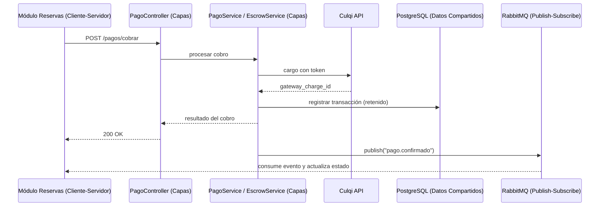

> [8. Aplicación de Patrones Arquitecturales](../8.md) › [8.4. Módulo 4 / Integrante 4](8.4.md)

# 8.4. Módulo 4 / Integrante 4

## **Módulo de pagos**

### Decisión 1 (Patrón de Módulo)
- **Título**: Elección entre Arquitectura en Capas y Descomposición por Dominio.
- **Contexto**: El módulo de pagos concentra lógica sensible: cobro al arrendatario, retención de fondos (escrow), liberación al arrendador, reembolsos e historial de transacciones. Además, se integra con Culqi mediante tokenización, publica eventos en RabbitMQ y encola reintentos con BullMQ. Un error de diseño en esta zona puede derivar en cobros duplicados, fondos no liberados o pérdida de trazabilidad financiera, por lo que se necesita una forma clara de estructurar internamente el código del microservicio.

- **Alternativas**:
    1. **Arquitectura en Capas:** Organiza el módulo en capas jerárquicas (controllers, guards, services, adapters, repositories, entities) con comunicación unidireccional descendente. Favorece la separación entre infraestructura web, reglas de negocio y acceso a datos.

    2. **Descomposición por Dominio:** Organiza el código alrededor de subdominios funcionales (Cobros, Escrow, Reembolsos) sin una separación técnica explícita entre infraestructura, negocio y persistencia.

- **Criterios de Elección**:
    - Facilitar la auditoría del flujo de dinero (relacionado al escenario ESC-R12).
    - Aislar la comunicación con Culqi del resto de la lógica de negocio.
    - Permitir pruebas unitarias aisladas por capa.
    - Mantenibilidad ante cambios futuros (nuevos métodos de pago, nuevo proveedor).
- **Decisión**: Arquitectura en Capas.
- **Sustento**: La Arquitectura en Capas separa con claridad la validación HTTP, la orquestación del flujo de cobro/escrow, el adapter hacia Culqi y el acceso a datos, lo que facilita auditar por dónde pasa cada transacción y aislar el impacto de un cambio de proveedor de pagos a una sola capa (el `CulqiAdapter`).

---

### Decisión 2 (Componente y Conector — Validaciones Síncronas)
- **Título**: Elección entre Cliente-Servidor y Peer-to-Peer para las validaciones críticas de cobro.
- **Contexto**: El módulo de pagos debe validar de forma inmediata si un cobro puede procesarse: verificar identidad (módulo Usuarios), confirmar el estado de una reserva (módulo Reservas) y comunicarse con Culqi. Estas validaciones no toleran demoras ni resultados ambiguos, ya que de ellas depende autorizar o rechazar una transacción económica real.

- **Alternativas**:
    1. **Cliente-Servidor:** Reservas y Usuarios envían solicitudes REST síncronas al servicio de Pagos, que centraliza la lógica y responde con el resultado de la validación.

    2. **Peer-to-Peer (P2P):** Los módulos intercambian información de pagos de forma directa y simétrica, sin un servidor central que centralice la regla de negocio.

- **Criterios de Elección**:
    - Centralizar el control de las reglas financieras en un único punto.
    - Garantizar una respuesta inmediata y determinista antes de confirmar una reserva.
    - Capacidad de aplicar controles de seguridad (rate limiting, detección de fraude) en un punto único.
- **Decisión**: Cliente-Servidor.
- **Sustento**: Centralizar las validaciones en el servicio de Pagos evita que Reservas o Usuarios repliquen reglas financieras y garantiza una respuesta inmediata y consistente, necesaria para decidir si una reserva puede confirmarse. Esto complementa la Decisión 2 de la sección 4.4 (enfoque híbrido REST + mensajería).

---

### Decisión 3 (Componente y Conector — Eventos de Estado)
- **Título**: Elección entre Publish-Subscribe (RabbitMQ) y REST síncrono puro para difundir eventos de estado del pago.
- **Contexto**: Además de las validaciones síncronas, el módulo de pagos genera eventos que interesan a otros módulos sin que estos deban bloquear su ejecución esperando una respuesta: confirmación de cobro, liberación de fondos, fallo de cobro o reembolso procesado. El módulo de Reservas necesita enterarse de estos eventos para actualizar el estado de la reserva y, eventualmente, notificar al usuario.

- **Alternativas**:
    1. **Publish-Subscribe (RabbitMQ):** El servicio de Pagos publica eventos (`pago.confirmado`, `pago.fallido`, `pago.liberado`, `reembolso.procesado`) en un exchange de RabbitMQ. Los módulos interesados se suscriben de forma independiente y los mensajes persisten en cola ante caídas temporales.

    2. **REST síncrono puro:** El servicio de Pagos llama directamente a los endpoints de cada módulo interesado tras procesar el cobro, sin infraestructura de mensajería adicional.

- **Criterios de Elección**:
    - Desacoplar al módulo de Pagos de la disponibilidad inmediata de sus consumidores.
    - Evitar pérdida de eventos financieros ante caídas temporales de Reservas.
    - Tolerancia a la consistencia eventual en la actualización del estado de la reserva.
- **Decisión**: Publish-Subscribe con RabbitMQ.
- **Sustento**: RabbitMQ desacopla a Pagos de la disponibilidad de Reservas y persiste los eventos ante caídas temporales, evitando que se pierda la notificación de un cobro ya confirmado. El costo de consistencia eventual (unos segundos de desfase) es aceptable porque el cobro ya quedó registrado de forma atómica en la base de datos antes de publicar el evento.

---

### Decisión 4 (Componente y Conector — Persistencia)
- **Título**: Elección entre Pipe-and-Filter y Datos Compartidos para el acceso a la información de transacciones.
- **Contexto**: El módulo de pagos debe almacenar el historial completo de transacciones (cobros, retenciones, liberaciones, reembolsos) con trazabilidad exacta de montos y fechas. Múltiples servicios internos (`PagoService`, `EscrowService`, `ReembolsoService`) necesitan leer y escribir sobre la misma información de forma consistente, sin generar estados contradictorios.

- **Alternativas**:
    1. **Pipe-and-Filter:** Transforma los datos de pago como un flujo secuencial de filtros (validar → tokenizar → cobrar → registrar), sin definir un mecanismo propio de persistencia ni consulta posterior.

    2. **Datos Compartidos:** Todos los servicios acceden a un repositorio central (`TransaccionRepository` sobre PostgreSQL) que administra la persistencia y el acceso concurrente mediante transacciones ACID.

- **Criterios de Elección**:
    - Evitar estados contradictorios entre servicios (p. ej. liberar fondos de una transacción ya reembolsada).
    - Soporte ACID para operaciones atómicas de cobro, retención y liberación.
    - Auditoría eficiente del historial de estados.
- **Decisión**: Datos Compartidos.
- **Sustento**: Un repositorio central sobre PostgreSQL garantiza una única fuente de verdad para el estado de cada transacción, con integridad ACID que evita inconsistencias entre `EscrowService` y `ReembolsoService`. Es coherente con la Decisión 3 de la sección 4.4 (modelo relacional con NUMERIC y JSONB).

---

### Decisión 5 (Patrón de Asignación)
- **Título**: Elección entre Multi-Tier y Map-Reduce para la asignación física del módulo.
- **Contexto**: El módulo de pagos maneja información altamente sensible: credenciales tokenizadas, montos y respuestas del proveedor externo. Es indispensable que ni el cliente ni otros módulos accedan directamente a la base de datos de transacciones, y que la lógica de cobro se ejecute en un entorno aislado y auditable.

- **Alternativas**:
    1. **Map-Reduce:** Distribuye el procesamiento de grandes volúmenes de datos en fases Map y Reduce sobre múltiples nodos, pensado para analítica masiva más que para transacciones individuales en tiempo real.

    2. **Multi-Tier:** Organiza el despliegue en tiers independientes: cliente, aplicación (microservicio de Pagos) y datos (PostgreSQL), cada uno con su propio ciclo de escalamiento.

- **Criterios de Elección**:
    - Aislar la base de datos financiera de cualquier acceso directo del cliente.
    - Escalar el tier de aplicación de forma independiente ante picos de transacciones.
    - Aplicar controles de seguridad diferenciados sobre el tier de datos.
- **Decisión**: Multi-Tier.
- **Sustento**: Multi-Tier aísla la base de datos financiera del acceso directo del cliente y permite escalar el tier de aplicación (workers de BullMQ, instancias del microservicio) sin tocar el tier de datos. Es coherente con la Decisión 1 de la sección 4.4 (microservicio independiente con su propia base de datos) y con el resto de módulos del sistema, que también adoptan Multi-Tier.

---

## Detalles de Aplicación (Instanciación en DriveShare)

Los cinco patrones seleccionados se combinan en un mismo flujo de trabajo dentro del microservicio de Pagos:

1. **Arquitectura en Capas** ordena internamente el código del microservicio: las peticiones entran por `PagoController`/`ReembolsoController`, pasan por `AuthGuard`, son orquestadas por `PagoService`/`EscrowService`/`ReembolsoService`, y solo estos servicios conocen al `CulqiAdapter` y al `TransaccionRepository`.

2. **Cliente-Servidor** se usa cuando Reservas necesita una respuesta inmediata (por ejemplo, `POST /pagos/cobrar` antes de confirmar una reserva).

3. **Publish-Subscribe (RabbitMQ)** se usa cuando Pagos necesita informar a Reservas de un cambio de estado sin bloquear el flujo (`pago.confirmado`, `pago.liberado`, `reembolso.procesado`).

4. **Datos Compartidos** garantiza que, sin importar si la escritura viene de un cobro directo o de un worker de BullMQ reintentando una operación fallida, siempre exista una única fila consistente en PostgreSQL por transacción.

5. **Multi-Tier** ubica todo lo anterior en un tier de aplicación separado del tier de datos, de modo que ni el frontend en React ni otros módulos acceden nunca directamente a la base de datos de transacciones.

**Beneficio concreto obtenido**: esta combinación permite que el flujo crítico de cobro sea inmediato y auditable (Capas + Cliente-Servidor + Datos Compartidos), mientras que la propagación del estado hacia el resto de la plataforma es tolerante a fallos y no bloqueante (Publish-Subscribe), todo desplegado en un tier aislado que protege los datos financieros (Multi-Tier).

---

[⬅️ Anterior](../8.3/8.3.md) | [🏠 Home](../../README.md) | [Siguiente ➡️](../8.5/8.5.md)
