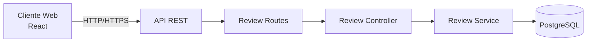
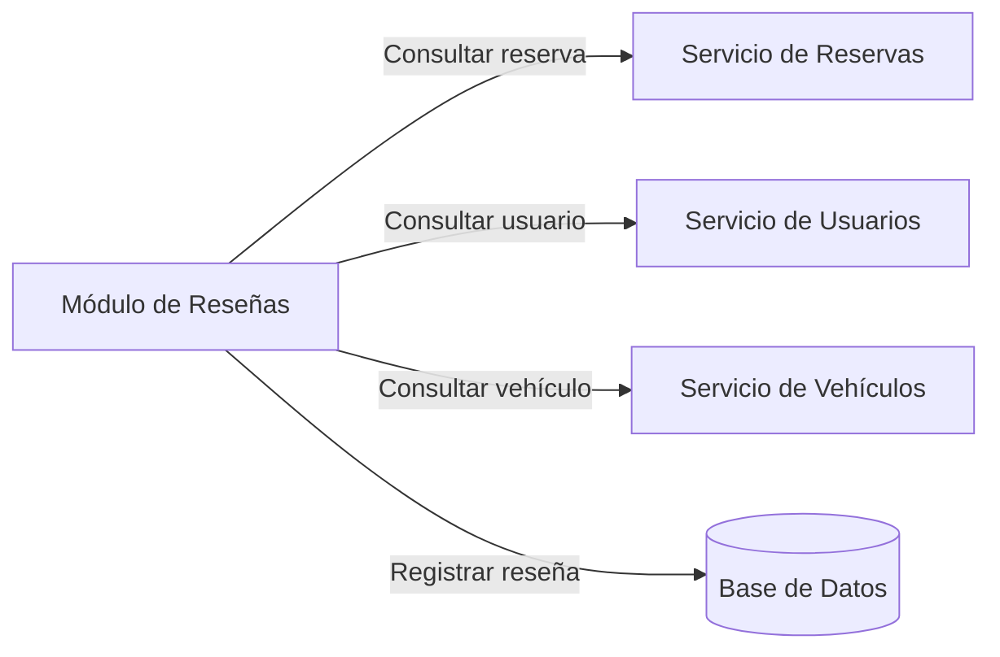
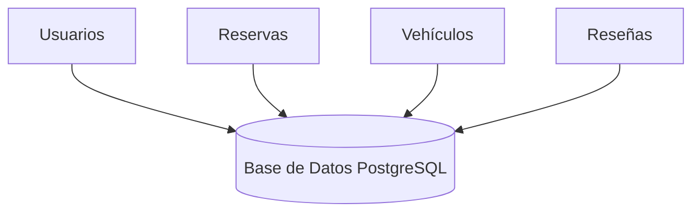
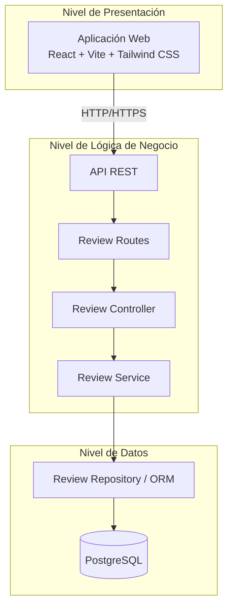

> [8. Aplicación de Patrones Arquitecturales](../8.md) › [8.5. Módulo 5 / Integrante 5](8.5.md)

# 8.5. Módulo 5 / Integrante 5

## Módulo 5: Reseñas y Reputación

El módulo de **Reseñas y Reputación** es responsable de gestionar las valoraciones realizadas por los usuarios al finalizar una reserva dentro de la plataforma **DriveShare**. Su propósito es incrementar la confianza entre arrendadores y arrendatarios mediante un sistema de calificaciones y comentarios basado en experiencias reales de uso.

Las principales responsabilidades del módulo comprenden el registro de reseñas, la consulta del historial de valoraciones, el cálculo de la reputación promedio de cada usuario y la validación de las condiciones necesarias para publicar una reseña, como la existencia de una reserva completada y la prevención de valoraciones duplicadas.

Debido a que este módulo interactúa con información proveniente de los módulos de Usuarios, Reservas y Vehículos, resulta necesario aplicar patrones arquitectónicos que favorezcan la separación de responsabilidades, la interoperabilidad entre componentes, la reutilización de servicios y la mantenibilidad del sistema.

En esta sección se presentan las decisiones arquitectónicas (ADR) adoptadas para el Módulo 5, justificando la selección de los patrones utilizados de acuerdo con los requerimientos funcionales y los atributos de calidad establecidos para DriveShare.

---

# Resumen de decisiones arquitectónicas (ADR)

| Código | Categoría | Patrones evaluados | Patrón seleccionado | Justificación |
|--------|-----------|-------------------|---------------------|---------------|
| ADR-01 | Patrón de Módulo | Arquitectura en Capas vs. Descomposición por Dominio | Arquitectura en Capas | Separa la lógica de presentación, negocio y persistencia, facilitando el mantenimiento y evolución del módulo de reseñas. |
| ADR-02 | Patrón Componente-Conector | Cliente-Servidor vs. Peer-to-Peer | Cliente-Servidor | Centraliza el procesamiento de solicitudes de creación y consulta de reseñas mediante una API REST. |
| ADR-03 | Patrón Componente-Conector | Arquitectura Orientada a Servicios (SOA) vs. Broker | SOA | Permite integrar el módulo de reseñas con los módulos de Usuarios, Reservas y Vehículos mediante servicios REST independientes. |
| ADR-04 | Patrón Componente-Conector | Datos Compartidos vs. Pipe-and-Filter | Datos Compartidos | Facilita el acceso consistente a la información compartida entre los distintos módulos mediante una base de datos relacional. |
| ADR-05 | Patrón de Asignación | Multi-Tier vs. Map-Reduce | Multi-Tier | Distribuye el frontend, backend y base de datos en niveles independientes que facilitan el despliegue y escalabilidad. |

---

# ADR-01: Arquitectura en Capas

## Categoría

Patrón de Módulo

## Patrones evaluados

- Arquitectura en Capas
- Descomposición por Dominio

## Contexto

El módulo de Reseñas y Reputación gestiona el registro de calificaciones y comentarios realizados por los usuarios después de finalizar una reserva. Además, permite consultar el historial de reseñas y calcular la reputación promedio de cada usuario.

Estas funcionalidades requieren aplicar reglas de negocio antes de acceder a la base de datos, como verificar que la reserva exista, que haya finalizado correctamente y que el usuario no haya emitido previamente una reseña para la misma reserva.

## Problema

Si la lógica de negocio, las rutas HTTP y el acceso a la base de datos se implementaran dentro de un mismo componente, el módulo presentaría un alto acoplamiento. Como consecuencia, cualquier modificación en las reglas para registrar reseñas o calcular la reputación implicaría cambios distribuidos por múltiples archivos, dificultando el mantenimiento y aumentando el riesgo de introducir errores.

## Alternativas consideradas

### Arquitectura en Capas

Organiza el módulo en capas independientes, separando las responsabilidades de presentación, lógica de negocio y persistencia de datos.

### Descomposición por Dominio

Agrupa todos los elementos relacionados con las reseñas dentro de un único dominio funcional, manteniendo juntos controladores, servicios, modelos y repositorios.

## Decisión

Se seleccionó el patrón **Arquitectura en Capas**, ya que proporciona una separación clara de responsabilidades entre la recepción de solicitudes HTTP, la implementación de las reglas de negocio y el acceso a la información persistente.

Esta organización facilita la evolución del módulo, permitiendo modificar la lógica relacionada con las reseñas sin afectar las rutas expuestas ni la estructura de almacenamiento de datos.

## Instanciación en DriveShare

Dentro del módulo de Reseñas y Reputación la arquitectura en capas se refleja mediante la siguiente organización:

- **Capa de Presentación:** expone los endpoints REST encargados de registrar, consultar y administrar reseñas mediante las rutas correspondientes.
- **Capa de Negocio:** implementa las validaciones necesarias para registrar una reseña, calcular la reputación promedio y verificar las reglas funcionales del módulo.
- **Capa de Persistencia:** administra el acceso a PostgreSQL mediante los modelos y repositorios encargados de almacenar las reseñas y recuperar la información solicitada.

```text
Frontend React
        │
        ▼
Review Routes
        │
        ▼
Review Controller
        │
        ▼
Review Service
        │
        ▼
Review Repository / ORM
        │
        ▼
PostgreSQL
```

## Beneficios

- Favorece la mantenibilidad del módulo.
- Reduce el acoplamiento entre componentes.
- Facilita la incorporación de nuevas reglas de reputación sin modificar las rutas HTTP.
- Permite realizar pruebas unitarias sobre la lógica de negocio de manera independiente.
- Mejora la legibilidad y organización del código fuente.

## Consecuencias

- Incrementa ligeramente la cantidad de clases y componentes del módulo.
- Una solicitud atraviesa varias capas antes de completarse, agregando un pequeño costo de procesamiento.
- Requiere mantener una clara separación de responsabilidades para evitar dependencias innecesarias entre capas.

---

# ADR-02: Cliente-Servidor

## Categoría

Patrón de Componente y Conector

## Patrones evaluados

- Cliente-Servidor
- Peer-to-Peer

## Contexto

El módulo de Reseñas y Reputación requiere que los usuarios puedan registrar y consultar valoraciones desde la aplicación web de DriveShare. Estas operaciones deben ejecutarse de forma segura y centralizada, garantizando que únicamente los usuarios autorizados puedan crear reseñas y acceder a la información correspondiente.

Asimismo, el sistema debe validar las solicitudes recibidas antes de procesarlas, verificando aspectos como la autenticación del usuario, la existencia de una reserva finalizada y la integridad de los datos enviados.

## Problema

Si cada cliente pudiera intercambiar información directamente con otros clientes para registrar o consultar reseñas, existiría un alto riesgo de inconsistencias, pérdida de control sobre los datos y vulnerabilidades de seguridad. Además, sería imposible garantizar que las reglas de negocio se ejecuten de forma uniforme para todos los usuarios.

Por ello, resulta necesario centralizar el procesamiento de las solicitudes en un servidor encargado de aplicar las validaciones, ejecutar la lógica de negocio y administrar el acceso a la base de datos.

## Alternativas consideradas

| Alternativa | Descripción | Ventaja | Desventaja |
| - | - | - | - |
| **Cliente-Servidor** | Centraliza toda la lógica de procesamiento en un servidor que atiende las solicitudes enviadas por los clientes mediante servicios REST. | Facilita la seguridad, el mantenimiento y el control de las reglas de negocio. | El servidor constituye el principal punto de procesamiento y debe dimensionarse adecuadamente para soportar la carga del sistema. |
| **Peer-to-Peer** | Cada cliente puede comunicarse directamente con otros clientes para intercambiar información sin depender de un servidor central. | Reduce la dependencia de un servidor único y distribuye el procesamiento. | No garantiza un control centralizado sobre las reseñas, dificultando la validación de permisos y la consistencia de la información. |

## Decisión

Se seleccionó el patrón **Cliente-Servidor**, ya que todas las solicitudes relacionadas con las reseñas son procesadas mediante una API REST centralizada.

El frontend únicamente envía solicitudes HTTP para registrar, consultar o actualizar información, mientras que el servidor ejecuta las validaciones correspondientes, aplica las reglas de negocio y accede a la base de datos.

Esta arquitectura permite mantener el control sobre la integridad de las reseñas y asegurar que todas las operaciones sean ejecutadas bajo las mismas políticas de seguridad.

## Instanciación en DriveShare

El patrón Cliente-Servidor se implementa de la siguiente manera:



El navegador web actúa como cliente, mientras que el backend de DriveShare centraliza toda la lógica asociada al módulo de Reseñas y Reputación.

## Beneficios obtenidos

- Centraliza el procesamiento de las reseñas en un único servidor.
- Facilita la autenticación y autorización de los usuarios.
- Garantiza que todas las reglas de negocio se ejecuten antes de almacenar la información.
- Reduce el riesgo de inconsistencias en la reputación de los usuarios.
- Simplifica el mantenimiento de la aplicación al concentrar la lógica del negocio en el backend.

## Consecuencias

**Procesamiento centralizado (Consecuencia positiva):** Todas las operaciones relacionadas con las reseñas se ejecutan desde un único punto de control, facilitando la aplicación uniforme de las reglas de negocio y los mecanismos de seguridad.

**Mayor seguridad (Consecuencia positiva):** Los clientes no interactúan directamente con la base de datos, reduciendo el riesgo de manipulaciones indebidas sobre la información almacenada.

**Escalabilidad controlada (Consecuencia positiva):** Es posible incorporar nuevas funcionalidades relacionadas con reputación o moderación de reseñas sin modificar la aplicación cliente.

**Dependencia del servidor (Trade-off):** La disponibilidad del módulo depende del correcto funcionamiento del servidor que procesa las solicitudes.

**Mayor carga en el backend (Trade-off):** Todo el procesamiento se concentra en el servidor, por lo que es necesario dimensionar adecuadamente los recursos para soportar múltiples solicitudes concurrentes.

---

# ADR-03: Arquitectura Orientada a Servicios (SOA)

## Categoría

Patrón de Componente y Conector

## Patrones evaluados

- Arquitectura Orientada a Servicios (SOA)
- Broker

## Contexto

El módulo de Reseñas y Reputación no funciona de manera independiente. Para registrar una nueva valoración necesita verificar información proveniente de otros módulos del sistema, como la existencia de una reserva finalizada, los datos del usuario que emite la reseña y el vehículo asociado a la operación.

Debido a ello, resulta necesario establecer un mecanismo de comunicación que permita intercambiar información entre módulos sin generar dependencias directas entre sus implementaciones.

## Problema

Si el módulo de Reseñas accediera directamente a las clases, modelos o tablas internas de los módulos de Usuarios o Reservas, se produciría un fuerte acoplamiento entre ellos. Como consecuencia, cualquier cambio realizado en alguno de estos módulos podría afectar el funcionamiento del resto del sistema, dificultando su evolución y mantenimiento.

Se requiere un mecanismo que permita reutilizar funcionalidades existentes mediante contratos de comunicación claramente definidos y desacoplados de la implementación interna de cada módulo.

## Alternativas consideradas

| Alternativa | Descripción | Ventaja | Desventaja |
| - | - | - | - |
| **Arquitectura Orientada a Servicios (SOA)** | Organiza la funcionalidad del sistema en servicios independientes accesibles mediante interfaces bien definidas. | Favorece la interoperabilidad, reutilización y bajo acoplamiento entre módulos. | Requiere administrar contratos de servicio y controlar la disponibilidad de los servicios consumidos. |
| **Broker** | Introduce un intermediario encargado de localizar y enrutar las solicitudes entre consumidores y proveedores de servicios. | Reduce el conocimiento directo entre componentes distribuidos. | Agrega un componente adicional a la arquitectura, aumentando la complejidad de la comunicación. |

## Decisión

Se seleccionó el patrón **Arquitectura Orientada a Servicios (SOA)** debido a que DriveShare organiza sus funcionalidades mediante servicios REST independientes.

El módulo de Reseñas consume servicios proporcionados por otros módulos para validar la existencia de reservas, obtener información de los usuarios y relacionar las valoraciones con los vehículos correspondientes, sin acceder directamente a su implementación interna.

De esta manera, cada módulo mantiene su autonomía funcional mientras expone únicamente las interfaces necesarias para interactuar con el resto del sistema.

## Instanciación en DriveShare

La comunicación entre módulos se realiza mediante servicios REST independientes.



Cada servicio mantiene su propia lógica de negocio y expone únicamente los endpoints necesarios para que otros módulos puedan consumir su funcionalidad.

## Beneficios obtenidos

- Favorece el bajo acoplamiento entre módulos.
- Permite reutilizar servicios existentes sin duplicar lógica de negocio.
- Facilita la incorporación de nuevos consumidores de los servicios.
- Simplifica el mantenimiento al aislar la implementación interna de cada módulo.
- Incrementa la interoperabilidad entre los distintos componentes de DriveShare.

## Consecuencias

**Mayor reutilización de funcionalidades (Consecuencia positiva):** Los servicios desarrollados para Usuarios, Reservas y Vehículos pueden ser utilizados por otros módulos sin necesidad de duplicar código.

**Desacoplamiento entre módulos (Consecuencia positiva):** Cada módulo evoluciona de forma independiente siempre que mantenga estables sus interfaces públicas.

**Mayor interoperabilidad (Consecuencia positiva):** Los servicios pueden ser consumidos por diferentes aplicaciones o componentes utilizando protocolos estándar como HTTP y REST.

**Dependencia de servicios externos (Trade-off):** El correcto funcionamiento del módulo depende de la disponibilidad de los servicios consumidos.

**Mayor complejidad en la comunicación (Trade-off):** Es necesario gestionar contratos de servicio, códigos de respuesta y posibles errores de comunicación entre módulos para garantizar un funcionamiento confiable.


---

# ADR-04: Datos Compartidos

## Categoría

Patrón de Componente y Conector

## Patrones evaluados

- Datos Compartidos
- Pipe-and-Filter

## Contexto

El módulo de Reseñas y Reputación almacena las valoraciones realizadas por los usuarios y necesita relacionarlas con la información de otros módulos del sistema, como Usuarios, Reservas y Vehículos.

Para garantizar la consistencia de los datos, las reseñas deben mantener referencias válidas hacia las entidades correspondientes, evitando duplicidad de información y permitiendo realizar consultas eficientes sobre la reputación de los usuarios.

## Problema

Si cada módulo almacenara su propia copia de la información de usuarios, reservas o vehículos, existiría redundancia de datos y sería difícil mantener la consistencia entre ellos. Además, cualquier modificación realizada en un módulo podría generar información desactualizada en los demás.

Se requiere un mecanismo que permita compartir la información persistente entre los distintos módulos sin duplicar datos y garantizando la integridad referencial del sistema.

## Alternativas consideradas

| Alternativa | Descripción | Ventaja | Desventaja |
| - | - | - | - |
| **Datos Compartidos** | Los módulos acceden a una base de datos común donde se almacena la información necesaria para el funcionamiento del sistema. | Garantiza consistencia de la información y evita duplicidad de datos. | Requiere controlar cuidadosamente la concurrencia y el acceso a la base de datos. |
| **Pipe-and-Filter** | Los datos atraviesan una secuencia de componentes que transforman la información antes de producir un resultado final. | Facilita el procesamiento secuencial de datos. | No resulta adecuado para operaciones transaccionales como el registro y consulta de reseñas. |

## Decisión

Se seleccionó el patrón **Datos Compartidos**, ya que DriveShare utiliza una base de datos PostgreSQL donde los diferentes módulos almacenan y consultan información relacionada.

El módulo de Reseñas registra las valoraciones en tablas específicas, manteniendo relaciones con las tablas de usuarios, reservas y vehículos mediante claves foráneas y consultas controladas desde la capa de persistencia.

Esta estrategia garantiza la integridad de la información y evita mantener múltiples copias de los mismos datos.

## Instanciación en DriveShare

La implementación del patrón se representa mediante una base de datos compartida donde distintos módulos acceden a la información según sus responsabilidades.



Cada módulo administra únicamente la información correspondiente a su dominio, mientras que PostgreSQL actúa como repositorio central para mantener la consistencia entre las relaciones existentes.

## Beneficios obtenidos

- Evita la duplicidad de información entre módulos.
- Garantiza la integridad referencial de las reseñas.
- Facilita consultas conjuntas entre usuarios, reservas, vehículos y valoraciones.
- Permite mantener una única fuente de información confiable.
- Simplifica la administración y respaldo de los datos del sistema.

## Consecuencias

**Consistencia de datos (Consecuencia positiva):** Todos los módulos consultan la misma información persistente, evitando diferencias entre registros relacionados.

**Reducción de redundancia (Consecuencia positiva):** No es necesario almacenar varias copias de la información de usuarios, reservas o vehículos.

**Consultas más eficientes (Consecuencia positiva):** Es posible obtener información relacionada mediante consultas SQL utilizando las relaciones existentes entre tablas.

**Dependencia de la base de datos (Trade-off):** Una indisponibilidad de PostgreSQL afecta simultáneamente a los módulos que dependen de ella.

**Mayor control de concurrencia (Trade-off):** Es necesario administrar correctamente las transacciones y accesos concurrentes para evitar inconsistencias en los datos.


---

# ADR-05: Multi-Tier

## Categoría

Patrón de Asignación

## Patrones evaluados

- Multi-Tier
- Map-Reduce

## Contexto

El módulo de Reseñas y Reputación forma parte de una aplicación web compuesta por una interfaz de usuario, una API encargada de procesar las reglas de negocio y una base de datos responsable de almacenar la información persistente.

Cada una de estas partes presenta responsabilidades y necesidades técnicas diferentes. La interfaz debe facilitar la interacción con los usuarios, el backend debe validar y procesar las solicitudes, y la base de datos debe garantizar la persistencia e integridad de las reseñas.

Por ello, es necesario organizar los componentes del módulo en niveles independientes que puedan desplegarse, mantenerse y escalarse de forma separada.

## Problema

Si la interfaz, la lógica de negocio y el almacenamiento de datos se desplegaran como una única unidad, cualquier modificación requeriría actualizar toda la aplicación. Esto aumentaría el acoplamiento entre tecnologías y dificultaría la escalabilidad, el mantenimiento y la administración de recursos.

Además, una arquitectura monolítica de despliegue impediría asignar recursos específicos según las necesidades de cada parte del sistema. Por ejemplo, el backend podría requerir mayor capacidad de procesamiento mientras que la base de datos podría necesitar mayor capacidad de almacenamiento.

## Alternativas consideradas

| Alternativa | Descripción | Ventaja | Desventaja |
| - | - | - | - |
| **Multi-Tier** | Distribuye la aplicación en niveles independientes, como presentación, lógica de negocio y datos. | Facilita el mantenimiento, despliegue y escalabilidad independiente de cada nivel. | Incrementa la complejidad de comunicación y configuración entre los niveles. |
| **Map-Reduce** | Divide grandes conjuntos de datos en tareas paralelas de procesamiento y luego combina los resultados obtenidos. | Es adecuado para el procesamiento distribuido de grandes volúmenes de información. | No resulta apropiado para operaciones transaccionales y solicitudes interactivas como el registro de reseñas. |

## Decisión

Se seleccionó el patrón **Multi-Tier**, ya que la arquitectura de DriveShare distribuye sus responsabilidades principales entre el frontend, el backend y la base de datos.

El frontend se encarga de presentar formularios, calificaciones y comentarios al usuario. El backend procesa las solicitudes, aplica las reglas de negocio y expone los servicios REST. Finalmente, PostgreSQL almacena las reseñas y mantiene sus relaciones con usuarios, vehículos y reservas.

Esta separación permite desplegar y administrar cada nivel de forma independiente, favoreciendo la mantenibilidad, la escalabilidad y la seguridad del sistema.

## Instanciación en DriveShare

El patrón Multi-Tier se implementa mediante tres niveles principales:



### Nivel de presentación

Está compuesto por la aplicación web desarrollada con React. Permite que los usuarios visualicen las reseñas, consulten reputaciones y registren nuevas valoraciones mediante formularios.

### Nivel de lógica de negocio

Está conformado por la API REST, las rutas, los controladores y los servicios del módulo. Este nivel recibe las solicitudes del frontend y ejecuta reglas como:

- Verificar la autenticación del usuario.
- Comprobar que la reserva haya finalizado.
- Validar que el usuario participe en la reserva.
- Evitar el registro de reseñas duplicadas.
- Validar el rango permitido de la calificación.
- Calcular la reputación promedio.

### Nivel de datos

Está compuesto por los repositorios, modelos y la base de datos PostgreSQL. Su responsabilidad es almacenar las reseñas y recuperar la información necesaria para las consultas de reputación.

## Beneficios obtenidos

- Permite desplegar el frontend, backend y base de datos de forma independiente.
- Facilita el escalamiento de los niveles que presenten mayor demanda.
- Favorece el mantenimiento al separar responsabilidades técnicas.
- Incrementa la seguridad al impedir que el frontend acceda directamente a la base de datos.
- Permite utilizar tecnologías diferentes en cada nivel.
- Facilita la administración de recursos de infraestructura.
- Reduce el impacto de los cambios realizados en un nivel sobre los demás.

## Consecuencias

**Escalabilidad independiente (Consecuencia positiva):** Cada nivel puede incrementar sus recursos según sus propias necesidades. Por ejemplo, se pueden ejecutar varias instancias del backend sin modificar el frontend ni la base de datos.

**Mejor separación tecnológica (Consecuencia positiva):** La interfaz, la lógica de negocio y la persistencia pueden evolucionar utilizando herramientas y tecnologías diferentes.

**Mayor seguridad (Consecuencia positiva):** La base de datos no queda expuesta directamente a los clientes, debido a que todas las operaciones deben atravesar la API REST.

**Facilidad de despliegue (Consecuencia positiva):** Los niveles pueden contenerizarse y desplegarse como servicios independientes mediante Docker.

**Mayor complejidad operativa (Trade-off):** Es necesario configurar correctamente la comunicación, las variables de entorno y los puertos de cada nivel.

**Latencia de red (Trade-off):** La comunicación entre niveles introduce un pequeño tiempo adicional frente a una aplicación ejecutada como una única unidad.

**Dependencia entre niveles (Trade-off):** Aunque cada nivel se despliega de forma independiente, el funcionamiento completo del módulo requiere que el frontend, el backend y la base de datos estén disponibles.

---

# Conclusión del módulo

La aplicación de los patrones Arquitectura en Capas, Cliente-Servidor, Arquitectura Orientada a Servicios, Datos Compartidos y Multi-Tier permite organizar el módulo de Reseñas y Reputación de manera coherente con la arquitectura general de DriveShare.

La Arquitectura en Capas separa las rutas, controladores, servicios y componentes de persistencia. Cliente-Servidor centraliza el procesamiento de las solicitudes enviadas desde la aplicación web. SOA facilita la interacción con los módulos de Usuarios, Reservas y Vehículos mediante servicios bien definidos. Datos Compartidos garantiza la consistencia de la información almacenada en PostgreSQL. Finalmente, Multi-Tier distribuye la solución entre los niveles de presentación, negocio y datos.

En conjunto, estas decisiones favorecen atributos de calidad como la modificabilidad, mantenibilidad, interoperabilidad, seguridad y escalabilidad. Además, permiten que el módulo evolucione mediante funcionalidades futuras, como moderación de comentarios, respuestas a reseñas, reportes de contenido, reputación diferenciada entre arrendadores y arrendatarios, y detección de valoraciones fraudulentas.

---

[⬅️ Anterior](../8.4/8.4.md) | [🏠 Home](../../README.md) | [Siguiente ➡️](../8.6/8.6.md)
