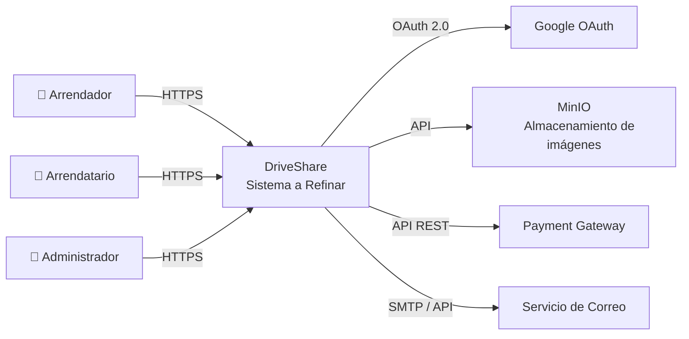

> [9. Metodología de Diseño de Arquitectura - Aplicación de ADD](../../9.md) › [9.2. Iteración 1: Definir la estructura general del sistema](../9.2.md) › [9.2.2. Elementos a refinar](9.2.2.md)

# 9.2.2. Elementos a refinar

### Elemento de partida

Al tratarse de la primera iteración del proceso **Attribute-Driven Design (ADD)** para un sistema desarrollado desde cero (*greenfield*), el elemento a refinar corresponde al sistema completo **DriveShare**, considerado inicialmente como una caja negra, tal como se presenta en el diagrama de contexto del proyecto.

En esta etapa todavía no se realiza un diseño detallado de cada módulo, sino que se establece la estructura general sobre la cual se desarrollarán las siguientes iteraciones del proceso ADD.

> **Figura 9.1. Sistema DriveShare como elemento inicial a refinar (Diagrama de Contexto).**

---

## Fronteras y condiciones del elemento

| Aspecto | Definición |
|----------|------------|
| **Alcance** | Plataforma web para el alquiler colaborativo de vehículos entre propietarios y arrendatarios mediante una arquitectura Cliente-Servidor. |
| **Actores** | Arrendador, Arrendatario y Administrador de la plataforma. |
| **Sistemas externos** | Google OAuth para autenticación, MinIO para almacenamiento de imágenes, pasarela de pagos, servicio de correo electrónico para verificación y recuperación de cuentas, además de los componentes Storage, Cache y Search definidos en la arquitectura. |
| **Funcionalidad a cubrir** | Los cinco módulos funcionales del sistema: Usuarios, Catálogo de Vehículos, Reservas, Pagos y Reseñas y Reputación. |

---

## Resultado esperado del refinamiento

El resultado esperado de esta primera iteración consiste en descomponer el sistema DriveShare en sus principales contenedores arquitectónicos, definiendo la organización general del sistema, las responsabilidades de cada componente y la comunicación entre ellos.

Asimismo, se espera establecer la distribución inicial de los cinco módulos funcionales dentro de la arquitectura, identificando la interacción entre el Frontend, Backend, Base de Datos y los componentes especializados definidos en el proyecto, tales como **Storage Component**, **Cache Component** y **Search Database**.

Esta descomposición permitirá que, en las siguientes iteraciones del método ADD, cada módulo pueda refinarse de manera independiente sin afectar la estructura general del sistema.

Sample content for section 9.2.2.

---

[⬅️ Anterior](../9.2.1/9.2.1.md) | [🏠 Home](../../../README.md) | [Siguiente ➡️](../9.2.3/9.2.3.md)
