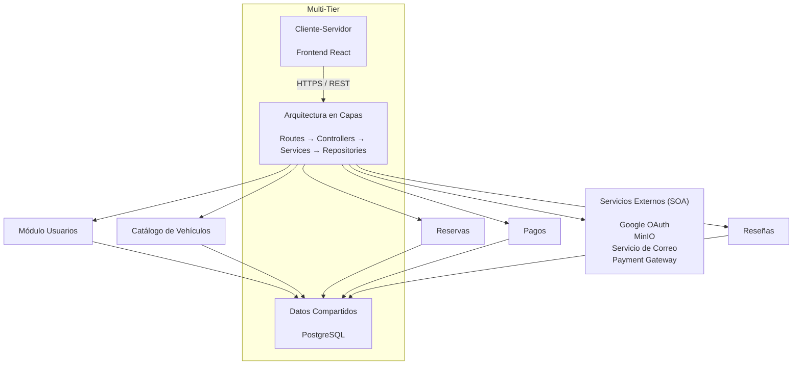

> [9. Metodología de Diseño de Arquitectura - Aplicación de ADD](../../9.md) › [9.2. Iteración 1: Definir la estructura general del sistema](../9.2.md) › [9.2.3. Conceptos de diseño](9.2.3.md)

# 9.2.3. Conceptos de diseño

En esta etapa del método **Attribute-Driven Design (ADD)** se seleccionan los conceptos de diseño que servirán como base para la arquitectura general de **DriveShare**. Estos conceptos fueron analizados previamente en el Capítulo 8 mediante las respectivas Architectural Decision Records (ADR), donde se evaluaron distintas alternativas arquitectónicas antes de seleccionar la solución más adecuada.

El objetivo de esta iteración es establecer una estructura común para todos los módulos del sistema, permitiendo que el desarrollo se realice de forma modular, mantenible y escalable.

---

## Conceptos evaluados y seleccionados

| Concepto de diseño | Alternativas descartadas | Selección | Justificación frente a los drivers |
|-------------------|-------------------------|-----------|-----------------------------------|
| **Arquitectura en Capas (Patrón de Módulo)** | Descomposición por Dominio | ✅ Seleccionado | Permite separar la presentación, lógica de negocio y persistencia, facilitando la mantenibilidad, reutilización y desarrollo independiente de los módulos del sistema. |
| **Cliente-Servidor (Componente-Conector)** | Peer-to-Peer | ✅ Seleccionado | Centraliza la lógica del negocio y la seguridad en el servidor, permitiendo que los clientes accedan a la plataforma mediante una API REST. |
| **Arquitectura Orientada a Servicios (SOA)** | Broker | ✅ Seleccionado | Facilita la integración con servicios externos como Google OAuth, MinIO, pasarela de pagos y servicio de correo mediante interfaces REST estandarizadas. |
| **Datos Compartidos (Componente-Conector)** | Pipe-and-Filter | ✅ Seleccionado | Proporciona un repositorio centralizado para almacenar usuarios, vehículos, reservas, pagos y reseñas, garantizando consistencia e integridad de la información. |
| **Multi-Tier (Patrón de Asignación)** | Map-Reduce | ✅ Seleccionado | Distribuye el sistema en tres niveles (Cliente, Aplicación y Datos), mejorando la seguridad, escalabilidad y mantenibilidad de la plataforma. |

---

# Relación entre los conceptos seleccionados

---

## Conceptos considerados y postergados

| Concepto | Motivo de postergación |
|-----------|------------------------|
| **Peer-to-Peer** | La plataforma requiere una administración centralizada de usuarios, vehículos, reservas y pagos, por lo que una arquitectura distribuida entre pares no resulta adecuada. |
| **Broker** | Las integraciones con Google OAuth, MinIO, pasarela de pagos y servicio de correo se realizan directamente mediante APIs REST, por lo que incorporar un Broker incrementaría la complejidad sin aportar beneficios significativos. |
| **Pipe-and-Filter** | DriveShare trabaja principalmente con operaciones CRUD y transacciones sobre datos persistentes, por lo que no requiere un procesamiento secuencial de flujos de datos. |
| **Map-Reduce** | El sistema no procesa grandes volúmenes de datos distribuidos; sus operaciones son transaccionales y orientadas al negocio, por lo que Multi-Tier resulta más apropiado. |

---

Los conceptos seleccionados constituyen la estructura arquitectónica base de DriveShare y servirán como referencia para las siguientes iteraciones del proceso ADD, donde se refinarán los módulos funcionales y se abordarán los atributos de calidad priorizados.

Sample content for section 9.2.3.

---

[⬅️ Anterior](../9.2.2/9.2.2.md) | [🏠 Home](../../../README.md) | [Siguiente ➡️](../9.2.4/9.2.4.md)
