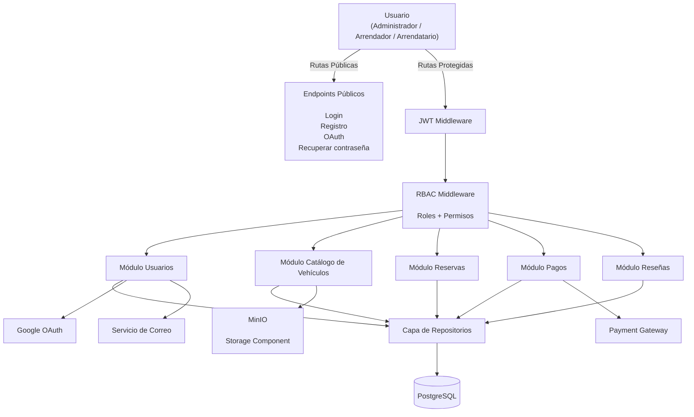

> [9. Metodología de Diseño de Arquitectura - Aplicación de ADD](../../9.md) › [9.2. Iteración 1: Definir la estructura general del sistema](../9.2.md) › [9.2.5. Vistas y Decisiones](9.2.5.md)

# 9.2.5. Vistas y Decisiones

## 9.2.5 Vista resultante de la iteración (Componentes de la API REST)

Como resultado de la primera iteración del proceso **Attribute-Driven Design (ADD)**, se obtiene una primera descomposición del contenedor **API REST**, el cual constituye el núcleo de procesamiento del sistema DriveShare.

La API REST centraliza la lógica de negocio de los cinco módulos funcionales, controla la autenticación y autorización mediante middleware, coordina el acceso a la persistencia y administra la comunicación con los servicios externos utilizados por la plataforma.

La siguiente figura muestra la vista de componentes obtenida durante esta iteración.

## Figura 9.2. Componentes del contenedor API REST de DriveShare

> **Figura 9.2. Componentes principales del contenedor API REST de DriveShare.**

*(Insertar aquí el diagrama de componentes mostrado anteriormente.)*

---

## Decisiones registradas en esta iteración

| # | Decisión | Sustento | Driver atendido |
|---|----------|----------|-----------------|
| **D2-01** | La API REST se organiza mediante una Arquitectura en Capas (Routes → Controllers → Services → Repositories). | ADR-01 | Mantenibilidad y modificabilidad. |
| **D2-02** | Toda solicitud protegida debe pasar primero por el Middleware JWT antes de acceder a cualquier módulo del sistema. | ADR-02 | Seguridad y control de acceso. |
| **D2-03** | El Middleware RBAC valida los permisos del usuario según su rol (Administrador, Arrendador o Arrendatario) antes de ejecutar la lógica de negocio correspondiente. | ADR-02 | Seguridad y autorización. |
| **D2-04** | Cada módulo funcional implementa su propia capa de servicios (Usuarios, Catálogo de Vehículos, Reservas, Pagos y Reseñas), manteniendo alta cohesión y bajo acoplamiento. | ADR-01 | Desarrollo modular y mantenibilidad. |
| **D2-05** | Todos los módulos acceden a la información mediante una Capa de Repositorios compartida, evitando consultas directas desde los controladores hacia la base de datos. | ADR-04 | Integridad de datos y reutilización del acceso a la información. |
| **D2-06** | PostgreSQL se establece como el repositorio central de datos para almacenar usuarios, vehículos, reservas, pagos y reseñas, actuando como única fuente de verdad del sistema. | ADR-04 | Consistencia e integridad de la información. |
| **D2-07** | Las integraciones con Google OAuth, Servicio de Correo, MinIO y la Pasarela de Pagos se realizan mediante servicios REST independientes, desacoplando la lógica de negocio de los proveedores externos. | ADR-03 | Interoperabilidad y modificabilidad. |
| **D2-08** | La arquitectura se despliega siguiendo el patrón Multi-Tier, separando el Cliente, la API REST y la Base de Datos en niveles independientes. | ADR-05 | Escalabilidad y mantenibilidad. |

---

Las decisiones adoptadas durante esta primera iteración permiten establecer una estructura arquitectónica común para todos los módulos de DriveShare. La separación entre autenticación, lógica de negocio, acceso a datos y servicios externos facilita la evolución independiente de cada componente y proporciona una base sólida para las siguientes iteraciones del proceso ADD, donde se refinarán las funcionalidades específicas y los atributos de calidad del sistema.

Sample content for section 9.2.5.

---

[⬅️ Anterior](../9.2.4/9.2.4.md) | [🏠 Home](../../../README.md) | [Siguiente ➡️](../9.2.6/9.2.6.md)
