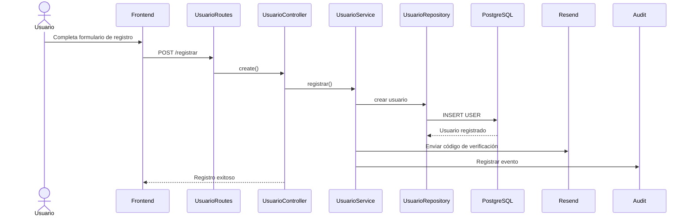

> [9. Metodología de Diseño de Arquitectura - Aplicación de ADD](../../9.md) › [9.3. Iteración 2: Identificar estructuras para soportar la funcionalidad primaria](../9.3.md) › [9.3.4. Elementos instanciados](9.3.4.md)

# 9.3.4. Elementos instanciados

## Componentes instanciados en la API REST

Cada módulo implementa la Arquitectura en Capas definida para el proyecto, organizando la funcionalidad mediante rutas, controladores, servicios y repositorios especializados.

| Módulo | Rutas (contrato REST) | Servicios instanciados | Repositorios / Modelos |
|---|---|---|---|
| Usuarios y Seguridad | `/login`, `/registrar`, `/verificar-cuenta`, `/recuperar-password`, `/reset-password`, `/auth/google`, `GET /`, `PUT /`, `PUT /:id/password`, `PUT /:id/estado` | `UsuarioService` | `UsuarioRepository`, `RepositoryBase`, `USER` |
| Reservas | `GET /availability/:vehicleId`, `GET /unavailable`, `POST /`, `GET /user`, `GET /owner`, `PUT /:id`, `PUT /:id/cancel`, `PUT /:id/confirm`, `PUT /:id/accept`, `PUT /:id/reject`, `PUT /:id/close` | `ReservationService` | `ReservationRepository`, `RESERVATION` |
| Auditoría | Integración automática desde el Backend | `AuditService` | `AuditRepository`, `AUDIT_LOG` |
| Pagos | API independiente del microservicio | `PaymentService` | Repositorios propios del microservicio |

---

## Componentes instanciados en la SPA

| Elemento | Instancias | Responsabilidad |
|---|---|---|
| Vistas | Login, Registro, Dashboard, Perfil, Recuperación de contraseña, Verificación de cuenta, Reservas, Vehículos y Pagos | Interfaz gráfica del sistema. |
| Componentes reutilizables | Formularios, Navbar, Sidebar, Cards, Tablas y Modales | Reutilización de componentes de interfaz entre las diferentes vistas. |
| Contextos globales | `UserContext` | Gestión de la sesión del usuario autenticado mediante JWT. |
| Servicios HTTP | `UsuarioService`, `ReservationService`, `PaymentService` | Comunicación entre el Frontend y la API REST mediante Axios. |

---

## Trazabilidad de la funcionalidad primaria

Como ejemplo representativo, el flujo correspondiente al registro e inicio de sesión de usuarios se implementa mediante la siguiente secuencia:

El mismo patrón de interacción (**Frontend → Routes → Controller → Service → Repository → Base de Datos**) se mantiene en el resto de módulos implementados, garantizando la separación de responsabilidades definida por la Arquitectura en Capas.
---

[⬅️ Anterior](../9.3.3/9.3.3.md) | [🏠 Home](../../../README.md) | [Siguiente ➡️](../9.3.5/9.3.5.md)