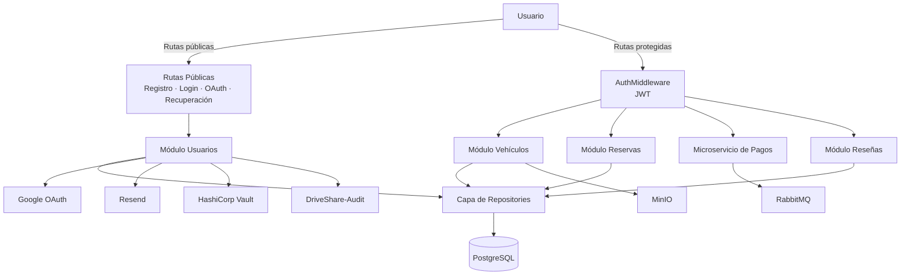

> [9. Metodología de Diseño de Arquitectura - Aplicación de ADD](../../9.md) › [9.3. Iteración 2: Identificar estructuras para soportar la funcionalidad primaria](../9.3.md) › [9.3.5. Vistas y Decisiones](9.3.5.md)

# 9.3.5. Vistas y Decisiones

## Vista resultante de la iteración (componentes de la API REST)

El bosquejo resultante corresponde al diagrama de componentes del contenedor **DriveShare-Backend** (nivel 3 del modelo C4, documentado en detalle en [6.3](../../../6/6.3/6.3.md)).

---

## Decisiones registradas en esta iteración

| # | Decisión | Sustento | Driver atendido |
|---|---|---|---|
| D2-01 | Cada módulo mantiene una **separación clara de responsabilidades**, organizando su funcionalidad en componentes especializados (Routes, Controllers, Services y Repositories). | [4.7.1](../../../4/4.7/4.7.1/4.7.1.md) | Mantenibilidad; funcionalidad primaria |
| D2-02 | La comunicación entre el Frontend, el Backend y los servicios del sistema se implementa mediante **APIs REST**, complementadas con mecanismos asíncronos cuando el módulo lo requiere. | [4.7.2](../../../4/4.7/4.7.2/4.7.2.md) | Interoperabilidad; comunicación entre módulos |
| D2-03 | La persistencia de la información se implementa mediante **PostgreSQL**, incorporando mecanismos especializados según las necesidades de cada módulo. | [4.7.3](../../../4/4.7/4.7.3/4.7.3.md) | Integridad; persistencia de datos |
| D2-04 | Los módulos implementados en el Backend mantienen una **Arquitectura en Capas**, separando la presentación, la lógica de negocio y la persistencia. | [4.7.4](../../../4/4.7/4.7.4/4.7.4.md) | Mantenibilidad; modificabilidad |
| D2-05 | La implementación utiliza las tecnologías seleccionadas para cada módulo (React, Express, PostgreSQL, JWT, Google OAuth, HashiCorp Vault, Redis, RabbitMQ, MinIO y Docker), respetando las decisiones tecnológicas definidas para la plataforma. | [4.7.5](../../../4/4.7/4.7.5/4.7.5.md) | Restricciones tecnológicas; seguridad; escalabilidad |
| D2-06 | Los contratos REST implementados por cada módulo mantienen una organización coherente entre rutas, controladores y servicios, facilitando la integración con el Frontend. | [7.2](../../../7/7.2/7.2.md) | Comunicación Frontend–Backend |
| D2-07 | La estructura interna del Frontend organiza la interfaz mediante vistas, componentes reutilizables, servicios HTTP y contexto global para la gestión de la sesión del usuario. | [7.1](../../../7/7.1/7.1.md) | Usabilidad; mantenibilidad |

---

[⬅️ Anterior](../9.3.4/9.3.4.md) | [🏠 Home](../../../README.md) | [Siguiente ➡️](../9.3.6/9.3.6.md)