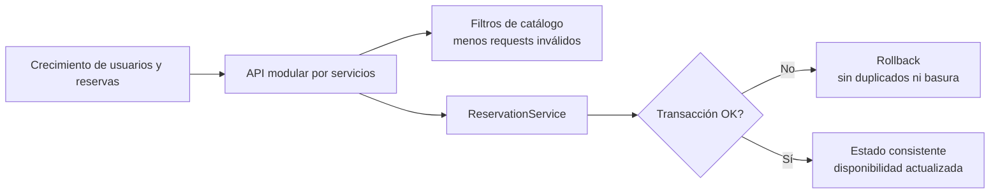
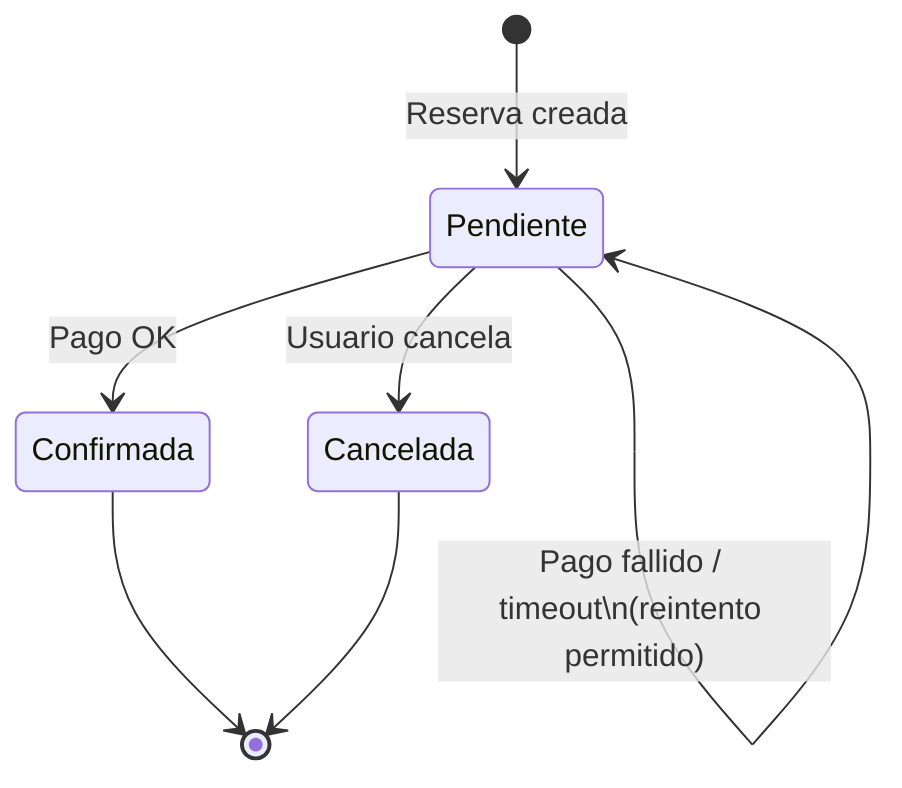

> [9. Metodología de Diseño de Arquitectura - Aplicación de ADD](../9.md) › [9.5. Iteraciones adicionales: Otros atributos de calidad](9.5.md)

# 9.5. Iteraciones adicionales: Otros atributos de calidad

Tras cubrir la estructura general (Iteración 1), la funcionalidad primaria (Iteración 2) y el núcleo *Must Have* empatado CONS-09 / CONS-01 (Iteración 3), se ejecutan **dos iteraciones adicionales** más acotadas para los escenarios *Must Have* restantes de la priorización del QAW: **CONS-07** (Escalabilidad), **CONS-11** (Fiabilidad de reservas) y **CONS-13** (Disponibilidad del servicio de pagos).

---

## Iteración 4 — CONS-07 y CONS-11: Escalabilidad y fiabilidad del núcleo operativo

### Objetivo

Soportar el crecimiento de publicaciones, reservas y consultas concurrentes sin degradar el servicio (**CONS-07**), y garantizar que un fallo durante el ciclo de una reserva no deje datos parciales ni duplicados (**CONS-11** / ESC-R11).

### Elementos a refinar

`ReservationService`, `ReservationRepository`, el esquema de `RESERVATION`, el catálogo con filtrado de disponibilidad y la organización modular del Backend/Frontend ya definida en iteraciones previas.

### Conceptos de diseño y elementos instanciados

| Táctica / patrón | Instanciación | Escenario |
|---|---|---|
| Modularidad / separación por capas | Cada módulo conserva Routes → Controller → Service → Repository; el crecimiento de carga se atiende por servicio sin reescribir toda la API. | CONS-07 |
| Limitar trabajo innecesario | El catálogo filtra por fechas/ubicación/tipo y “solo disponibles”, reduciendo solicitudes de reserva inválidas. | CONS-07 |
| Transacciones atómicas | Crear/actualizar reservas dentro de transacción Sequelize con *rollback* ante error. | CONS-11 |
| Control de estados | Cancelar, rechazar o finalizar liberan fechas; no se reactivan reservas canceladas. | CONS-11 |
| Revalidación en puntos críticos | Confirmación tras pago vuelve a verificar solapamientos antes de pasar a `Confirmada`. | CONS-11 |

### Decisiones y revisión

| # | Decisión | Estado |
|---|---|---|
| D4-01 | El crecimiento se aborda por **módulos independientes** y contratos REST estables, no por un monolito de lógica mezclada. | **Completamente abordado** (estructura) |
| D4-02 | Toda escritura crítica de reserva usa **transacción + validación de solapamiento**. | **Completamente abordado** |
| D4-03 | El escalado horizontal de contenedores / caché Redis intensiva se considera refuerzo operativo, no requisito para dar por cubierta la integridad de CONS-11. | **Parcialmente abordado** |

---

## Iteración 5 — CONS-13: Disponibilidad del flujo de pagos

### Objetivo

Mantener la continuidad del negocio cuando el microservicio de pagos o la pasarela externa fallan: la reserva no debe quedar en un estado ambiguo y el usuario debe recibir una respuesta controlada (**CONS-13** / ESC-R13).

### Elementos a refinar

Integración Frontend ↔ Backend de Reservas ↔ *DriveShare-Pagos*, el estado `Pendiente` de la reserva y la confirmación explícita tras un cobro exitoso.

### Conceptos de diseño y elementos instanciados

| Táctica / patrón | Instanciación | Escenario |
|---|---|---|
| Separación de servicios | Los pagos viven en un microservicio independiente; un fallo de pasarela no tumba el Backend principal ni el catálogo. | CONS-13 |
| Estado intermedio explícito | La reserva nace en `Pendiente` y solo pasa a `Confirmada` tras confirmación de pago exitosa. | CONS-13 |
| Timeout / error controlado | Si el cobro falla o no responde, el Frontend informa el error y la reserva no se confirma automáticamente. | CONS-13 |
| Reintento lógico de negocio | El usuario puede reintentar el pago mientras la reserva siga `Pendiente` y el vehículo continúe disponible. | CONS-13 |
| Desacoplamiento por eventos (cuando aplica) | El diseño contempla notificar confirmaciones/reembolsos hacia Reservas sin acoplar la UI al detalle de la pasarela. | CONS-13 |

### Decisiones y revisión

| # | Decisión | Estado |
|---|---|---|
| D5-01 | No se confirma una reserva sin evidencia de pago exitoso (o aceptación explícita del propietario en el flujo correspondiente). | **Completamente abordado** |
| D5-02 | Un fallo de pagos deja la reserva en `Pendiente` o cancelable, nunca en un estado “confirmado a medias”. | **Completamente abordado** |
| D5-03 | La recuperación total ante caída prolongada de la pasarela (colas, compensaciones avanzadas) se considera mejora continua del microservicio de Pagos. | **Parcialmente abordado** |

---

## Cierre del proceso ADD

Con la Iteración 3 se cubrió el núcleo empatado **CONS-09 / CONS-01**. Con estas **dos** iteraciones adicionales se abordan los *Must Have* restantes más críticos para la operación: **escalabilidad/fiabilidad del núcleo de reservas (CONS-07 / CONS-11)** y **disponibilidad del flujo de pagos (CONS-13)**.

Los escenarios *Should Have* y *Could Have* (por ejemplo CONS-08, CONS-10, CONS-14, CONS-06, CONS-03) quedan soportados en gran medida por la arquitectura en capas, el RBAC y la modularidad ya definidas, sin requerir una tercera iteración adicional de refinamiento en este documento.

---

[⬅️ Anterior](../9.4/9.4.md) | [🏠 Home](../../README.md)
