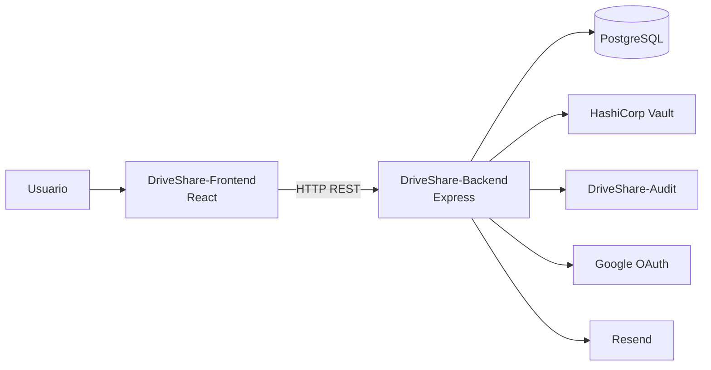

# DriveShare · Módulo 1- Usuarios 

Módulo encargado de la gestión de usuarios y la seguridad de **DriveShare**, desarrollado bajo una arquitectura desacoplada compuesta por un **Frontend**, un **Backend**, un **Sidecar de Auditoría** y la infraestructura necesaria mediante **Docker**, **PostgreSQL** y **HashiCorp Vault**.

El módulo implementa los procesos relacionados con la autenticación, autorización, gestión de perfiles, recuperación de credenciales, verificación de cuentas, integración con proveedores externos y registro de auditoría de eventos críticos del sistema.


## Tecnologías utilizadas

| Capa | Tecnologías |
|------|-------------|
| **Backend** | Node.js, Express.js, Sequelize ORM, PostgreSQL, JWT, Passport Google OAuth 2.0, Express Rate Limit |
| **Frontend** | React, React Router DOM, Axios, Context API |
| **Integraciones** | Google OAuth 2.0, Resend, HashiCorp Vault |
| **Infraestructura** | Docker Compose, PostgreSQL, pgAdmin, Sidecar de Auditoría |

---

## ▶️ Cómo ejecutar el módulo

Necesitas tener instalados **Node.js 18+** y **Docker Desktop**.

```bash
npm install

docker compose up -d

npm run dev
```

Una vez iniciado el sistema estarán disponibles los siguientes servicios:

| Servicio | Descripción |
|----------|-------------|
| **DriveShare-Frontend** | Interfaz gráfica del módulo de usuarios desarrollada en React. |
| **DriveShare-Backend** | API REST y lógica de negocio del módulo de usuarios. |
| **PostgreSQL** | Base de datos principal del módulo. |
| **pgAdmin** | Administración de PostgreSQL. |
| **HashiCorp Vault** | Gestión segura de llaves criptográficas RSA. |
| **DriveShare-Audit** | Sidecar encargado del registro de eventos de auditoría. |

---


# 🏗 Arquitectura general



El módulo se encuentra dividido en tres componentes principales:

## DriveShare-Frontend

Aplicación React encargada de la interacción con el usuario.

Entre sus responsabilidades se encuentran:

- Inicio de sesión.
- Registro.
- Gestión del perfil.
- Recuperación de contraseña.
- Verificación de cuentas.
- Cambio de rol.
- Consumo de la API REST mediante Axios.
- Administración de la sesión mediante Context API.

---

## DriveShare-Backend

API REST desarrollada con Express encargada de implementar toda la lógica de negocio del módulo.

Sus principales responsabilidades son:

- Gestión de usuarios.
- Autenticación.
- Autorización mediante JWT.
- Inicio de sesión con Google OAuth.
- Recuperación de contraseña.
- Verificación de cuentas.
- Gestión de perfiles.
- Cambio de rol.
- Cifrado RSA.
- Integración con Resend.
- Comunicación con Vault.
- Registro de eventos hacia el Sidecar.

---

## DriveShare-Audit

Servicio independiente encargado exclusivamente del registro de eventos de auditoría.

El Sidecar recibe solicitudes HTTP provenientes del Backend y almacena eventos relacionados con:

- Inicio de sesión.
- Registro.
- Actualización del perfil.
- Cambio de rol.
- Recuperación de contraseña.
- Cambio de contraseña.
- Verificación de cuenta.
- Activación o desactivación de usuarios.

Esta separación permite desacoplar completamente la lógica de auditoría del dominio principal del sistema.

---
# 🧩 Requisitos funcionales implementados

| Requisito | Implementación |
|-----------|----------------|
| RF1 Registro de usuario | `POST /registrar` → `UsuarioController.create()` → `UsuarioService.create()` |
| RF2 Verificación de existencia del correo electrónico | Validación mediante `UsuarioRepository.findByEmail()` antes de registrar el usuario. |
| RF3 Inicio de sesión seguro | `POST /login` → `UsuarioController.login()` → `UsuarioService.login()` + JWT |
| RF4 Autenticación con OAuth | `GET /auth/google` → `GET /auth/callback/google` + Passport Google OAuth 2.0 |
| RF5 Gestión de sesión | JWT + `AuthMiddleware` + `UserContext` para mantener la sesión del usuario. |
| RF6 Recuperación de contraseña | `POST /recuperar-password` → `POST /reset-password` + Resend |
| RF7 Gestión de perfil | `GET /:id`, `PUT /`, `PUT /:id/password`, `PUT /:id/estado` → `UsuarioController` → `UsuarioService` |
| RF8 Verificación de cuenta por correo electrónico | `POST /verificar-cuenta` + código enviado mediante Resend |

# 🔐 Funcionalidades adicionales implementadas

Además de los requisitos funcionales definidos para el módulo, se implementaron mecanismos orientados a fortalecer la seguridad, mantenibilidad y escalabilidad del sistema.

| Funcionalidad | Implementación |
|---------------|----------------|
| Protección de rutas | `AuthMiddleware` + JWT |
| Rate Limiter | `RateLimitMiddleware` |
| Repository Pattern | `RepositoryBase` + `UsuarioRepository` |
| Cifrado RSA | RSA OAEP SHA-256 |
| Gestión de secretos | HashiCorp Vault |
| Auditoría | Sidecar de Auditoría |
| Envío de correos | Resend |
| Inicio de sesión federado | Google OAuth 2.0 |
---

# 🔗 Integraciones

| Servicio | Propósito |
|----------|-----------|
| PostgreSQL | Persistencia de usuarios |
| Google OAuth 2.0 | Autenticación federada |
| Resend | Envío de correos electrónicos |
| HashiCorp Vault | Gestión segura de llaves RSA |
| DriveShare Audit | Registro de eventos de auditoría |

---

## Correos electrónicos automáticos

El módulo utiliza **Resend** para el envío automático de notificaciones relacionadas con la gestión de usuarios.

Actualmente se implementan los siguientes flujos:

- Activación de cuenta.
- Verificación mediante código.
- Recuperación de contraseña.
- Confirmación de restablecimiento de contraseña.
- Confirmación de cambio de contraseña.
- Notificación de cambio de estado de la cuenta.

El servicio incorpora mecanismos de reintento y manejo de errores para garantizar el envío de los mensajes.

---

## Auditoría

Todas las operaciones críticas ejecutadas por el Backend generan automáticamente un evento de auditoría enviado al Sidecar independiente.

Entre ellas se encuentran:

- Registro de usuarios.
- Inicio de sesión.
- Inicio de sesión con Google.
- Verificación de cuenta.
- Recuperación de contraseña.
- Restablecimiento de contraseña.
- Actualización del perfil.
- Cambio de contraseña.
- Cambio de estado del usuario.

Esto permite desacoplar completamente la lógica de auditoría del dominio principal del sistema.

---

## Gestión de secretos

Las llaves criptográficas RSA utilizadas para el cifrado de información sensible son almacenadas en **HashiCorp Vault**.

Durante la inicialización del sistema, las llaves pública y privada son cargadas automáticamente al servidor Vault mediante un script de inicialización.

Posteriormente, el Backend obtiene dichas llaves dinámicamente para cifrar y descifrar la información sensible de los usuarios sin almacenar secretos directamente en el código fuente.

---

# 🏛 Decisiones de arquitectura

- **4.1 D1 / 8.1 ADR-01 (Arquitectura en Capas):**
  El Backend se implementó siguiendo una Arquitectura en Capas, organizando el sistema en **Routes → Controllers → Services → Repositories → Models**, con responsabilidades claramente definidas para favorecer la mantenibilidad, reutilización y separación de responsabilidades.

- **4.1 D2 / 8.1 ADR-02 (Cliente-Servidor mediante REST):**
  La comunicación entre el Frontend y el Backend se realiza mediante una arquitectura Cliente-Servidor utilizando una API REST sobre HTTP/HTTPS y respuestas en formato JSON.

- **4.1 D3 / 8.1 ADR-04 (Datos Compartidos):**
  El módulo utiliza PostgreSQL como repositorio central de datos compartidos, accediendo a la información mediante Sequelize y el patrón Repository para garantizar la persistencia, consistencia e integridad de los datos.

- **4.1 D4 (Rate Limiting):**
  Se implementó Rate Limiting para controlar la cantidad de solicitudes sobre operaciones críticas como registro, autenticación y recuperación de contraseña, reduciendo el riesgo de abuso y ataques de fuerza bruta.

- **4.1 D5 / 8.1 ADR-05 (Multi-Tier):**
  El despliegue del módulo se organiza en múltiples niveles independientes (Frontend, Backend y Base de Datos), permitiendo desacoplar la presentación, la lógica de negocio y la persistencia de datos.

- **4.1 D6 (Tecnologías de Seguridad):**
  Se adoptó PostgreSQL, HashiCorp Vault, RSA-2048 OAEP SHA-256 y bcrypt para proteger la información sensible, gestionar secretos de forma centralizada y garantizar un almacenamiento seguro de credenciales y datos confidenciales.

- **8.1 ADR-03 (Arquitectura Orientada a Servicios - SOA):**
  El módulo integra servicios externos mediante APIs REST, como Google OAuth para autenticación federada y Resend para el envío de correos electrónicos, manteniendo desacoplada la lógica de negocio respecto a dichos proveedores.

- **Patrón Sidecar (Auditoría):**
  Se implementó un Sidecar independiente para el registro de eventos de auditoría, permitiendo desacoplar esta funcionalidad del Backend principal y mejorar la mantenibilidad del sistema.

---
# 📂 Estructura del proyecto

```text
DriveShare/
│
├── DriveShare-Backend/
│   └── src/
│       ├── config/
│       ├── controllers/
│       ├── integration/
│       ├── middlewares/
│       ├── models/
│       ├── repositories/
│       ├── routes/
│       ├── scripts/
│       ├── services/
│       └── tests/
│
├── DriveShare-Audit/
│   └── src/
│       ├── config/
│       ├── controllers/
│       ├── models/
│       ├── repositories/
│       ├── routes/
│       ├── services/
│       └── utils/
│
├── DriveShare-Frontend/
│   └── src/
│       ├── assets/
│       ├── components/
│       ├── context/
│       ├── data/
│       ├── services/
│       ├── styles/
│       ├── utils/
│       ├── views/
│       └── main.jsx
│
├── docker-compose.yml
├── package.json
└── README.md
```
---
# 🧱 Componentes del módulo

| Componente | Responsabilidad |
|------------|-----------------|
| DriveShare-Frontend | Interfaz de usuario y gestión de sesión. |
| DriveShare-Backend | API REST y lógica de negocio del módulo de usuarios. |
| DriveShare-Audit | Registro de eventos de auditoría mediante Sidecar. |
| PostgreSQL | Persistencia de datos del módulo. |
| HashiCorp Vault | Gestión de secretos y llaves RSA. |
| Docker Compose | Orquestación de todos los servicios del módulo. |

---
# 🔄 Flujo general del módulo

El flujo de funcionamiento del módulo de Usuarios sigue la siguiente secuencia:

1. El usuario interactúa con la interfaz desarrollada en React.
2. El Frontend envía solicitudes HTTP al Backend mediante la API REST.
3. El Backend valida la autenticación y ejecuta la lógica de negocio correspondiente.
4. Cuando es necesario acceder a información persistente, el Backend consulta PostgreSQL mediante Sequelize y el patrón Repository.
5. Para operaciones relacionadas con información sensible, el Backend obtiene las llaves criptográficas desde HashiCorp Vault.
6. Las operaciones críticas generan automáticamente eventos de auditoría enviados al Sidecar independiente.
7. Finalmente, el Backend responde al Frontend con los resultados de la operación.

---

# 📈 Beneficios de la arquitectura

La arquitectura del módulo fue diseñada priorizando la separación de responsabilidades y el desacoplamiento entre sus componentes.

La organización en capas facilita la incorporación de nuevas funcionalidades sin afectar la lógica existente, mientras que el uso de patrones como **Repository**, **Cliente-Servidor**, **Datos Compartidos**, **Multi-Tier** y **SOA** favorece la mantenibilidad y evolución del sistema.

Asimismo, la integración de un **Sidecar de Auditoría** permite extender las capacidades de monitoreo y trazabilidad sin modificar el Backend principal, y el uso de **HashiCorp Vault** proporciona una gestión centralizada y segura de secretos.

---

# ✅ Conclusión

El Módulo de Usuarios de DriveShare implementa una arquitectura desacoplada compuesta por Frontend, Backend y Sidecar de Auditoría, apoyada en PostgreSQL, HashiCorp Vault y Docker Compose.

Esta arquitectura permite gestionar de forma segura el ciclo de vida de los usuarios, integrando autenticación local y federada, protección de datos sensibles, auditoría de eventos e integración con servicios externos, manteniendo una solución escalable, mantenible y alineada con las decisiones arquitectónicas definidas para el proyecto.

# Autor

**Integrante:** Jean Carlo Rado

**Módulo desarrollado:** Usuarios 

**Proyecto:** DriveShare

**Curso:** Arquitectura de Software