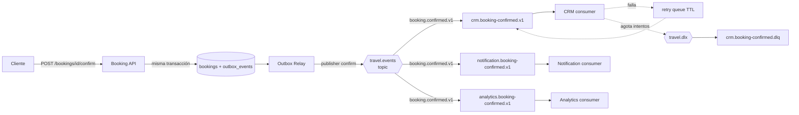

# Demo de Arquitectura Orientada a Eventos (EDA)

Carpeta autocontenida: no depende del resto del repositorio y puede borrarse sin afectarlo.
Las credenciales de `.env.example` son **solo de demo local**; no representan una configuración productiva.

## 1. Problema que se quiere demostrar

En un sistema de reservas, confirmar una reserva obliga a avisar a otras capacidades (CRM, notificaciones,
analítica). Si Booking las llama por HTTP, queda **acoplado** a ellas: si CRM cae, la confirmación falla o se
vuelve lenta. La demo muestra cómo un evento `BookingConfirmed` evita ese acoplamiento y qué costos aparecen
a cambio: entrega duplicada, fallos parciales y depuración distribuida.

> EDA no depende de microservicios. Se usan varias capacidades desplegables por separado porque así el
> acoplamiento entre componentes distribuidos es visible.

## 2. Arquitectura



```mermaid
sequenceDiagram
  participant B as Booking API
  participant DB as Postgres
  participant R as Outbox Relay
  participant MQ as RabbitMQ
  participant C as CRM consumer
  B->>DB: BEGIN; UPDATE booking; INSERT outbox; COMMIT
  B-->>B: responde 200 (sin publicar)
  R->>DB: lee outbox sin publicar
  R->>MQ: publish (persistente) + confirm
  R->>DB: marca published_at
  MQ->>C: entrega (sin ACK automático)
  C->>DB: BEGIN; marca event_id; aplica efecto; COMMIT
  C->>MQ: ACK
```

Detalle y justificación en [docs/architecture.md](docs/architecture.md) y en los ADR de `docs/decisions/`.

## 3. Stack

Python 3.12, FastAPI, SQLAlchemy 2, Pydantic v2, aio-pika, PostgreSQL 16, RabbitMQ 4.0 (management),
Docker Compose, pytest, Ruff. Contrato: `asyncapi.yaml` (AsyncAPI 3.0) y envelope tipo CloudEvents 1.0.

## 4. Cómo levantar

Desde la raíz del repositorio:

```bash
cd event-driven-architecture
cp .env.example .env
docker compose up -d --build
python scripts/healthcheck.py --wait 90
```

PowerShell:

```powershell
Set-Location event-driven-architecture
Copy-Item .env.example .env
docker compose up -d --build
python scripts/healthcheck.py --wait 90
```

Los scripts de `scripts/` usan solo la biblioteca estándar de Python: no hay que instalar nada en el host.

## 5. URLs

| Qué | URL |
|---|---|
| FastAPI docs (Booking) | http://localhost:8000/docs |
| RabbitMQ Management | http://localhost:15672 (usuario/clave de `.env`) |
| Estado de consumers y relay (solo localhost) | CRM `:8001`, Notification `:8002`, Analytics `:8003`, Relay `:8004` |

## 6. Cómo correr cada demo

| Script | Qué muestra |
|---|---|
| `python scripts/demo_01_happy_path.py` | Publish/Subscribe: un evento, tres consumers |
| `python scripts/demo_02_consumer_down.py` | Desacoplamiento temporal: CRM caído y luego recupera el backlog (ejecuta `docker compose stop/start crm-consumer`; si Docker no está disponible desde el script, imprime el comando) |
| `python scripts/demo_03_redelivery.py` | Crash antes del ACK, redelivery e idempotencia |
| `python scripts/demo_04_poison_dlq.py` | Reintentos acotados y Dead Letter Queue |
| `python scripts/demo_05_trace.py [id]` | Línea de tiempo por `correlation_id` (`--new` inyecta un fallo para ver el retry) |
| `python scripts/demo_06_outbox.py` | Transactional Outbox: sin relay no se puede publicar, la reserva igual se confirma y el event se publica cuando el relay vuelve (ejecuta `docker compose stop/start outbox-relay`) |

Todo en secuencia: `sh scripts/demo-all.sh` (Linux/macOS/Git Bash) o `./scripts/demo-all.ps1` (Windows).
También hay `make up`, `make health`, `make test`, `make demo-all`.
Guion para exponer en [docs/demo-runbook.md](docs/demo-runbook.md).

## 7. Qué patrón demuestra cada cosa

| Patrón | Dónde mirar |
|---|---|
| Transactional Outbox | `services/booking_service/src/booking_service/service.py` (`confirm_booking`) |
| Relay + publisher confirm | `services/outbox_relay/src/outbox_relay/relay.py` |
| Exchange, routing key, colas, DLX | `shared/src/shared/rabbit.py` |
| Manual ACK, retry y DLQ | `shared/src/shared/consumer.py` (`_on_message`) |
| Idempotencia | `shared/src/shared/db.py` (`already_processed`) usada en cada `handler.py` |
| Contrato del evento | `shared/src/shared/events.py` y `asyncapi.yaml` |
| Logs estructurados y correlación | `shared/src/shared/logging.py` |

Control de fallos (solo con `DEMO_MODE=true`): `POST :8001/debug/crash-next-after-commit` hace que el CRM
termine el proceso (`os._exit(1)`) después de confirmar el efecto en BD y antes del ACK; `restart: unless-stopped`
lo vuelve a levantar y RabbitMQ reentrega el mensaje. `POST :8001/debug/fail-next/{n}` fuerza `n` fallos transitorios.

## 8. Cómo resetear

```bash
python scripts/reset_demo.py      # purga colas y trunca tablas (requiere DEMO_MODE=true)
docker compose down -v            # reinicio total (borra volúmenes; vuelve a ejecutar init.sql)
```

## 9. Limitaciones

- Una sola instancia PostgreSQL con tablas separadas por servicio; en producción serían almacenes independientes.
- Garantía **at-least-once**, no exactly-once de extremo a extremo (ver ADR 003).
- El backoff de reintento es fijo (`RETRY_DELAY_MS`, 2 s) y `MAX_RETRIES=3` cuenta **intentos totales**.
- La línea de tiempo vive en tablas `*_timeline` simples; no hay ELK/Grafana ni OpenTelemetry.
- No hay autenticación, pagos reales ni envío real de correos.
- `analytics` también tiene cola de reintento y DLQ (la spec lo pedía solo para CRM y Notification) para reutilizar el mismo bucle.
- Los puertos de consumers/relay se publican en `127.0.0.1` solo para que los scripts del host lean estado.

## 10. Qué cambiaría en producción

Bases de datos por servicio; secretos reales y TLS; Debezium/CDC o relay replicado en lugar de polling;
backoff exponencial con varias colas de retry; versionado y registro de esquemas; clústeres de RabbitMQ con quorum queues;
métricas, trazas distribuidas (OpenTelemetry) y alertas sobre el tamaño de las DLQ; limpieza periódica de `outbox_events` y `*_processed_events`.
