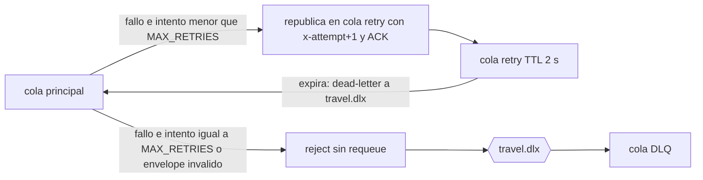

# Arquitectura

## Componentes

| Componente | Rol | Tipo |
|---|---|---|
| booking-api | Dueño de la reserva; produce `BookingConfirmed` (escribe en el outbox) | Negocio |
| crm-consumer | Mantiene una proyección CRM simulada | Negocio |
| notification-consumer | Registra una notificación simulada (no envía correo) | Negocio |
| analytics-consumer | Registra un hecho analítico simulado | Negocio |
| outbox-relay | Lee `outbox_events` y publica al broker | Infraestructura de integración |
| RabbitMQ, PostgreSQL | Broker y almacenamiento | Infraestructura |

Booking **no** llama por HTTP a CRM, Notification ni Analytics. La única coordinación posterior a la
confirmación es el evento. Los servicios no leen tablas ajenas como mecanismo de integración.

## Flujo de un evento

1. `POST /bookings/{id}/confirm`: en **una** transacción local se actualiza `bookings` y se inserta en `outbox_events`.
2. El relay consulta filas sin `published_at`, publica en el exchange `travel.events` con routing key `booking.confirmed.v1`
   (mensaje persistente, `mandatory`), espera el publisher confirm y marca `published_at`.
3. RabbitMQ copia el mensaje a tres colas durables (una por capacidad suscriptora).
4. Cada consumer recibe con ACK manual, valida el envelope con Pydantic, ejecuta en **una** transacción local
   (marcar `event_id` + aplicar efecto) y recién entonces hace ACK.

## Decisiones de mensajería (dónde viven)

| Decisión | Valor | Archivo |
|---|---|---|
| Exchange / tipo | `travel.events`, topic, durable | `shared/src/shared/rabbit.py` |
| Routing key | `booking.confirmed.v1` | `shared/src/shared/events.py` |
| Colas | `crm.`, `notification.`, `analytics.` + `booking-confirmed.v1` | `shared/src/shared/rabbit.py` |
| ACK | manual, después del commit | `shared/src/shared/consumer.py` |
| Idempotencia | `INSERT ... ON CONFLICT DO NOTHING` sobre `<svc>_processed_events` | `shared/src/shared/db.py` |
| Retry | cola `*.retry` con TTL; el consumer republica con `x-attempt + 1` | `shared/src/shared/consumer.py` |
| DLQ | `reject(requeue=False)` -> `travel.dlx` -> `*.dlq` | `rabbit.py` + `consumer.py` |

## Reintentos y DLQ

El contador de intentos es un header propio (`x-attempt`), no `x-death`, para que sea fácil de explicar y de verificar.
Un envelope inválido nunca se reintenta: va directo a la DLQ.

## Evento "venenoso" de la demo

El envelope es válido, pero `amount` es negativo. El modelo no lo impide a propósito; la regla de negocio
del CRM (`amount > 0`) lo rechaza siempre. Notification y Analytics lo procesan porque no tienen esa regla.

## Correlación

Cada log JSON lleva `service`, `action`, `event_id`, `correlation_id`, `booking_id`, `attempt`, `timestamp`.
Además cada servicio guarda esas acciones en su tabla `<svc>_timeline` y las expone en `GET /timeline?q=<id>`;
`demo_05_trace.py` las junta y ordena por tiempo.

## Outbox: duplicados por diseño

Si el relay cae entre publicar y marcar `published_at`, la fila se publica otra vez al reiniciar. Es aceptado:
los consumers son idempotentes.
